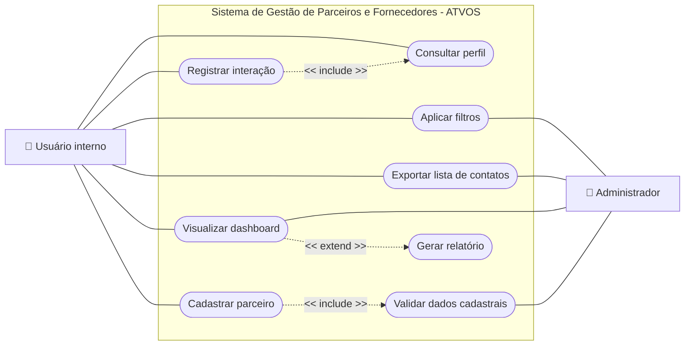

# WAD - Web Application Document - Módulo 2 - Inteli

**_Os trechos em itálico servem apenas como guia para o preenchimento da seção. Por esse motivo, não devem fazer parte da documentação final_**

## Nome do Grupo

#### Nomes dos integrantes do grupo

## Sumário

[1. Introdução](#c1)

[2. Visão Geral da Aplicação Web](#c2)

[3. Projeto Técnico da Aplicação Web](#c3)

[4. Desenvolvimento da Aplicação Web](#c4)

[5. Testes da Aplicação Web](#c5)

[6. Estudo de Mercado e Plano de Marketing](#c6)

[7. Conclusões e trabalhos futuros](#c7)

[8. Referências](c#8)

[Anexos](#c9)

 

# 1. Introdução (sprints 1 a 5)

A ATVOS, empresa do setor sucroenergético, enfrenta dificuldades na gestão do relacionamento com seus parceiros de terras e fornecedores de cana. As informações encontram-se dispersas em planilhas, e-mails e anotações individuais, sem padronização ou centralização, o que torna o histórico de interações dependente do conhecimento de cada analista. Dessa forma, a continuidade dos relacionamentos ao longo das safras é comprometida, assim como a capacidade de tomada de decisão estratégica por parte da gestão.

Diante dessa problemática, será desenvolvida uma aplicação web do tipo CRM, sigla para Customer Relationship Management, isto é, uma ferramenta voltada à gestão centralizada do relacionamento com clientes e parceiros de negócio. No contexto deste projeto, a solução permitirá que a ATVOS registre, acompanhe e analise suas interações com parceiros de terras e fornecedores de cana em um único ambiente digital, substituindo o modelo atual fragmentado por um fluxo estruturado e rastreável de informações.

A aplicação será construída sobre três pilares principais. O primeiro é o cadastro centralizado, por meio do qual parceiros e fornecedores serão registrados com informações detalhadas de perfil, localização e oportunidades associadas. O segundo é o histórico de alterações e interações, que garantirá rastreabilidade e continuidade das relações independente de mudanças no time responsável. O terceiro é o controle de acesso por perfil, com três níveis distintos de permissão, assegurando que cada usuário interaja com o sistema de acordo com seu papel e responsabilidade dentro da organização.

Com a adoção dessa solução, espera-se que a ATVOS consolide uma visão única e confiável de seus parceiros estratégicos, reduza o retrabalho operacional e fortaleça a tomada de decisões com base em dados estruturados e históricos preservados ao longo das safras.

# 2. Visão Geral da Aplicação Web (sprint 1)

## 2.1. Escopo do Projeto (sprints 1 e 4)

### 2.1.1. Modelo de 5 Forças de Porter (sprint 1)
 
A análise das 5 Forças de Porter permite compreender a dinâmica competitiva do setor sucroenergético e os desafios estruturais enfrentados pela ATVOS, terceira maior empresa de moagem de cana-de-açúcar do Brasil, atrás de Raízen e BP Bunge (AGROADVANCE, 2025). Internamente, a ausência de governança de dados compromete "a tomada de decisão rápida e a continuidade das interações para relações de longo prazo" (INTELI, 2026), expondo a empresa a riscos competitivos em todas as forças analisadas.

A ameaça de novos entrantes é baixa a moderada. As barreiras de entrada são limitantes: o setor demanda US$31 bilhões apenas para metas de descarbonização (Portal da Indústria, 2023), as melhores regiões produtivas já estão ocupadas e as licenças ambientais dificultam qualquer novo player (UDOP, 2025). O ponto de atenção é o etanol de milho, rota alternativa que já mobilizou R$23 bilhões em investimentos e as fronteiras competitivas do setor (NPagro, 2024; Porter, 2008).

O poder de barganha dos fornecedores é moderado e distinto. A necessidade de processar a cana em até 50 km do corte cria dependência geográfica dos fornecedores de terra, conferindo maior poder (Canal Rural, 2026). Já os fornecedores de cana têm poder limitado, pois os preços são regulados pelo Consecana (AGROADVANCE, 2025).

O poder de barganha dos clientes é alto. Distribuidoras como Raízen, Vibra e Ipiranga concentram mais de 53% do mercado de etanol e açúcar VHP (ANP, 2024), diminuindo o poder de precificação da ATVOS (Porter, 1979). A venda direta a postos (Lei n.º 14.292/2022) e a liderança em CBIOs via RenovaBio (ATVOS, 2025) oferecem diferenciação parcial junto a compradores com metas climáticas (Agência Brasil, 2022).

A rivalidade entre concorrentes é alta. O setor disputa terras, fornecedores e CBIOs em um mercado consolidado, onde ineficiências internas ampliam a vulnerabilidade frente a concorrentes mais estruturados.

A ameaça de produtos substitutos é moderada e crescente. Com 80% da cana destinada ao etanol (ATVOS, 2023), a empresa é vulnerável a veículos elétricos, cuja adoção pode reduzir a demanda em até 40% até 2035 (Brasilagro, 2021), ao etanol de milho (AgFeed, 2023) e ao biometano para transporte pesado (Eixo, 2025).

Em resumo, a ATVOS opera em um ambiente de pressões competitivas estruturais relevantes, em que a maturidade em gestão de dados pode ser determinante para preservar margens, fidelizar clientes estratégicos e sustentar vantagem competitiva no longo prazo.

### 2.1.2. Análise SWOT da Instituição Parceira (sprint 1)

A análise SWOT é uma ferramenta que avalia as forças, fraquezas, oportunidades e ameaças.

FORÇAS                                                                                                          | FRAQUEZAS                                                                                                          |
| :------------------------------------------------------------------------------------------------------------------------- | :----------------------------------------------------------------------------------------------------------------------------- |
| É a segunda maior empresa de etanol do Brasil, possuindo também uma linha de produtos diversificada.           | Gestão de clientes e parceiros ainda manual, assim não atingindo o resultado que poderiam alcançar. |

 

| OPORTUNIDADES                                                                                                                                                                                                                 | AMEAÇAS                                                                                                                                                                                                                   |
| :------------------------------------------------------------------------------------------------------------------------------------------------------------------------------------------------------------------------------------------- | :----------------------------------------------------------------------------------------------------------------------------------------------------------------------------------------------------------------------------------- |
| Descarbonização da aviação com SAF de cana com alta rentabilidade. RenovaBio impulsiona Atvos com metas de CBIOs para distribuidoras de combustíveis.|Mudanças climáticas ameaçam safras de cana com secas e chuvas intensas.  |

Conclui-se que a Atvos, enfrenta riscos climáticos e operacionais, possuindo oportunidades estratégicas em SAF e CBIOs impulsionando sua rentabilidade. 

---

### 2.1.3. Solução (sprints 1 a 5)

## Análise do Projeto ATVOS

2.1.3. Solução (sprints 1 a 5)
a) Problema a ser resolvido
Os dados de gestão de parceiros de terras e fornecedores de cana-de-açúcar encontram-se dispersos em planilhas, sem governança adequada. Essa fragmentação compromete a preservação do histórico de relacionamento, dificulta a padronização dos cadastros e prejudica a tomada de decisão ágil e a continuidade das relações de longo prazo.

b) Dados disponíveis
Os dados estão disponíveis no SharePoint da área de Estratégia de Terras da ATVOS, de caráter confidencial. Os arquivos incluem bases cadastrais de fornecedores de cana, registros de contatos de parceiros e proprietários de terra, estruturas de cadastro existentes e informações de acesso ao portal de gestão de parceiros.

c) Solução proposta
Será desenvolvida uma aplicação web full stack com front-end em HTML, CSS e JavaScript, back-end em Node.js e banco de dados SQLite. A solução centralizará cadastros de parceiros, registrará o histórico de interações e disponibilizará dashboards analíticos. O acesso será controlado por três perfis distintos: administrador, editor e observador.

d) Forma de utilização da solução
A aplicação será utilizada via navegador web pelos times internos da área de Negócios Agrícolas. Cada perfil terá acesso às funcionalidades correspondentes ao seu nível de permissão: cadastro e edição de parceiros, registro de interações, aplicação de filtros por nome, região e tipo de parceiro, visualização de dashboards e exportação de listas.

e) Benefícios esperados
Centralização e padronização dos cadastros de parceiros; eliminação de planilhas dispersas e redução de retrabalho operacional; preservação do histórico de relacionamento ao longo das safras independente de mudanças no time; e agilidade na consulta e análise de dados para suporte à tomada de decisão estratégica.

f) Critério de sucesso e como será avaliado
O sucesso será avaliado pela entrega do MVP funcional com os três módulos principais operacionais (cadastro, histórico e controle de acesso), pela validação dos fluxos pelos usuários internos da ATVOS em testes de usabilidade e pela capacidade demonstrada de substituir as planilhas dispersas pela aplicação desenvolvida.

### 2.1.4. Value Proposition Canvas (sprint 1): 
*Sem limite de palavras – usar template do curso*

*Elaborar o Value Proposition Canvas com base na proposta de solução definida.*

### 2.1.5. Matriz de Riscos do Projeto (sprint 1)

*Sem limite de palavras – usar template do curso*

*Registre na matriz os riscos identificados no projeto.*

## 2.2. Personas (sprint 1)

  Figura 2.2.1 - Persona 1: Juliano Soares 
   
  Fonte: Material produzido pelos autores. (Imagem de pessoa produzida pelo Gemini)

## 2.3. User Stories (sprints 1 a 5)

*Posicione aqui a lista de User Stories levantadas para o projeto. Siga o template de User Stories e utilize a mesma referência USXX no roadmap de seu quadro Kanban. Indique todas as User Stories mapeadas, mesmo aquelas que não forem implementadas ao longo do projeto. Não se esqueça de explicar o INVEST das 5 User Stories prioritárias*

*ATUALIZE ESTA SEÇÃO SEMPRE QUE ALGUMA DEMANDA MUDAR EM SEU PROJETO*

*Template de User Story*
Identificação | USXX (troque XX por numeração ordenada das User Stories)
--- | ---
Persona | nome da Persona
User Story | "como (papel/perfil), posso (ação/meta), para (benefício/razão)"
Critério de aceite 1 | CR1: descrever cenário + testes de aceite
Critério de aceite 2 | CR2: descrever cenário + testes de aceite
Critério de aceite ... | CR...
Critérios INVEST | *(Por que é Independente? Por que é Negociável? Por que é Valorosa? Por que é Estimável? Por que é Pequena? Por que é Testável?)*

---
User Stories são descrições simples de funcionalidades escritas do ponto de vista do usuário, no formato "como [perfil], posso [ação], para [benefício]". Para garantir a qualidade de cada história, foi aplicado o método INVEST, que avalia se a história é Independente, Negociável, Valiosa, Estimável, Pequena e Testável. As User Stories a seguir estão ordenadas por prioridade de desenvolvimento.

---

Identificação | US01
--- | ---
Persona | Editor (Analista de Negócios Agrícolas)
User Story | "Como editor, posso cadastrar fornecedores de cana com suas informações específicas, para que os dados de cada agricultor parceiro estejam centralizados e padronizados no sistema."
Critério de aceite 1 | CR1: Ao preencher os campos do perfil de fornecedor de cana (CPF/CNPJ, inscrição estadual, área plantada em hectares, TCH médio, ATR médio, histórico de cumprimento de cota, certificações e usina de referência) e confirmar, o fornecedor é salvo e exibido na listagem.
Critério de aceite 2 | CR2: Ao tentar salvar sem preencher campos obrigatórios, o sistema exibe aviso de validação e não conclui o cadastro.
Critérios INVEST | Independente: pode ser desenvolvida sem depender do cadastro de proprietários ou de interações. Negociável: os campos do formulário podem ser revistos com a equipe da ATVOS sem alterar o objetivo central. Valiosa: resolve diretamente a dispersão dos dados de fornecedores em planilhas, centralizando as informações em um único sistema acessível a toda a equipe. Estimável: envolve formulário, validação e persistência no banco de dados, com escopo claro para estimar o esforço. Pequena: abrange apenas o fluxo de criação de um novo fornecedor de cana, sem integrações externas. Testável: verifica-se se o fornecedor aparece na listagem após o cadastro e se os campos obrigatórios são devidamente validados.

---

Identificação | US02
--- | ---
Persona | Editor (Analista de Negócios Agrícolas)
User Story | "Como editor, posso cadastrar proprietários de terra com suas informações específicas, para que os dados de cada proprietário parceiro estejam centralizados e padronizados no sistema."
Critério de aceite 1 | CR1: Ao preencher os campos do perfil de proprietário de terra (CPF/CNPJ, documentação da terra, localização, distância da usina, área total disponível em hectares, topografia, status da documentação fundiária, CAR, situação ambiental e tipo de contrato) e confirmar, o proprietário é salvo e exibido na listagem.
Critério de aceite 2 | CR2: Ao tentar salvar sem preencher campos obrigatórios, o sistema exibe aviso de validação e não conclui o cadastro.
Critérios INVEST | Independente: pode ser desenvolvida em paralelo à US01, com formulário e lógica próprios para o perfil de proprietário. Negociável: os campos podem ser ajustados conforme as necessidades da área de Estratégia de Terras. Valiosa: centraliza os dados de proprietários que hoje estão dispersos em planilhas, eliminando retrabalho e padronizando o cadastro. Estimável: reutiliza a estrutura da US01 com campos distintos para o perfil de proprietário, com esforço bem delimitado. Pequena: escopo restrito ao fluxo de criação de um proprietário de terra. Testável: verifica-se se o proprietário aparece na listagem após o cadastro e se os campos específicos são corretamente salvos.

---

Identificação | US03
--- | ---
Persona | Editor (Analista de Negócios Agrícolas)
User Story | "Como editor, posso registrar o histórico de interações com parceiros, para que o relacionamento seja documentado e acessível a toda a equipe."
Critério de aceite 1 | CR1: Ao adicionar uma interação (data, tipo e descrição) ao perfil de um parceiro, ela é salva e exibida no histórico em ordem cronológica.
Critério de aceite 2 | CR2: O histórico exibe corretamente todas as interações registradas anteriormente, sem perda de dados.
Critérios INVEST | Independente: pode ser construída separadamente das funcionalidades de visualização e filtro, com lógica própria de persistência. Negociável: os tipos de interação e os campos do formulário podem ser ajustados conforme o fluxo de trabalho real da equipe. Valiosa: resolve a perda de histórico de relacionamento, uma das principais dores identificadas no briefing da ATVOS. Estimável: envolve formulário de registro e listagem cronológica, com escopo claro e bem delimitado. Pequena: funcionalidade focada em um único fluxo, registrar e listar interações por parceiro. Testável: verifica-se se a interação registrada aparece no histórico do parceiro correto e na ordem cronológica esperada.

---

Identificação | US04
--- | ---
Persona | Observador (Coordenador de Estratégia de Terras)
User Story | "Como observador, posso visualizar o perfil detalhado de cada parceiro, para que eu possa consultar rapidamente as informações necessárias para a tomada de decisão."
Critério de aceite 1 | CR1: Ao clicar em um parceiro na listagem, o sistema exibe todos os dados cadastrais e o histórico de interações em uma tela de perfil.
Critério de aceite 2 | CR2: A tela de perfil carrega em até 3 segundos, conforme o requisito de desempenho definido.
Critérios INVEST | Independente: a tela de visualização pode ser prototipada e desenvolvida antes mesmo de todas as funcionalidades de edição estarem concluídas. Negociável: o layout e as informações exibidas no perfil podem ser ajustados com base no feedback dos usuários internos. Valiosa: permite que observadores consultem dados de forma centralizada, eliminando a necessidade de buscar planilhas dispersas. Estimável: tela somente de leitura, sem formulários complexos, com esforço menor que as User Stories de edição. Pequena: escopo limitado a exibir dados já cadastrados de forma organizada e legível. Testável: verifica-se se todos os dados do parceiro são exibidos corretamente e se o tempo de carregamento está dentro do limite definido.

---

Identificação | US05
--- | ---
Persona | Editor (Analista de Negócios Agrícolas)
User Story | "Como editor, posso editar os dados cadastrais de parceiros, para que as informações estejam sempre atualizadas e confiáveis para a equipe."
Critério de aceite 1 | CR1: Ao alterar os dados de um parceiro e confirmar, as mudanças são salvas e refletidas imediatamente no perfil.
Critério de aceite 2 | CR2: O sistema registra automaticamente a data e hora da última atualização do cadastro.
Critérios INVEST | Independente: pode ser desenvolvida em paralelo às User Stories de cadastro, compartilhando o formulário com lógica de edição. Negociável: os campos editáveis e as regras de validação podem ser revistos conforme o feedback dos usuários. Valiosa: garante que as informações dos parceiros reflitam a realidade atual, mantendo a confiabilidade dos dados no sistema. Estimável: reutiliza a interface das User Stories de cadastro com adaptações para edição, com esforço bem delimitado. Pequena: fluxo limitado a buscar, alterar e salvar dados de um parceiro existente. Testável: verifica-se se as alterações são salvas corretamente e se a data de atualização é registrada.

---

Identificação | US06
--- | ---
Persona | Observador (Coordenador de Estratégia de Terras)
User Story | "Como observador, posso filtrar a lista de parceiros por nome, região, área ou tipo de parceiro, para que eu encontre rapidamente o parceiro que procuro sem precisar percorrer toda a lista."
Critério de aceite 1 | CR1: Ao aplicar um filtro, a listagem exibe apenas os parceiros que correspondem ao critério selecionado.
Critério de aceite 2 | CR2: Filtros podem ser combinados e o resultado é atualizado sem necessidade de recarregar a página.

---

Identificação | US07
--- | ---
Persona | Observador (Coordenador de Estratégia de Terras)
User Story | "Como observador, posso visualizar dashboards com estatísticas sobre a base de parceiros, para que eu tenha uma visão gerencial do portfólio agrícola."
Critério de aceite 1 | CR1: O dashboard exibe o número total de parceiros, a distribuição por tipo e por região.
Critério de aceite 2 | CR2: Os dados exibidos no dashboard refletem sempre as informações mais recentes do banco de dados.

---

Identificação | US08
--- | ---
Persona | Observador (Coordenador de Estratégia de Terras)
User Story | "Como observador, posso exportar a lista de contatos dos parceiros, para que eu possa compartilhar informações com pessoas que não têm acesso ao sistema."
Critério de aceite 1 | CR1: Ao acionar a exportação, o sistema gera um arquivo com nome, contato, tipo e região de cada parceiro.
Critério de aceite 2 | CR2: O arquivo exportado está em formato CSV ou XLSX e pode ser aberto sem erros.

---

Identificação | US09
--- | ---
Persona | Administrador do Sistema
User Story | "Como administrador, posso cadastrar usuários com perfis de acesso definidos, para que o sistema seja utilizado de forma segura e com acessos controlados."
Critério de aceite 1 | CR1: Ao preencher nome, e-mail e perfil (administrador, editor ou observador) e confirmar, o usuário é salvo e exibido na listagem.
Critério de aceite 2 | CR2: Ao tentar cadastrar um usuário com e-mail já existente, uma mensagem de erro é exibida e o cadastro não é concluído.

---

Identificação | US10

Persona | Administrador do Sistema
User Story | "Como administrador, posso inativar usuários do sistema, para que colaboradores que saíram da equipe não tenham mais acesso às informações da ATVOS."
Critério de aceite 1 | CR1: Ao inativar um usuário, ele perde o acesso imediatamente e não consegue realizar login.
Critério de aceite 2 | CR2: O usuário inativado não é excluído do banco de dados; seu registro é mantido com status inativo para fins de controle.

---

As User Stories levantadas cobrem os fluxos essenciais para resolver a principal dor identificada pela ATVOS: a dispersão dos dados de fornecedores de cana e proprietários de terra em planilhas desconectadas. A priorização reflete esse objetivo, garantindo que o sistema entregue valor desde as primeiras sprints. As funcionalidades de suporte, como filtros, dashboards e exportação, serão implementadas conforme o avanço do projeto.
# 3. Projeto da Aplicação Web (sprints 1 a 5)

## 3.1. Requisitos do Sistema (sprints 1 a 5)

*Esta seção formaliza o que o sistema deve fazer, sob quais regras e com quais qualidades. Atualize a cada sprint conforme os requisitos evoluem.*

## 3.1.0.1 Minimundo do sistema (sprints 1 a 5)
O sistema proposto é uma aplicação web interna para apoio à gestão de parceiros agrícolas da ATVOS, com foco em fornecedores de cana-de-açúcar e proprietários de terra. Atualmente, essas informações estão dispersas em planilhas, o que dificulta a padronização dos cadastros, a preservação do histórico de relacionamento e a consulta rápida de dados relevantes para a tomada de decisão.

A aplicação centraliza os cadastros de parceiros agrícolas, permite o registro de interações, disponibiliza consultas filtradas e oferece visualizações gerenciais por meio de dashboards. O sistema será utilizado por equipes internas ligadas à gestão agrícola, estratégia de terras e administração da base de usuários.

As entidades principais consideradas no minimundo são: usuários internos, parceiros agrícolas, fornecedores de cana, proprietários de terra, terras e propriedades, interações e registros de atualização. Entre essas entidades, estabelecem-se as seguintes relações: um parceiro agrícola pode estar associado a múltiplas terras, e uma terra pode estar associada a múltiplos parceiros; cada interação registrada é vinculada a um parceiro e a um usuário interno responsável; todo registro de atualização é associado ao usuário que realizou a alteração e ao registro modificado, preservando o histórico de versões anteriores.

A aplicação não substitui sistemas corporativos externos da ATVOS nem realiza integrações automáticas com SharePoint, ERP ou ferramentas financeiras nesta versão do MVP. O objetivo central é garantir uma base única, organizada, rastreável e consultável para apoiar a gestão dos relacionamentos agrícolas da empresa.

### 3.1.0.2 Atores e Responsabilidades Principais

| Ator | Responsabilidades principais | Permissões principais |
|---|---|---|
| Administrador do Sistema | Gerenciar usuários internos, definir perfis de acesso e inativar contas quando necessário. | Criar, editar, visualizar e inativar usuários; atribuir perfis de acesso. |
| Editor | Cadastrar e atualizar informações de parceiros agrícolas, fornecedores de cana e proprietários de terra. Registrar histórico de interações. | Criar e editar parceiros; registrar interações; consultar cadastros. |
| Observador | Consultar informações consolidadas sobre parceiros e apoiar a tomada de decisão com base nos dados disponíveis. | Visualizar lista de parceiros, acessar perfil detalhado, aplicar filtros, visualizar dashboards e exportar listas. |
| Parceiro Agrícola | Representa o fornecedor de cana ou proprietário de terra cadastrado no sistema. Não acessa diretamente a aplicação no MVP. | Não possui acesso ao sistema; seus dados são gerenciados por usuários internos. |
| Sistema Web | Processar requisições, validar regras de negócio, persistir dados e retornar informações aos usuários conforme seu perfil de acesso. | Executar validações, controlar permissões, registrar dados e disponibilizar consultas. |
| Banco de Dados | Armazenar cadastros, usuários, interações, registros de atualização e informações históricas. | Persistir e recuperar dados conforme solicitado pelo backend. |

### 3.1.1. Requisitos Funcionais (sprint 1, refinar até sprint 5)

| ID    | Descrição                                                                                                                 | Prioridade | Status    |
| ----- | ------------------------------------------------------------------------------------------------------------------------- | ---------- | --------- |
| RF001 | O sistema deve permitir o cadastro de usuários com três perfis de acesso: administrador, editor e observador.                 | Alta       | Planejado |
| RF002 | O sistema deve permitir que o administrador crie, edite, visualize e inative usuários.                                        | Alta       | Planejado |
| RF003 | O sistema deve permitir que o administrador atribua um perfil de acesso a cada usuário cadastrado.                            | Alta       | Planejado |
| RF004 | O sistema deve permitir que o editor cadastre novos parceiros agrícolas.                                                      | Alta       | Planejado |
| RF005 | O sistema deve permitir que o editor edite dados cadastrais de parceiros agrícolas existentes.                                | Alta       | Planejado |
| RF006 | O sistema deve permitir que o editor registre dados de relacionamento e histórico de interações com parceiros agrícolas.      | Alta       | Planejado |
| RF007 | O sistema deve permitir que o observador visualize a lista de parceiros agrícolas cadastrados.                                | Alta       | Planejado |
| RF008 | O sistema deve permitir que o observador consulte o perfil detalhado de um parceiro agrícola.                                 | Alta       | Planejado |
| RF009 | O sistema deve rejeitar ou sinalizar registros duplicados com base nos seguintes identificadores únicos: CPF, CNPJ e e-mail.  | Alta       | Planejado |
| RF010 | O sistema deve validar o preenchimento de campos obrigatórios antes de salvar qualquer registro.                              | Alta       | Planejado |
| RF011 | O sistema deve exigir autenticação via e-mail e senha para acesso.                                                            | Alta       | Planejado |
| RF012 | O sistema deve impedir que registros excluídos logicamente apareçam nas consultas e listagens normais.                        | Alta       | Planejado |
| RF013 | O sistema deve manter um histórico de versões de cada registro, permitindo a visualização de valores anteriores a cada edição.| Alta       | Planejado |
| RF014 | O sistema deve permitir que o administrador exclua registros de parceiros e terras de forma lógica.                           | Alta       | Planejado |
| RF015 | O sistema deve permitir associar múltiplos parceiros a uma mesma terra e múltiplas terras a um mesmo parceiro.                | Alta       | Planejado |
| RF016 | O sistema deve permitir a aplicação de filtros por nome, região, área contratada, potencial agrícola ou tipo de parceiro.     | Média      | Planejado |
| RF017 | O sistema deve exibir dashboards com estatísticas sobre a base de parceiros, segmentações e histórico de interações.          | Média      | Planejado |
| RF018 | O sistema deve permitir a exportação de listas básicas de contatos e parceiros.                                               | Média      | Planejado |
| RF019 | O sistema deve registrar a data de criação e última atualização de todos os registros do sistema.                             | Média      | Planejado |
| RF020 | O sistema deve registrar o usuário responsável por cada criação ou atualização de registro.                                   | Média      | Planejado |
| RF021 | O sistema deve definir o comportamento do sistema após a inativação de um usuário: acesso revogado imediatamente, sessão encerrada e histórico de ações preservado. | Alta      | Planejado |

### 3.1.2. Regras de Negócio (sprint 1, refinar até sprint 5)

*Numere e redija as RN de forma implementável e testável. Toda RN deve ter pelo menos um teste automatizado associado a partir da sprint 3.*

| ID   | Descrição | RF associado |
|------|-----------|--------------|
| RN01 | Um usuário deve possuir um único e-mail associado (unicidade garantida no sistema). | RF001, RF002, RF009 |
| RN02 | Somente usuários cadastrados internamente podem acessar o sistema. | RF011 |
| RN03 | Existem três níveis de acesso: Observador, Editor e Administrador. | RF001 |
| RN04 | Observadores podem apenas visualizar dados de parceiros, terras e histórico de interações e não possuem acesso à gestão de usuários. | RF007, RF008 |
| RN05 | Editores podem inserir, atualizar e visualizar dados, mas não podem excluir registros nem acessar a gestão de usuários. | RF004, RF005, RF006 |
| RN06 | Administradores podem inserir, atualizar, excluir logicamente e visualizar tanto dados quanto cadastros. | RF002, RF003, RF014 |
| RN07 | A exclusão de dados é lógica: o registro não é apagado, apenas marcado como excluído. | RF012, RF014 |
| RN08 | Registros excluídos logicamente não devem aparecer em consultas padrão do sistema. | RF012 |
| RN09 | O sistema deve rejeitar registros duplicados com base nos identificadores únicos: CPF, CNPJ e e-mail. | RF009 |
| RN10 | Campos obrigatórios para parceiros e terras (nome, CPF/CNPJ, e-mail, tipo de parceiro, área em hectares, município e estado) não podem ser nulos. | RF010 |
| RN11 | Toda criação ou alteração de registro deve armazenar data, hora e o identificador do usuário responsável. | RF019, RF020 |
| RN12 | Alterações de dados devem manter versões anteriores disponíveis para consulta. | RF013 |
| RN13 | Um parceiro pode possuir múltiplas terras associadas. | RF015 |
| RN14 | Uma terra pode possuir múltiplos parceiros associados. | RF015 |
| RN15 | Ao inativar um usuário, o sistema deve revogar seu acesso imediatamente, encerrar sessões ativas e preservar o histórico de ações realizadas. | RF021 |

### 3.1.3. Requisitos Não Funcionais — 8 Eixos ISO/IEC 25010 (sprints 1 a 5)

*Preencha os 8 eixos. Cada eixo deve ter ao menos um RNF verificável (com métrica, limite ou critério concreto) ou justificativa explícita de ausência. Evolua do conceitual (sprint 1) ao técnico mensurável (sprint 5).*

#### Justificativa, derivação e mensuração dos RNFs

Como a Sprint 1 tem foco em especificação conceitual, os requisitos não funcionais foram definidos como metas verificáveis para orientar as próximas etapas de projeto, implementação e testes. Cada RNF foi derivado do minimundo do sistema, das necessidades identificadas no contexto da ATVOS e dos fluxos prioritários definidos nos Requisitos Funcionais e nas Regras de Negócio.

| Eixo | Derivação a partir do contexto da ATVOS | Forma de mensuração | Conexão com RF/RN | Critério de aceite conceitual |
|---|---|---|---|---|
| **USAB — Usabilidade** | A ATVOS possui informações hoje dispersas em planilhas, e-mails e anotações individuais, o que dificulta a consulta rápida ao histórico e aos dados dos parceiros. Por isso, o sistema deve reduzir o esforço de navegação para que usuários internos encontrem informações sem depender de conhecimento informal ou busca manual em arquivos externos. | A mensuração será feita em testes de usabilidade nas sprints futuras, verificando se pelo menos 80% dos usuários conseguem acessar o perfil de um parceiro em até 4 cliques. | Relaciona-se aos RF007 e RF008, que tratam da listagem e consulta detalhada de parceiros, e à RN04, que define o acesso de visualização para o perfil Observador. | O RNF será considerado atendido se a navegação prevista permitir que a maioria dos usuários internos acesse o perfil do parceiro em até 4 cliques no fluxo listagem → detalhe. |
| **CONF — Confiabilidade** | A dor central do parceiro envolve baixa padronização, risco de inconsistência cadastral e perda de histórico de relacionamento. Como a solução pretende substituir controles dispersos por uma base única, os dados persistidos precisam respeitar regras mínimas de integridade. | A mensuração será feita pela verificação de que 100% dos registros persistidos respeitam validações de integridade, como campos obrigatórios e unicidade de CPF/CNPJ/e-mail. | Relaciona-se aos RF009, RF010, RF019 e RF020, e às RN09, RN10 e RN11, que tratam de duplicidade, obrigatoriedade de campos e registro de auditoria. | O RNF será aceito se o sistema impedir persistência de registros que violem regras de integridade previstas, como campos obrigatórios nulos ou identificadores duplicados. |
| **DES — Desempenho** | Como a aplicação será usada para consulta operacional e apoio à tomada de decisão, tempos de resposta altos poderiam manter a dependência de planilhas e reduzir a utilidade do sistema no uso diário. O desempenho, portanto, foi definido para os fluxos de consulta mais relevantes do MVP. | A mensuração será feita por testes de desempenho nas próximas sprints, considerando tempo de resposta p95 menor que 3 segundos para consultas com até 100 registros em ambiente controlado. | Relaciona-se aos RF007, RF008 e RF016, que envolvem listagem, consulta de perfil e aplicação de filtros. | O RNF será aceito se as consultas priorizadas retornarem em p95 < 3 segundos no cenário definido para o MVP. |
| **SUP — Suportabilidade** | O projeto evoluirá ao longo das sprints, com refinamento progressivo de funcionalidades, regras e telas. Por isso, o sistema deve ser concebido com organização técnica suficiente para permitir manutenção e expansão sem comprometer os fluxos já definidos. | A mensuração será feita pela verificação arquitetural de que 100% das funcionalidades implementadas respeitem separação em camadas, como Controller, Service e Repository. | Relaciona-se de forma transversal aos RF004 a RF020, especialmente aos fluxos de cadastro, edição, consulta, histórico e auditoria. Também se conecta às RN11 e RN12, pois histórico e versionamento exigem organização clara da lógica de negócio. | O RNF será aceito se as funcionalidades implementadas forem organizadas em camadas, evitando concentração indevida de regra de negócio na interface ou no acesso direto ao banco. |
| **SEG — Segurança** | O sistema lidará com dados internos e estratégicos sobre parceiros agrícolas, terras, fornecedores e histórico de relacionamento. Como esses dados não devem ser acessados ou alterados por qualquer usuário, o controle de acesso por perfil é essencial desde a concepção do sistema. | A mensuração será feita verificando se 100% das operações protegidas exigem autenticação e validação de permissão conforme o perfil do usuário. | Relaciona-se aos RF001, RF002, RF003, RF011 e RF021, e às RN02, RN03, RN04, RN05, RN06 e RN15, que definem perfis, autenticação e comportamento após inativação de usuário. | O RNF será aceito se usuários não autenticados ou sem permissão não conseguirem executar operações protegidas, como edição, exclusão lógica ou gestão de usuários. |
| **CAP — Capacidade** | Como a aplicação é voltada a equipes internas da ATVOS, não há necessidade de escala pública massiva. Ainda assim, o sistema deve ser concebido para suportar múltiplos usuários internos realizando consultas e cadastros simultaneamente. | A mensuração será feita por testes futuros considerando até 20 usuários simultâneos executando operações básicas, como consulta, cadastro e edição, sem falhas críticas. | Relaciona-se aos RF004, RF005, RF006, RF007, RF008 e RF016, que representam os principais fluxos operacionais do sistema. | O RNF será aceito se o sistema suportar até 20 usuários simultâneos realizando operações básicas sem indisponibilidade ou erro crítico nos fluxos prioritários. |
| **REST — Restrições de Design** | O MVP foi definido como aplicação web acessível por navegador, sem necessidade de aplicativo móvel, instalação local ou integração automática com sistemas corporativos externos nesta etapa. Essa restrição reduz complexidade e mantém o escopo adequado ao projeto acadêmico e ao MVP. | A mensuração será feita verificando se 100% das funcionalidades priorizadas são acessíveis por navegadores modernos compatíveis com HTML5, CSS3 e JavaScript. | Relaciona-se a todos os RFs, pois a solução proposta será entregue como aplicação web. Também reforça a restrição de escopo definida no minimundo, que exclui integrações automáticas com SharePoint, ERP e ferramentas financeiras no MVP. | O RNF será aceito se os fluxos priorizados puderem ser executados em navegador moderno, sem dependência de instalação local ou aplicação externa. |
| **ORG — Organizacionais** | O escopo do MVP deve respeitar as restrições definidas no TAP, no workshop do parceiro e no recorte da Sprint 1. Como a solução não deve substituir sistemas corporativos da ATVOS nem integrar automaticamente fontes externas neste momento, o requisito organizacional evita expansão indevida de escopo. | A mensuração será feita pela verificação de que o MVP possui 0 integrações externas com ERP, SharePoint ou APIs corporativas e permanece restrito aos módulos planejados. | Relaciona-se aos RF001 a RF021 como restrição transversal de escopo, especialmente aos módulos de usuários, parceiros, histórico, filtros, dashboards e exportação. | O RNF será aceito se o MVP permanecer dentro do escopo definido, sem implementar integrações externas não previstas para a Sprint 1. |

### 3.1.4. Matriz RF → RN → Endpoint (sprints 3 a 5)

*Matriz de cobertura mostrando quais RN e endpoints implementam cada RF.*

| RF    | RN associadas | Endpoint    | Método |
|-------|---------------|-------------|--------|
| RF001 | RN01, RN02    | `/usuarios` | POST   |

### 3.1.5 Critérios de Aceite Técnicos (Sprint 1)
| CT       | Critério Técnico                                                                                             | RF associados              | RN associados    | RNF associados |
| -------- | ------------------------------------------------------------------------------------------------------------ | -------------------------- | ---------------- | -------------- |
| **CT01** | O sistema deve impedir o cadastro de usuários com e-mail já existente, retornando erro de duplicidade.       | RF001, RF002               | RN01, RN09       | CONF, SEG      |
| **CT02** | O sistema deve validar o preenchimento de todos os campos obrigatórios antes de persistir qualquer registro. | RF010                      | RN10             | CONF           |
| **CT03** | O sistema deve exigir autenticação válida para acesso a qualquer funcionalidade protegida.                   | RF011                      | RN02             | SEG            |
| **CT04** | O sistema deve impedir que usuários executem ações fora de suas permissões (ex: Observador não pode editar). | RF007, RF008, RF004, RF005 | RN04, RN05, RN06 | SEG            |
| **CT05** | O sistema deve garantir que registros excluídos logicamente não apareçam nas listagens padrão.               | RF012, RF014               | RN07, RN08       | CONF           |
| **CT06** | O sistema deve registrar data, hora e usuário responsável em toda criação ou alteração de dados.             | RF019, RF020               | RN11             | CONF           |
| **CT07** | O sistema deve manter versões anteriores dos dados após edições, permitindo rastreabilidade histórica.       | RF013                      | RN12             | CONF           |
| **CT08** | O sistema deve associar corretamente múltiplos parceiros a uma terra e múltiplas terras a um parceiro.       | RF015                      | RN13, RN14       | CONF           |
| **CT09** | O sistema deve revogar imediatamente o acesso de usuários inativados e encerrar sessões ativas.              | RF021                      | RN15             | SEG            |
| **CT10** | O sistema deve retornar os dados mais recentes e consistentes nas consultas de parceiros.                    | RF007, RF008               | RN08, RN11       | CONF, DES      |
| **CT11** | O sistema deve responder consultas de parceiros dentro do tempo definido em RNF de desempenho.               | RF007, RF008, RF016        | —                | DES            |
| **CT12** | O sistema deve suportar múltiplas requisições simultâneas sem falhas críticas nas operações básicas.         | RF004–RF008                | —                | CAP            |

## 3.2. Arquitetura (sprints 1 a 5)

### 3.2.1. Diagrama de Arquitetura (sprints 3 e 4)

*Posicione aqui o diagrama de arquitetura da solução, indicando as camadas principais (Controller, Service, Repository, Model) e suas responsabilidades. Atualize sempre que necessário.*

### 3.2.2. Diagrama de Casos de Uso (sprint 1)

### 3.2.3. Diagrama de Classes do Domínio (sprint 2)

*Diagrama UML de classes com entidades, atributos, relacionamentos e responsabilidades. Diferencie **associação**, **agregação** (losango vazio), **composição** (losango cheio) e **herança** (triângulo vazio). Multiplicidade explícita em toda associação.*

### 3.2.4. Diagrama de Sequência UML (sprint 3)

*Ao menos um fluxo prioritário, mostrando a interação entre as camadas Controller → Service → Repository → Banco. Linhas de vida verticais, ativação correta, mensagens síncronas e assíncronas diferenciadas, retornos tracejados.*

### 3.2.5. Diagrama de Atividades ou Estados (sprint 3)

*Ao menos um fluxo relevante em UML ou BPMN. Use a notação da ferramenta escolhida de forma consistente (sem misturar convenções).*

### 3.2.6. Diagrama de Implantação (sprints 4 e 5)

*Diagrama UML de deployment mostrando nós físicos, artefatos e canais de comunicação. Representa a visão Engineering + Technology do RM-ODP.*

### 3.2.7. Padrões de Projeto Aplicados (sprints 3 a 5)

*Documente os design patterns utilizados (Repository, Strategy, Factory, DTO etc.) e quais princípios SOLID se aplicam. Justifique a adoção de cada padrão com base em uma necessidade real do projeto.*

## 3.3. Wireframes (sprint 2)

*Posicione aqui as imagens do wireframe construído para sua solução e, opcionalmente, o link para acesso (mantenha o link sempre público para visualização)*

## 3.4. Guia de estilos (sprint 3)

*Descreva aqui orientações gerais para o leitor sobre como utilizar os componentes do guia de estilos de sua solução*

### 3.4.1 Cores

*Apresente aqui a paleta de cores, com seus códigos de aplicação e suas respectivas funções*

### 3.4.2 Tipografia

*Apresente aqui a tipografia da solução, com famílias de fontes e suas respectivas funções*

### 3.4.3 Iconografia e imagens 

*(esta subseção é opcional, caso não existam ícones e imagens, apague esta subseção)*

*posicione aqui imagens e textos contendo exemplos padronizados de ícones e imagens, com seus respectivos atributos de aplicação, utilizadas na solução*

## 3.5 Protótipo de alta fidelidade (sprint 3)

*posicione aqui algumas imagens demonstrativas de seu protótipo de alta fidelidade e o link para acesso ao protótipo completo (mantenha o link sempre público para visualização)*

## 3.6. Modelagem do banco de dados (sprints 2 e 4)

### 3.6.1. Modelo Entidade-Relacionamento (ER) (sprint 2)

*Apresente o modelo ER conceitual com entidades, atributos e relacionamentos. Use notação consistente (Chen ou Crow's Foot — não misture).*

### 3.6.2. Diagrama Entidade-Relacionamento (DER) (sprint 2)

*Posicione aqui o DER com cardinalidades explícitas em ambos os lados de cada relação e identificação de PK/FK. O DER deve ser coerente com o diagrama de classes (3.2.3).*

### 3.6.3. Modelo Relacional e Modelo Físico (sprints 2 e 4)

*Posicione aqui os diagramas de modelos relacionais do banco de dados, apresentando todos os esquemas de tabelas e suas relações. Inclua as migrations DDL numeradas e reproduzíveis (`CREATE TABLE`, `CREATE INDEX`, constraints `NOT NULL`, `UNIQUE`, `FOREIGN KEY`, `CHECK`). Utilize texto para complementar suas explicações quando necessário.*

### 3.6.4. Consultas SQL e lógica proposicional (sprint 2)

*posicione aqui uma lista de consultas SQL compostas, realizadas pelo back-end da aplicação web, com sua respectiva lógica proposicional, descrita conforme template abaixo. Lembre-se que para usar LaTeX em markdown, basta você colocar as expressões entre $ ou $$*

*Template de SQL + lógica proposicional*
#1 | ---
--- | ---
**Expressão SQL** | SELECT * FROM suppliers WHERE (state = 'California' AND supplier_id <> 900) OR (supplier_id = 100); 
**Proposições lógicas** | $A$: O estado é 'California' (state = 'California')   $B$: O ID do fornecedor não é 900 (supplier_id ≠ 900)   $C$: O ID do fornecedor é 100 (supplier_id = 100)
**Expressão lógica proposicional** | $(A \land B) \lor C$
**Tabela Verdade** | <table> <thead> <tr> <th>$A$</th> <th>$B$</th> <th>$C$</th> <th>$(A \land B)$</th> <th>$(A \land B) \lor C$</th> </tr> </thead> <tbody> <tr> <td>F</td> <td>F</td> <td>F</td> <td>F</td> <td>F</td> </tr> <tr> <td>F</td> <td>F</td> <td>V</td> <td>F</td> <td>V</td> </tr> <tr> <td>F</td> <td>V</td> <td>F</td> <td>F</td> <td>F</td> </tr> <tr> <td>F</td> <td>V</td> <td>V</td> <td>F</td> <td>V</td> </tr> <tr> <td>V</td> <td>F</td> <td>F</td> <td>F</td> <td>F</td> </tr> <tr> <td>V</td> <td>F</td> <td>V</td> <td>F</td> <td>V</td> </tr> <tr> <td>V</td> <td>V</td> <td>F</td> <td>V</td> <td>V</td> </tr> <tr> <td>V</td> <td>V</td> <td>V</td> <td>V</td> <td>V</td> </tr> </tbody> </table>

*Dica: edite a tabela verdade fora do markdown, para ter melhor controle*

## 3.7. WebAPI e endpoints (sprints 3 e 4)

*Utilize um link para outra página de documentação contendo a descrição completa de cada endpoint. Ou descreva aqui cada endpoint criado para seu sistema.* 

*Cada endpoint deve conter endereço, método (GET, POST, PUT, PATCH, DELETE), header, body, formatos de response e os status codes possíveis (200, 201, 204, 400, 401, 403, 404, 409, 422, 500).*

## 3.8. Autenticação, Autorização e Resiliência (sprint 5)

### 3.8.1. Autenticação

*Descreva o fluxo de autenticação implementado: persistência de senha com hash bcrypt/argon2 (parâmetros de custo explícitos e justificados), validação de credenciais e criação de sessão. Senhas em texto plano no banco não são aceitas.*

### 3.8.2. Controle de sessão

*Descreva o controle de sessão baseado em `session id` persistido em tabela própria, com expiração. Se optar por JWT, justifique a escolha explicando os trade-offs (stateless, não revogável, payload exposto).*

### 3.8.3. Autorização

*Descreva as regras de autorização por rota e por operação, baseadas no perfil do usuário autenticado. A verificação deve ocorrer no backend — o frontend nunca é fonte de verdade para autorização.*

### 3.8.4. Estratégias de Resiliência

*Descreva as estratégias aplicadas no tratamento de falhas de rede: timeout, retry com backoff exponencial, circuit breaker e idempotência em operações críticas (`PUT`, `DELETE`, operações de pagamento etc.).*

## 3.9. Matriz de Rastreabilidade (RTM) (sprints 3 a 5)

*A RTM consolida a rastreabilidade completa do sistema. Um elo quebrado invalida toda a cadeia — mantenha-a atualizada a cada sprint. A partir da sprint 3 não deve haver lacunas nos fluxos centrais.*

| Persona | RF    | RN   | Endpoint    | Tela     | Teste | Evidência        |
|---------|-------|------|-------------|----------|-------|------------------|
| ...     | RF001 | RN01 | `/usuarios` | Cadastro | CT02  | print, log, relatório de cobertura |

# 4. Desenvolvimento da Aplicação Web

## 4.1. Primeira versão da aplicação web (sprint 3)

*Descreva e ilustre aqui o desenvolvimento da primeira versão do sistema web. Utilize prints de tela para ilustrar. Indique obrigatoriamente: (a) o que foi implementado, (b) o que não foi concluído, (c) dificuldades técnicas enfrentadas e próximos passos.*

## 4.2. Segunda versão da aplicação web (sprint 4)

*Descreva e ilustre aqui o desenvolvimento da segunda versão do sistema web, com foco no que foi consolidado entre a primeira versão funcional e o sistema operacional integrado. Utilize prints de tela para ilustrar. Indique obrigatoriamente: (a) o que foi implementado, (b) o que não foi concluído, (c) dificuldades técnicas enfrentadas e próximos passos.*

## 4.3. Versão final da aplicação web (sprint 5)

*Descreva e ilustre aqui o desenvolvimento da versão final do sistema web, com foco em refatorações, correções finais e na camada de autenticação/autorização entregue. Utilize prints de tela para ilustrar. Indique obrigatoriamente: (a) o que foi refinado ou adicionado desde a sprint 4, (b) pendências remanescentes, (c) dificuldades técnicas enfrentadas.*

# 5. Testes

## 5.1. Relatório de testes de integração de endpoints automatizados (sprint 4)

*Liste e descreva os testes automatizados dos endpoints criados e planejados para sua solução, implementados com **Jest**. Cubra as duas abordagens:*

- ***White-box*** *— testes unitários de Service que exercitam ramos internos, exceções e regras de negócio (conhecimento da implementação).*
- ***Black-box*** *— testes de integração dos endpoints via Jest + Supertest, verificando apenas o contrato HTTP (status, body, efeito observável), sem depender da implementação interna.*

*Posicione aqui também o relatório de cobertura de testes Jest se houver (através de link ou transcrito para estrutura markdown).*

## 5.2. Testes de usabilidade (sprint 5)

### 5.2.1. Relatório de testes de guerrilha

*Posicione aqui as tabelas com enunciados de tarefas, etapas e resultados de testes de usabilidade. Ou utilize um link para seu relatório de testes (mantenha o link sempre público para visualização).*

### 5.2.2. Relatório de testes SUS (System Usability Scale)

*Posicione aqui o relatório dos testes SUS realizados.*

# 6. Estudo de Mercado e Plano de Marketing (sprint 4)

## 6.1 Resumo Executivo

*Preencher com até 300 palavras, sem necessidade de fonte*

*Apresente de forma clara e objetiva os principais destaques do projeto: oportunidades de mercado, diferenciais competitivos da aplicação web e os objetivos estratégicos pretendidos.*

## 6.2 Análise de Mercado

*a) Visão Geral do Setor (até 250 palavras)*
*Contextualize o setor no qual a aplicação está inserida, considerando aspectos econômicos, tecnológicos e regulatórios. Utilize fontes confiáveis.*

*b) Tamanho e Crescimento do Mercado (até 250 palavras)*
*Apresente dados quantitativos sobre o tamanho atual e projeções de crescimento do mercado. Utilize fontes confiáveis.*

*c) Tendências de Mercado (até 300 palavras)*
*Identifique e analise tendências relevantes (tecnológicas, comportamentais e mercadológicas) que influenciam o setor. Utilize fontes confiáveis.*

## 6.3 Análise da Concorrência

*a) Principais Concorrentes (até 250 palavras)*
*Liste os concorrentes diretos e indiretos, destacando suas principais características e posicionamento no mercado.*

*b) Vantagens Competitivas da Aplicação Web (até 250 palavras)*
*Descreva os diferenciais da sua aplicação em relação aos concorrentes, sem necessidade de citação de fontes.*

## 6.4 Público-Alvo

*a) Segmentação de Mercado (até 250 palavras)*
Descreva os principais segmentos de mercado a serem atendidos pela aplicação. Utilize bases de dados e fontes confiáveis.*

*b) Perfil do Público-Alvo (até 250 palavras)*
*Caracterize o público-alvo com dados demográficos, psicográficos e comportamentais, incluindo necessidades específicas. Utilize fontes obrigatórias.*

## 6.5 Posicionamento

*a) Proposta de Valor Única (até 250 palavras)*
*Defina de maneira clara o que torna a sua aplicação única e valiosa para o mercado.*

*b) Estratégia de Diferenciação (até 250 palavras)*
*Explique como sua aplicação se destacará da concorrência, evidenciando a lógica por trás do posicionamento.*

## 6.6 Estratégia de Marketing 

*a) Produto/Serviço (até 200 palavras)*
*Descreva as funcionalidades, benefícios e diferenciais da aplicação*

*b) Preço (até 200 palavras)*
*Explique o modelo de precificação adotado e justifique com base nas análises anteriores.*

*c) Praça (Distribuição) (até 200 palavras)*
*Apresente os canais digitais utilizados para distribuir e entregar a aplicação ao público.*

*d) Promoção (até 200 palavras)*
*Descreva as estratégias digitais planejadas, como SEO, redes sociais, marketing de conteúdo e campanhas pagas.*

# 7. Conclusões e trabalhos futuros (sprint 5)

*Escreva de que formas a solução da aplicação web atingiu os objetivos descritos na seção 2 deste documento. Indique pontos fortes e pontos a melhorar de maneira geral.*

*Relacione os pontos de melhorias evidenciados nos testes com planos de ações para serem implementadas. O grupo não precisa implementá-las, pode deixar registrado aqui o plano para ações futuras*

*Relacione também quaisquer outras ideias que o grupo tenha para melhorias futuras*

# 8. Referências (sprints 1 a 5)

_Incluir as principais referências de seu projeto, para que seu parceiro possa consultar caso ele se interessar em aprofundar. Um exemplo de referência de livro e de site:_ 

Agência Brasil. (2022, janeiro 4). Sancionada lei que autoriza postos a comprarem etanol de produtores. https://agenciabrasil.ebc.com.br/politica/noticia/2022-01/sancionada-lei-que-autoriza-postos-comprarem-etanol-de-produtores

Agência Nacional do Petróleo, Gás Natural e Biocombustíveis. (2024, fevereiro 1). Vendas de gasolina, diesel e etanol cresceram em 2023. https://www.poder360.com.br/energia/vendas-de-gasolina-diesel-e-etanol-cresceram-em-2023-diz-anp/

Agroadvance. (2025). Preço do ATR no CONSECANA-SP. https://agroadvance.com.br/blog-consecana-preco-do-atr/

Agroadvance. (2025). 15 maiores grupos do setor sucroalcooleiro no Brasil em 2024/25. https://agroadvance.com.br/blog-maiores-grupos-do-setor-sucroalcooleiro/

AgFeed. (2023). Fora da RJ, Atvos refaz planos e mira biometano, etanol de milho e de aviação. https://agfeed.com.br/negocios/fora-da-rj-atvos-refaz-planos-e-mira-biometano-etanol-de-milho-e-de-aviacao/

ATVOS. (2023). Reuters: Atvos aposta em etanol, não em açúcar, em novo investimento em cana no Brasil. https://atvos.com/reuters-atvos-aposta-em-etanol-nao-em-acucar-em-novo-investimento-em-cana-no-brasil/

ATVOS. (2025, janeiro). Relatório anual da safra 2023/2024. https://www.udop.com.br/noticia/2025/01/14/atvos-divulga-relatorio-anual-da-safra-2023-2024.html

Brasilagro. (2021). País terá dilema com carros elétricos em 2030: o que fazer com tanto etanol? https://www.brasilagro.com.br/conteudo/pais-tera-dilema-com-carros-eletricos-em-2030o-que-fazer-com-tanto-etanol.html

Broto Notícias. (2026, abril). Pressão da safra 2026/27 e demanda retraída forçam queda nas cotações de etanol e açúcar em SP. https://noticias.broto.com.br/cotacoes/queda-cotacoes-etanol-acucar-safra-2026-27

Canal Rural. (2026). Usinas ampliam canaviais por arrendamento. https://www.canalrural.com.br/agricultura/cana/usinas-ampliam-canaviais-por-arrendamento-e-mudam-estrutura-fundiaria-em-sao-paulo/

Eixo. (2025). Hidrogênio e biometano: os gases do futuro. https://eixos.com.br/hidrogenio/hidrogenio-e-biometano-os-gases-do-futuro/

INTELI. (2023). Adalove. Disponível em: https://adalove.inteli.edu.br/feed

NPagro. (2024). Investimentos em usinas de etanol de milho somam R$ 23 bilhões no país. https://www.npagro.com.br/materias/investimentos-em-usinas-de-etanol-de-milho-somam-r-23-bilhoes-no-pais/

Portal da Indústria. (2023). Setor sucroenergético precisa de investimentos de US$ 31 bilhões para contribuir com metas de redução de emissões de CO₂. Confederação Nacional da Indústria. https://noticias.portaldaindustria.com.br/noticias/economia/setor-sucroenergetico-precisa-de-investimentos-de-us-31-bilhoes-para-contribuir-com-metas-de-reducao-de-emissoes-de-co2/

Porter, M. E. (1979). How competitive forces shape strategy. Harvard Business Review, 57(2), 137–145.

Porter, M. E. (2008). The five competitive forces that shape strategy. Harvard Business Review, 86(1), 78–93.

UDOP. (2025, 26 de março). Atvos obtém licença de instalação para sua primeira fábrica de biometano em Mato Grosso do Sul. União Nacional da Bioenergia. https://www.udop.com.br/noticia/2025/3/26/atvos-obtem-licenca-de-instalacao-para-sua-primeira-fabrica-de-biometano-em-mato-grosso-do-sul

INTELI — INSTITUTO DE TECNOLOGIA E LIDERANÇA. Projeto Parceiro ATVOS: 1AMD2 — Aplicação Web. São Paulo, 2026.

# Anexos

*Inclua aqui quaisquer complementos para seu projeto, como diagramas, imagens, tabelas etc. Organize em sub-tópicos utilizando headings menores (use ## ou ### para isso)*