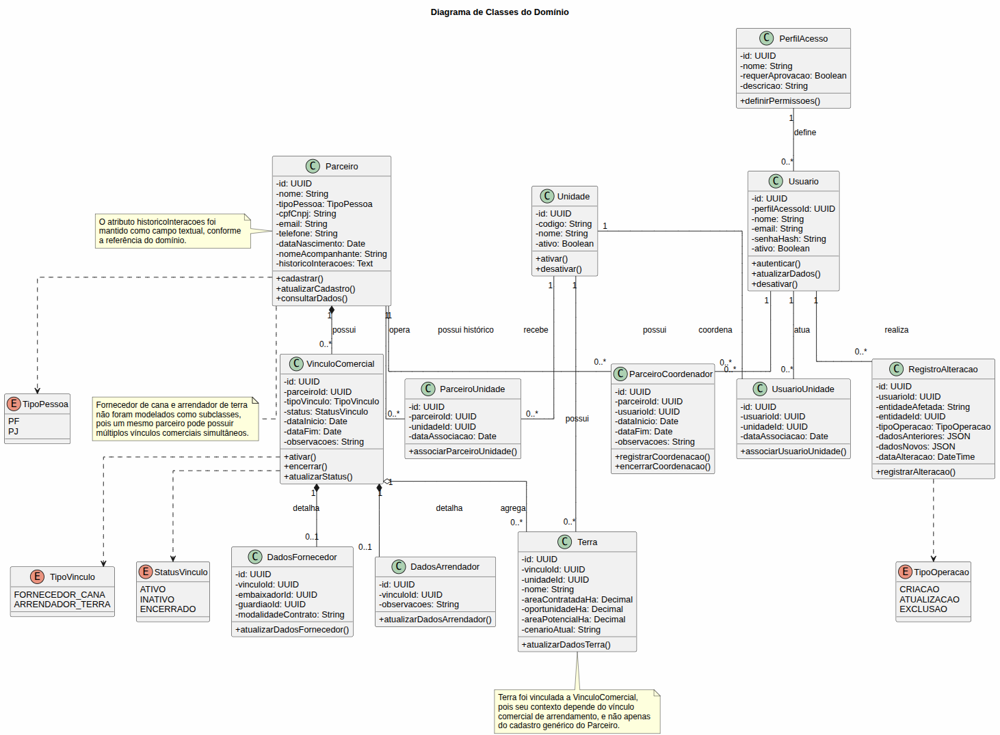
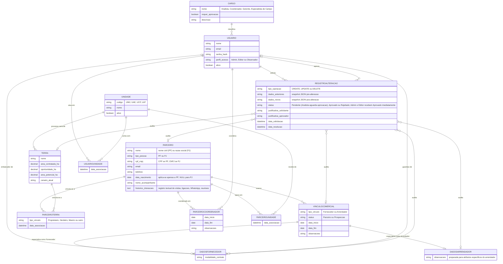

# WAD - Web Application Document - Módulo 2 - Inteli

## Grupo 67

#### Integrantes

- Antônio de Souza Dantas Neto
- Gabriel Gomes Pimentel
- Haila Thauane Falcão Novaes
- João Paulo Barreto Ferreira Andrade Rodrigues de Paula
- Mariana Pires de Carvalho Moussa
- Tiago Brun de Arruda
- William Junior dos Santos Maia

## Sumário

[1. Introdução](#c1)

[2. Visão Geral da Aplicação Web](#c2)

[3. Projeto Técnico da Aplicação Web](#c3)

[4. Desenvolvimento da Aplicação Web](#c4)

[5. Testes da Aplicação Web](#c5)

[6. Estudo de Mercado e Plano de Marketing](#c6)

[7. Conclusões e trabalhos futuros](#c7)

[8. Referências](c#8)

[Anexos](#c9)

 

# 1. Introdução (sprints 1 a 5)

A ATVOS, empresa do setor sucroenergético, enfrenta dificuldades na gestão do relacionamento com seus parceiros de terras e fornecedores de cana. As informações encontram-se dispersas em planilhas, e-mails e anotações individuais, sem padronização ou centralização, o que torna o histórico de interações dependente do conhecimento de cada analista. Dessa forma, a continuidade dos relacionamentos ao longo das safras é comprometida, assim como a capacidade de tomada de decisão estratégica por parte da gestão.

Diante dessa problemática, será desenvolvida uma aplicação web do tipo CRM, sigla para Customer Relationship Management, isto é, uma ferramenta voltada à gestão centralizada do relacionamento com clientes e parceiros de negócio. No contexto deste projeto, a solução permitirá que a ATVOS registre, acompanhe e analise suas interações com parceiros de terras e fornecedores de cana em um único ambiente digital, substituindo o modelo atual fragmentado por um fluxo estruturado e rastreável de informações.

A aplicação será construída sobre três pilares principais. O primeiro é o cadastro centralizado, por meio do qual parceiros e fornecedores serão registrados com informações detalhadas de perfil, localização e oportunidades associadas. O segundo é o histórico de alterações e interações, que garantirá rastreabilidade e continuidade das relações independente de mudanças no time responsável. O terceiro é o controle de acesso por perfil, com três níveis distintos de permissão, assegurando que cada usuário interaja com o sistema de acordo com seu papel e responsabilidade dentro da organização.

Com a adoção dessa solução, espera-se que a ATVOS consolide uma visão única e confiável de seus parceiros estratégicos, reduza o retrabalho operacional e fortaleça a tomada de decisões com base em dados estruturados e históricos preservados ao longo das safras.

# 2. Visão Geral da Aplicação Web (sprint 1)

## 2.1. Escopo do Projeto (sprints 1 e 4)

### 2.1.1. Modelo de 5 Forças de Porter (sprint 1)
 
A análise das 5 Forças de Porter permite compreender a dinâmica competitiva do setor sucroenergético e os desafios estruturais enfrentados pela ATVOS, terceira maior empresa de moagem de cana-de-açúcar do Brasil, atrás de Raízen e BP Bunge (AGROADVANCE, 2025). Internamente, a ausência de governança de dados compromete "a tomada de decisão rápida e a continuidade das interações para relações de longo prazo" (INTELI, 2026), expondo a empresa a riscos competitivos em todas as forças analisadas.

A ameaça de novos entrantes é baixa a moderada. As barreiras de entrada são limitantes: o setor demanda US$31 bilhões apenas para metas de descarbonização (Portal da Indústria, 2023), as melhores regiões produtivas já estão ocupadas e as licenças ambientais dificultam qualquer novo player (UDOP, 2025). O ponto de atenção é o etanol de milho, rota alternativa que já mobilizou R$23 bilhões em investimentos e as fronteiras competitivas do setor (NPagro, 2024; Porter, 2008).

O poder de barganha dos fornecedores é moderado e distinto. A necessidade de processar a cana em até 50 km do corte cria dependência geográfica dos fornecedores de terra, conferindo maior poder (Canal Rural, 2026). Já os fornecedores de cana têm poder limitado, pois os preços são regulados pelo Consecana (AGROADVANCE, 2025).

O poder de barganha dos clientes é alto. Distribuidoras como Raízen, Vibra e Ipiranga concentram mais de 53% do mercado de etanol e açúcar VHP (ANP, 2024), diminuindo o poder de precificação da ATVOS (Porter, 1979). A venda direta a postos (Lei n.º 14.292/2022) e a liderança em CBIOs via RenovaBio (ATVOS, 2025) oferecem diferenciação parcial junto a compradores com metas climáticas (Agência Brasil, 2022).

A rivalidade entre concorrentes é alta. O setor disputa terras, fornecedores e CBIOs em um mercado consolidado, onde ineficiências internas ampliam a vulnerabilidade frente a concorrentes mais estruturados.

A ameaça de produtos substitutos é moderada e crescente. Com 80% da cana destinada ao etanol (ATVOS, 2023), a empresa é vulnerável a veículos elétricos, cuja adoção pode reduzir a demanda em até 40% até 2035 (Brasilagro, 2021), ao etanol de milho (AgFeed, 2023) e ao biometano para transporte pesado (Eixo, 2025).

Em resumo, a ATVOS opera em um ambiente de pressões competitivas estruturais relevantes, em que a maturidade em gestão de dados pode ser determinante para preservar margens, fidelizar clientes estratégicos e sustentar vantagem competitiva no longo prazo.

### 2.1.2. Análise SWOT da Instituição Parceira (sprint 1)

A análise SWOT é uma ferramenta que avalia as forças, fraquezas, oportunidades e ameaças.

| FORÇAS | FRAQUEZAS |
| :------------------------------------------------------------------------------------------------------------------------- | :----------------------------------------------------------------------------------------------------------------------------- |
| É a segunda maior empresa de etanol do Brasil, possuindo também uma linha de produtos diversificada.           | Gestão de clientes e parceiros ainda manual, assim não atingindo o resultado que poderiam alcançar. |

 

| OPORTUNIDADES                                                                                                                                                                                                                 | AMEAÇAS                                                                                                                                                                                                                   |
| :------------------------------------------------------------------------------------------------------------------------------------------------------------------------------------------------------------------------------------------- | :----------------------------------------------------------------------------------------------------------------------------------------------------------------------------------------------------------------------------------- |
| Descarbonização da aviação com SAF de cana com alta rentabilidade. RenovaBio impulsiona ATVOS com metas de CBIOs para distribuidoras de combustíveis.|Mudanças climáticas ameaçam safras de cana com secas e chuvas intensas.  |

Conclui-se que a Atvos enfrenta riscos climáticos e operacionais, possuindo oportunidades estratégicas em SAF e CBIOs impulsionando sua rentabilidade.

---

### 2.1.3. Solução (sprints 1 a 5)

#### a) Problema a ser resolvido

Os dados de gestão de parceiros de terras e fornecedores de cana-de-açúcar encontram-se dispersos em planilhas, sem governança adequada. Essa fragmentação compromete a preservação do histórico de relacionamento, dificulta a padronização dos cadastros e prejudica a tomada de decisão ágil e a continuidade das relações de longo prazo.

#### b) Dados disponíveis

Os dados estão disponíveis no SharePoint da área de Estratégia de Terras da ATVOS, de caráter confidencial. Os arquivos incluem bases cadastrais de fornecedores de cana, registros de contatos de parceiros e proprietários de terra, estruturas de cadastro existentes e informações de acesso ao portal de gestão de parceiros.

#### c) Solução proposta

Será desenvolvida uma aplicação web full stack com front-end em HTML, CSS e JavaScript, back-end em Node.js e banco de dados SQLite. A solução centralizará cadastros de parceiros, registrará o histórico de interações e disponibilizará dashboards analíticos. O acesso será controlado por três perfis distintos: administrador, editor e observador.

#### d) Forma de utilização da solução

A aplicação será utilizada via navegador web pelos times internos da área de Negócios Agrícolas. Cada perfil terá acesso às funcionalidades correspondentes ao seu nível de permissão: cadastro e edição de parceiros, registro de interações, aplicação de filtros por nome, região e tipo de parceiro, visualização de dashboards e exportação de listas.

#### e) Benefícios esperados

Centralização e padronização dos cadastros de parceiros; eliminação de planilhas dispersas e redução de retrabalho operacional; preservação do histórico de relacionamento ao longo das safras independente de mudanças no time; e agilidade na consulta e análise de dados para suporte à tomada de decisão estratégica.

#### f) Critério de sucesso e como será avaliado

O sucesso será avaliado pela entrega do MVP funcional com os três módulos principais operacionais (cadastro, histórico e controle de acesso), pela validação dos fluxos pelos usuários internos da ATVOS em testes de usabilidade e pela capacidade demonstrada de substituir as planilhas dispersas pela aplicação desenvolvida.

### 2.1.4. Value Proposition Canvas (sprint 1):

O Value Proposition Canvas é uma ferramenta de design estratégico que coloca lado a lado o perfil do cliente (suas tarefas, dores e ganhos esperados) e o mapa de valor da solução (seus produtos, aliviadores de dor e criadores de ganho). O objetivo é garantir que o que a solução entrega responda de forma direta ao que o cliente realmente precisa. No contexto deste projeto, o canvas foi construído a partir das informações levantadas no Kick Off com a ATVOS, tendo como segmento-cliente os coordenadores de campo e gerentes regionais da área de Negócios Agrícolas responsáveis pela gestão de parceiros de terras e fornecedores de cana.

 

  Figura 2.1.4 - Value Proposition Canvas 
   
  Fonte: Material produzido pelos autores, 2026.

 

---

#### 1. O Perfil do Cliente

O segmento-cliente é composto pelos coordenadores de campo e gerentes regionais da ATVOS que atuam na área de Negócios Agrícolas. O trabalho diário desses profissionais envolve manter o relacionamento com parceiros estratégicos (fornecedores de cana-de-açúcar e proprietários de terra) ao longo das safras, garantindo a continuidade dos contratos e a qualidade das informações para a tomada de decisão. No entanto, o modelo atual de gestão apresenta limitações estruturais que comprometem diretamente esse trabalho.

**Tarefas do Cliente**

As principais atividades que esse profissional precisa realizar são: cadastrar e manter atualizados os dados de fornecedores de cana e proprietários de terra; registrar e consultar o histórico de interações com cada parceiro; acessar rapidamente perfis e informações relevantes para negociações; e controlar quem da equipe pode visualizar ou editar cada informação.

**Dores**

A maior frustração é a dispersão dos dados em planilhas, e-mails e anotações individuais, sem qualquer padronização. Isso torna o histórico de relacionamento dependente do conhecimento de cada analista: quando um profissional sai da equipe, o histórico vai junto. Além disso, a falta de padronização nos cadastros dificulta a consulta ágil, gera retrabalho constante e expõe informações sensíveis a acessos não controlados.

**Ganhos Esperados**

Esse profissional espera ter uma visão única e confiável de todos os parceiros, com o histórico de relacionamento preservado independentemente de mudanças no time. Espera também agilidade na consulta de dados para suportar decisões estratégicas e rastreabilidade completa de todas as alterações realizadas no sistema.

---

#### 2. O Mapa de Valor

Para responder diretamente à realidade desse cliente, a solução proposta é um CRM web desenvolvido sob medida para a área de Negócios Agrícolas da ATVOS. A aplicação é estruturada em torno de três pilares: o cadastro centralizado de parceiros, o histórico rastreável de interações e o controle de acesso por perfil. Juntos, esses pilares substituem o modelo fragmentado atual por um fluxo estruturado, padronizado e auditável de informações.

**Produtos e Serviços**

A solução entrega: um CRM web centralizado para gestão de parceiros agrícolas; indicadores-chave de desempenho da base de parceiros para suporte gerencial; exportação de listas de contatos para uso externo ao sistema; e controle de acesso segmentado por perfil: administrador, editor e observador.

**Aliviadores de Dor**

Para eliminar a dependência do conhecimento individual, o sistema preserva o histórico de interações por parceiro de forma permanente e cronológica. Para acabar com a despadronização, o cadastro conta com campos validados e obrigatórios que garantem consistência nos dados. A substituição das planilhas por um fluxo rastreável resolve a fragmentação, e a inativação de usuários sem exclusão de histórico mantém o controle de acesso sem perda de informações.

**Criadores de Ganho**

O sistema permite filtrar parceiros por nome, região, área e tipo, reduzindo o tempo de busca. A visão gerencial via indicadores-chave de desempenho entrega consolidação dos dados sem exportações manuais. O registro de auditoria de todas as alterações garante rastreabilidade completa. O acesso centralizado via navegador, sem instalação, torna o sistema acessível de qualquer ponto. Por fim, a continuidade operacional independente de mudanças no time é o ganho mais estratégico da solução: o relacionamento com o parceiro deixa de estar na memória do analista e passa a estar no sistema.

---

#### Conclusão do Alinhamento

A construção do Value Proposition Canvas deixou claro que o problema central da ATVOS é mais relacional do que transacional: o risco não está em não ter dados, mas em perdê-los quando a equipe muda. A solução responde diretamente a essa dor ao tornar o histórico de relacionamento um ativo institucional, e não individual. Cada funcionalidade entregue, do cadastro padronizado ao controle de acesso, foi definida a partir de uma dor ou ganho identificado no canvas, o que garantiu que o escopo do MVP fosse construído com foco real no valor percebido pelo cliente, e não em funcionalidades genéricas.

### 2.1.5. Matriz de Riscos do Projeto (sprint 1)

A matriz de riscos é uma ferramenta fundamental de gestão de projetos, utilizada para identificar, classificar e planejar respostas a eventos que possam impactar negativamente (ameaças) ou positivamente (oportunidades) o desenvolvimento da aplicação Web. Ela permite visualizar, de forma estruturada, os principais riscos do projeto, avaliando sua probabilidade de ocorrência e o impacto potencial sobre os resultados. A análise e o acompanhamento contínuo desses riscos são essenciais para garantir a entrega do MVP no prazo, com qualidade e alinhamento aos objetivos do grupo.

#### 2.1.5.1 Classificação de Impacto, Probabilidade e Matriz de Risco

  Figura 2.1.5.1 - Classificação de Impacto 
   
  Fonte: Material produzido pelos autores, 2026.

  Figura 2.1.5.2 - Classificação de Probabilidade 
   
  Fonte: Material produzido pelos autores, 2026.

  Figura 2.1.5.3 - Matriz de Risco 
   
  Fonte: Material produzido pelos autores, 2026.

#### 2.1.5.2 Lista de Riscos (Ameaças)

##### A. Informações não atualizadas

Há o risco das informações sobre os clientes e os produtos não serem atualizadas a todo momento. Caso isso ocorra, o projeto falhará em realizar um de seus principais objetivos.

**Responsáveis:** Antônio, Gabriel, Haila, João, Mariana, Tiago, William

**Impacto:** Alto

**Probabilidade:** Média

**Plano de Resposta ao Risco:** Validar o site com testes durante o desenvolvimento para garantir a constante atualização.

##### B. Atraso na entrega do MVP

Atrasos nas funcionalidades da aplicação WEB podem comprometer na entrega ao parceiro.

**Responsáveis:** Antônio, Gabriel, Haila, João, Mariana, Tiago, William

**Impacto:** Alto

**Probabilidade:** Baixa

**Plano de Resposta ao Risco:** Priorizar uma divisão equilibrada de tarefas entre todos, com o objetivo de não pesar para ninguém e assim ser possível todos os integrantes do grupo finalizarem suas responsabilidades antes do prazo.

##### C. Exposição de dados confidenciais

As informações dos parceiros e fornecedores da ATVOS não devem ser expostas, visto que é conteúdo estratégico e restrito da empresa. Caso isso ocorra, causaria dano grave ao negócio.

**Responsáveis:** Antônio, Gabriel, Haila, João, Mariana, Tiago, William

**Impacto:** Muito Alto

**Probabilidade:** Baixa

**Plano de Resposta ao Risco:** Não publicar o sistema em URL pública sem controle de acesso, além de também tratar os arquivos de dados de forma confidencial durante todo o desenvolvimento da aplicação WEB.

##### D. UX inadequada

Interfaces pouco intuitivas podem inviabilizar o uso pela equipe da ATVOS, que precisa de consulta rápida ao perfil de parceiros.

**Responsáveis:** Antônio, Gabriel, Haila, João, Mariana, Tiago, William

**Impacto:** Médio

**Probabilidade:** Média

**Plano de Resposta ao Risco:** Realizar casos de testes com pelo menos 5 pessoas e ver se elas conseguem utilizar a aplicação WEB, anotando quaisquer dificuldades que forem encontradas. Além disso, será possível conferir o design do site com a professora de UX para receber seus feedbacks.

#### 2.1.5.3 Lista de Riscos (Oportunidades)

##### E. Eliminação de planilhas

A centralização dos dados de parceiros facilita muito para a ATVOS, diminuindo o tempo de trabalho deles, e eliminando a perda de histórico de informações dos parceiros e produtores.

**Responsáveis:** Antônio, Gabriel, Haila, João, Mariana, Tiago, William

**Impacto:** Alto

**Probabilidade:** Muito Alta

**Plano de Resposta ao Risco:** Demonstrar a qualidade do projeto durante a apresentação do MVP e comparar o tempo economizado entre o uso de planilhas e o uso da aplicação WEB.

##### F. Fortalecimento do relacionamento com parceiro

Com o histórico de interações centralizado e acessível para a ATVOS, ela pode personalizar o relacionamento com fornecedores e parceiros, fortalecendo a fidelidade a longo prazo

**Responsáveis:** Antônio, Gabriel, Haila, João, Mariana, Tiago, William

**Impacto:** Alto

**Probabilidade:** Alta

**Plano de Resposta ao Risco:** Priorizar a funcionalidade de registro de informações e consulta do histórico de interações com os parceiros e fornecedores no MVP.

---

A matriz de riscos foi utilizada de forma que permite a equipe antecipar ameaças, planejar respostas e aproveitar oportunidades. O acompanhamento dos riscos pode contribuir para a organização do grupo, a entrega do MVP no prazo e a elevação da qualidade do produto. Além disso, a análise dos riscos, aliada à comunicação eficiente e à definição clara de responsabilidades, é fundamental para o sucesso da aplicação web.

## 2.2. Personas (sprint 1)

Personas são representações fictícias dos usuários da aplicação, construídas com base nas informações coletadas durante entrevistas e workshops com os clientes. Elas são um recurso fundamental para que as equipes de desenvolvimento, design e marketing se sensibilizem com o usuário, entendam suas dores e expectativas e moldem uma solução voltada para quem realmente vai usá-la. No presente projeto, foram construídas três personas (apresentadas nas figuras 2.2.1, 2.2.2 e 2.2.3), com base nas informações coletadas durante o workshop com o parceiro (ATVOS) e no mapeamento dos perfis envolvidos na problemática. As personas representam os principais usuários internos da aplicação: o analista responsável pelo cadastro e atualização dos dados, a coordenadora responsável pela consulta e análise gerencial, e o gerente responsável pela governança de acessos e supervisão da base.

  Figura 2.2.1 - Persona 1: Juliano Soares 
   
  Fonte: Material produzido pelos autores, 2026. (Imagem de pessoa produzida por IA generativa)

 

  Figura 2.2.2 - Persona 2: Bianca Souza 
   
  Fonte: Material produzido pelos autores, 2026. (Imagem de pessoa produzida por IA generativa)

 

  Figura 2.2.3 - Persona 3: Marcelo Andrade 
   
  Fonte: Material produzido pelos autores, 2026. (Imagem de pessoa produzida por IA generativa)

 

| Persona | Papel no sistema | Dores principais | Necessidades | Relação com a solução |
|---|---|---|---|---|
| Juliano Soares | Editor / Analista de Negócios Agrícolas | Dados dispersos, dificuldade para registrar informações de forma eficiente e risco de esquecimento ou perda de dados. | Cadastrar, editar e consultar dados padronizados de parceiros e fornecedores. | Usa o sistema para centralizar cadastros, atualizar informações e registrar interações com parceiros. |
| Bianca Souza | Observadora / Coordenadora de Estratégia de Terras | Dificuldade para encontrar dados específicos, sintetizar informações e acompanhar a atuação dos analistas. | Consultar perfis, aplicar filtros, visualizar histórico e acessar dados consolidados para negociações. | Usa o sistema para análise gerencial, consulta de dados e acompanhamento da base de parceiros. |
| Marcelo Andrade | Administrador do Sistema / Gerente de coordenadores | Falta de controle sobre acessos e edições, dificuldade de auditoria e risco de inconsistência dos dados. | Gerenciar permissões, consultar histórico de alterações, auditar ações e visualizar indicadores gerenciais. | Usa o sistema para garantir governança, segurança, rastreabilidade e controle de acesso. |

Ao analisar as três personas do projeto, observa-se que suas dores possuem uma mesma origem: a descentralização dos dados dos parceiros e fornecedores. No entanto, essa problemática impacta cada perfil de forma distinta. O analista é afetado pelo retrabalho operacional no cadastro e atualização das informações; a coordenadora é impactada pela dificuldade de consulta, análise e acompanhamento dos parceiros; e o administrador enfrenta riscos relacionados ao controle de acesso, auditoria e governança da base. Dessa forma, a solução deve contemplar funcionalidades operacionais, analíticas e administrativas para sustentar a gestão do relacionamento agrícola da ATVOS.

## 2.3. User Stories (sprints 1 a 5)

---

User Stories são descrições simples de funcionalidades escritas do ponto de vista do usuário, no formato "como [perfil], posso [ação], para [benefício]". Para garantir a qualidade de cada história, foi aplicado o método INVEST, que avalia se a história é Independente, Negociável, Valiosa, Estimável, Pequena e Testável. As User Stories a seguir estão ordenadas por prioridade de desenvolvimento.

---

Identificação | US01
--- | ---
Persona | Juliano Soares — Editor / Analista de Negócios Agrícolas
Prioridade | Alta
User Story | "Como editor, posso cadastrar fornecedores de cana com suas informações específicas, para que os dados de cada agricultor parceiro estejam centralizados e padronizados no sistema."
Critério de aceite 1 | CR1: Ao preencher os campos do perfil de fornecedor de cana (CPF/CNPJ, inscrição estadual, área plantada em hectares, TCH médio, ATR médio, histórico de cumprimento de cota, certificações e usina de referência) e confirmar, o fornecedor é salvo e exibido na listagem.
Critério de aceite 2 | CR2: Ao tentar salvar sem preencher campos obrigatórios, o sistema exibe aviso de validação e não conclui o cadastro.
Critérios INVEST | Independente: pode ser desenvolvida sem depender do cadastro de proprietários ou de interações. Negociável: os campos do formulário podem ser revistos com a equipe da ATVOS sem alterar o objetivo central. Valiosa: resolve diretamente a dispersão dos dados de fornecedores em planilhas, centralizando as informações em um único sistema acessível a toda a equipe e facilitando a consulta organizada das informações dos agricultores parceiros. Estimável: envolve formulário, validação e persistência no banco de dados, com escopo claro para estimar o esforço. Pequena: abrange apenas o fluxo de criação de um novo fornecedor de cana, sem integrações externas. Testável: verifica-se se o fornecedor aparece na listagem após o cadastro e se os campos obrigatórios são devidamente validados.

---

Identificação | US02
--- | ---
Persona | Juliano Soares — Editor / Analista de Negócios Agrícolas
Prioridade | Alta
User Story | "Como editor, posso cadastrar proprietários de terra com suas informações específicas, para que os dados de cada proprietário parceiro estejam centralizados e padronizados no sistema."
Critério de aceite 1 | CR1: Ao preencher os campos do perfil de proprietário de terra (CPF/CNPJ, documentação da terra, localização, distância da usina, área total disponível em hectares, topografia, status da documentação fundiária, CAR, situação ambiental e tipo de contrato) e confirmar, o proprietário é salvo e exibido na listagem.
Critério de aceite 2 | CR2: Ao tentar salvar sem preencher campos obrigatórios, o sistema exibe aviso de validação e não conclui o cadastro.
Critérios INVEST | Independente: pode ser desenvolvida em paralelo à US01, com formulário e lógica próprios para o perfil de proprietário. Negociável: os campos podem ser ajustados conforme as necessidades da área de Estratégia de Terras. Valiosa: centraliza os dados de proprietários que hoje estão dispersos em planilhas, eliminando retrabalho e padronizando o cadastro. Estimável: reutiliza a estrutura da US01 com campos distintos para o perfil de proprietário, com esforço bem delimitado. Pequena: escopo restrito ao fluxo de criação de um proprietário de terra. Testável: verifica-se se o proprietário aparece na listagem após o cadastro e se os campos específicos são corretamente salvos.

---

Identificação | US03
--- | ---
Persona | Juliano Soares — Editor / Analista de Negócios Agrícolas
Prioridade | Alta
User Story | "Como editor, posso registrar o histórico de interações com parceiros, para que o relacionamento seja documentado e acessível a toda a equipe."
Critério de aceite 1 | CR1: Ao adicionar uma interação (data, tipo e descrição) ao perfil de um parceiro, ela é salva e exibida no histórico em ordem cronológica.
Critério de aceite 2 | CR2: O histórico exibe todos os registros de interações com o parceiro com data, tipo e descrição visíveis. Ao cadastrar uma nova interação, ela aparece no topo da lista após a confirmação.
Critérios INVEST | Independente: pode ser construída separadamente das funcionalidades de visualização e filtro, com lógica própria de persistência. Negociável: os tipos de interação e os campos do formulário podem ser ajustados conforme o fluxo de trabalho real da equipe. Valiosa: resolve a perda de histórico de relacionamento, uma das principais dores identificadas no briefing da ATVOS. Estimável: envolve formulário de registro e listagem cronológica, com escopo claro e bem delimitado. Pequena: funcionalidade focada em um único fluxo, registrar e listar interações por parceiro. Testável: verifica-se se a interação registrada aparece no histórico do parceiro correto e na ordem cronológica esperada.

---

Identificação | US04
--- | ---
Persona | Bianca Souza — Observadora / Coordenadora de Estratégia de Terras
Prioridade | Alta
User Story | "Como observador, posso visualizar o perfil detalhado de cada parceiro, para que eu possa consultar rapidamente as informações necessárias para a tomada de decisão."
Critério de aceite 1 | CR1: Ao clicar em um parceiro na listagem, o sistema exibe todos os dados cadastrais e o histórico de interações em uma tela de perfil.
Critério de aceite 2 | CR2: A tela de perfil carrega em até 3 segundos, conforme o requisito de desempenho definido.
Critérios INVEST | Independente: a tela de visualização pode ser prototipada e desenvolvida antes mesmo de todas as funcionalidades de edição estarem concluídas. Negociável: o layout e as informações exibidas no perfil podem ser ajustados com base no feedback dos usuários internos. Valiosa: permite que observadores consultem dados de forma centralizada, eliminando a necessidade de buscar planilhas dispersas. Estimável: tela somente de leitura, sem formulários complexos, com esforço menor que as User Stories de edição. Pequena: escopo limitado a exibir dados já cadastrados de forma organizada e legível. Testável: verifica-se se todos os dados do parceiro são exibidos corretamente e se o tempo de carregamento está dentro do limite definido.

---

Identificação | US05
--- | ---
Persona | Juliano Soares — Editor / Analista de Negócios Agrícolas
Prioridade | Alta
User Story | "Como editor, posso editar os dados cadastrais de parceiros, para que as informações estejam sempre atualizadas e confiáveis para a equipe."
Critério de aceite 1 | CR1: Ao alterar os dados de um parceiro e confirmar, as mudanças são salvas e refletidas imediatamente no perfil.
Critério de aceite 2 | CR2: O sistema registra automaticamente a data e hora da última atualização do cadastro.
Critérios INVEST | Independente: pode ser desenvolvida em paralelo às User Stories de cadastro, compartilhando o formulário com lógica de edição. Negociável: os campos editáveis e as regras de validação podem ser revistos conforme o feedback dos usuários. Valiosa: garante que as informações dos parceiros reflitam a realidade atual, mantendo a confiabilidade dos dados no sistema. Estimável: reutiliza a interface das User Stories de cadastro com adaptações para edição, com esforço bem delimitado. Pequena: fluxo limitado a buscar, alterar e salvar dados de um parceiro existente. Testável: verifica-se se as alterações são salvas corretamente e se a data de atualização é registrada.

---

Identificação | US09
--- | ---
Persona | Marcelo Andrade — Administrador do Sistema / Gerente de coordenadores
Prioridade | Alta
User Story | "Como administrador, posso cadastrar usuários com perfis de acesso definidos, para que o sistema seja utilizado de forma segura e com acessos controlados."
Critério de aceite 1 | CR1: Ao preencher nome, e-mail e perfil (administrador, editor ou observador) e confirmar, o usuário é salvo e exibido na listagem.
Critério de aceite 2 | CR2: Ao tentar cadastrar um usuário com e-mail já existente, uma mensagem de erro é exibida e o cadastro não é concluído.
Critérios INVEST | Independente: pode ser desenvolvida antes de qualquer funcionalidade de gestão de parceiros, pois define os acessos que viabilizam o uso do restante do sistema. Negociável: os campos do formulário de cadastro e os perfis de acesso disponíveis podem ser revistos conforme as políticas internas de TI e segurança da informação da ATVOS. Valiosa: garante que apenas usuários autorizados acessem o sistema, atendendo aos requisitos de segurança e controle de acesso definidos para o projeto. Estimável: envolve formulário de cadastro com atribuição de perfil e persistência no banco de dados, com escopo claro e bem delimitado. Pequena: fluxo restrito ao cadastro e atribuição de perfil de acesso de um único usuário, sem integrações externas. Testável: verifica-se se o usuário cadastrado consegue realizar login e acessa apenas as funcionalidades correspondentes ao seu perfil de acesso.

---

Identificação | US10
--- | ---
Persona | Marcelo Andrade — Administrador do Sistema / Gerente de coordenadores
Prioridade | Alta
User Story | "Como administrador, posso inativar usuários do sistema, para que colaboradores que saíram da equipe não tenham mais acesso às informações da ATVOS."
Critério de aceite 1 | CR1: Ao inativar um usuário, ele perde o acesso imediatamente e não consegue realizar login.
Critério de aceite 2 | CR2: O usuário inativado não é excluído do banco de dados; seu registro é mantido com status inativo para fins de controle.
Critérios INVEST | Independente: pode ser desenvolvida logo após o cadastro de usuários (US09), com lógica própria de atualização de status no banco de dados. Negociável: o comportamento da inativação — como o encerramento imediato de sessão e a preservação do histórico de ações — pode ser refinado conforme as políticas internas da ATVOS. Valiosa: garante que ex-colaboradores não mantenham acesso às informações sensíveis do sistema, reduzindo riscos de segurança sem a necessidade de excluir registros históricos. Estimável: envolve atualização de status no banco de dados e invalidação de sessão ativa, com esforço bem delimitado. Pequena: funcionalidade restrita à alteração do status do usuário para inativo, sem exclusão de dados ou impacto em outros módulos. Testável: verifica-se se o usuário inativado não consegue realizar login e se o histórico de ações permanece acessível para fins de auditoria.

---

Identificação | US06
--- | ---
Persona | Bianca Souza — Observadora / Coordenadora de Estratégia de Terras
Prioridade | Média
User Story | "Como observador, posso filtrar a lista de parceiros por nome, região, área ou tipo de parceiro, para que eu encontre rapidamente o parceiro que procuro sem precisar percorrer toda a lista."
Critério de aceite 1 | CR1: Ao aplicar um filtro, a listagem exibe apenas os parceiros que correspondem ao critério selecionado.
Critério de aceite 2 | CR2: Filtros podem ser combinados e o resultado é atualizado sem necessidade de recarregar a página.
Critérios INVEST | Independente: pode ser implementada de forma isolada após a listagem básica de parceiros estar disponível, sem depender de funcionalidades de edição ou cadastro. Negociável: os critérios de filtro (nome, região, área, tipo de parceiro) podem ser ajustados conforme as prioridades operacionais da equipe da ATVOS. Valiosa: reduz o tempo de busca por parceiros específicos, aumentando a eficiência do observador na consulta e na tomada de decisão. Estimável: envolve parâmetros de consulta ao banco de dados sobre registros já existentes, sem lógica de negócio complexa. Pequena: funcionalidade restrita à aplicação de filtros sobre uma listagem já existente, sem impacto nas funcionalidades de edição ou cadastro. Testável: verifica-se se, ao aplicar um filtro, apenas os parceiros correspondentes ao critério selecionado são exibidos na listagem.

---

Identificação | US07
--- | ---
Persona | Bianca Souza — Observadora / Coordenadora de Estratégia de Terras
Prioridade | Média
User Story | "Como observador, posso visualizar dashboards com estatísticas sobre a base de parceiros, para que eu tenha uma visão gerencial do portfólio agrícola."
Critério de aceite 1 | CR1: O dashboard exibe o número total de parceiros, a distribuição por tipo e por região.
Critério de aceite 2 | CR2: Os dados exibidos no dashboard refletem o estado atual do banco de dados no momento em que a tela é carregada ou atualizada manualmente pelo usuário.
Critérios INVEST | Independente: pode ser desenvolvida após os cadastros básicos estarem funcionais, consumindo dados já persistidos no banco sem novas dependências. Negociável: os gráficos, métricas e segmentações exibidas no dashboard podem ser priorizados e ajustados conforme as necessidades gerenciais da ATVOS. Valiosa: oferece visão consolidada do portfólio agrícola, apoiando a tomada de decisão estratégica sem necessidade de exportações manuais e facilitando o acompanhamento de indicadores relevantes sobre os parceiros cadastrados. Estimável: envolve consultas agregadas ao banco de dados e renderização de gráficos com componentes e escopo bem definidos. Pequena: funcionalidade restrita à visualização de dados consolidados, sem lógica de criação ou edição de registros. Testável: verifica-se se os dados exibidos nos gráficos e indicadores correspondem aos registros mais recentes do banco de dados.

---

Identificação | US08
--- | ---
Persona | Bianca Souza — Observadora / Coordenadora de Estratégia de Terras
Prioridade | Média
User Story | "Como observador, posso exportar a lista de contatos dos parceiros, para que eu possa compartilhar informações com pessoas que não têm acesso ao sistema."
Critério de aceite 1 | CR1: Ao acionar a exportação, o sistema gera um arquivo com nome, contato, tipo e região de cada parceiro.
Critério de aceite 2 | CR2: O arquivo exportado está em formato CSV ou XLSX e pode ser aberto sem erros.
Critérios INVEST | Independente: pode ser desenvolvida separadamente das funcionalidades de filtro e dashboard, com lógica própria de geração de arquivo. Negociável: o formato do arquivo exportado (CSV ou XLSX) e os campos incluídos podem ser definidos conforme as necessidades da equipe e os sistemas de destino utilizados pela ATVOS. Valiosa: permite que informações dos parceiros sejam compartilhadas com pessoas sem acesso ao sistema, ampliando o alcance dos dados sem comprometer o controle de acesso interno. Estimável: envolve consulta ao banco de dados e geração de arquivo estruturado, com lógica bem delimitada e sem dependências externas. Pequena: funcionalidade restrita à exportação de uma lista de contatos já existente no sistema. Testável: verifica-se se o arquivo gerado contém todos os dados esperados, está no formato correto e pode ser aberto sem erros em ferramentas de planilha.

---

As User Stories levantadas cobrem os fluxos essenciais para resolver a principal dor identificada pela ATVOS: a dispersão dos dados de fornecedores de cana e proprietários de terra em planilhas desconectadas. A priorização reflete esse objetivo, garantindo que o sistema entregue valor desde as primeiras sprints. As funcionalidades de suporte, como filtros, dashboards e exportação, serão implementadas conforme o avanço do projeto.

# 3. Projeto da Aplicação Web (sprints 1 a 5)

## 3.1. Requisitos do Sistema (sprints 1 a 5)

### 3.1.0.1 Minimundo do sistema (sprints 1 a 5)

O sistema proposto é uma aplicação web interna para apoio à gestão de parceiros agrícolas da ATVOS, com foco em fornecedores de cana-de-açúcar e proprietários de terra. Atualmente, essas informações estão dispersas em planilhas, o que dificulta a padronização dos cadastros, a preservação do histórico de relacionamento e a consulta rápida de dados relevantes para a tomada de decisão.

A aplicação centraliza os cadastros de parceiros agrícolas, permite o registro de interações, disponibiliza consultas filtradas e oferece visualizações gerenciais por meio de dashboards. O sistema será utilizado por equipes internas ligadas à gestão agrícola, estratégia de terras e administração da base de usuários.

As entidades principais consideradas no minimundo são: usuários internos, parceiros agrícolas, fornecedores de cana, proprietários de terra, terras e propriedades, interações e registros de atualização. Entre essas entidades, estabelecem-se as seguintes relações: um parceiro agrícola pode estar associado a múltiplas terras, e uma terra pode estar associada a múltiplos parceiros; cada interação registrada é vinculada a um parceiro e a um usuário interno responsável; todo registro de atualização é associado ao usuário que realizou a alteração e ao registro modificado, preservando o histórico de versões anteriores.

A aplicação não substitui sistemas corporativos externos da ATVOS nem realiza integrações automáticas com SharePoint, ERP ou ferramentas financeiras nesta versão do MVP. O objetivo central é garantir uma base única, organizada, rastreável e consultável para apoiar a gestão dos relacionamentos agrícolas da empresa.

### 3.1.0.2 Atores e Responsabilidades Principais

| Ator | Responsabilidades principais | Permissões principais |
|---|---|---|
| Administrador do Sistema | Gerenciar usuários internos, definir perfis de acesso e inativar contas quando necessário. | Criar, editar, visualizar e inativar usuários; atribuir perfis de acesso. |
| Editor | Cadastrar e atualizar informações de parceiros agrícolas, fornecedores de cana e proprietários de terra. Registrar histórico de interações. | Criar e editar parceiros; registrar interações; consultar cadastros. |
| Observador | Consultar informações consolidadas sobre parceiros e apoiar a tomada de decisão com base nos dados disponíveis. | Visualizar lista de parceiros, acessar perfil detalhado, aplicar filtros, visualizar dashboards e exportar listas. |
| Parceiro Agrícola | Representa o fornecedor de cana ou proprietário de terra cadastrado no sistema. Não acessa diretamente a aplicação no MVP. | Não possui acesso ao sistema; seus dados são gerenciados por usuários internos. |
| Sistema Web | Processar requisições, validar regras de negócio, persistir dados e retornar informações aos usuários conforme seu perfil de acesso. | Executar validações, controlar permissões, registrar dados e disponibilizar consultas. |
| Banco de Dados | Armazenar cadastros, usuários, interações, registros de atualização e informações históricas. | Persistir e recuperar dados conforme solicitado pelo backend. |

### 3.1.1. Requisitos Funcionais (sprint 1, refinar até sprint 5)

| ID    | Descrição                                                                                                                     | Prioridade | Status    |
| ----- | ------------------------------------------------------------------------------------------------------------------------------| ---------- | --------- |
| RF001 | O sistema deve permitir o cadastro de usuários com três perfis de acesso: administrador, editor e observador.                 | Alta       | Planejado |
| RF002 | O sistema deve permitir que o administrador crie, edite, visualize e inative usuários.                                        | Alta       | Planejado |
| RF003 | O sistema deve permitir que o administrador atribua um perfil de acesso a cada usuário cadastrado.                            | Alta       | Planejado |
| RF004 | O sistema deve permitir que o editor cadastre novos parceiros agrícolas.                                                      | Alta       | Planejado |
| RF005 | O sistema deve permitir que o editor edite dados cadastrais de parceiros agrícolas existentes.                                | Alta       | Planejado |
| RF006 | O sistema deve permitir que o editor registre dados de relacionamento e histórico de interações com parceiros agrícolas.      | Alta       | Planejado |
| RF007 | O sistema deve permitir que o observador visualize a lista de parceiros agrícolas cadastrados.                                | Alta       | Planejado |
| RF008 | O sistema deve permitir que o observador consulte o perfil detalhado de um parceiro agrícola.                                 | Alta       | Planejado |
| RF009 | O sistema deve rejeitar ou sinalizar registros duplicados com base nos seguintes identificadores únicos: CPF, CNPJ e e-mail.  | Alta       | Planejado |
| RF010 | O sistema deve verificar o preenchimento de campos obrigatórios antes dos registros serem enviados para a validação. Registros com o status rascunho podem ser salvos com dados incompletos.                                                                                                                            | Alta       | Planejado |
| RF011 | O sistema deve exigir autenticação via e-mail e senha para acesso.                                                            | Alta       | Planejado |
| RF012 | O sistema deve impedir que registros excluídos logicamente apareçam nas consultas e listagens normais.                        | Alta       | Planejado |
| RF013 | O sistema deve manter um histórico de versões de cada registro, permitindo a visualização de valores anteriores a cada edição.| Alta       | Planejado |
| RF014 | O sistema deve permitir que o administrador exclua registros de parceiros e terras de forma lógica.                           | Alta       | Planejado |
| RF015 | O sistema deve permitir associar múltiplos parceiros a uma mesma terra e múltiplas terras a um mesmo parceiro.                | Alta       | Planejado |
| RF016 | O sistema deve permitir a aplicação de filtros por nome, região, área contratada, potencial agrícola ou tipo de parceiro.     | Média      | Planejado |
| RF017 | O sistema deve exibir dashboards com estatísticas sobre a base de parceiros, segmentações e histórico de interações.          | Média      | Planejado |
| RF018 | O sistema deve permitir a exportação de listas básicas de contatos e parceiros.                                               | Média      | Planejado |
| RF019 | O sistema deve registrar a data de criação e última atualização de todos os registros do sistema.                             | Média      | Planejado |
| RF020 | O sistema deve registrar o usuário responsável por cada criação ou atualização de registro.                                   | Média      | Planejado |
| RF021 | O sistema deve definir o comportamento do sistema após a inativação de um usuário: acesso revogado imediatamente, sessão encerrada e histórico de ações preservado. | Alta      | Planejado |
| RF022 | O sistema deve permitir que o analista envie um registro para validação do coordenador.                                       | Alta        | Planejado |
| RF023 | O sistema deve exibir ao coordenador uma fila de registros pendentes de validação.                                            | Alta        | Planejado |
| RF024 | O sistema deve permitir que o coordenador edite, aprove ou devolva um registro pendente.                                      | Alta        | Planejado |
| RF025 | O sistema deve permitir upload de arquivos vinculados a um parceiro ou relatório.                                             | Média       | Planejado |
| RF026 | O sistema deve executar um processo automático periódico que identifica registros que não sofreram alterações por um período configurável e notifica o analista responsável e o coordenador vinculado.                                                                                                                              | Média       | Planejado |

### 3.1.2. Regras de Negócio (sprint 1, refinar até sprint 5)

| ID   | Descrição | RF associado |
|------|-----------|--------------|
| RN01 | Um usuário deve possuir um único e-mail associado (unicidade garantida no sistema). | RF001, RF002 |
| RN02 | Somente usuários cadastrados internamente podem acessar o sistema. | RF011 |
| RN03 | Existem três níveis de acesso: Analistas, Coordenadores e Gerentes. | RF001 |
| RN04 | Analistas podem visualizar registros com status ativo, podem criar e alterar registros com status rascunho e podem enviar esses registros com status rascunho para uma validação. | RF007, RF008 |
| RN05 | Coordenadores podem visualizar registros com status ativo e status pendente(registros enviados por analistas), podem alterar os registros com status pendente e transformar seus status em ativo. | RF004, RF005, RF006 |
| RN06 | Gerentes podem inserir, atualizar, excluir logicamente e visualizar registros em qualquer status, e também são responsáveis pelos cadastros de usuários. | RF002, RF003, RF014 |
| RN07 | A exclusão de dados é lógica: o registro não é apagado, apenas marcado como excluído. | RF012, RF014 |
| RN08 | Registros excluídos logicamente não devem aparecer em consultas padrão do sistema. | RF012 |
| RN09 | O sistema deve rejeitar registros duplicados com base nos identificadores únicos: CPF, CNPJ e e-mail. | RF009 |
| RN10 | Campos obrigatórios para parceiros e terras (nome, CPF/CNPJ, e-mail, tipo de parceiro, área em hectares, município e estado) não podem ser nulos em registros com status ativo (Registros com status rascunho podem ser salvos com campos incompletos). | RF010 |
| RN11 | Toda criação ou alteração de registro deve armazenar data, hora e o identificador do usuário responsável. | RF019, RF020 |
| RN12 | Alterações de dados devem manter versões anteriores disponíveis para consulta. | RF013 |
| RN13 | Um parceiro pode possuir múltiplas terras associadas. | RF015 |
| RN14 | Uma terra pode possuir múltiplos parceiros associados. | RF015 |
| RN15 | Ao inativar um usuário, o sistema deve revogar seu acesso imediatamente, encerrar sessões ativas e preservar o histórico de ações realizadas. | RF021 |
| RN16 | Um registro do tipo rascunho/devolvido só transita para status pendente após ser concluído por um analista. | RF022 |
| RN17 | Um registro do tipo pendente só transita para status ativo/devolvido após ser revisado por um coordenador. | RF023, RF024 |
| RN18 | Registros com status ativo que não sofreram alterações por um período configurado geram notificações para os usuários do sistema (analistas, coordenadores e gerentes). | RF026 |

### 3.1.3. Requisitos Não Funcionais — 8 Eixos ISO/IEC 25010 (sprints 1 a 5)

#### Justificativa, derivação e mensuração dos RNFs

Como a Sprint 1 tem foco em especificação conceitual, os requisitos não funcionais foram definidos como metas verificáveis para orientar as próximas etapas de projeto, implementação e testes. Cada RNF foi derivado do minimundo do sistema, das necessidades identificadas no contexto da ATVOS e dos fluxos prioritários definidos nos Requisitos Funcionais e nas Regras de Negócio.

| Eixo | Derivação a partir do contexto da ATVOS | Forma de mensuração | Conexão com RF/RN | Critério de aceite conceitual |
|---|---|---|---|---|
| **USAB — Usabilidade** | A ATVOS possui informações hoje dispersas em planilhas, e-mails e anotações individuais, o que dificulta a consulta rápida ao histórico e aos dados dos parceiros. Por isso, o sistema deve reduzir o esforço de navegação para que usuários internos encontrem informações sem depender de conhecimento informal ou busca manual em arquivos externos. | A mensuração será feita em testes de usabilidade nas sprints futuras, verificando se pelo menos 80% dos usuários conseguem acessar o perfil de um parceiro em até 4 cliques. | Relaciona-se aos RF007 e RF008, que tratam da listagem e consulta detalhada de parceiros, e à RN04, que define o acesso de visualização para o perfil Observador. | O RNF será considerado atendido se a navegação prevista permitir que a maioria dos usuários internos acesse o perfil do parceiro em até 4 cliques no fluxo listagem → detalhe. |
| **CONF — Confiabilidade** | A dor central do parceiro envolve baixa padronização, risco de inconsistência cadastral e perda de histórico de relacionamento. Como a solução pretende substituir controles dispersos por uma base única, os dados persistidos precisam respeitar regras mínimas de integridade. | A mensuração será feita pela verificação de que 100% dos registros persistidos respeitam validações de integridade, como campos obrigatórios e unicidade de CPF/CNPJ/e-mail. | Relaciona-se aos RF009, RF010, RF019 e RF020, e às RN09, RN10 e RN11, que tratam de duplicidade, obrigatoriedade de campos e registro de auditoria. | O RNF será aceito se o sistema impedir persistência de registros que violem regras de integridade previstas, como campos obrigatórios nulos ou identificadores duplicados. |
| **DES — Desempenho** | Como a aplicação será usada para consulta operacional e apoio à tomada de decisão, tempos de resposta altos poderiam manter a dependência de planilhas e reduzir a utilidade do sistema no uso diário. O desempenho, portanto, foi definido para os fluxos de consulta mais relevantes do MVP. | A mensuração será feita por testes de desempenho nas próximas sprints, considerando tempo de resposta p95 menor que 3 segundos para consultas com até 100 registros em ambiente controlado. | Relaciona-se aos RF007, RF008 e RF016, que envolvem listagem, consulta de perfil e aplicação de filtros. | O RNF será aceito se as consultas priorizadas retornarem em p95 < 3 segundos no cenário definido para o MVP. |
| **SUP — Suportabilidade** | O projeto evoluirá ao longo das sprints, com refinamento progressivo de funcionalidades, regras e telas. Por isso, o sistema deve ser concebido com organização técnica suficiente para permitir manutenção e expansão sem comprometer os fluxos já definidos. | A mensuração será feita pela verificação arquitetural de que 100% das funcionalidades implementadas respeitem separação em camadas, como Controller, Service e Repository. | Relaciona-se de forma transversal aos RF004 a RF020, especialmente aos fluxos de cadastro, edição, consulta, histórico e auditoria. Também se conecta às RN11 e RN12, pois histórico e versionamento exigem organização clara da lógica de negócio. | O RNF será aceito se as funcionalidades implementadas forem organizadas em camadas, evitando concentração indevida de regra de negócio na interface ou no acesso direto ao banco. |
| **SEG — Segurança** | O sistema lidará com dados internos e estratégicos sobre parceiros agrícolas, terras, fornecedores e histórico de relacionamento. Como esses dados não devem ser acessados ou alterados por qualquer usuário, o controle de acesso por perfil é essencial desde a concepção do sistema. | A mensuração será feita verificando se 100% das operações protegidas exigem autenticação e validação de permissão conforme o perfil do usuário. | Relaciona-se aos RF001, RF002, RF003, RF011 e RF021, e às RN02, RN03, RN04, RN05, RN06 e RN15, que definem perfis, autenticação e comportamento após inativação de usuário. | O RNF será aceito se usuários não autenticados ou sem permissão não conseguirem executar operações protegidas, como edição, exclusão lógica ou gestão de usuários. |
| **CAP — Capacidade** | Como a aplicação é voltada a equipes internas da ATVOS, não há necessidade de escala pública massiva. Ainda assim, o sistema deve ser concebido para suportar múltiplos usuários internos realizando consultas e cadastros simultaneamente. | A mensuração será feita por testes futuros considerando até 20 usuários simultâneos executando operações básicas, como consulta, cadastro e edição, sem falhas críticas. | Relaciona-se aos RF004, RF005, RF006, RF007, RF008 e RF016, que representam os principais fluxos operacionais do sistema. | O RNF será aceito se o sistema suportar até 20 usuários simultâneos realizando operações básicas sem indisponibilidade ou erro crítico nos fluxos prioritários. |
| **REST — Restrições de Design** | O MVP foi definido como aplicação web acessível por navegador, sem necessidade de aplicativo móvel, instalação local ou integração automática com sistemas corporativos externos nesta etapa. Essa restrição reduz complexidade e mantém o escopo adequado ao projeto acadêmico e ao MVP. | A mensuração será feita verificando se 100% das funcionalidades priorizadas são acessíveis por navegadores modernos compatíveis com HTML5, CSS3 e JavaScript. | Relaciona-se a todos os RFs, pois a solução proposta será entregue como aplicação web. Também reforça a restrição de escopo definida no minimundo, que exclui integrações automáticas com SharePoint, ERP e ferramentas financeiras no MVP. | O RNF será aceito se os fluxos priorizados puderem ser executados em navegador moderno, sem dependência de instalação local ou aplicação externa. |
| **ORG — Organizacionais** | O escopo do MVP deve respeitar as restrições definidas no TAP, no workshop do parceiro e no recorte da Sprint 1. Como a solução não deve substituir sistemas corporativos da ATVOS nem integrar automaticamente fontes externas neste momento, o requisito organizacional evita expansão indevida de escopo. | A mensuração será feita pela verificação de que o MVP possui 0 integrações externas com ERP, SharePoint ou APIs corporativas e permanece restrito aos módulos planejados. | Relaciona-se aos RF001 a RF021 como restrição transversal de escopo, especialmente aos módulos de usuários, parceiros, histórico, filtros, dashboards e exportação. | O RNF será aceito se o MVP permanecer dentro do escopo definido, sem implementar integrações externas não previstas para a Sprint 1. |

### 3.1.4. Matriz RF → RN → Endpoint (sprints 3 a 5)

| RF    | US relacionada | RN associadas    | Endpoint                                             | Método      |
|-------|----------------|------------------|------------------------------------------------------|-------------|
| RF001 | US09 | RN01, RN03 | `/usuarios` | POST |
| RF002 | US09, US10 | RN01, RN06 | `/usuarios/:id` | GET, PUT |
| RF003 | US09 | RN03 | `/usuarios/:id/perfil` | PUT |
| RF004 | US01, US02 | RN09, RN10 | `/parceiros` | POST |
| RF005 | US05 | RN10, RN11, RN12 | `/parceiros/:id` | PUT |
| RF006 | US03 | RN11 | `/parceiros/:id/interacoes` | POST |
| RF007 | US04, US06 | RN04, RN08 | `/parceiros` | GET |
| RF008 | US04 | RN04, RN08 | `/parceiros/:id` | GET |
| RF009 | US01, US02, US09 | RN09 | `/usuarios`, `/parceiros` | POST, PUT |
| RF010 | US01, US02, US09 | RN10 | `/usuarios`, `/parceiros`, `/terras` | POST, PUT |
| RF011 | US09, US10 | RN01, RN02 | `/auth/login` | POST |
| RF012 | US04, US06, US07, US08 | RN07, RN08 | `/parceiros`, `/terras` | GET |
| RF013 | US05 | RN12 | `/parceiros/:id/historico` | GET |
| RF014 | Sem US prioritária associada nesta Sprint | RN06, RN07 | `/parceiros/:id` e `/terras/:id` | PUT (A exclusão é lógica) |
| RF015 | US01, US02 | RN13, RN14 | `/parceiros/:id/terras` e `/terras/:id/parceiros` | GET, POST |
| RF016 | US06 | RN04, RN08 | `/parceiros?nome=&regiao=&area=&tipo=` | GET |
| RF017 | US07 | RN04 | `/dashboards/parceiros` e `/dashboards/interacoes` | GET |
| RF018 | US08 | RN04 | `/parceiros/exportar` | GET |
| RF019 | US01, US02, US03, US05, US09, US10 | RN11 | `/usuarios`, `/parceiros`, `/parceiros/:id/interacoes` | POST, PUT |
| RF020 | US01, US02, US03, US05, US09, US10 | RN11 | `/usuarios`, `/parceiros`, `/parceiros/:id/interacoes` | POST, PUT |
| RF021 | US10 | RN15 | `/usuarios/:id/inativar`; `/auth/sessoes/:id` | PUT (Novamente, a exclusão é lógica) |

### 3.1.5 Critérios de Aceite Técnicos (Sprint 1)

| CT       | Critério Técnico                                                                                             | RF associados              | RN associados    | RNF associados |
| -------- | ------------------------------------------------------------------------------------------------------------ | -------------------------- | ---------------- | -------------- |
| **CT01** | O sistema deve impedir o cadastro de usuários com e-mail já existente, retornando erro de duplicidade.       | RF001, RF002               | RN01, RN09       | CONF, SEG      |
| **CT02** | O sistema deve validar o preenchimento de todos os campos obrigatórios antes de persistir qualquer registro. | RF010                      | RN10             | CONF           |
| **CT03** | O sistema deve exigir autenticação válida para acesso a qualquer funcionalidade protegida.                   | RF011                      | RN02             | SEG            |
| **CT04** | O sistema deve impedir que usuários executem ações fora de suas permissões (ex: Observador não pode editar). | RF007, RF008, RF004, RF005 | RN04, RN05, RN06 | SEG            |
| **CT05** | O sistema deve garantir que registros excluídos logicamente não apareçam nas listagens padrão.               | RF012, RF014               | RN07, RN08       | CONF           |
| **CT06** | O sistema deve registrar data, hora e usuário responsável em toda criação ou alteração de dados.             | RF019, RF020               | RN11             | CONF           |
| **CT07** | O sistema deve manter versões anteriores dos dados após edições, permitindo rastreabilidade histórica.       | RF013                      | RN12             | CONF           |
| **CT08** | O sistema deve associar corretamente múltiplos parceiros a uma terra e múltiplas terras a um parceiro.       | RF015                      | RN13, RN14       | CONF           |
| **CT09** | O sistema deve revogar imediatamente o acesso de usuários inativados e encerrar sessões ativas.              | RF021                      | RN15             | SEG            |
| **CT10** | O sistema deve retornar os dados mais recentes e consistentes nas consultas de parceiros.                    | RF007, RF008               | RN08, RN11       | CONF, DES      |
| **CT11** | O sistema deve responder consultas de parceiros dentro do tempo definido em RNF de desempenho.               | RF007, RF008, RF016        | —                | DES            |
| **CT12** | O sistema deve suportar múltiplas requisições simultâneas sem falhas críticas nas operações básicas.         | RF004–RF008                | —                | CAP            |

## 3.2. Arquitetura (sprints 1 a 5)

### 3.2.1. Diagrama de Arquitetura (sprints 3 e 4)

*Posicione aqui o diagrama de arquitetura da solução, indicando as camadas principais (Controller, Service, Repository, Model) e suas responsabilidades. Atualize sempre que necessário.*

### 3.2.2. Diagrama de Casos de Uso (Sprint 1)

O Diagrama de Casos de Uso apresentado para esta primeira sprint tem como objetivo mapear as interações fundamentais entre os usuários e a aplicação web de gestão de parceiros da ATVOS, estabelecendo as fronteiras funcionais necessárias para mitigar a dispersão de dados e a falta de governança histórica no relacionamento agrícola. Através da representação de atores como Editor, Observador e Administrador, o diagrama detalha desde processos operacionais críticos, como o cadastro e registro de interações, até funcionalidades estratégicas de consulta, gestão e controle de acessos.

A modelagem funcional reflete os quatro níveis de maturidade definidos pela ATVOS no Termo de Abertura de Projeto (TAPI). O diagrama integra o Nível 1 (Fundacional) no cadastro de parceiros, o Nível 2 (Operacional) no histórico de interações e filtros, o Nível 3 (Estratégico) na gestão visual da jornada e personas, e o Nível 4 (Avançado) no monitoramento de KPIs de desempenho. Esta estrutura garante que o sistema evolua de um repositório de dados para uma ferramenta de acompanhamento de indicadores.

  Figura 3.2.2 - Diagrama de casos de uso 
   
  Fonte: Material produzido pelos autores, 2026. (Diagrama esquematizado no https://plantuml.com/)

> Observação: O diagrama apresenta uma visão inicial dos casos de uso e será refinado nas próximas sprints. A especificação textual a seguir detalha os atores, relações de include/extend, RFs e User Stories associadas de forma mais precisa.

---

#### Especificação dos Casos de Uso

Abaixo, detalham-se os casos de uso mapeados, descrevendo as responsabilidades de cada funcionalidade e seus respectivos fluxos de controle.

Identificação | UC01 - Enviar Parceiro/Fornecedor para validação.
--- | ---
**ATOR PRINCIPAL** |  Analista de Negócios Agrícolas
**ATOR(ES) SECUNDÁRIO(S)** | Sistema Web; Banco de Dados
**PRÉ-CONDIÇÕES** |  Usuário autenticado com perfil de analista.
**FLUXO PRINCIPAL** | 1. O analista acessa a tela de cadastro de parceiro.  2. O sistema exibe o formulário de cadastro.  3. O analista preenche os campos disponíveis.   4. O analista salva o registro como rascunho.   5. O sistema persiste o registro com status rascunho, sem exigir campos obrigatórios.   6. O analista conclui o preenchimento.   7. O sistema envia o registro com status pendente para os coordenadores.
**FLUXOS ALTERNATIVOS** | **FA01: Analista não envia o registro**   6. Analista deixa a página de preenchimento.   7. Sistema armazena registro rascunho do Analista no seu perfil. 
**PÓS-CONDIÇÕES** | Novo registro de parceiro criado com status rascunho.
**US RELACIONADAS** | US01, US02
**RN RELACIONADAS** | RN04, RN16

Identificação | UC02 - Editar Parceiro/Fornecedor
--- | ---
**ATOR PRINCIPAL** | Analista de Negócios Agrícolas
**ATOR(ES) SECUNDÁRIO(S)** | Sistema Web; Banco de Dados
**PRÉ-CONDIÇÕES** | Usuário autenticado com perfil de analista; parceiro cadastrado com status rascunho, devolvido ou ativo. 
**FLUXO PRINCIPAL** | 1. O analista acessa o perfil do parceiro.   2. O analista seleciona a opção de editar.   3. O sistema exibe o formulário com os dados atuais preenchidos.   4. O analista altera os campos desejados e confirma.   5. O sistema valida os dados, persiste as alterações e registra data, hora e usuário responsável.   6. O sistema preserva a versão anterior no histórico.   7. O sistema exibe o perfil atualizado para o analista como rascunho.
**FLUXOS ALTERNATIVOS** | **FA01 — Analista envia para validação após edição:**   1. Após confirmar a edição, o analista decide enviar para validação.   2. O sistema executa UC01   **FA02 — Registro com status incompatível:**   1. O analista tenta editar um registro com status excluído.   2. O sistema bloqueia a edição e exibe mensagem informando que o registro não pode ser editado neste status.  3. O fluxo é encerrado.
**PÓS-CONDIÇÕES** | Dados do parceiro atualizados para o analista.
**US RELACIONADAS** | US05
**RN RELACIONADAS** | RN11, RN12, RN16, RN18

Identificação | UC03 - Consultar Registros Ativos do Parceiro
--- | ---
**ATOR PRINCIPAL** | Analista de Negócios Agrícolas ou Coordenador de Estratégia de Terras ou Gerente de Coordenadores
**ATOR(ES) SECUNDÁRIO(S)** | Sistema Web; Banco de Dados
**PRÉ-CONDIÇÕES** | Usuário autenticado; parceiro com status ativo existente no sistema. 
**FLUXO PRINCIPAL** | 1. O usuário acessa a listagem de parceiros.   2. O usuário seleciona um parceiro.   3. O sistema recupera e exibe todos os dados cadastrais e o histórico de interações do parceiro.   4. A tela carrega em até 3 segundos.
**FLUXOS ALTERNATIVOS** | **FA01 — Parceiro não encontrado:**   1. O registro buscado não existe.   2. O sistema exibe mensagem informando que o parceiro não foi encontrado.  3. O fluxo é encerrado.   **FA02 — Tempo de carregamento excedido:**   1. A tela não carrega dentro do limite de 3 segundos.   2. O sistema exibe mensagem de erro de tempo limite.   3. O usuário pode tentar novamente.
**PÓS-CONDIÇÕES** | Dados do parceiro exibidos ao usuário.
**US RELACIONADAS** | US04, US06
**RN RELACIONADAS** | RN04, RN05

Identificação | UC04 - Validar Registro
--- | ---
**ATOR PRINCIPAL** | Coordenador de Estratégia de Terras
**ATOR(ES) SECUNDÁRIO(S)** | Sistema Web; Banco de Dados
**PRÉ-CONDIÇÕES** | Usuário autenticado com perfil de coordenador; ao menos um registro com status pendente na fila.
**FLUXO PRINCIPAL** | 1. O coordenador acessa a fila de validação.  2. O sistema exibe os registros com status pendente, ordenados por data de envio.  3. O coordenador seleciona um registro.  4. O sistema exibe os dados completos do registro.  5. O coordenador revisa os dados e seleciona a opção de aprovar.  6. O sistema altera o status do registro para ativo.  7. O registro passa a aparecer nas consultas normais do sistema.  8. O sistema notifica o analista responsável sobre a aprovação.
**FLUXOS ALTERNATIVOS** | **FA01 — Coordenador devolve o registro:**  1. O coordenador identifica inconsistências nos dados.  2. O coordenador seleciona a opção de devolver e preenche um comentário explicando o motivo.  3. O sistema altera o status do registro para devolvido.  4. O sistema notifica o analista responsável com o comentário do coordenador.  5. O fluxo é encerrado.   **FA02 — Fila vazia:**   1. O coordenador acessa a fila de validação sem registros pendentes.  2. O sistema exibe mensagem informando que não há registros aguardando validação.
**PÓS-CONDIÇÕES** | Registro aprovado com status ativo e visível no sistema, ou devolvido ao analista com comentário.
**US RELACIONADAS** | ---
**RN RELACIONADAS** | RN05, RN16, RN17, RN18

| Caso de Uso | Descrição | Ator principal | Atores secundários | Pré-requisitos | Pós-requisitos | Include | Extend | RF relacionados | US relacionadas |
| :--- | :--- | :--- | :--- | :--- | :--- | :--- | :--- | :--- | :--- |
| **Registrar interações** | Permite anotar visitas, reuniões, chamadas ou qualquer contato feito com o parceiro (Nível 2). | Editor | Sistema Web; Banco de Dados | Parceiro cadastrado no sistema. | Histórico de relacionamento atualizado. | Não se aplica | Não se aplica | RF006, RF019, RF020 | US03 |
| **Cadastrar parceiros** | Inserção de novos fornecedores, proprietários de terra, dados cadastrais e área produtiva (Nível 1). | Editor | Sistema Web; Banco de Dados | Usuário autenticado com perfil de editor. | Novo registro de parceiro criado. | Validar dados cadastrais | Não se aplica | RF004, RF009, RF010, RF019, RF020 | US01, US02 |
| **Editar parceiro** | Atualização de dados cadastrais de parceiros agrícolas existentes, mantendo rastreabilidade das alterações. | Editor | Sistema Web; Banco de Dados | Parceiro cadastrado no sistema e usuário autenticado com perfil de editor. | Dados atualizados e histórico de alteração preservado. | Validar dados cadastrais; Registrar atualização | Não se aplica | RF005, RF010, RF013, RF019, RF020 | US05 |
| **Consultar perfis** | Busca e visualização detalhada de um parceiro específico e seu histórico. | Observador | Sistema Web; Banco de Dados | Registro existente e ativo no sistema. | Visualização dos dados do parceiro. | Não se aplica | Não se aplica | RF008, RF012 | US04 |
| **Aplicar filtros de busca** | Segmentação da base de dados por nome, região, área ou tipo de parceiro. | Observador | Sistema Web; Banco de Dados | Acesso à lista de parceiros. | Lista de registros filtrada na tela. | Não se aplica | Não se aplica | RF007, RF016 | US06 |
| **Visualizar dashboard** | Consulta de indicadores, estatísticas e métricas da base de parceiros (Nível 4). | Observador | Sistema Web; Banco de Dados | Existência de dados ativos no banco. | Exibição de métricas atualizadas. | Não se aplica | Não se aplica | RF017 | US07 |
| **Exportar lista de contatos** | Exportação da lista de contatos e parceiros para compartilhamento controlado fora do sistema. | Observador | Sistema Web; Banco de Dados | Lista de parceiros disponível para consulta. | Arquivo gerado para download com base na lista atual, filtrada ou completa. | Não se aplica | Aplicar filtros de busca | RF018 | US08 |
| **Gerenciar acessos** | Definição, consulta e manutenção de permissões e níveis de acesso. | Administrador | Sistema Web; Banco de Dados | Privilégios de Administrador. | Permissões de usuários atualizadas. | Cadastrar usuário; Inativar usuário | Não se aplica | RF001, RF002, RF003, RF021 | US09, US10 |
| **Cadastrar usuário** | Cadastro de usuários internos com perfil de acesso definido. | Administrador | Sistema Web; Banco de Dados | Privilégios de Administrador. | Usuário habilitado para login conforme perfil atribuído. | Validar dados cadastrais | Não se aplica | RF001, RF002, RF003, RF009, RF010, RF019, RF020 | US09 |
| **Inativar usuário** | Revogação de acesso de usuários inativos, com encerramento de sessão e preservação de histórico. | Administrador | Sistema Web; Banco de Dados | Usuário existente e privilégios de Administrador. | Usuário inativado e impedido de acessar o sistema. | Não se aplica | Não se aplica | RF002, RF021 | US10 |
| **Validar dados cadastrais** | Verificação obrigatória de consistência, unicidade e preenchimento dos dados inseridos. | Sistema | Banco de Dados | Acionamento de cadastro ou edição. | Dados validados ou erro retornado. | Não se aplica | Não se aplica | RF009, RF010 | US01, US02, US09 |
| **Auditar histórico** | Funcionalidade administrativa derivada dos requisitos de rastreabilidade e auditoria, permitindo revisar alterações, datas, responsáveis e logs do sistema. | Administrador | Sistema Web; Banco de Dados | Privilégios de Administrador. | Histórico de auditoria consultado. | Não se aplica | Não se aplica | RF013, RF019, RF020 | US05, US10 |

---

A modelagem funcional consolidada neste diagrama demonstra a viabilidade técnica da solução ao aplicar corretamente relações entre atores, casos de uso e semânticas de inclusão e extensão, permitindo que o sistema diferencie com rigor os níveis de acesso e responsabilidades entre a operação de campo, a consulta gerencial e a administração da plataforma. Conclui-se que a estrutura proposta atende aos objetivos iniciais da Sprint 1 e deverá ser refinada nas próximas sprints conforme a evolução dos requisitos, endpoints e testes, pois organiza o fluxo de dados mestres e parâmetros globais sob a custódia do Administrador e fornece ao Editor e ao Observador as ferramentas necessárias para a manutenção da integridade informacional, estabelecendo uma base sólida e auditável que servirá de alicerce para o desenvolvimento das interfaces e do banco de dados nas etapas subsequentes do projeto.

### 3.2.3. Diagrama de Classes do Domínio 

### Imagem do diagrama

### Explicação textual detalhada do diagrama

O diagrama de classes do domínio representa a estrutura conceitual das principais entidades envolvidas na aplicação. Ele descreve quais informações são armazenadas, como essas informações se relacionam e quais responsabilidades cada classe possui dentro do sistema. A modelagem foi construída com foco no domínio da gestão de parceiros externos, vínculos comerciais, terras, usuários internos, unidades operacionais e auditoria de alterações.

A classe central do modelo é `Parceiro`. Ela representa uma identidade externa, que pode ser pessoa física ou pessoa jurídica, com a qual a ATVOS mantém relacionamento comercial. Por isso, essa classe concentra dados gerais como nome, tipo de pessoa, CPF ou CNPJ, e-mail, telefone, data de nascimento e nome do acompanhante. O atributo `historicoInteracoes` foi mantido como texto porque aparece como informação diretamente associada ao cadastro do parceiro nas referências do domínio. Assim, ele representa um histórico resumido ou observações de interações vinculadas ao parceiro.

A classe `Parceiro` não foi especializada diretamente em fornecedor de cana ou arrendador de terra. Em vez disso, foi criada a classe `VinculoComercial`, que representa o papel comercial exercido por um parceiro. Essa decisão é importante porque um mesmo parceiro pode exercer mais de um papel simultaneamente. Por exemplo, uma mesma pessoa ou empresa pode atuar como fornecedora de cana e também como arrendadora de terra. Dessa forma, o parceiro permanece como identidade única, enquanto seus papéis comerciais são representados por vínculos.

A classe `VinculoComercial` armazena informações sobre o tipo de vínculo, status, data de início, data de fim e observações. O atributo `tipoVinculo` indica se o vínculo é de fornecedor de cana ou de arrendador de terra. O atributo `status` indica a situação do vínculo, como ativo, inativo ou encerrado. Essa classe foi relacionada a `Parceiro` por composição, pois um vínculo comercial só faz sentido quando está associado a um parceiro existente.

Os dados específicos de cada tipo de vínculo foram separados em classes próprias. A classe `DadosFornecedor` representa informações adicionais quando o vínculo comercial é do tipo fornecedor de cana, como embaixador, guardião e modalidade de contrato. Já a classe `DadosArrendador` representa informações específicas do vínculo de arrendamento, como observações próprias desse tipo de relação. Essas duas classes foram ligadas a `VinculoComercial` por composição, pois seus dados dependem diretamente da existência do vínculo comercial correspondente.

A classe `Terra` representa uma propriedade ou área rural relacionada ao contexto de arrendamento. Ela possui atributos como nome, área contratada, oportunidade em hectares, área potencial e cenário atual. No modelo, `Terra` foi vinculada a `VinculoComercial`, e não diretamente a `Parceiro`, porque sua existência no sistema está relacionada ao vínculo comercial de arrendamento. Além disso, `Terra` também se relaciona com `Unidade`, pois cada terra está associada a uma unidade operacional da ATVOS.

A classe `Unidade` representa uma unidade industrial ou operacional da ATVOS. Ela possui atributos como código, nome e status de atividade. Essa classe é usada para indicar onde a operação acontece, em quais unidades um parceiro atua e em quais unidades um usuário interno trabalha. Por isso, ela aparece relacionada a `Terra`, `ParceiroUnidade` e `UsuarioUnidade`.

A classe `Usuario` representa o colaborador interno da ATVOS que acessa e opera o sistema. Ela possui dados como nome, e-mail, senha criptografada, status ativo e referência ao perfil de acesso. O usuário é responsável por executar ações no sistema, como consultar registros, atualizar dados e gerar registros de alteração. No modelo, ele se relaciona com `PerfilAcesso`, `RegistroAlteracao`, `ParceiroCoordenador` e `UsuarioUnidade`.

A classe `PerfilAcesso` representa o conjunto de permissões atribuído a um usuário. Ela não representa necessariamente um cargo formal da empresa, mas sim o papel de acesso dentro da aplicação. Por isso, perfis como administrador, analista e coordenador devem ser entendidos como níveis de permissão no sistema. O atributo `requerAprovacao` indica se ações realizadas por usuários desse perfil exigem algum tipo de validação ou aprovação, conforme a regra definida para a operação.

A classe `RegistroAlteracao` representa a trilha de auditoria do sistema. Ela registra qual usuário realizou determinada alteração, qual entidade foi afetada, qual registro foi modificado, qual tipo de operação ocorreu, quais eram os dados anteriores, quais são os novos dados e quando a alteração aconteceu. Essa classe é importante para rastreabilidade, pois permite acompanhar modificações feitas nos cadastros e identificar responsáveis pelas mudanças.

Também foram criadas classes associativas para representar relações muitos-para-muitos com atributos próprios. A classe `ParceiroCoordenador` registra o histórico de coordenação entre parceiros e usuários internos. Ela possui datas de início e fim, além de observações, permitindo acompanhar mudanças de coordenação ao longo do tempo. A classe `ParceiroUnidade` representa a associação entre parceiros e unidades, indicando em quais unidades um parceiro opera. A classe `UsuarioUnidade` representa a associação entre usuários e unidades, indicando em quais unidades cada colaborador atua.

Por fim, o diagrama usa enumerações para representar campos com valores limitados e pré-definidos. A enumeração `TipoPessoa` define se o parceiro é pessoa física ou jurídica. A enumeração `TipoVinculo` define os tipos possíveis de vínculo comercial. A enumeração `StatusVinculo` define os estados possíveis de um vínculo. A enumeração `TipoOperacao` define quais tipos de alteração podem ser registrados na auditoria.

### Tabela de classes do domínio

| Classe | Tipo | Papel no domínio |
|---|---|---|
| `Parceiro` | Classe principal | Representa a identidade externa, pessoa física ou jurídica, com a qual a ATVOS mantém relacionamento comercial. |
| `VinculoComercial` | Classe principal | Representa o papel comercial exercido por um parceiro, como fornecedor de cana ou arrendador de terra. |
| `DadosFornecedor` | Classe de detalhamento | Armazena informações específicas quando o vínculo comercial é do tipo fornecedor de cana. |
| `DadosArrendador` | Classe de detalhamento | Armazena informações específicas quando o vínculo comercial é do tipo arrendador de terra. |
| `Terra` | Classe principal | Representa propriedades ou áreas rurais associadas ao vínculo comercial de arrendamento e à unidade operacional. |
| `Usuario` | Classe principal | Representa o colaborador interno que acessa e utiliza o sistema. |
| `PerfilAcesso` | Classe de apoio | Define o nível de permissão do usuário dentro da aplicação. |
| `Unidade` | Classe principal | Representa uma unidade operacional ou industrial da ATVOS. |
| `RegistroAlteracao` | Classe de auditoria | Registra alterações feitas no sistema para garantir rastreabilidade. |
| `ParceiroCoordenador` | Classe associativa | Representa o histórico de coordenação entre parceiro e usuário. |
| `ParceiroUnidade` | Classe associativa | Representa a associação entre parceiro e unidade operacional. |
| `UsuarioUnidade` | Classe associativa | Representa a associação entre usuário interno e unidade operacional. |
| `TipoPessoa` | Enumeração | Define se o parceiro é pessoa física ou pessoa jurídica. |
| `TipoVinculo` | Enumeração | Define os tipos possíveis de vínculo comercial. |
| `StatusVinculo` | Enumeração | Define os estados possíveis de um vínculo comercial. |
| `TipoOperacao` | Enumeração | Define os tipos de operação registrados na auditoria. |

### Tabela de relacionamentos principais

| Relacionamento | Tipo UML | Multiplicidade | Interpretação |
|---|---|---|---|
| `Parceiro` — `VinculoComercial` | Composição | `1` para `0..*` | Um parceiro pode possuir nenhum, um ou vários vínculos comerciais. Cada vínculo comercial pertence a exatamente um parceiro. |
| `VinculoComercial` — `DadosFornecedor` | Composição | `1` para `0..1` | Um vínculo comercial pode ter dados de fornecedor quando seu tipo for fornecedor de cana. Cada conjunto de dados de fornecedor pertence a um único vínculo. |
| `VinculoComercial` — `DadosArrendador` | Composição | `1` para `0..1` | Um vínculo comercial pode ter dados de arrendador quando seu tipo for arrendador de terra. Cada conjunto de dados de arrendador pertence a um único vínculo. |
| `VinculoComercial` — `Terra` | Agregação | `1` para `0..*` | Um vínculo comercial de arrendamento pode agregar várias terras. A terra possui identidade própria, mas está vinculada ao contexto comercial do arrendamento. |
| `Unidade` — `Terra` | Associação | `1` para `0..*` | Uma unidade pode possuir várias terras associadas. Cada terra está associada a uma unidade operacional. |
| `PerfilAcesso` — `Usuario` | Associação | `1` para `0..*` | Um perfil de acesso pode estar associado a vários usuários. Cada usuário possui exatamente um perfil de acesso. |
| `Usuario` — `RegistroAlteracao` | Associação | `1` para `0..*` | Um usuário pode realizar vários registros de alteração. Cada registro de alteração é realizado por um único usuário. |
| `Parceiro` — `ParceiroCoordenador` | Associação | `1` para `0..*` | Um parceiro pode ter vários registros históricos de coordenação. Cada registro de coordenação está associado a um parceiro. |
| `Usuario` — `ParceiroCoordenador` | Associação | `1` para `0..*` | Um usuário pode coordenar vários parceiros ao longo do tempo. Cada registro de coordenação está associado a um usuário. |
| `Parceiro` — `ParceiroUnidade` | Associação | `1` para `0..*` | Um parceiro pode estar associado a várias unidades. Cada associação pertence a um parceiro. |
| `Unidade` — `ParceiroUnidade` | Associação | `1` para `0..*` | Uma unidade pode receber vários parceiros. Cada associação pertence a uma unidade. |
| `Usuario` — `UsuarioUnidade` | Associação | `1` para `0..*` | Um usuário pode atuar em várias unidades. Cada associação pertence a um usuário. |
| `Unidade` — `UsuarioUnidade` | Associação | `1` para `0..*` | Uma unidade pode possuir vários usuários atuantes. Cada associação pertence a uma unidade. |
| `Parceiro` — `TipoPessoa` | Dependência | — | A classe `Parceiro` usa a enumeração `TipoPessoa` para indicar se a identidade externa é pessoa física ou jurídica. |
| `VinculoComercial` — `TipoVinculo` | Dependência | — | A classe `VinculoComercial` usa `TipoVinculo` para indicar o papel comercial exercido. |
| `VinculoComercial` — `StatusVinculo` | Dependência | — | A classe `VinculoComercial` usa `StatusVinculo` para indicar a situação atual do vínculo. |
| `RegistroAlteracao` — `TipoOperacao` | Dependência | — | A classe `RegistroAlteracao` usa `TipoOperacao` para indicar se a alteração foi criação, atualização ou exclusão. |

### Explicação dos tipos de relacionamento UML utilizados

No diagrama, foram utilizados diferentes tipos de relacionamento UML para representar corretamente as dependências entre as classes: associação simples, agregação, composição, dependência e classes associativas.

A associação simples foi usada quando duas classes se relacionam, mas uma não depende da outra para existir. Um exemplo é a relação entre `PerfilAcesso` e `Usuario`. Um usuário possui um perfil de acesso, mas o perfil não depende da existência de um usuário específico. O mesmo ocorre entre `Usuario` e `RegistroAlteracao`: o usuário realiza registros de alteração, mas a classe `Usuario` continua existindo independentemente de um registro específico.

A composição, representada pelo losango cheio, foi usada quando uma classe depende fortemente da outra para existir no contexto do sistema. A relação entre `Parceiro` e `VinculoComercial` foi modelada como composição, pois um vínculo comercial só faz sentido se estiver associado a um parceiro. A mesma lógica foi aplicada entre `VinculoComercial` e as classes `DadosFornecedor` e `DadosArrendador`, pois esses dados específicos só existem como detalhamento de um vínculo comercial.

A agregação, representada pelo losango vazio, foi usada entre `VinculoComercial` e `Terra`. Essa relação indica que o vínculo comercial de arrendamento agrega terras, mas a terra possui identidade própria, atributos próprios e também se relaciona com outra classe, como `Unidade`. Por isso, `Terra` não foi tratada como parte totalmente dependente de `VinculoComercial`, mas como uma entidade agregada ao contexto do vínculo.

As classes associativas foram utilizadas para representar relações muitos-para-muitos que possuem atributos próprios. Por exemplo, um parceiro pode estar associado a vários usuários coordenadores ao longo do tempo, e um usuário pode coordenar vários parceiros. Como essa relação possui informações como data de início, data de fim e observações, ela foi representada pela classe `ParceiroCoordenador`. O mesmo raciocínio foi aplicado às classes `ParceiroUnidade` e `UsuarioUnidade`, que armazenam a data da associação entre as entidades relacionadas.

As dependências com enumerações foram usadas para indicar que algumas classes possuem atributos com valores pré-definidos. A classe `Parceiro` depende de `TipoPessoa`, a classe `VinculoComercial` depende de `TipoVinculo` e `StatusVinculo`, e a classe `RegistroAlteracao` depende de `TipoOperacao`. Essas enumerações evitam valores livres inconsistentes e tornam as regras do domínio mais controladas.

As multiplicidades indicam quantas instâncias de uma classe podem se relacionar com instâncias de outra. Por exemplo, a relação `Parceiro 1` para `VinculoComercial 0..*` indica que um parceiro pode ter nenhum, um ou vários vínculos comerciais, enquanto cada vínculo pertence a exatamente um parceiro. Já a relação `VinculoComercial 1` para `DadosFornecedor 0..1` indica que um vínculo pode ter, no máximo, um conjunto de dados de fornecedor, porque esse detalhamento só se aplica quando o vínculo é do tipo fornecedor de cana.

### Decisão sobre herança

A herança foi analisada durante a construção do modelo, especialmente para representar os papéis de fornecedor de cana e arrendador de terra. Uma possibilidade seria criar classes como `FornecedorCana` e `ArrendadorTerra` como subclasses de `Parceiro`. No entanto, essa solução foi descartada por não representar corretamente o domínio do sistema.

O motivo é que fornecedor e arrendador não são tipos fixos e exclusivos de parceiro, mas sim papéis comerciais que um mesmo parceiro pode exercer. Um parceiro pode, ao mesmo tempo, fornecer cana e possuir terras vinculadas à operação. Se fosse usada herança direta, o modelo tenderia a limitar o parceiro a uma única especialização, o que reduziria a flexibilidade do sistema e criaria uma hierarquia artificial.

Por isso, a classe `VinculoComercial` foi adotada como alternativa à herança. Ela permite representar múltiplos papéis comerciais para a mesma identidade externa. Dessa forma, a classe `Parceiro` representa o cadastro único da pessoa física ou jurídica, enquanto `VinculoComercial` representa os papéis comerciais exercidos por esse parceiro.

Portanto, a herança foi diferenciada e avaliada, mas não aplicada no modelo final por uma decisão de aderência ao domínio. A modelagem por composição entre `Parceiro` e `VinculoComercial` foi considerada mais adequada, pois atende à necessidade de múltiplos vínculos comerciais simultâneos.

### 3.2.4. Diagrama de Sequência UML (sprint 3)

  Figura 3.2.4.1 - Primeiro fluxo: Cadastro de usuários 
   
  Fonte: Material produzido pelos autores, 2026. (Diagrama esquematizado no Mermaid)

  Figura 3.2.4.2- Primeiro fluxo: Cadastro de usuários 
   
  Fonte: Material produzido pelos autores, 2026. (Diagrama esquematizado no Mermaid)

### 3.2.5. Diagrama de Atividades ou Estados (sprint 3)

*Ao menos um fluxo relevante em UML ou BPMN. Use a notação da ferramenta escolhida de forma consistente (sem misturar convenções).*

### 3.2.6. Diagrama de Implantação (sprints 4 e 5)

*Diagrama UML de deployment mostrando nós físicos, artefatos e canais de comunicação. Representa a visão Engineering + Technology do RM-ODP.*

### 3.2.7. Padrões de Projeto Aplicados (sprints 3 a 5)

*Documente os design patterns utilizados (Repository, Strategy, Factory, DTO etc.) e quais princípios SOLID se aplicam. Justifique a adoção de cada padrão com base em uma necessidade real do projeto.*

## 3.3. Wireframes (sprint 2)

*Posicione aqui as imagens do wireframe construído para sua solução e, opcionalmente, o link para acesso (mantenha o link sempre público para visualização)*

## 3.4. Guia de estilos (sprint 3)

*Descreva aqui orientações gerais para o leitor sobre como utilizar os componentes do guia de estilos de sua solução*

### 3.4.1 Cores

*Apresente aqui a paleta de cores, com seus códigos de aplicação e suas respectivas funções*

### 3.4.2 Tipografia

*Apresente aqui a tipografia da solução, com famílias de fontes e suas respectivas funções*

### 3.4.3 Iconografia e imagens 

*(esta subseção é opcional, caso não existam ícones e imagens, apague esta subseção)*

*posicione aqui imagens e textos contendo exemplos padronizados de ícones e imagens, com seus respectivos atributos de aplicação, utilizadas na solução*

## 3.5 Protótipo de alta fidelidade (sprint 3)

*posicione aqui algumas imagens demonstrativas de seu protótipo de alta fidelidade e o link para acesso ao protótipo completo (mantenha o link sempre público para visualização)*

## 3.6. Modelagem do banco de dados (sprints 2 e 4)

### 3.6.1. Modelo Entidade-Relacionamento (ER) (sprint 2)
*Apresente o modelo ER conceitual com entidades, atributos e relacionamentos. Use notação consistente (Chen ou Crow's Foot — não misture).*

### Introdução

O Modelo Entidade-Relacionamento Conceitual representa a **fundação lógica** do sistema CRM da Atvos: descreve **quais entidades existem no domínio**, **quais informações cada uma carrega** e **como elas se relacionam**, sem comprometer-se ainda com decisões de implementação técnica.

Esta seção tem como objetivo oferecer uma visão abstrata e compreensível por todos os envolvidos no projeto, incluindo equipe técnica, professor, time da Atvos e demais stakeholders, sobre **como a realidade operacional da gestão de parceiros agrícolas será traduzida em estrutura de dados**. As decisões aqui tomadas servem de base direta para o Diagrama de Classes (3.2.3), o DER Lógico (3.6.2) e o Modelo Físico (3.6.3), garantindo coerência ao longo de todo o projeto.

A modelagem foi conduzida com base em **dois pilares complementares**: (1) o **minimundo** descrito no início deste documento, com regras de negócio, fluxos prioritários e personas; e (2) os **dados reais** disponibilizados pela Atvos, em particular as planilhas operacionais utilizadas hoje pela equipe (Base de Dados Oficial, Contatos de Parceiros e Fornecedores, Base Geral de Fornecedores de Cana e Estrutura de Cadastro). O princípio adotado foi **modelar o que tem evidência de uso**: todo atributo presente neste modelo possui origem identificável (planilha, regra de negócio ou requisito do WAD), evitando especulação ou complexidade desnecessária.

### Notação e visão geral

A notação adotada é **Crow's Foot**, aplicada de forma consistente em toda a seção (e mantida coerente nas seções 3.6.2 e 3.2.3). Foram identificadas **13 entidades** distribuídas em três grupos lógicos, conforme apresentado a seguir:

- **Núcleo do parceiro externo**: Parceiro, VinculoComercial, DadosFornecedor, DadosArrendador, Terra e ParceiroTerra. Representa as identidades externas com as quais a Atvos se relaciona comercialmente, separando conceitualmente **identidade** (a pessoa física ou jurídica) do **papel comercial** (Fornecedor de Cana ou Arrendador de Terra) que essa identidade exerce. ParceiroTerra é a entidade associativa N:N que reflete a regra de negócio de que múltiplos parceiros podem vincular-se à mesma terra (RN13, RN14, RF015).

- **Núcleo de operação interna**: Usuario, Cargo e Unidade. Representa os colaboradores internos da Atvos, sua estrutura organizacional e as unidades industriais onde a operação acontece.

- **Auditoria e associações**: RegistroAlteracao, ParceiroCoordenador, ParceiroUnidade e UsuarioUnidade. Implementa o **fluxo de aprovação de alterações** (RN11, RN12), o **histórico de coordenação** entre parceiros e colaboradores, e os **relacionamentos N:N** entre as entidades dos outros dois grupos. RegistroAlteracao mantém relacionamentos explícitos e opcionais com cada entidade auditável, tornando todos os elos de rastreabilidade visíveis no próprio diagrama conceitual.

### Decisões estruturais relevantes

Três decisões de modelagem merecem destaque por serem fundamentais para a robustez do sistema:

1. **Separação entre identidade e papel comercial.** Uma mesma pessoa física ou jurídica pode atuar simultaneamente como Fornecedor e Arrendador (caso real observado nas planilhas). Por isso, a entidade Parceiro mantém apenas dados de identidade (nome, CPF/CNPJ, contatos), enquanto VinculoComercial concretiza cada papel exercido. Esta separação evita duplicação de cadastro e garante consistência de dados de contato.

2. **Especialização para vínculos com atributos próprios.** As entidades DadosFornecedor e DadosArrendador são especializações de VinculoComercial: existem apenas quando o vínculo é do tipo correspondente. DadosFornecedor concentra atributos específicos de fornecimento de cana (modalidade contratual, embaixador, guardião). DadosArrendador, neste momento, está modelada como entidade preparada para receber atributos próprios conforme retorno da Atvos. A separação foi mantida por solicitação do cliente, prevendo divergência de atributos em iterações futuras.

3. **Auditoria via relacionamentos explícitos e opcionais.** A entidade RegistroAlteracao implementa **simultaneamente** o fluxo de aprovação (RN11, RN12) e a trilha de auditoria do sistema. No modelo conceitual, cada registro de auditoria se relaciona de forma **explícita e opcional** com cada entidade auditável (Parceiro, VinculoComercial, DadosFornecedor, DadosArrendador e Terra) por meio de relacionamentos individuais com cardinalidade `[0..1]`. A constraint de negócio é que **exatamente um** desses relacionamentos é não-nulo por registro, validada em camada de aplicação (Service). Esta representação torna todos os elos de auditoria visíveis no diagrama conceitual, coerente com a notação Crow's Foot adotada. A decisão de como implementar a restrição de exclusividade (polimorfismo técnico, tabelas separadas ou outra estratégia) pertence ao modelo físico (3.6.3).

Adicionalmente, a relação entre Parceiro e Terra foi modelada como **N:N** via entidade associativa ParceiroTerra, refletindo diretamente as regras RN13, RN14 e RF015: herdeiros, meeiros ou coproprietários podem compartilhar a mesma gleba, e um mesmo parceiro pode vincular-se a múltiplas terras.

### Diagrama ER Conceitual

### Resumo dos relacionamentos

| # | Relacionamento | Cardinalidade | Descrição |
|---|---|---|---|
| 1 | Parceiro / VinculoComercial | `[1..1] :: [0..N]` | Um Parceiro pode exercer múltiplos vínculos comerciais simultaneamente (Fornecedor, Arrendador ou ambos). Todo vínculo pertence a exatamente um Parceiro. |
| 2 | VinculoComercial / DadosFornecedor | `[1..1] :: [0..1]` | Especialização: vínculos do tipo Fornecedor possuem registro em DadosFornecedor; vínculos do tipo Arrendador não. |
| 3 | VinculoComercial / DadosArrendador | `[1..1] :: [0..1]` | Especialização irmã da anterior: vínculos do tipo Arrendador possuem registro em DadosArrendador. |
| 4a | Parceiro / ParceiroTerra | `[1..1] :: [0..N]` | Cada registro de ParceiroTerra pertence a exatamente um Parceiro; um Parceiro pode vincular-se a zero ou muitas terras. |
| 4b | Terra / ParceiroTerra | `[1..1] :: [0..N]` | Cada registro de ParceiroTerra pertence a exatamente uma Terra; uma Terra pode ter zero ou muitos parceiros vinculados (herdeiros, meeiros, coproprietários). Reflete diretamente RN13, RN14 e RF015. |
| 5 | Terra / Unidade | `[N..1]` | Toda terra processa cana em uma unidade industrial específica; uma unidade recebe de várias terras. |
| 6 | Cargo / Usuario | `[1..1] :: [0..N]` | Cada usuário ocupa um cargo organizacional; cada cargo pode ter vários usuários. |
| 7a | Usuario / DadosFornecedor (embaixador) | `[0..1] :: [0..N]` | Cada DadosFornecedor pode ter um embaixador atribuído; um usuário pode ser embaixador de vários fornecedores. Os dois relacionamentos Usuario para DadosFornecedor materializam-se como duas FKs distintas na entidade. |
| 7b | Usuario / DadosFornecedor (guardião) | `[0..1] :: [0..N]` | Mesma estrutura para o guardião (suplente do embaixador). |
| 8 | Usuario / RegistroAlteracao (solicitante) | `[1..1] :: [0..N]` | Toda solicitação possui um solicitante obrigatório. |
| 9 | Usuario / RegistroAlteracao (aprovador) | `[0..1] :: [0..N]` | O aprovador é opcional (NULL enquanto a solicitação está pendente). |
| 10a | RegistroAlteracao / Parceiro | `[0..N] :: [0..1]` | Um RegistroAlteracao pode auditar zero ou um Parceiro; um Parceiro pode ter zero ou muitos registros de auditoria. |
| 10b | RegistroAlteracao / VinculoComercial | `[0..N] :: [0..1]` | Idem para VinculoComercial. |
| 10c | RegistroAlteracao / DadosFornecedor | `[0..N] :: [0..1]` | Idem para DadosFornecedor. |
| 10d | RegistroAlteracao / DadosArrendador | `[0..N] :: [0..1]` | Idem para DadosArrendador. |
| 10e | RegistroAlteracao / Terra | `[0..N] :: [0..1]` | Idem para Terra. |
| ★ | Constraint 10a a 10e | exclusividade | Exatamente um dos cinco relacionamentos acima é não-nulo por registro de RegistroAlteracao. Validada em camada de aplicação (Service); os demais quatro ficam NULL. |
| 11 | Parceiro / Usuario via ParceiroCoordenador | N:N com histórico | Múltiplos coordenadores podem atender o mesmo parceiro ao longo do tempo (data_inicio / data_fim). |
| 12 | Parceiro / Unidade via ParceiroUnidade | N:N | Um parceiro pode operar em múltiplas unidades industriais simultaneamente. |
| 13 | Usuario / Unidade via UsuarioUnidade | N:N | Um colaborador pode atuar em múltiplas unidades industriais. |

### Boas práticas aplicadas no modelo

- **Modelagem dirigida por evidência.** Cada atributo de negócio possui origem identificável: ou está presente nas planilhas operacionais da Atvos, ou deriva diretamente de regra de negócio explicitada no minimundo. Atributos especulativos do WAD (US01, US02) sem evidência nas planilhas, como TCH, ATR, CAR e demais, foram conscientemente excluídos do modelo e documentados como pendências para validação direta com o cliente, evitando inflar a estrutura com dados que talvez nunca sejam preenchidos.

- **Separação clara entre identidade, papel e atributo específico.** A divisão Parceiro / VinculoComercial / (DadosFornecedor ou DadosArrendador) elimina duplicação de identidade quando uma pessoa exerce múltiplos papéis, garante consistência de contato (alterar telefone do parceiro afeta todos os papéis) e permite especialização limpa quando atributos específicos forem necessários.

- **Distinção entre cargo organizacional e perfil de acesso.** A entidade Cargo modela a função do colaborador na estrutura da Atvos (Analista, Coordenador, Gerente, Especialista de Campo) e carrega regra de negócio (`requer_aprovacao`). Já o atributo `perfil_acesso` em Usuario representa a permissão técnica no sistema (Admin, Editor, Observador). Os dois conceitos coexistem porque são dimensões independentes: um Coordenador pode ser Editor, um Gerente pode ser Admin.

- **Auditoria estrutural via RegistroAlteracao.** O fluxo de aprovação obrigatório para alterações feitas por Analistas (RN11) e a necessidade de trilha de versionamento (RN12) foram resolvidos com **uma única entidade**, que serve simultaneamente como fila de aprovação e log de auditoria. No modelo conceitual, RegistroAlteracao mantém relacionamentos explícitos e opcionais com cada entidade auditável (Parceiro, VinculoComercial, DadosFornecedor, DadosArrendador e Terra), com a constraint de que exatamente um desses vínculos é não-nulo por registro. O campo `status` opera em dois modos: registros originados de Analistas iniciam como `Pendente` e aguardam aprovação de Coordenador ou Gerente; registros originados de Admin ou Editor recebem `Aprovado` imediatamente. Essa unificação reduz redundância e centraliza a lógica de governança em um único ponto do modelo.

- **Histórico modelado apenas onde tem valor de negócio.** Optou-se por manter histórico (`data_inicio`/`data_fim`) apenas em ParceiroCoordenador, onde a troca de coordenador ao longo do tempo é uma necessidade real do CRM. As demais associações N:N (ParceiroUnidade, UsuarioUnidade, ParceiroTerra) guardam apenas o estado atual ou o momento de associação, evitando complexidade desnecessária.

- **Soft delete como padrão.** As entidades sujeitas a ciclo de vida operacional (Usuario, Unidade) possuem o campo `ativo`, permitindo inativação lógica sem perda de histórico, alinhado à RN15 (US10) e à boa prática de preservação de dados auditáveis.

- **Internacionalização de regra de negócio via dado.** O comportamento de aprovação obrigatória não está hard-coded no nome do cargo, mas sim no atributo `requer_aprovacao` da entidade Cargo. Isso permite que a Atvos altere a política de aprovação no futuro (incluindo novos cargos ou alterando os existentes) sem necessidade de redeploy do código.

- **Documentação de pendências.** Decisões que dependem de validação com a Atvos (Top 15, Portal PMF, definições de áreas, atributos específicos de Arrendador, entre outras) foram explicitamente preservadas como questões em aberto, evitando que sejam modeladas precipitadamente e demonstrando rigor metodológico.

### Conclusão

A modelagem ER Conceitual apresentada nesta seção não é apenas um artefato formal de documentação: é a **espinha dorsal técnica** que viabiliza concretamente os requisitos do sistema CRM da Atvos. Cada decisão tomada aqui responde a uma necessidade operacional específica e mensurável.

A separação entre Parceiro e VinculoComercial é o que permite que **uma mesma empresa cadastrada uma vez** apareça simultaneamente como fornecedora de cana e arrendadora de terra, situação real observada em diversas linhas das planilhas, e que sem esse cuidado de modelagem geraria duplicação cadastral e inconsistência de contato. A especialização DadosFornecedor / DadosArrendador, mesmo com a segunda começando enxuta, **prepara o sistema para evolução estruturada** conforme a Atvos confirme atributos específicos por papel, evitando refatoração custosa em iteração futura.

A entidade ParceiroTerra, introduzida como associativa N:N entre Parceiro e Terra, resolve diretamente a contradição que existiria em um modelo 1:N diante das regras RN13, RN14 e RF015: uma gleba pode ser compartilhada por herdeiros, meeiros ou coproprietários, e um mesmo parceiro pode vincular-se a múltiplas propriedades. Ambos os sentidos do relacionamento precisam ser "muitos para muitos".

A entidade RegistroAlteracao concretiza diretamente as regras RN11 (auditoria), RN12 (versionamento) e o fluxo de aprovação obrigatória descrito nas conversas com a Atvos: alterações de Analistas vão para fila, são revisadas por Coordenadores ou Gerentes, e o histórico é preservado para sempre. Os relacionamentos explícitos e opcionais com cada entidade auditável, representados no diagrama conceitual com cardinalidade `[0..1]` em cada elo, permitem que **uma única estrutura** atenda todo o domínio auditável do sistema, sem multiplicação de entidades de auditoria e sem recorrer a técnicas de implementação no modelo conceitual.

A entidade ParceiroCoordenador com histórico responde ao caso, observado em campo, de coordenadores que se aposentam, mudam de função ou são realocados, preservando a memória institucional de "quem cuidou de quem e quando", informação valiosa em decisões futuras de relacionamento. As associações N:N entre Parceiro, Usuario e Unidade refletem a realidade multissítio da Atvos, em que um mesmo parceiro pode entregar cana a duas unidades e um mesmo coordenador atende parceiros em mais de uma planta.

Por fim, o princípio de **modelagem dirigida por evidência**, com cada atributo justificado por planilha real ou regra de negócio explícita, torna este modelo não apenas tecnicamente sólido, mas também **negocialmente honesto**: ele entrega exatamente o que a Atvos precisa hoje, com pontos de extensão claramente sinalizados para o que ainda virá, e zero complexidade especulativa. As próximas seções (3.6.2 DER Lógico e 3.6.3 Modelo Físico) detalharão como esta estrutura conceitual será concretizada em chaves, constraints e SQL executável, mantendo total coerência com o que foi estabelecido aqui.

### 3.6.2. Diagrama Entidade-Relacionamento (DER) (sprint 2)

*Posicione aqui o DER com cardinalidades explícitas em ambos os lados de cada relação e identificação de PK/FK. O DER deve ser coerente com o diagrama de classes (3.2.3).*

### 3.6.3. Modelo Relacional e Modelo Físico (sprints 2 e 4)

*Posicione aqui os diagramas de modelos relacionais do banco de dados, apresentando todos os esquemas de tabelas e suas relações. Inclua as migrations DDL numeradas e reproduzíveis (`CREATE TABLE`, `CREATE INDEX`, constraints `NOT NULL`, `UNIQUE`, `FOREIGN KEY`, `CHECK`). Utilize texto para complementar suas explicações quando necessário.*

### 3.6.4. Consultas SQL e lógica proposicional (sprint 2)

*posicione aqui uma lista de consultas SQL compostas, realizadas pelo back-end da aplicação web, com sua respectiva lógica proposicional, descrita conforme template abaixo. Lembre-se que para usar LaTeX em markdown, basta você colocar as expressões entre $ ou $$*

*Template de SQL + lógica proposicional*
#1 | ---
--- | ---
**Expressão SQL** | SELECT * FROM suppliers WHERE (state = 'California' AND supplier_id <> 900) OR (supplier_id = 100); 
**Proposições lógicas** | $A$: O estado é 'California' (state = 'California')   $B$: O ID do fornecedor não é 900 (supplier_id ≠ 900)   $C$: O ID do fornecedor é 100 (supplier_id = 100)
**Expressão lógica proposicional** | $(A \land B) \lor C$
**Tabela Verdade** | <table> <thead> <tr> <th>$A$</th> <th>$B$</th> <th>$C$</th> <th>$(A \land B)$</th> <th>$(A \land B) \lor C$</th> </tr> </thead> <tbody> <tr> <td>F</td> <td>F</td> <td>F</td> <td>F</td> <td>F</td> </tr> <tr> <td>F</td> <td>F</td> <td>V</td> <td>F</td> <td>V</td> </tr> <tr> <td>F</td> <td>V</td> <td>F</td> <td>F</td> <td>F</td> </tr> <tr> <td>F</td> <td>V</td> <td>V</td> <td>F</td> <td>V</td> </tr> <tr> <td>V</td> <td>F</td> <td>F</td> <td>F</td> <td>F</td> </tr> <tr> <td>V</td> <td>F</td> <td>V</td> <td>F</td> <td>V</td> </tr> <tr> <td>V</td> <td>V</td> <td>F</td> <td>V</td> <td>V</td> </tr> <tr> <td>V</td> <td>V</td> <td>V</td> <td>V</td> <td>V</td> </tr> </tbody> </table>

*Dica: edite a tabela verdade fora do markdown, para ter melhor controle*

## 3.7. WebAPI e endpoints (sprints 3 e 4)

*Utilize um link para outra página de documentação contendo a descrição completa de cada endpoint. Ou descreva aqui cada endpoint criado para seu sistema.* 

*Cada endpoint deve conter endereço, método (GET, POST, PUT, PATCH, DELETE), header, body, formatos de response e os status codes possíveis (200, 201, 204, 400, 401, 403, 404, 409, 422, 500).*

## 3.8. Autenticação, Autorização e Resiliência (sprint 5)

### 3.8.1. Autenticação

*Descreva o fluxo de autenticação implementado: persistência de senha com hash bcrypt/argon2 (parâmetros de custo explícitos e justificados), validação de credenciais e criação de sessão. Senhas em texto plano no banco não são aceitas.*

### 3.8.2. Controle de sessão

*Descreva o controle de sessão baseado em `session id` persistido em tabela própria, com expiração. Se optar por JWT, justifique a escolha explicando os trade-offs (stateless, não revogável, payload exposto).*

### 3.8.3. Autorização

*Descreva as regras de autorização por rota e por operação, baseadas no perfil do usuário autenticado. A verificação deve ocorrer no backend — o frontend nunca é fonte de verdade para autorização.*

### 3.8.4. Estratégias de Resiliência

*Descreva as estratégias aplicadas no tratamento de falhas de rede: timeout, retry com backoff exponencial, circuit breaker e idempotência em operações críticas (`PUT`, `DELETE`, operações de pagamento etc.).*

## 3.9. Matriz de Rastreabilidade (RTM) (sprints 3 a 5)

*A RTM consolida a rastreabilidade completa do sistema. Um elo quebrado invalida toda a cadeia — mantenha-a atualizada a cada sprint. A partir da sprint 3 não deve haver lacunas nos fluxos centrais.*

| Persona                            | RF    | RN               | Endpoint                          | Tela                          | Teste | Evidência        |
|------------------------------------|-------|------------------|-----------------------------------|-------------------------------|-------|------------------|
| Gerente de coordenadores           | RF001 | RN03             | POST /usuarios                  | Cadastro de Usuário           | ---   | ---  |
| Gerente de coordenadores           | RF003 | RN03             | PUT /usuarios/:id/perfil        | Cadastro de Usuário           | ---   | ---  |
| Gerente de coordenadores           | RF011 | RN01, RN02       | POST /auth/login                | Login                         | ---   | ---  |
| Gerente de coordenadores           | RF021 | RN15             | PUT /usuarios/:id/inativar      | Listagem de Usuários          | ---   | ---  |
| Gerente de coordenadores           | RF013 | RN12             | GET /parceiros/:id/historico | Auditoria / Histórico | --- | --- |
| Analista de Negócios Agrícolas     | RF004 | RN09, RN10       | POST /parceiros                 | Cadastro de Parceiro          | ---   | ---  |
| Analista de Negócios Agrícolas     | RF010 | RN10             | POST/PUT /usuarios; POST/PUT /parceiros; POST/PUT /terras | Cadastro / Edição de Parceiro | ---   | ---  |
| Analista de Negócios Agrícolas     | RF005 | RN10, RN11, RN12 | PUT /parceiros/:id              | Edição de Parceiro            | ---   | ---  |
| Analista de Negócios Agrícolas     | RF019 | RN11             | POST/PUT /usuarios; POST/PUT /parceiros; POST /parceiros/:id/interacoes | Edição de Parceiro            | ---   | ---  |
| Analista de Negócios Agrícolas     | RF020 | RN11             | POST/PUT /usuarios; POST/PUT /parceiros; POST /parceiros/:id/interacoes | Edição de Parceiro            | ---   | ---  |
| Analista de Negócios Agrícolas     | RF006 | RN11             | POST /parceiros/:id/interacoes | Perfil do Parceiro            | ---   | ---  |
| Coordenador de Estratégia de Terras| RF007 | RN04, RN08       | GET /parceiros                  | Listagem de Parceiros         | ---   | ---  |
| Coordenador de Estratégia de Terras| RF008 | RN04, RN08       | GET /parceiros/:id              | Perfil do Parceiro            | ---   | ---  |
| Coordenador de Estratégia de Terras | RF016 | RN04, RN08 | GET /parceiros?nome=&regiao=&area=&tipo= | Listagem de Parceiros | --- | --- |
| Coordenador de Estratégia de Terras | RF017 | RN04 | GET /dashboards/parceiros; GET /dashboards/interacoes | Dashboard | --- | --- |
| Coordenador de Estratégia de Terras | RF018 | RN04 | GET /parceiros/exportar | Exportação de Lista | --- | --- |
| Todos                              | RF012 | RN07, RN08       | GET /parceiros; GET /terras       | ---                           | ---   | ---  |

# 4. Desenvolvimento da Aplicação Web

## 4.1. Primeira versão da aplicação web (sprint 3)

*Descreva e ilustre aqui o desenvolvimento da primeira versão do sistema web. Utilize prints de tela para ilustrar. Indique obrigatoriamente: (a) o que foi implementado, (b) o que não foi concluído, (c) dificuldades técnicas enfrentadas e próximos passos.*

## 4.2. Segunda versão da aplicação web (sprint 4)

*Descreva e ilustre aqui o desenvolvimento da segunda versão do sistema web, com foco no que foi consolidado entre a primeira versão funcional e o sistema operacional integrado. Utilize prints de tela para ilustrar. Indique obrigatoriamente: (a) o que foi implementado, (b) o que não foi concluído, (c) dificuldades técnicas enfrentadas e próximos passos.*

## 4.3. Versão final da aplicação web (sprint 5)

*Descreva e ilustre aqui o desenvolvimento da versão final do sistema web, com foco em refatorações, correções finais e na camada de autenticação/autorização entregue. Utilize prints de tela para ilustrar. Indique obrigatoriamente: (a) o que foi refinado ou adicionado desde a sprint 4, (b) pendências remanescentes, (c) dificuldades técnicas enfrentadas.*

# 5. Testes

## 5.1. Relatório de testes de integração de endpoints automatizados (sprint 4)

*Liste e descreva os testes automatizados dos endpoints criados e planejados para sua solução, implementados com **Jest**. Cubra as duas abordagens:*

- ***White-box*** *— testes unitários de Service que exercitam ramos internos, exceções e regras de negócio (conhecimento da implementação).*
- ***Black-box*** *— testes de integração dos endpoints via Jest + Supertest, verificando apenas o contrato HTTP (status, body, efeito observável), sem depender da implementação interna.*

*Posicione aqui também o relatório de cobertura de testes Jest se houver (através de link ou transcrito para estrutura markdown).*

## 5.2. Testes de usabilidade (sprint 5)

### 5.2.1. Relatório de testes de guerrilha

*Posicione aqui as tabelas com enunciados de tarefas, etapas e resultados de testes de usabilidade. Ou utilize um link para seu relatório de testes (mantenha o link sempre público para visualização).*

### 5.2.2. Relatório de testes SUS (System Usability Scale)

*Posicione aqui o relatório dos testes SUS realizados.*

# 6. Estudo de Mercado e Plano de Marketing (sprint 4)

## 6.1 Resumo Executivo

*Preencher com até 300 palavras, sem necessidade de fonte*

*Apresente de forma clara e objetiva os principais destaques do projeto: oportunidades de mercado, diferenciais competitivos da aplicação web e os objetivos estratégicos pretendidos.*

## 6.2 Análise de Mercado

*a) Visão Geral do Setor (até 250 palavras)*
*Contextualize o setor no qual a aplicação está inserida, considerando aspectos econômicos, tecnológicos e regulatórios. Utilize fontes confiáveis.*

*b) Tamanho e Crescimento do Mercado (até 250 palavras)*
*Apresente dados quantitativos sobre o tamanho atual e projeções de crescimento do mercado. Utilize fontes confiáveis.*

*c) Tendências de Mercado (até 300 palavras)*
*Identifique e analise tendências relevantes (tecnológicas, comportamentais e mercadológicas) que influenciam o setor. Utilize fontes confiáveis.*

## 6.3 Análise da Concorrência

*a) Principais Concorrentes (até 250 palavras)*
*Liste os concorrentes diretos e indiretos, destacando suas principais características e posicionamento no mercado.*

*b) Vantagens Competitivas da Aplicação Web (até 250 palavras)*
*Descreva os diferenciais da sua aplicação em relação aos concorrentes, sem necessidade de citação de fontes.*

## 6.4 Público-Alvo

*a) Segmentação de Mercado (até 250 palavras)*
Descreva os principais segmentos de mercado a serem atendidos pela aplicação. Utilize bases de dados e fontes confiáveis.*

*b) Perfil do Público-Alvo (até 250 palavras)*
*Caracterize o público-alvo com dados demográficos, psicográficos e comportamentais, incluindo necessidades específicas. Utilize fontes obrigatórias.*

## 6.5 Posicionamento

*a) Proposta de Valor Única (até 250 palavras)*
*Defina de maneira clara o que torna a sua aplicação única e valiosa para o mercado.*

*b) Estratégia de Diferenciação (até 250 palavras)*
*Explique como sua aplicação se destacará da concorrência, evidenciando a lógica por trás do posicionamento.*

## 6.6 Estratégia de Marketing 

*a) Produto/Serviço (até 200 palavras)*
*Descreva as funcionalidades, benefícios e diferenciais da aplicação*

*b) Preço (até 200 palavras)*
*Explique o modelo de precificação adotado e justifique com base nas análises anteriores.*

*c) Praça (Distribuição) (até 200 palavras)*
*Apresente os canais digitais utilizados para distribuir e entregar a aplicação ao público.*

*d) Promoção (até 200 palavras)*
*Descreva as estratégias digitais planejadas, como SEO, redes sociais, marketing de conteúdo e campanhas pagas.*

# 7. Conclusões e trabalhos futuros (sprint 5)

*Escreva de que formas a solução da aplicação web atingiu os objetivos descritos na seção 2 deste documento. Indique pontos fortes e pontos a melhorar de maneira geral.*

*Relacione os pontos de melhorias evidenciados nos testes com planos de ações para serem implementadas. O grupo não precisa implementá-las, pode deixar registrado aqui o plano para ações futuras*

*Relacione também quaisquer outras ideias que o grupo tenha para melhorias futuras*

# 8. Referências (sprints 1 a 5)

Agência Brasil. (2022, janeiro 4). Sancionada lei que autoriza postos a comprarem etanol de produtores. https://agenciabrasil.ebc.com.br/politica/noticia/2022-01/sancionada-lei-que-autoriza-postos-comprarem-etanol-de-produtores

Agência Nacional do Petróleo, Gás Natural e Biocombustíveis. (2024, fevereiro 1). Vendas de gasolina, diesel e etanol cresceram em 2023. https://www.poder360.com.br/energia/vendas-de-gasolina-diesel-e-etanol-cresceram-em-2023-diz-anp/

Agroadvance. (2025). Preço do ATR no CONSECANA-SP. https://agroadvance.com.br/blog-consecana-preco-do-atr/

Agroadvance. (2025). 15 maiores grupos do setor sucroalcooleiro no Brasil em 2024/25. https://agroadvance.com.br/blog-maiores-grupos-do-setor-sucroalcooleiro/

AgFeed. (2023). Fora da RJ, ATVOS refaz planos e mira biometano, etanol de milho e de aviação. https://agfeed.com.br/negocios/fora-da-rj-atvos-refaz-planos-e-mira-biometano-etanol-de-milho-e-de-aviacao/

ATVOS. (2023). Reuters: ATVOS aposta em etanol, não em açúcar, em novo investimento em cana no Brasil. https://atvos.com/reuters-atvos-aposta-em-etanol-nao-em-acucar-em-novo-investimento-em-cana-no-brasil/

ATVOS. (2025, janeiro). Relatório anual da safra 2023/2024. https://www.udop.com.br/noticia/2025/01/14/atvos-divulga-relatorio-anual-da-safra-2023-2024.html

Brasilagro. (2021). País terá dilema com carros elétricos em 2030: o que fazer com tanto etanol? https://www.brasilagro.com.br/conteudo/pais-tera-dilema-com-carros-eletricos-em-2030o-que-fazer-com-tanto-etanol.html

Broto Notícias. (2026, abril). Pressão da safra 2026/27 e demanda retraída forçam queda nas cotações de etanol e açúcar em SP. https://noticias.broto.com.br/cotacoes/queda-cotacoes-etanol-acucar-safra-2026-27

Canal Rural. (2026). Usinas ampliam canaviais por arrendamento. https://www.canalrural.com.br/agricultura/cana/usinas-ampliam-canaviais-por-arrendamento-e-mudam-estrutura-fundiaria-em-sao-paulo/

Eixo. (2025). Hidrogênio e biometano: os gases do futuro. https://eixos.com.br/hidrogenio/hidrogenio-e-biometano-os-gases-do-futuro/

INTELI. (2023). Adalove. Disponível em: https://adalove.inteli.edu.br/feed

NPagro. (2024). Investimentos em usinas de etanol de milho somam R$ 23 bilhões no país. https://www.npagro.com.br/materias/investimentos-em-usinas-de-etanol-de-milho-somam-r-23-bilhoes-no-pais/

Portal da Indústria. (2023). Setor sucroenergético precisa de investimentos de US$ 31 bilhões para contribuir com metas de redução de emissões de CO₂. Confederação Nacional da Indústria. https://noticias.portaldaindustria.com.br/noticias/economia/setor-sucroenergetico-precisa-de-investimentos-de-us-31-bilhoes-para-contribuir-com-metas-de-reducao-de-emissoes-de-co2/

Porter, M. E. (1979). How competitive forces shape strategy. Harvard Business Review, 57(2), 137–145.

Porter, M. E. (2008). The five competitive forces that shape strategy. Harvard Business Review, 86(1), 78–93.

UDOP. (2025, 26 de março). ATVOS obtém licença de instalação para sua primeira fábrica de biometano em Mato Grosso do Sul. União Nacional da Bioenergia. https://www.udop.com.br/noticia/2025/3/26/atvos-obtem-licenca-de-instalacao-para-sua-primeira-fabrica-de-biometano-em-mato-grosso-do-sul

INTELI — INSTITUTO DE TECNOLOGIA E LIDERANÇA. Projeto Parceiro ATVOS: 1AMD2 — Aplicação Web. São Paulo, 2026.

Grupo 6. (2026). Value Proposition Canvas ATVOS. Canva. https://canva.link/towo8wkfnm7kd6v

# Anexos

## Classificação de Impacto, Probabilidade e Matriz de Risco

https://canva.link/1vkfsz6nre0h1iq
