# WAD - Web Application Document - Módulo 2 - Inteli

## Grupo Atwatts

#### Integrantes

- Antônio de Souza Dantas Neto
- Gabriel Gomes Pimentel
- Haila Thauane Falcão Novaes
- João Paulo Barreto Ferreira Andrade Rodrigues de Paula
- Mariana Pires de Carvalho Moussa
- Tiago Brun de Arruda
- William Junior dos Santos Maia


## Sumário

[1. Introdução](#c1)

[2. Visão Geral da Aplicação Web](#c2)

[3. Projeto Técnico da Aplicação Web](#c3)

[4. Desenvolvimento da Aplicação Web](#c4)

[5. Testes da Aplicação Web](#c5)

[6. Estudo de Mercado e Plano de Marketing](#c6)

[7. Conclusões e trabalhos futuros](#c7)

[8. Referências](#c8)

[Anexos](#c9)

<br>


# <a name="c1"></a>1. Introdução (sprints 1 a 5)

A ATVOS, empresa do setor sucroenergético, enfrenta dificuldades na gestão do relacionamento com seus parceiros de terras e fornecedores de cana. As informações encontram-se dispersas em planilhas, e-mails e anotações individuais, sem padronização ou centralização, o que torna o histórico de interações dependente do conhecimento de cada analista. Na prática, quando um coordenador de campo deixa a equipe, os registros de negociações e visitas com determinado parceiro simplesmente desaparecem, obrigando o substituto a reconstruir o relacionamento do zero a cada safra. Dessa forma, a continuidade dos relacionamentos é comprometida, assim como a capacidade de tomada de decisão estratégica por parte da gestão.

Diante dessa problemática, será desenvolvida uma aplicação web do tipo CRM, sigla para Customer Relationship Management, isto é, uma ferramenta voltada à gestão centralizada do relacionamento com clientes e parceiros de negócio. No contexto deste projeto, a solução permitirá que a ATVOS registre, acompanhe e analise suas interações com parceiros de terras e fornecedores de cana em um único ambiente digital, substituindo o modelo atual fragmentado por um fluxo estruturado e rastreável de informações.

A aplicação será construída sobre três pilares principais. O primeiro é o cadastro centralizado, por meio do qual parceiros e fornecedores serão registrados com informações detalhadas de perfil, localização e oportunidades associadas. O segundo é o histórico de alterações e interações, que garantirá rastreabilidade e continuidade das relações independente de mudanças no time responsável. O terceiro é o controle de acesso por perfil, com três níveis distintos de permissão, assegurando que cada usuário interaja com o sistema de acordo com seu papel e responsabilidade dentro da organização.

Com a adoção dessa solução, espera-se que a ATVOS consolide uma visão única e confiável de seus parceiros estratégicos, reduza o retrabalho operacional e fortaleça a tomada de decisões com base em dados estruturados e históricos preservados ao longo das safras.

# <a name="c2"></a>2. Visão Geral da Aplicação Web (sprint 1)

## 2.1. Escopo do Projeto (sprints 1 e 4)

### 2.1.1. Modelo de 5 Forças de Porter (sprint 1)
 
A análise das 5 Forças de Porter permite compreender a dinâmica competitiva do setor sucroenergético e os desafios estruturais enfrentados pela ATVOS, terceira maior empresa de moagem de cana-de-açúcar do Brasil, atrás de Raízen e BP Bunge (AGROADVANCE, 2025). A ausência de governança de dados compromete a tomada de decisão rápida e a continuidade das interações (INTELI, 2026), tornando o CRM proposto uma resposta direta às vulnerabilidades competitivas identificadas em cada força.

A ameaça de novos entrantes é baixa a moderada. O setor demanda US$31 bilhões para metas de descarbonização (Portal da Indústria, 2023), as melhores regiões produtivas já estão ocupadas e as licenças ambientais dificultam novos players (UDOP, 2025). O etanol de milho, que já mobilizou R$23 bilhões em investimentos, expande as fronteiras competitivas do setor (NPagro, 2024; Porter, 2008).

O poder de barganha dos fornecedores é moderado e distinto. A necessidade de processar a cana em até 50 km do corte cria dependência geográfica dos fornecedores de terra (Canal Rural, 2026). Já os fornecedores de cana têm poder limitado, com preços regulados pelo Consecana (AGROADVANCE, 2025). O CRM permite registrar histórico de negociações por fornecedor, reduzindo a assimetria de informação nessas tratativas.

O poder de barganha dos clientes é alto. Distribuidoras como Raízen, Vibra e Ipiranga concentram mais de 53% do mercado de etanol e açúcar VHP (ANP, 2024), diminuindo o poder de precificação da ATVOS (Porter, 1979). A venda direta a postos (Lei n.º 14.292/2022) e a liderança em CBIOs via RenovaBio (ATVOS, 2025) oferecem diferenciação parcial junto a compradores com metas climáticas (Agência Brasil, 2022).

A rivalidade entre concorrentes é alta. O setor disputa terras, fornecedores e CBIOs em um mercado consolidado, onde ineficiências internas ampliam a vulnerabilidade frente a concorrentes mais estruturados. Cadastro centralizado e histórico preservado são vantagens operacionais diretas nesse contexto.

A ameaça de produtos substitutos é moderada e crescente. Com 80% da cana destinada ao etanol (ATVOS, 2023), a empresa é vulnerável a veículos elétricos, que podem reduzir a demanda em até 40% até 2035 (Brasilagro, 2021), ao etanol de milho (AgFeed, 2023) e ao biometano para transporte pesado (Eixo, 2025).

Em resumo, o CRM proposto atua diretamente na redução de vulnerabilidades operacionais da ATVOS: preserva o histórico com parceiros estratégicos, padroniza cadastros e viabiliza decisões mais ágeis frente à concorrência.

### 2.1.2. Análise SWOT da Instituição Parceira (sprint 1)

No mercado nacional de etanol, a ATVOS compete com Raízen e Biosev, diferenciando-se pela diversificação produtiva.

| FORÇAS | FRAQUEZAS |
| :------------------------------------------------------------------------------------------------------------------------- | :----------------------------------------------------------------------------------------------------------------------------- |
| Terceira maior empresa de moagem de cana do Brasil, com portfólio em etanol, açúcar VHP e CBIOs.           | Gestão de parceiros fragmentada em planilhas, gerando perda de histórico a cada troca de analista. |


<br>


| OPORTUNIDADES                                                                                                                                                                                                                 | AMEAÇAS                                                                                                                                                                                                                   |
| :------------------------------------------------------------------------------------------------------------------------------------------------------------------------------------------------------------------------------------------- | :----------------------------------------------------------------------------------------------------------------------------------------------------------------------------------------------------------------------------------- |
| Expansão do SAF e metas de CBIOs via RenovaBio fortalecem a relevância de relacionamentos agrícolas estruturados.|Mudanças climáticas comprometem safras e a dependência de conhecimento individual agrava a gestão de crises. |

O CRM converte o histórico de parceiros em ativo institucional, fortalecendo a competitividade da ATVOS.


---

### 2.1.3. Solução (sprints 1 a 5)

#### a) Problema a ser resolvido

Os dados de gestão de parceiros de terras e fornecedores de cana-de-açúcar encontram-se dispersos em planilhas, sem governança adequada. Essa fragmentação compromete a preservação do histórico de relacionamento, dificulta a padronização dos cadastros e prejudica a tomada de decisão ágil e a continuidade das relações de longo prazo.

#### b) Dados disponíveis

Os dados estão disponíveis no SharePoint da área de Estratégia de Terras da ATVOS, de caráter confidencial. Os arquivos incluem bases cadastrais de fornecedores de cana, registros de contatos de parceiros e proprietários de terra, estruturas de cadastro existentes e informações de acesso ao portal de gestão de parceiros.

#### c) Solução proposta

Será desenvolvida uma aplicação web full stack com front-end em HTML, CSS e JavaScript, back-end em Node.js e banco de dados SQLite. A solução centralizará cadastros de parceiros, registrará o histórico de interações. O acesso será controlado por três perfis distintos: administrador, analista e coordenador.

#### d) Forma de utilização da solução

A aplicação será utilizada via navegador web pelos times internos da área de Negócios Agrícolas. Cada perfil terá acesso às funcionalidades correspondentes ao seu nível de permissão: cadastro e edição de parceiros, registro de interações, aplicação de filtros por nome, região e tipo de parceiro e exportação de listas.

#### e) Benefícios esperados

Centralização e padronização dos cadastros de parceiros; eliminação de planilhas dispersas e redução de retrabalho operacional; preservação do histórico de relacionamento ao longo das safras independente de mudanças no time; e agilidade na consulta e análise de dados para suporte à tomada de decisão estratégica.

#### f) Critério de sucesso e como será avaliado

O sucesso será avaliado pela entrega do MVP funcional com os três módulos operacionais (cadastro, histórico e controle de acesso); pela redução mensurável do tempo de consulta a dados de parceiros frente ao modelo de planilhas; e pela validação com usuários internos da ATVOS em testes de usabilidade, com taxa de conclusão de tarefas acima de 80%.

### 2.1.4. Value Proposition Canvas (sprint 1)

O Value Proposition Canvas foi construído a partir das informações levantadas no Kick Off com a ATVOS, tendo como segmento-cliente os coordenadores de campo e gerentes regionais da área de Negócios Agrícolas responsáveis pela gestão de parceiros de terras e fornecedores de cana.

<br>
<div align="center">
  <sub>Figura 2.1.4 - Value Proposition Canvas</sub><br>
  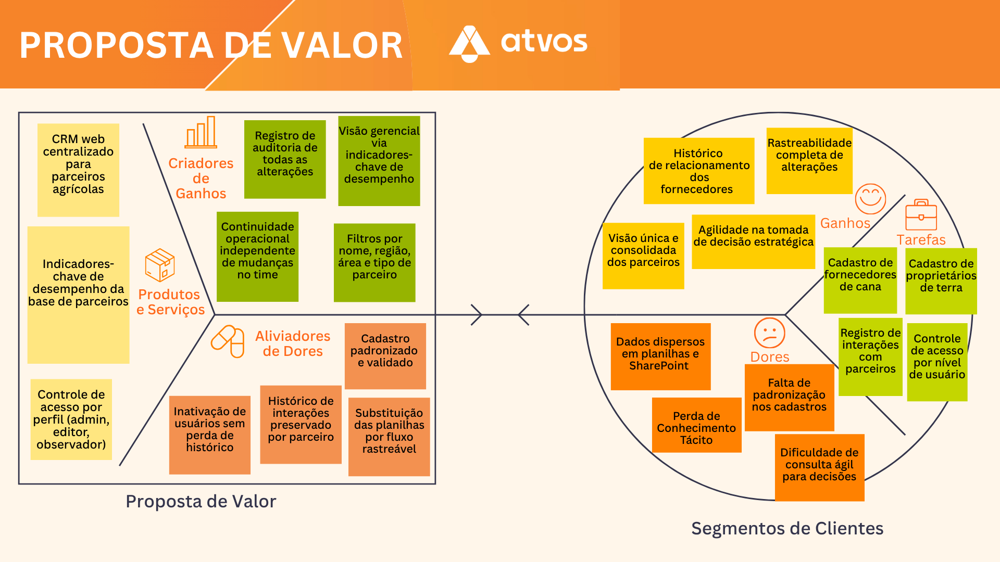<br>
  <sup>Fonte: Material produzido pelos autores, 2026.</sup>
</div><br>

---

#### 1. O Perfil do Cliente

O segmento-cliente é composto pelos coordenadores de campo e gerentes regionais da ATVOS que atuam na área de Negócios Agrícolas. O trabalho diário desses profissionais envolve manter o relacionamento com parceiros estratégicos (fornecedores de cana-de-açúcar e proprietários de terra) ao longo das safras, garantindo a continuidade dos contratos e a qualidade das informações para a tomada de decisão. No entanto, o modelo atual de gestão apresenta limitações estruturais que comprometem diretamente esse trabalho.

**Tarefas do Cliente**

As principais atividades que esse profissional precisa realizar são: cadastrar e manter atualizados os dados de fornecedores de cana e proprietários de terra; registrar e consultar o histórico de interações com cada parceiro; acessar rapidamente perfis e informações relevantes para negociações; e controlar quem da equipe pode visualizar ou editar cada informação.

**Dores**

A maior frustração é a dispersão dos dados em planilhas, e-mails e anotações individuais, sem qualquer padronização. Na prática, um coordenador que precisa consultar o histórico de um parceiro antes de uma visita de renovação contratual frequentemente não encontra registros organizados — ou depende de ligar para o colega que tratou o assunto anteriormente. Quando um profissional sai da equipe, o histórico vai junto. Além disso, a falta de padronização nos cadastros dificulta a consulta ágil, gera retrabalho constante e expõe informações sensíveis a acessos não controlados.

**Ganhos Esperados**

Esse profissional espera ter uma visão única e confiável de todos os parceiros, com o histórico de relacionamento preservado independentemente de mudanças no time. Espera também agilidade na consulta de dados para suportar decisões estratégicas e rastreabilidade completa de todas as alterações realizadas no sistema.

---

#### 2. O Mapa de Valor

Para responder diretamente à realidade desse cliente, a solução proposta é um CRM web desenvolvido sob medida para a área de Negócios Agrícolas da ATVOS. A aplicação é estruturada em torno de três pilares: o cadastro centralizado de parceiros, o histórico rastreável de interações e o controle de acesso por perfil. Juntos, esses pilares substituem o modelo fragmentado atual por um fluxo estruturado, padronizado e auditável de informações.

**Produtos e Serviços**

A solução entrega: um CRM web centralizado para gestão de parceiros agrícolas; indicadores-chave de desempenho da base de parceiros para suporte gerencial; exportação de listas de contatos para uso externo ao sistema; e controle de acesso segmentado por perfil: administrador, analista e coordenador.

**Aliviadores de Dor**

Para eliminar a dependência do conhecimento individual, o sistema preserva o histórico de interações por parceiro de forma permanente e cronológica. Para acabar com a despadronização, o cadastro conta com campos validados e obrigatórios que garantem consistência nos dados. A substituição das planilhas por um fluxo rastreável resolve a fragmentação, e a inativação de usuários sem exclusão de histórico mantém o controle de acesso sem perda de informações.

**Criadores de Ganho**

O sistema permite filtrar parceiros por nome, região, área e tipo, reduzindo o tempo de busca. A visão gerencial via indicadores-chave de desempenho entrega consolidação dos dados sem exportações manuais. O registro de auditoria de todas as alterações garante rastreabilidade completa. O acesso centralizado via navegador, sem instalação, torna o sistema acessível de qualquer ponto. Por fim, a continuidade operacional independente de mudanças no time é o ganho mais estratégico da solução: o relacionamento com o parceiro deixa de estar na memória do analista e passa a estar no sistema.


---

#### Conclusão do Alinhamento

O problema central da ATVOS é mais relacional do que transacional: o risco não está em não ter dados, mas em perdê-los quando a equipe muda. A solução responde diretamente a essa dor ao tornar o histórico de relacionamento um ativo institucional, e não individual. Cada funcionalidade entregue, do cadastro padronizado ao controle de acesso, foi definida a partir de uma dor ou ganho identificado no canvas, o que garantiu que o escopo do MVP fosse construído com foco real no valor percebido pelo usuário.


### 2.1.5. Matriz de Riscos do Projeto (sprint 1)

A matriz de riscos é uma ferramenta fundamental de gestão de projetos, utilizada para identificar, classificar e planejar respostas a eventos que possam impactar negativamente (ameaças) ou positivamente (oportunidades) o desenvolvimento da aplicação Web. Ela permite visualizar, de forma estruturada, os principais riscos do projeto, avaliando sua probabilidade de ocorrência e o impacto potencial sobre os resultados. A análise e o acompanhamento contínuo desses riscos são essenciais para garantir a entrega do MVP no prazo, com qualidade e alinhamento aos objetivos do grupo.

#### 2.1.5.1 Classificação de Impacto, Probabilidade e Matriz de Risco

Os critérios de classificação de impacto seguem uma escala de cinco níveis: Muito Baixo (impacto desprezível sobre prazo, escopo ou qualidade), Baixo (impacto isolado e facilmente contornável), Médio (impacto moderado que exige esforço de mitigação), Alto (impacto significativo sobre a entrega do MVP ou a satisfação do parceiro) e Muito Alto (impacto crítico que pode inviabilizar o projeto ou causar dano grave ao parceiro). A probabilidade segue escala análoga: Muito Baixa (evento improvável dado o contexto atual), Baixa, Média, Alta e Muito Alta (evento esperado se nenhuma ação preventiva for tomada). A combinação de impacto e probabilidade determina o nível de criticidade de cada risco na matriz, orientando a priorização das respostas.


<div align="center">
  <sub>Figura 2.1.5.1 - Classificação de Impacto</sub><br>
  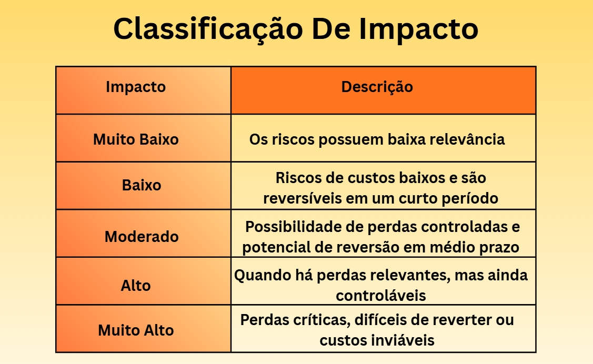<br>
  <sup>Fonte: Material produzido pelos autores, 2026.</sup>
</div>

<div align="center">
  <sub>Figura 2.1.5.2 - Classificação de Probabilidade</sub><br>
  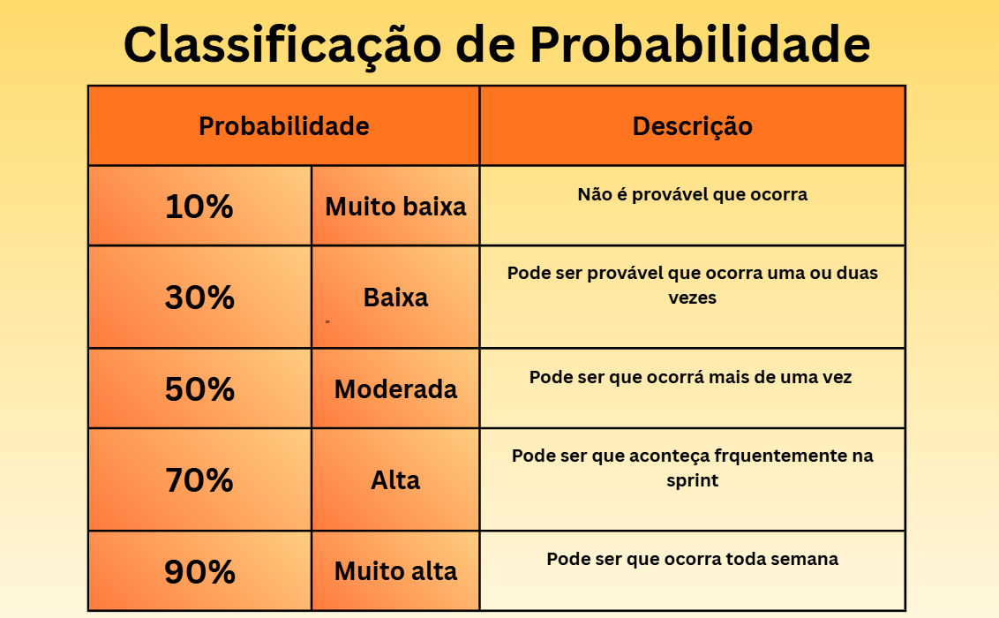<br>
  <sup>Fonte: Material produzido pelos autores, 2026.</sup>
</div>

<div align="center">
  <sub>Figura 2.1.5.3 - Matriz de Risco</sub><br>
  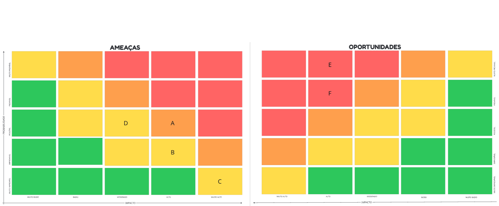<br>
  <sup>Fonte: Material produzido pelos autores, 2026.</sup>
</div>

#### 2.1.5.2 Lista de Riscos (Ameaças)

##### A. Informações não atualizadas

Há o risco das informações sobre os parceiros não serem mantidas atualizadas após o cadastro inicial, comprometendo a confiabilidade do sistema como fonte única de verdade.

**Responsáveis:** Antônio, Gabriel, Haila, João, Mariana, Tiago, William

**Impacto:** Alto

**Probabilidade:** Média

**Plano de Resposta ao Risco:** Implementar alertas automáticos para cadastros sem atualização há mais de 90 dias; validar a consistência dos dados em testes de integração durante o desenvolvimento; e estabelecer com a ATVOS um responsável interno pelo monitoramento periódico da base após a entrega do MVP.

##### B. Atraso na entrega do MVP

Atrasos nas funcionalidades da aplicação web podem comprometer a entrega ao parceiro no prazo acordado.

**Responsáveis:** Antônio, Gabriel, Haila, João, Mariana, Tiago, William

**Impacto:** Alto

**Probabilidade:** Baixa

**Plano de Resposta ao Risco:** Manter divisão de tarefas equilibrada com acompanhamento semanal de progresso; priorizar funcionalidades core (cadastro, histórico, controle de acesso) nas primeiras sprints; e acionar plano de contingência de redistribuição de tarefas caso algum membro enfrente impedimento técnico ou de disponibilidade.

##### C. Exposição de dados confidenciais

As informações dos parceiros e fornecedores da ATVOS não devem ser expostas, visto que é conteúdo estratégico e restrito da empresa.

**Responsáveis:** Antônio, Gabriel, Haila, João, Mariana, Tiago, William

**Impacto:** Muito Alto

**Probabilidade:** Baixa

**Plano de Resposta ao Risco:** Não publicar o sistema em URL pública sem controle de acesso; manter arquivos de dados reais fora do repositório git, utilizando dados anonimizados para desenvolvimento e testes; revisar permissões de acesso ao repositório antes de cada entrega; e registrar formalmente o protocolo de manuseio de dados confidenciais com o time.

##### D. UX inadequada

Interfaces pouco intuitivas podem inviabilizar o uso pela equipe da ATVOS, que precisa de consulta rápida ao perfil de parceiros.

**Responsáveis:** Antônio, Gabriel, Haila, João, Mariana, Tiago, William

**Impacto:** Médio

**Probabilidade:** Média

**Plano de Resposta ao Risco:** Realizar testes de usabilidade com pelo menos 5 usuários representativos do perfil da ATVOS, registrando erros, hesitações e tempo de conclusão de tarefas; incorporar os resultados em ciclo de melhoria antes da entrega final; e validar protótipos de tela com a orientação da professora de UX ao longo das sprints.

#### 2.1.5.3 Lista de Riscos (Oportunidades)

##### E. Eliminação de planilhas

A centralização dos dados de parceiros facilita muito para a ATVOS, diminuindo o tempo de trabalho deles e eliminando a perda de histórico de informações dos parceiros e produtores.

**Responsáveis:** Antônio, Gabriel, Haila, João, Mariana, Tiago, William

**Impacto:** Alto

**Probabilidade:** Muito Alta

**Plano de Resposta ao Risco:** Demonstrar a qualidade do projeto durante a apresentação do MVP, comparando o tempo médio de consulta entre o modelo de planilhas e a aplicação, e documentando a redução de etapas operacionais para tarefas-chave como cadastro e consulta de histórico.

##### F. Fortalecimento do relacionamento com parceiro

Com o histórico de interações centralizado e acessível para a ATVOS, ela pode personalizar o relacionamento com fornecedores e parceiros, fortalecendo a fidelidade a longo prazo.

**Responsáveis:** Antônio, Gabriel, Haila, João, Mariana, Tiago, William

**Impacto:** Alto

**Probabilidade:** Alta

**Plano de Resposta ao Risco:** Priorizar a funcionalidade de registro e consulta do histórico de interações nas primeiras sprints do MVP, garantindo que o módulo esteja funcional e validado com usuários reais antes das funcionalidades secundárias.

---

A matriz de riscos permite à equipe antecipar ameaças, planejar respostas e aproveitar oportunidades. O acompanhamento dos riscos contribui para a organização do grupo, a entrega do MVP no prazo e a elevação da qualidade do produto. Aliada à comunicação eficiente e à definição clara de responsabilidades, é fundamental para o sucesso da aplicação web.

## 2.2. Personas (sprint 1)

Personas são representações fictícias dos usuários da aplicação, construídas com base nas informações coletadas durante entrevistas e workshops com os clientes. Elas são um recurso fundamental para que as equipes de desenvolvimento, design e marketing se sensibilizem com o usuário, entendam suas dores e expectativas e moldem uma solução voltada para quem realmente vai usá-la. No presente projeto, foram construídas três personas (apresentadas nas figuras 2.2.1, 2.2.2 e 2.2.3), com base nas informações coletadas durante o workshop com o parceiro (ATVOS) e no mapeamento dos perfis envolvidos na problemática. As personas representam os principais usuários internos da aplicação: o analista responsável pelo cadastro e atualização dos dados, a coordenadora responsável pela consulta e análise gerencial, e o gerente responsável pela governança de acessos e supervisão da base.

<div align="center">
  <sub>Figura 2.2.1 - Persona 1: Juliano Soares</sub><br>
  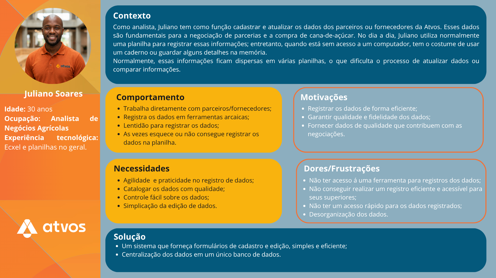<br>
  <sup>Fonte: Material produzido pelos autores, 2026. (Imagem de pessoa produzida por IA generativa)</sup>
</div><br>

<div align="center">
  <sub>Figura 2.2.2 - Persona 2: Bianca Souza</sub><br>
  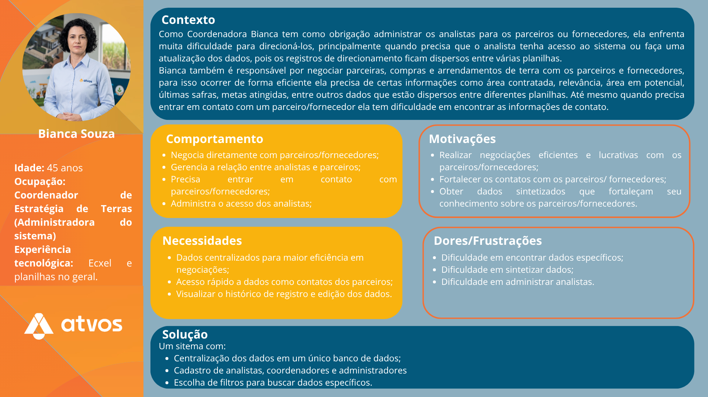<br>
  <sup>Fonte: Material produzido pelos autores, 2026. (Imagem de pessoa produzida por IA generativa)</sup>
</div><br>

<div align="center">
  <sub>Figura 2.2.3 - Persona 3: Marcelo Andrade</sub><br>
  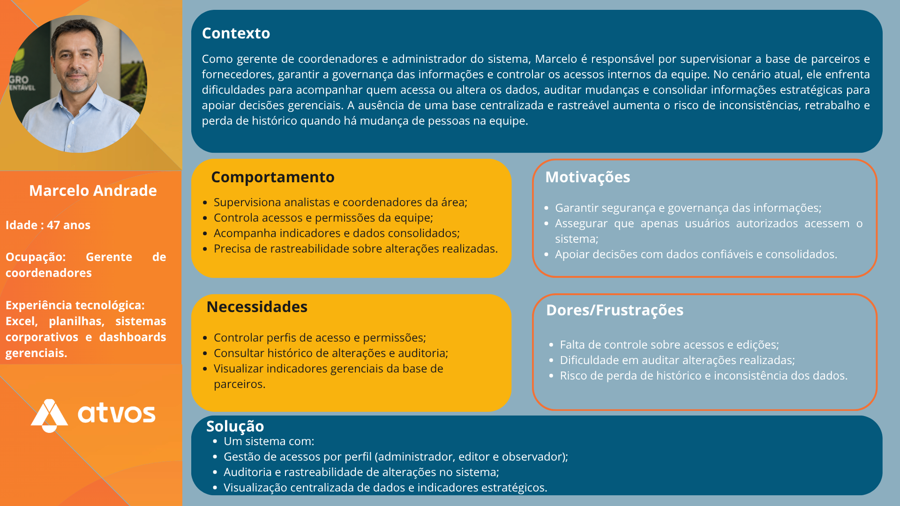<br>
  <sup>Fonte: Material produzido pelos autores, 2026. (Imagem de pessoa produzida por IA generativa)</sup>
</div><br>

| Persona | Papel no sistema | Dores principais | Necessidades | Relação com a solução |
|---|---|---|---|---|
| Juliano Soares | Editor / Analista de Negócios Agrícolas | Perde tempo buscando informações dispersas em planilhas e e-mails, correndo o risco de trabalhar com dados desatualizados ou duplicados, o que compromete a confiabilidade dos registros. | Ter um ponto central e confiável para registrar e atualizar dados de parceiros, de modo que possa trabalhar com informações sempre corretas sem depender de fontes fragmentadas. | Usa o sistema para centralizar cadastros, atualizar informações e registrar interações com parceiros. |
| Bianca Souza | Observadora / Coordenadora de Estratégia de Terras | Chega a reuniões e negociações sem visão completa do portfólio, pois precisa consolidar manualmente dados de fontes distintas, o que reduz a qualidade das decisões estratégicas. | Acessar rapidamente uma visão consolidada e atualizada dos parceiros para embasar decisões estratégicas e conduzir negociações com informação confiável. | Usa o sistema para análise gerencial, consulta de dados e acompanhamento da base de parceiros. |
| Marcelo Andrade | Administrador do Sistema / Gerente de coordenadores | Não consegue rastrear quem alterou dados críticos nem revogar acessos com agilidade, expondo a empresa a inconsistências e a riscos de uso indevido das informações. | Saber exatamente quem pode acessar e alterar dados, e ter rastreabilidade suficiente para identificar e corrigir inconsistências antes que causem problemas operacionais. | Usa o sistema para garantir governança, segurança, rastreabilidade e controle de acesso. |

Ao analisar as três personas do projeto, observa-se que suas dores possuem uma mesma origem: a descentralização dos dados dos parceiros e fornecedores. No entanto, essa problemática impacta cada perfil de forma distinta. O analista é afetado pelo retrabalho operacional no cadastro e atualização das informações; a coordenadora é impactada pela dificuldade de consulta, análise e acompanhamento dos parceiros; e o administrador enfrenta riscos relacionados ao controle de acesso, auditoria e governança da base. Dessa forma, a solução deve contemplar funcionalidades operacionais, analíticas e administrativas para sustentar a gestão do relacionamento agrícola da ATVOS.


## 2.3. User Stories (sprints 1 a 5)

---

User Stories são descrições simples de funcionalidades escritas do ponto de vista do usuário, no formato "como [perfil], posso [ação], para [benefício]". Para garantir a qualidade de cada história, foi aplicado o método INVEST, que avalia se a história é Independente, Negociável, Valiosa, Estimável, Pequena e Testável. As User Stories a seguir estão ordenadas por prioridade de desenvolvimento.

---

Identificação | US01
--- | ---
Persona | Juliano Soares — Analista de Negócios Agrícolas
Prioridade | Alta
User Story | "Como analista de negócios agrícolas, posso cadastrar fornecedores de cana salvando o registro como rascunho e enviando para validação, para que os dados de cada agricultor parceiro sejam revisados e ativados de forma padronizada no sistema."
Critério de aceite 1 | CR1: Dado que o analista está autenticado e acessa o formulário de cadastro de fornecedor de cana, quando preenche os campos disponíveis e salva como rascunho, então o registro é persistido com status rascunho e fica disponível na seção de rascunhos do analista.
Critério de aceite 2 | CR2: Dado que o analista concluiu o preenchimento do formulário de fornecedor de cana, quando aciona o envio para validação, então o registro muda para status pendente e aparece na fila de validação do coordenador.
Critérios INVEST | Independente: pode ser desenvolvida sem depender do cadastro de proprietários ou de interações. Negociável: os campos do formulário podem ser revistos com a equipe da ATVOS sem alterar o objetivo central. Valiosa: resolve diretamente a dispersão dos dados de fornecedores em planilhas, centralizando as informações em um único sistema com fluxo de validação rastreável. Estimável: envolve formulário, validação, persistência e fluxo de status, com escopo claro para estimar o esforço. Pequena: abrange apenas o fluxo de criação e envio de um novo fornecedor de cana para validação, sem integrações externas. Testável: verifica-se se o registro aparece como rascunho após salvar e se muda para pendente após o envio para validação.

---

Identificação | US02
--- | ---
Persona | Juliano Soares — Analista de Negócios Agrícolas
Prioridade | Alta
User Story | "Como analista de negócios agrícolas, posso cadastrar proprietários de terra salvando o registro como rascunho e enviando para validação, para que os dados de cada proprietário parceiro sejam revisados e ativados de forma padronizada no sistema."
Critério de aceite 1 | CR1: Dado que o analista está autenticado e acessa o formulário de cadastro de proprietário de terra, quando preenche os campos disponíveis e salva como rascunho, então o registro é persistido com status rascunho e fica disponível na seção de rascunhos do analista.
Critério de aceite 2 | CR2: Dado que o analista concluiu o preenchimento do formulário de proprietário de terra, quando aciona o envio para validação, então o registro muda para status pendente e aparece na fila de validação do coordenador.
Critérios INVEST | Independente: pode ser desenvolvida em paralelo à US01, com formulário e lógica próprios para o perfil de proprietário. Negociável: os campos podem ser ajustados conforme as necessidades da área de Estratégia de Terras. Valiosa: centraliza os dados de proprietários que hoje estão dispersos em planilhas, eliminando retrabalho e padronizando o cadastro com fluxo de validação. Estimável: reutiliza a estrutura da US01 com campos distintos para o perfil de proprietário, com esforço bem delimitado. Pequena: escopo restrito ao fluxo de criação e envio de um proprietário de terra para validação. Testável: verifica-se se o registro aparece como rascunho após salvar e se muda para pendente após o envio para validação.

---

Identificação | US03
--- | ---
Persona | Juliano Soares — Analista de Negócios Agrícolas
Prioridade | Alta
User Story | "Como analista de negócios agrícolas, posso registrar o histórico de interações com parceiros, para que o relacionamento seja documentado e acessível a toda a equipe."
Critério de aceite 1 | CR1: Dado que o analista está autenticado e acessa o perfil de um parceiro com status ativo, quando preenche os campos de interação (data, tipo e descrição) e confirma, então a interação é salva e exibida no histórico do parceiro em ordem cronológica.
Critério de aceite 2 | CR2: Dado que o analista registrou uma ou mais interações com um parceiro, quando acessa o histórico desse parceiro, então todos os registros são exibidos com data, tipo e descrição visíveis, e a interação mais recente aparece no topo da lista.
Critérios INVEST | Independente: pode ser construída separadamente das funcionalidades de visualização e filtro, com lógica própria de persistência. Negociável: os tipos de interação e os campos do formulário podem ser ajustados conforme o fluxo de trabalho real da equipe. Valiosa: resolve a perda de histórico de relacionamento, uma das principais dores identificadas no briefing da ATVOS. Estimável: envolve formulário de registro e listagem cronológica, com escopo claro e bem delimitado. Pequena: funcionalidade focada em um único fluxo, registrar e listar interações por parceiro. Testável: verifica-se se a interação registrada aparece no histórico do parceiro correto e na ordem cronológica esperada.

---

Identificação | US04
--- | ---
Persona | Bianca Souza — Coordenadora de Estratégia de Terras
Prioridade | Alta
User Story | "Como coordenadora de estratégia de terras, posso visualizar o perfil detalhado de cada parceiro com status ativo, para que eu possa consultar rapidamente as informações necessárias para a tomada de decisão."
Critério de aceite 1 | CR1: Dado que a coordenadora está autenticada e visualiza a listagem de parceiros com status ativo, quando clica em um parceiro, então o sistema exibe todos os dados cadastrais e o histórico de interações na tela de perfil.
Critério de aceite 2 | CR2: Dado que a coordenadora acessa a tela de perfil de um parceiro ativo, quando a página é carregada, então todos os dados são exibidos em até 3 segundos, conforme o requisito de desempenho definido.
Critérios INVEST | Independente: a tela de visualização pode ser prototipada e desenvolvida antes mesmo de todas as funcionalidades de edição estarem concluídas. Negociável: o layout e as informações exibidas no perfil podem ser ajustados com base no feedback dos usuários internos. Valiosa: permite que coordenadoras consultem dados de parceiros ativos de forma centralizada, eliminando a necessidade de buscar planilhas dispersas. Estimável: tela somente de leitura, sem formulários complexos, com esforço menor que as User Stories de edição. Pequena: escopo limitado a exibir dados de parceiros ativos de forma organizada e legível. Testável: verifica-se se todos os dados do parceiro ativo são exibidos corretamente e se o tempo de carregamento está dentro do limite definido.

---

Identificação | US05
--- | ---
Persona | Juliano Soares — Analista de Negócios Agrícolas
Prioridade | Alta
User Story | "Como analista de negócios agrícolas, posso editar os dados cadastrais de parceiros com status rascunho, devolvido ou ativo, para que as informações estejam sempre atualizadas e confiáveis para a equipe."
Critério de aceite 1 | CR1: Dado que o analista está autenticado e acessa o perfil de um parceiro com status rascunho, devolvido ou ativo, quando altera um ou mais dados cadastrais e confirma, então as mudanças são salvas, o sistema registra data, hora e usuário responsável, e a versão anterior é preservada no histórico.
Critério de aceite 2 | CR2: Dado que o analista tenta editar um parceiro com status excluído, quando tenta acessar a opção de edição, então o sistema bloqueia a ação e exibe mensagem informando que o registro não pode ser editado neste status.
Critérios INVEST | Independente: pode ser desenvolvida em paralelo às User Stories de cadastro, compartilhando o formulário com lógica de edição. Negociável: os campos editáveis e as regras de validação podem ser revistos conforme o feedback dos usuários. Valiosa: garante que as informações dos parceiros reflitam a realidade atual, mantendo a confiabilidade e a rastreabilidade dos dados no sistema. Estimável: reutiliza a interface das User Stories de cadastro com adaptações para edição e controle de status, com esforço bem delimitado. Pequena: fluxo limitado a buscar, alterar e salvar dados de um parceiro existente com status compatível. Testável: verifica-se se as alterações são salvas com rastreabilidade e se a edição é bloqueada para registros excluídos.

---

Identificação | US06
--- | ---
Persona | Bianca Souza — Coordenadora de Estratégia de Terras
Prioridade | Média
User Story | "Como coordenadora de estratégia de terras, posso filtrar a lista de parceiros ativos por nome, região, área ou tipo de parceiro, para que eu encontre rapidamente o parceiro que procuro sem precisar percorrer toda a lista."
Critério de aceite 1 | CR1: Dado que a coordenadora está autenticada e visualiza a listagem de parceiros com status ativo, quando aplica um ou mais filtros (nome, região, área ou tipo de parceiro), então a listagem exibe apenas os parceiros ativos que correspondem ao critério selecionado.
Critério de aceite 2 | CR2: Dado que a coordenadora aplicou um filtro na listagem de parceiros ativos, quando adiciona um segundo critério de filtro, então o resultado é atualizado combinando os dois filtros sem necessidade de recarregar a página.
Critérios INVEST | Independente: pode ser implementada de forma isolada após a listagem básica de parceiros ativos estar disponível, sem depender de funcionalidades de edição ou cadastro. Negociável: os critérios de filtro (nome, região, área, tipo de parceiro) podem ser ajustados conforme as prioridades operacionais da equipe da ATVOS. Valiosa: reduz o tempo de busca por parceiros ativos específicos, aumentando a eficiência da coordenadora na consulta e na tomada de decisão. Estimável: envolve parâmetros de consulta ao banco de dados sobre registros já existentes, sem lógica de negócio complexa. Pequena: funcionalidade restrita à aplicação de filtros sobre a listagem de parceiros ativos, sem impacto nas funcionalidades de edição ou cadastro. Testável: verifica-se se, ao aplicar um filtro, apenas os parceiros ativos correspondentes ao critério selecionado são exibidos na listagem.

---

Identificação | US07
--- | ---
Persona | Bianca Souza — Coordenadora de Estratégia de Terras
Prioridade | Média
User Story | "Como coordenadora de estratégia de terras, posso exportar a lista de contatos dos parceiros ativos, para que eu possa compartilhar informações com pessoas que não têm acesso ao sistema."
Critério de aceite 1 | CR1: Dado que a coordenadora está autenticada e acessa a funcionalidade de exportação, quando aciona a exportação da lista de contatos, então o sistema gera um arquivo contendo nome, contato, tipo e região de cada parceiro com status ativo.
Critério de aceite 2 | CR2: Dado que o sistema gerou o arquivo de exportação, quando a coordenadora faz o download e abre o arquivo, então o arquivo está em formato CSV ou XLSX e pode ser aberto sem erros em ferramentas de planilha.
Critérios INVEST | Independente: pode ser desenvolvida separadamente das funcionalidades de filtro, com lógica própria de geração de arquivo. Negociável: o formato do arquivo exportado (CSV ou XLSX) e os campos incluídos podem ser definidos conforme as necessidades da equipe e os sistemas de destino utilizados pela ATVOS. Valiosa: permite que informações dos parceiros ativos sejam compartilhadas com pessoas sem acesso ao sistema, ampliando o alcance dos dados sem comprometer o controle de acesso interno. Estimável: envolve consulta ao banco de dados e geração de arquivo estruturado, com lógica bem delimitada e sem dependências externas. Pequena: funcionalidade restrita à exportação de uma lista de contatos de parceiros ativos já existente no sistema. Testável: verifica-se se o arquivo gerado contém todos os dados esperados de parceiros ativos, está no formato correto e pode ser aberto sem erros em ferramentas de planilha.

---

Identificação | US08
--- | ---
Persona | Marcelo Andrade — Gerente de Coordenadores
Prioridade | Alta
User Story | "Como gerente de coordenadores, posso cadastrar usuários com perfis de acesso definidos, para que o sistema seja utilizado de forma segura e com acessos controlados."
Critério de aceite 1 | CR1: Dado que o gerente de coordenadores está autenticado e acessa o formulário de cadastro de usuário, quando preenche nome, e-mail e perfil de acesso (gerente de coordenadores, analista de negócios agrícolas ou coordenador de estratégia de terras) e confirma, então o usuário é salvo e exibido na listagem com status ativo.
Critério de aceite 2 | CR2: Dado que o gerente de coordenadores está no formulário de cadastro de usuário, quando tenta cadastrar um e-mail já existente no sistema, então uma mensagem de erro é exibida e o cadastro não é concluído.
Critérios INVEST | Independente: pode ser desenvolvida antes de qualquer funcionalidade de gestão de parceiros, pois define os acessos que viabilizam o uso do restante do sistema. Negociável: os campos do formulário de cadastro e os perfis de acesso disponíveis podem ser revistos conforme as políticas internas de TI e segurança da informação da ATVOS. Valiosa: garante que apenas usuários autorizados acessem o sistema, atendendo aos requisitos de segurança e controle de acesso definidos para o projeto. Estimável: envolve formulário de cadastro com atribuição de perfil e persistência no banco de dados, com escopo claro e bem delimitado. Pequena: fluxo restrito ao cadastro e atribuição de perfil de acesso de um único usuário, sem integrações externas. Testável: verifica-se se o usuário cadastrado consegue realizar login e acessa apenas as funcionalidades correspondentes ao seu perfil de acesso.

---

Identificação | US09
--- | ---
Persona | Marcelo Andrade — Gerente de Coordenadores
Prioridade | Alta
User Story | "Como gerente de coordenadores, posso inativar usuários do sistema, para que colaboradores que saíram da equipe não tenham mais acesso às informações da ATVOS."
Critério de aceite 1 | CR1: Dado que o gerente de coordenadores está autenticado e acessa o cadastro de um usuário ativo, quando aciona a inativação e confirma, então o usuário perde o acesso imediatamente, as sessões ativas são encerradas e não consegue realizar login no sistema.
Critério de aceite 2 | CR2: Dado que um usuário foi inativado, quando o gerente de coordenadores consulta o registro desse usuário, então o registro é exibido com status inativo e o histórico de ações é preservado, sem exclusão de dados.
Critérios INVEST | Independente: pode ser desenvolvida logo após o cadastro de usuários (US08), com lógica própria de atualização de status no banco de dados. Negociável: o comportamento da inativação, como o encerramento imediato de sessão e a preservação do histórico de ações, pode ser refinado conforme as políticas internas da ATVOS. Valiosa: garante que ex-colaboradores não mantenham acesso às informações sensíveis do sistema, reduzindo riscos de segurança sem a necessidade de excluir registros históricos. Estimável: envolve atualização de status no banco de dados e invalidação de sessão ativa, com esforço bem delimitado. Pequena: funcionalidade restrita à alteração do status do usuário para inativo, sem exclusão de dados ou impacto em outros módulos. Testável: verifica-se se o usuário inativado não consegue realizar login e se o histórico de ações permanece acessível para fins de auditoria.

---

Identificação | US10
--- | ---
Persona | Marcelo Andrade — Gerente de Coordenadores
Prioridade | Alta
User Story | "Como gerente de coordenadores, posso editar os dados de usuários cadastrados, para que as informações e permissões de acesso estejam sempre corretas e atualizadas no sistema."
Critério de aceite 1 | CR1: Dado que o gerente de coordenadores está autenticado e acessa o perfil de um usuário ativo, quando altera os dados (nome, e-mail ou perfil de acesso) e confirma, então as mudanças são salvas, o sistema registra data, hora e responsável pela alteração, e o usuário atualizado aparece na listagem.
Critério de aceite 2 | CR2: Dado que o gerente de coordenadores tenta alterar o e-mail de um usuário para um já cadastrado por outro usuário, quando confirma a alteração, então o sistema exibe mensagem de erro informando duplicidade e não persiste a alteração.
Critérios INVEST | Independente: pode ser desenvolvida logo após o cadastro de usuários (US08), compartilhando a interface do formulário com adaptações para edição. Negociável: os campos editáveis e as regras de validação podem ser revistos conforme as políticas internas de TI e segurança da ATVOS. Valiosa: permite que o gerente mantenha os dados dos usuários sempre corretos, garantindo que os perfis de acesso reflitam as responsabilidades atuais de cada colaborador. Estimável: reutiliza o formulário de cadastro com lógica de edição e validação de unicidade de e-mail, com esforço bem delimitado. Pequena: fluxo restrito à alteração de dados de um usuário existente, sem impacto em outros módulos. Testável: verifica-se se as alterações são salvas com rastreabilidade e se a duplicidade de e-mail é corretamente bloqueada.

---

Identificação | US11
--- | ---
Persona | Bianca Souza — Coordenadora de Estratégia de Terras
Prioridade | Média
User Story | "Como coordenadora de estratégia de terras, posso validar registros de parceiros pendentes aprovando ou devolvendo com comentário, para que apenas dados corretos e revisados sejam ativados no sistema."
Critério de aceite 1 | CR1: Dado que a coordenadora está autenticada e acessa a fila de validação com registros pendentes, quando seleciona um registro e aciona a aprovação, então o status do registro muda para ativo, o registro passa a aparecer nas consultas do sistema e o analista responsável é notificado.
Critério de aceite 2 | CR2: Dado que a coordenadora identifica inconsistências em um registro pendente, quando aciona a devolução e preenche um comentário, então o status muda para devolvido, o analista responsável é notificado com o comentário e o registro sai da fila de validação.
Critérios INVEST | Independente: pode ser desenvolvida após o fluxo de envio para validação (US01 e US02) estar implementado, com lógica própria de transição de status. Negociável: os critérios de revisão e o formato do comentário de devolução podem ser ajustados conforme o fluxo de trabalho real da equipe de coordenação. Valiosa: garante que apenas registros revisados e aprovados pela coordenação se tornem ativos no sistema, mantendo a qualidade e a confiabilidade dos dados. Estimável: envolve transição de status, notificação ao analista e persistência de comentário, com escopo bem delimitado. Pequena: fluxo restrito à revisão e aprovação ou devolução de um registro pendente por vez. Testável: verifica-se se o registro aprovado aparece como ativo nas consultas e se o registro devolvido retorna ao analista com o comentário visível.

---

Identificação | US12
--- | ---
Persona | Juliano Soares — Analista de Negócios Agrícolas
Prioridade | Média
User Story | "Como analista de negócios agrícolas, posso visualizar meus rascunhos e registros devolvidos com o comentário do coordenador, para que eu saiba quais cadastros preciso corrigir ou concluir."
Critério de aceite 1 | CR1: Dado que o analista está autenticado e acessa a seção de rascunhos, quando a página é carregada, então o sistema exibe todos os registros com status rascunho e devolvido vinculados ao analista logado, com nome do parceiro, status e data da última atualização.
Critério de aceite 2 | CR2: Dado que o analista seleciona um registro com status devolvido, quando a tela de perfil é carregada, então o comentário do coordenador é exibido em destaque junto aos dados do parceiro, permitindo identificar o que precisa ser corrigido.
Critérios INVEST | Independente: pode ser desenvolvida após o cadastro e envio para validação (US01 e US02) estarem implementados, com lógica própria de consulta filtrada por usuário e status. Negociável: os campos exibidos na listagem de rascunhos e o formato de destaque do comentário podem ser ajustados conforme o feedback dos analistas. Valiosa: permite que o analista retome cadastros incompletos ou corrija registros devolvidos sem perder o contexto, reduzindo retrabalho e aumentando a rastreabilidade do fluxo de validação. Estimável: envolve consulta filtrada ao banco de dados por usuário e status, com exibição de listagem e detalhes do registro, com esforço bem delimitado. Pequena: funcionalidade restrita à visualização de registros próprios com status rascunho ou devolvido, sem lógica de edição embutida. Testável: verifica-se se apenas os rascunhos do analista logado são exibidos e se o comentário do coordenador aparece em destaque nos registros devolvidos.

---

As User Stories levantadas cobrem os fluxos essenciais para resolver a principal dor identificada pela ATVOS: a dispersão dos dados de fornecedores de cana e proprietários de terra em planilhas desconectadas. O fluxo de validação por status (rascunho, pendente, ativo, devolvido) garante rastreabilidade e governança das informações desde o cadastro. A priorização reflete esse objetivo, com as histórias de alta prioridade cobrindo os fluxos centrais de cadastro, edição e gestão de usuários, e as de prioridade média endereçando funcionalidades de consulta, filtro, exportação e validação que ampliam a utilidade e a governança do sistema.

# <a name="c3"></a>3. Projeto da Aplicação Web (sprints 1 a 5)

## 3.1. Requisitos do Sistema (sprints 1 a 5)

### 3.1.0.1 Minimundo do sistema (sprints 1 a 5)

O sistema proposto é uma aplicação web interna para apoio à gestão de parceiros agrícolas da ATVOS, com foco em fornecedores de cana-de-açúcar e proprietários de terra. Atualmente, essas informações estão dispersas em planilhas, o que dificulta a padronização dos cadastros, a preservação do histórico de relacionamento e a consulta rápida de dados relevantes para a tomada de decisão.

A aplicação centraliza os cadastros de parceiros agrícolas, permite o registro de interações, disponibiliza consultas filtradas. O sistema será utilizado por equipes internas ligadas à gestão agrícola, estratégia de terras e administração da base de usuários.

As entidades principais consideradas no minimundo são: usuários internos, parceiros agrícolas, fornecedores de cana, proprietários de terra, terras e propriedades, interações e registros de atualização. Entre essas entidades, estabelecem-se as seguintes relações: um parceiro agrícola pode estar associado a múltiplas terras, e uma terra pode estar associada a múltiplos parceiros; cada interação registrada é vinculada a um parceiro e a um usuário interno responsável; todo registro de atualização é associado ao usuário que realizou a alteração e ao registro modificado, preservando o histórico de versões anteriores.

A aplicação não substitui sistemas corporativos externos da ATVOS nem realiza integrações automáticas com SharePoint, ERP ou ferramentas financeiras nesta versão do MVP. O objetivo central é garantir uma base única, organizada, rastreável e consultável para apoiar a gestão dos relacionamentos agrícolas da empresa.

### 3.1.0.2 Atores e Responsabilidades Principais

| Ator | Responsabilidades principais | Permissões principais |
|---|---|---|
| Administrador do Sistema | Gerenciar usuários internos, definir perfis de acesso e inativar contas quando necessário. | Criar, editar, visualizar e inativar usuários; atribuir perfis de acesso. |
| Editor | Cadastrar e atualizar informações de parceiros agrícolas, fornecedores de cana e proprietários de terra. Registrar histórico de interações. | Criar e editar parceiros; registrar interações; consultar cadastros. |
| Observador | Consultar informações consolidadas sobre parceiros e apoiar a tomada de decisão com base nos dados disponíveis. | Visualizar lista de parceiros, acessar perfil detalhado, aplicar filtros e exportar listas. |
| Parceiro Agrícola | Representa o fornecedor de cana ou proprietário de terra cadastrado no sistema. Não acessa diretamente a aplicação no MVP. | Não possui acesso ao sistema; seus dados são gerenciados por usuários internos. |
| Sistema Web | Processar requisições, validar regras de negócio, persistir dados e retornar informações aos usuários conforme seu perfil de acesso. | Executar validações, controlar permissões, registrar dados e disponibilizar consultas. |
| Banco de Dados | Armazenar cadastros, usuários, interações, registros de atualização e informações históricas. | Persistir e recuperar dados conforme solicitado pelo backend. |

### 3.1.1. Requisitos Funcionais (sprint 1, refinar até sprint 5)

| ID    | Descrição                                                                                                                     | Prioridade | Status    |
| ----- | ------------------------------------------------------------------------------------------------------------------------------| ---------- | --------- |
| RF001 | O sistema deve permitir o cadastro de usuários com três perfis de acesso: administrador, analista e coordenador.                 | Alta       | Planejado |
| RF002 | O sistema deve permitir que o administrador crie, edite, visualize e inative usuários.                                        | Alta       | Planejado |
| RF003 | O sistema deve permitir que o administrador atribua um perfil de acesso a cada usuário cadastrado.                            | Alta       | Planejado |
| RF004 | O sistema deve permitir que o analista cadastre novos parceiros agrícolas.                                                      | Alta       | Planejado |
| RF005 | O sistema deve permitir que o analista edite dados cadastrais de parceiros agrícolas existentes.                                | Alta       | Planejado |
| RF006 | O sistema deve permitir que o analista registre dados de relacionamento e histórico de interações com parceiros agrícolas.      | Alta       | Planejado |
| RF007 | O sistema deve permitir que o coordenador visualize a lista de parceiros agrícolas cadastrados.                                | Alta       | Planejado |
| RF008 | O sistema deve permitir que o coordenador consulte o perfil detalhado de um parceiro agrícola.                                 | Alta       | Planejado |
| RF009 | O sistema deve rejeitar ou sinalizar registros duplicados com base nos seguintes identificadores únicos: CPF, CNPJ e e-mail.  | Alta       | Planejado |
| RF010 | O sistema deve verificar o preenchimento de campos obrigatórios antes dos registros serem enviados para a validação. Registros com o status rascunho podem ser salvos com dados incompletos.                                                                                                                            | Alta       | Planejado |
| RF011 | O sistema deve exigir autenticação via e-mail e senha para acesso.                                                            | Alta       | Planejado |
| RF012 | O sistema deve impedir que registros excluídos logicamente apareçam nas consultas e listagens normais.                        | Alta       | Planejado |
| RF013 | O sistema deve manter um histórico de versões de cada registro, permitindo a visualização de valores anteriores a cada edição.| Alta       | Planejado |
| RF014 | O sistema deve permitir que o administrador exclua registros de parceiros e terras de forma lógica.                           | Alta       | Planejado |
| RF015 | O sistema deve permitir associar múltiplos parceiros a uma mesma terra e múltiplas terras a um mesmo parceiro.                | Alta       | Planejado |
| RF016 | O sistema deve permitir a aplicação de filtros por nome, região, área contratada, potencial agrícola ou tipo de parceiro.     | Média      | Planejado |
| RF017 | O sistema deve permitir a exportação de listas básicas de contatos e parceiros.                                               | Média      | Planejado |
| RF018 | O sistema deve registrar a data de criação e última atualização de todos os registros do sistema.                             | Média      | Planejado |
| RF019 | O sistema deve registrar o usuário responsável por cada criação ou atualização de registro.                                   | Média      | Planejado |
| RF020 | O sistema deve definir o comportamento do sistema após a inativação de um usuário: acesso revogado imediatamente, sessão encerrada e histórico de ações preservado. | Alta      | Planejado |
| RF021 | O sistema deve permitir que o analista envie um registro para validação do coordenador.                                       | Alta        | Planejado |
| RF022 | O sistema deve exibir ao coordenador uma fila de registros pendentes de validação.                                            | Alta        | Planejado |
| RF023 | O sistema deve permitir que o coordenador edite, aprove ou devolva um registro pendente.                                      | Alta        | Planejado |
| RF024 | O sistema deve permitir upload de arquivos vinculados a um parceiro ou relatório.                                             | Média       | Planejado |
| RF025 | O sistema deve executar um processo automático periódico que identifica registros que não sofreram alterações por um período configurável e notifica o analista responsável e o coordenador vinculado.                                                                                                                              | Média       | Planejado |


### 3.1.2. Regras de Negócio (sprint 1, refinar até sprint 5)

| ID   | Descrição | RF associado |
|------|-----------|--------------|
| RN01 | Um usuário deve possuir um único e-mail associado (unicidade garantida no sistema). | RF001, RF002 |
| RN02 | Somente usuários cadastrados internamente podem acessar o sistema. | RF011 |
| RN03 | Existem três níveis de acesso: Analistas, Coordenadores e Gerentes. | RF001 |
| RN04 | Analistas podem visualizar registros com status ativo, podem criar e alterar registros com status rascunho e podem enviar esses registros com status rascunho para uma validação. | RF007, RF008 |
| RN05 | Coordenadores podem visualizar registros com status ativo e status pendente(registros enviados por analistas), podem alterar os registros com status pendente e transformar seus status em ativo. | RF004, RF005, RF006 |
| RN06 | Gerentes podem inserir, atualizar, excluir logicamente e visualizar registros em qualquer status, e também são responsáveis pelos cadastros de usuários. | RF002, RF003, RF014 |
| RN07 | A exclusão de dados é lógica: o registro não é apagado, apenas marcado como excluído. | RF012, RF014 |
| RN08 | Registros excluídos logicamente não devem aparecer em consultas padrão do sistema. | RF012 |
| RN09 | O sistema deve rejeitar registros duplicados com base nos identificadores únicos: CPF, CNPJ e e-mail. | RF009 |
| RN10 | Campos obrigatórios para parceiros e terras (nome, CPF/CNPJ, e-mail, tipo de parceiro, área em hectares, município e estado) não podem ser nulos em registros com status ativo (Registros com status rascunho podem ser salvos com campos incompletos). | RF010 |
| RN11 | Toda criação ou alteração de registro deve armazenar data, hora e o identificador do usuário responsável. | RF018, RF019 |
| RN12 | Alterações de dados devem manter versões anteriores disponíveis para consulta. | RF013 |
| RN13 | Um parceiro pode possuir múltiplas terras associadas. | RF015 |
| RN14 | Uma terra pode possuir múltiplos parceiros associados. | RF015 |
| RN15 | Ao inativar um usuário, o sistema deve revogar seu acesso imediatamente, encerrar sessões ativas e preservar o histórico de ações realizadas. | RF020 |
| RN16 | Um registro do tipo rascunho/devolvido só transita para status pendente após ser concluído por um analista. | RF021 |
| RN17 | Um registro do tipo pendente só transita para status ativo/devolvido após ser revisado por um coordenador. | RF022, RF023 |
| RN18 | Registros com status ativo que não sofreram alterações por um período configurado geram notificações para os usuários do sistema (analistas, coordenadores e gerentes). | RF025 |
| RN19 | Requisicoes de edicao de parceiro sem nenhum campo editavel no body devem ser rejeitadas com erro 400. | RF005 |
| RN20 | Tentativas de edicao de parceiros inexistentes devem ser rejeitadas com erro 404. | RF005 |

### 3.1.3. Requisitos Não Funcionais — 8 Eixos ISO/IEC 25010 (sprints 1 a 5)

Os Requisitos Não Funcionais (RNFs) definem os critérios de qualidade que o sistema deve atender para que os requisitos funcionais sejam úteis, confiáveis e sustentáveis no contexto de uso da ATVOS. Eles complementam os RFs ao estabelecer parâmetros de experiência, segurança, desempenho, manutenção, rastreabilidade e organização do produto.

Para este projeto, os RNFs foram organizados nos oito eixos definidos para a documentação da solução, tomando a ISO/IEC 25010 como referência e adaptando sua aplicação ao MVP do CRM agrícola. Os critérios abaixo foram formulados de modo verificável, com relação explícita aos fluxos principais: autenticação, gestão de usuários, cadastro e validação de parceiros, consulta por filtros, histórico de interações, vínculos com terras, exportação e dashboard.

| ID | Eixo | Requisito Não Funcional | Relação com RFs/fluxos principais | Critério de aceite / Forma de verificação |
|---|---|---|---|---|
| RNF-USAB-01 | Usabilidade | O sistema deve apresentar formulários de cadastro e edição com campos obrigatórios identificáveis, mensagens de erro compreensíveis e indicação visual de sucesso ou falha nas operações. | RF001, RF002, RF004, RF005, RF010, RF021, RF022, RF023; fluxos de cadastro de usuários, cadastro/edição de parceiros e validação. | Verificar por teste manual e/ou teste de interface os cenários de envio válido, campos obrigatórios ausentes, e-mail duplicado, CPF/CNPJ duplicado e transição de status inválida; o usuário deve compreender o motivo do erro sem consultar documentação técnica. |
| RNF-USAB-02 | Usabilidade | O sistema deve permitir que a listagem, os filtros e o perfil detalhado de parceiros sejam navegáveis em telas desktop e mobile sem sobreposição de informações críticas. | RF007, RF008, RF016, RF017; fluxos de listagem de parceiros, filtro por nome/região/área/tipo, perfil do parceiro e exportação. | Verificar as telas de login, listagem, filtros, detalhe, cadastro e exportação em largura desktop e mobile; botões, campos, tabelas e mensagens devem permanecer legíveis e acionáveis. |
| RNF-CONF-01 | Confiabilidade | O sistema deve validar dados de entrada antes da persistência, rejeitando payloads inválidos, identificadores duplicados e referências inexistentes. | RF004, RF005, RF009, RF010, RF015, RF018, RF019; fluxos de cadastro de usuários, parceiros, terras e vínculos parceiro-terra. | Executar testes automatizados de controllers e services para payload inválido, CPF/CNPJ/e-mail duplicado, usuário responsável inexistente, terra inexistente e parceiro inexistente; a API deve retornar erros controlados sem gravar dados inconsistentes. |
| RNF-CONF-02 | Confiabilidade | O sistema deve preservar a consistência dos fluxos de status, impedindo transições incompatíveis entre rascunho, pendente, ativo, devolvido e inativo. | RF012, RF021, RF022, RF023; fluxos de envio para validação, aprovação, devolução e exclusão lógica. | Executar testes automatizados para envio de rascunho/devolvido para pendente, aprovação de pendente para ativo, devolução de pendente para devolvido e bloqueio de transições inválidas; registros inativos não devem aparecer nas consultas padrão. |
| RNF-DESEMP-01 | Desempenho | As páginas e endpoints dos fluxos prioritários devem responder em até 3 segundos em ambiente local ou de homologação com base acadêmica de testes. | RF007, RF008, RF016, RF017; fluxos de listagem, filtros, perfil detalhado, dashboard e exportação. | Medir o tempo de resposta de `GET /api/parceiros`, `GET /api/parceiros/:id`, filtros combinados, `GET /dashboards/interacoes` e `GET /parceiros/exportar`; cada operação deve concluir em até 3 segundos sem travamento perceptível. |
| RNF-DESEMP-02 | Desempenho | As consultas de listagem e filtros devem delegar filtragem e ordenação ao banco de dados, evitando processamento desnecessário na camada de controller ou view. | RF007, RF012, RF016; fluxos de listagem de parceiros, listagem de terras e aplicação de filtros. | Revisar repositories e testes de filtros para confirmar uso de parâmetros de consulta, `WHERE`, ordenação e exclusão de inativos no banco; não deve haver filtragem principal feita manualmente após carregar todos os registros. |
| RNF-SUP-01 | Suportabilidade | Novas funcionalidades devem seguir a arquitetura em camadas documentada, separando rotas, controllers, services, repositories, schemas, models, errors e middlewares. | RF001 a RF023; todos os fluxos implementados na WebAPI. | Revisar a implementação de cada novo fluxo; regra de negócio deve ficar em service, acesso a banco em repository, validação em schema/controller e tratamento de falhas em errors/middleware. |
| RNF-SUP-02 | Suportabilidade | Cada endpoint ou fluxo relevante deve possuir documentação objetiva e, quando aplicável, testes automatizados de sucesso, erro e persistência. | RF001, RF004, RF005, RF006, RF007, RF008, RF013, RF015, RF016, RF017, RF020, RF021, RF022, RF023; fluxos cobertos na documentação da WebAPI e RTM. | Conferir a existência de documentação em `documentos/`, tabela de endpoints na seção 3.7 e testes em `src/tests` ou `src/test`; alterações futuras devem atualizar a RTM e a documentação correspondente. |
| RNF-SEG-01 | Segurança | O sistema deve exigir autenticação para acesso aos fluxos protegidos e impedir que usuários inativos mantenham sessões válidas. | RF011, RF020; fluxos de login, revogação de sessão e inativação de usuários. | Executar testes para credenciais válidas, senha incorreta, usuário inexistente, token ausente, sessão revogada e usuário inativo; operações protegidas devem retornar erro controlado quando a autenticação não for válida. |
| RNF-SEG-02 | Segurança | O sistema deve aplicar controle de acesso por perfil no backend, impedindo operações administrativas ou de alteração por usuários sem permissão. | RF001, RF002, RF003, RF004, RF005, RF007, RF008, RF020; fluxos de gestão de usuários, edição de dados, consulta e inativação. | Verificar por testes e revisão de rotas/services que administrador, analista e coordenador acessam apenas as operações previstas; o frontend não pode ser a única barreira de autorização. |
| RNF-CAP-01 | Capacidade | O sistema deve suportar uso interno simultâneo por pelo menos 20 usuários em operações básicas de consulta, cadastro e edição, sem indisponibilidade dos fluxos principais. | RF004, RF005, RF006, RF007, RF008, RF016; fluxos de cadastro, edição, registro de interações, listagem e filtros. | Realizar teste de carga simples em homologação ou local, simulando requisições concorrentes aos endpoints principais; não deve haver falhas críticas, perda de dados ou degradação que impeça o uso básico. |
| RNF-CAP-02 | Capacidade | A base deve comportar crescimento gradual de registros de parceiros, terras, vínculos e interações sem exigir mudança estrutural imediata no MVP. | RF006, RF007, RF008, RF013, RF015, RF016, RF017; fluxos de histórico, vínculos N:N, consulta e exportação. | Popular a base de teste com volume representativo para o projeto acadêmico, por exemplo 1.000 parceiros, 1.000 terras e 5.000 interações, e verificar listagem, detalhe, histórico e exportação dentro do limite de desempenho definido. |
| RNF-RAST-01 | Rastreabilidade | Cada requisito funcional deve manter vínculo documentado com regras de negócio, endpoint, tela ou fluxo, teste e evidência na matriz de rastreabilidade. | RF001 a RF023; RTM da seção 3.9, matriz RF -> RN -> Endpoint da seção 3.1.4 e documentação da WebAPI. | Revisar a RTM a cada sprint; nenhum fluxo central de usuários, parceiros, terras, validação, histórico, exportação ou dashboard deve ficar sem RF, RN, endpoint e teste/evidência associados. |
| RNF-RAST-02 | Rastreabilidade | O sistema deve registrar autoria e data/hora em criações e alterações, preservando histórico consultável para auditoria dos cadastros. | RF013, RF018, RF019; fluxos de cadastro, edição, histórico de alterações e registro de interações. | Executar testes que confirmem persistência de `criado_por`, `atualizado_por`, timestamps e histórico em `GET /api/parceiros/:id/historico`; alterações anteriores devem permanecer acessíveis após edição. |
| RNF-ORG-01 | Organização | A documentação do projeto deve manter separação clara entre análise de negócio, requisitos, arquitetura, modelagem, endpoints, testes, evidências e ativos visuais. | WAD, README, documentação em `documentos/`, RTM e seções 3.1, 3.2, 3.6, 3.7 e 3.9. | Verificar, antes de cada entrega, se novos conteúdos foram inseridos na seção correta, com nomenclatura consistente e sem duplicar informações conflitantes entre WAD, README e documentos de endpoints. |
| RNF-ORG-02 | Organização | A estrutura do código e dos documentos deve manter nomenclatura coerente para módulos, RFs, RNs, RNFs, endpoints, testes e evidências. | RF001 a RF023; módulos de autenticação, usuários, parceiros, terras, interações, exportação e dashboard. | Revisar nomes de arquivos, tabelas e referências cruzadas; endpoints documentados devem corresponder às rotas implementadas e testes citados devem existir no repositório. |

#### Restrições de Design

Além dos oito eixos de RNF, o projeto possui restrições de design que delimitam as escolhas técnicas e de produto do MVP. Essas restrições não substituem os RNFs acima; elas definem o contorno dentro do qual a solução deve ser implementada e verificada.

| ID | Restrição de Design | Relação com RFs/fluxos principais | Critério de aceite / Forma de verificação |
|---|---|---|---|
| RD-01 | O MVP deve permanecer como aplicação web interna, acessível por navegador e por rotas HTTP, sem aplicativo móvel nativo nesta entrega. | Todos os RFs; fluxos de login, usuários, parceiros, terras, interações, dashboard e exportação. | Verificar que os fluxos implementados estão disponíveis por views HTML ou endpoints HTTP documentados, sem dependência de app mobile para uso básico. |
| RD-02 | A WebAPI deve manter a convenção de rotas JSON sob `/api/...` e rotas HTML/formulários em caminhos de navegação como `/login`, `/parceiros` e `/usuarios`. | RF001 a RF023; documentação de endpoints da seção 3.7. | Conferir `src/app.ts`, `src/routes/` e a tabela de endpoints; novas rotas devem seguir a mesma separação entre contratos JSON e navegação HTML. |
| RD-03 | O sistema não deve depender de integrações automáticas com ERP, SharePoint, sistemas financeiros ou ferramentas corporativas externas no escopo do MVP. | Escopo do minimundo; fluxos de cadastro, consulta, exportação e histórico. | Verificar que cadastro, consulta, validação, histórico e exportação funcionam com a base PostgreSQL/Supabase e arquivos gerados pela aplicação, sem chamada obrigatória a sistemas externos. |
| RD-04 | A implementação deve seguir a arquitetura Node.js, Express, TypeScript e PostgreSQL/Supabase já documentada, mantendo separação em camadas. | RF001 a RF023; arquitetura da seção 3.2 e fluxos da WebAPI. | Revisar estrutura de pastas, imports e responsabilidades; novas funcionalidades devem respeitar routes, controllers, services, repositories, schemas, models, errors e middlewares. |

### 3.1.4. Matriz RF → RN → Endpoint (sprints 3 a 5)

| RF | US relacionada | RN associadas | Endpoint | Método |
|---|---|---|---|---|
| RF001 | US08 | RN01, RN03 | `/api/usuarios` | POST |
| RF002 | US08, US09, US10 | RN01, RN06 | `/usuarios/:id` | PUT |
| RF002 | US08, US09, US10 | RN01, RN06 | `/usuarios/:id/inativar` | PUT |
| RF003 | US08 | RN03, RN06 | `/usuarios/:id/perfil` | PUT |
| RF004 | US01, US02 | RN05, RN10 | `/api/parceiros` | POST |
| RF005 | US05 | RN10, RN19, RN20 | `/api/parceiros/:id` | PATCH |
| RF006 | US03 | RN11 | `/parceiros/:id/interacoes` | POST |
| RF007 | US04, US06 | RN04, RN08 | `/api/parceiros` | GET |
| RF008 | US04 | RN04, RN08 | `/api/parceiros/:id` | GET |
| RF009 | US01, US02, US08 | RN09 | `/api/usuarios` | POST |
| RF009 | US01, US02, US08 | RN09 | `/api/parceiros` | POST |
| RF009 | US01, US02, US08 | RN09 | `/api/parceiros/:id` | PATCH |
| RF010 | US01, US02, US08 | RN10 | `/api/usuarios` | POST |
| RF010 | US01, US02, US08 | RN10 | `/api/parceiros` | POST |
| RF010 | US01, US02, US08 | RN10 | `/api/parceiros/:id` | PATCH |
| RF010 | US01, US02, US08 | RN10 | `/api/terras` | POST |
| RF010 | US01, US02, US08 | RN10 | `/api/terras/:id` | PUT |
| RF011 | US08, US09 | RN02 | `/login` | POST |
| RF012 | US04, US06, US07 | RN07, RN08 | `/api/parceiros` | GET |
| RF012 | US04, US06, US07 | RN07, RN08 | `/api/parceiros/:id` | GET |
| RF012 | US04, US06, US07 | RN07, RN08 | `/api/terras` | GET |
| RF013 | US05 | RN12 | `/api/parceiros/:id/historico` | GET |
| RF014 | Sem US prioritária associada nesta Sprint | RN06, RN07, RN08 | `/usuarios/:id/inativar` | PUT |
| RF014 | Sem US prioritária associada nesta Sprint | RN06, RN07, RN08 | `/api/parceiros/:id` | PATCH |
| RF014 | Sem US prioritária associada nesta Sprint | RN06, RN07, RN08 | `/api/terras/:id` | PUT |
| RF015 | US01, US02 | RN13, RN14 | `/api/parceiros/:id/terras` | GET, POST |
| RF015 | US01, US02 | RN13, RN14 | `/api/terras/:id/parceiros` | GET, POST |
| RF016 | US06 | RN04, RN08 | `/api/parceiros?nome=&regiao=&area=&tipo=` | GET |
| RF017 | US07 | RN04 | `/parceiros/exportar` | GET |
| RF018 | US01, US02, US03, US05, US08, US09 | RN11 | `/api/usuarios` | POST |
| RF018 | US01, US02, US03, US05, US08, US09 | RN11 | `/usuarios/:id` | PUT |
| RF018 | US01, US02, US03, US05, US08, US09 | RN11 | `/api/parceiros` | POST |
| RF018 | US01, US02, US03, US05, US08, US09 | RN11 | `/api/parceiros/:id` | PATCH |
| RF018 | US01, US02, US03, US05, US08, US09 | RN11 | `/parceiros/:id/interacoes` | POST |
| RF018 | US01, US02, US03, US05, US08, US09 | RN11 | `/api/terras` | POST |
| RF018 | US01, US02, US03, US05, US08, US09 | RN11 | `/api/terras/:id` | PUT |
| RF019 | US01, US02, US03, US05, US08, US09 | RN11 | `/api/usuarios` | POST |
| RF019 | US01, US02, US03, US05, US08, US09 | RN11 | `/usuarios/:id` | PUT |
| RF019 | US01, US02, US03, US05, US08, US09 | RN11 | `/api/parceiros` | POST |
| RF019 | US01, US02, US03, US05, US08, US09 | RN11 | `/api/parceiros/:id` | PATCH |
| RF019 | US01, US02, US03, US05, US08, US09 | RN11 | `/parceiros/:id/interacoes` | POST |
| RF019 | US01, US02, US03, US05, US08, US09 | RN11 | `/api/terras` | POST |
| RF019 | US01, US02, US03, US05, US08, US09 | RN11 | `/api/terras/:id` | PUT |
| RF020 | US09 | RN15 | `/usuarios/:id/inativar` | PUT |
| RF020 | US09 | RN15 | `/auth/sessoes/:id` | PUT |
| RF021 | US01, US02 | RN16 | `/api/parceiros/:id/validacao` | PUT |
| RF022 | US11 | RN17 | `/api/parceiros/:id/aprovar` | PUT |
| RF023 | US11 | RN17 | `/api/parceiros/:id/devolver` | PUT |
| RF024 | Sem US prioritária associada nesta Sprint | — | — | — |
| RF025 | Sem US prioritária associada nesta Sprint | RN18 | — | — |

### 3.1.5. Critérios de Aceite Técnicos (Sprint 1)

| CT       | Critério Técnico                                                                                             | RF associados              | RN associados    | RNF associados |
| -------- | ------------------------------------------------------------------------------------------------------------ | -------------------------- | ---------------- | -------------- |
| **CT01** | O sistema deve impedir o cadastro de usuários com e-mail já existente, retornando erro de duplicidade.       | RF001, RF002               | RN01, RN09       | CONF, SEG      |
| **CT02** | O sistema deve validar o preenchimento de todos os campos obrigatórios antes de persistir qualquer registro. | RF010                      | RN10             | CONF           |
| **CT03** | O sistema deve exigir autenticação válida para acesso a qualquer funcionalidade protegida.                   | RF011                      | RN02             | SEG            |
| **CT04** | O sistema deve impedir que usuários executem ações fora de suas permissões (ex: Observador não pode editar). | RF007, RF008, RF004, RF005 | RN04, RN05, RN06 | SEG            |
| **CT05** | O sistema deve garantir que registros excluídos logicamente não apareçam nas listagens padrão.               | RF012, RF014               | RN07, RN08       | CONF           |
| **CT06** | O sistema deve registrar data, hora e usuário responsável em toda criação ou alteração de dados.             | RF018, RF019               | RN11             | CONF           |
| **CT07** | O sistema deve manter versões anteriores dos dados após edições, permitindo rastreabilidade histórica.       | RF013                      | RN12             | CONF           |
| **CT08** | O sistema deve associar corretamente múltiplos parceiros a uma terra e múltiplas terras a um parceiro.       | RF015                      | RN13, RN14       | CONF           |
| **CT09** | O sistema deve revogar imediatamente o acesso de usuários inativados e encerrar sessões ativas.              | RF020                      | RN15             | SEG            |
| **CT10** | O sistema deve retornar os dados mais recentes e consistentes nas consultas de parceiros.                    | RF007, RF008               | RN08, RN11       | CONF, DES      |
| **CT11** | O sistema deve responder consultas de parceiros dentro do tempo definido em RNF de desempenho.               | RF007, RF008, RF016        | —                | DES            |
| **CT12** | O sistema deve suportar múltiplas requisições simultâneas sem falhas críticas nas operações básicas.         | RF004–RF008                | —                | CAP            |


## 3.2. Arquitetura (sprints 1 a 5)

### 3.2.1. Diagrama de Arquitetura (sprints 3 e 4)

A arquitetura da aplicação web desenvolvida para a ATVOS segue o padrão de Arquitetura em Camadas, organizada no estilo User-Controller-Service-Repository, que é usualmente adotado em aplicações back-end com Node.js por promover separação clara de responsabilidades, facilidade de manutenção e testabilidade independente de cada camada.
<br>


Nesse padrão, cada camada possui um papel bem definido e se comunica exclusivamente com as camadas adjacentes definidas. A camada Controller é responsável por receber as requisições HTTP, validar os dados de entrada e delegar o processamento ao Service. A camada Service contém todas as regras de negócio do sistema, sendo responsável por operações entre múltiplos repositórios quando necessário e lançando exceções de domínio em caso de violação de regras. A camada Repository abstrai o acesso ao banco de dados, isolando as queries SQL do restante da aplicação e retornando entidades mapeadas para o Service. A camada Model representa as entidades do domínio, correspondendo diretamente às tabelas do banco de dados PostgreSQL hospedado no Supabase. Adicionalmente, a camada Errors centraliza as exceções de domínio reutilizáveis pelos Services, e funções auxiliares agrupadas como Helpers oferecem utilitários transversais, como tratamento assíncrono de erros e formatação de respostas.
<br>


O diagrama a seguir representa visualmente essa organização, evidenciando os componentes de cada camada e os relacionamentos entre eles.

```mermaid
flowchart TB
    classDef client fill:#AED6F1,stroke:#2E86C1,color:#1a1a1a,font-weight:bold
    classDef route fill:#BFD7EA,stroke:#5D8AA8,color:#1a1a1a,font-weight:bold
    classDef controller fill:#2E75B6,stroke:#1F4E79,color:#fff,font-weight:bold
    classDef service fill:#FF8100,stroke:#b35a00,color:#1a1a1a,font-weight:bold
    classDef repository fill:#70AD47,stroke:#4a7a2e,color:#1a1a1a,font-weight:bold
    classDef model fill:#E1EB80,stroke:#96B400,color:#1a1a1a,font-weight:bold
    classDef schema fill:#F7DC6F,stroke:#B7950B,color:#1a1a1a,font-weight:bold
    classDef helper fill:#D5D8DC,stroke:#717D7E,color:#1a1a1a,font-style:italic
    classDef middleware fill:#D7BDE2,stroke:#7D3C98,color:#1a1a1a,font-weight:bold
    classDef error fill:#F1948A,stroke:#C0392B,color:#1a1a1a,font-weight:bold
    classDef banco fill:#3F5B70,stroke:#1e3040,color:#fff,font-weight:bold

    %% Cliente
    USER(["Usuário\nNavegador / Cliente HTTP"]):::client

    %% Rotas Express
    subgraph ROUTES["0. Routes"]
        direction LR
        RT0["index.routes"]:::route
        RT1["auth.routes"]:::route
        RT2["user.routes"]:::route
        RT3["parceiroRoutes"]:::route
        RT4["terra.routes"]:::route
        RT5["interacao.routes"]:::route
        RT6["exporta.routes"]:::route
        RT7["dashboardInteracoes.routes"]:::route
    end

    %% Camada 1 - Controllers
    subgraph LAYER1["1. Controller"]
        direction LR
        C1["AuthController"]:::controller
        C2["UserController"]:::controller
        C3["ParceiroController"]:::controller
        C4["TerraController"]:::controller
        C5["InteracaoController"]:::controller
        C6["ExportaController"]:::controller
        C7["DashboardInteracoesController"]:::controller
    end

    %% Camada 2 - Services
    subgraph LAYER2["2. Service"]
        direction LR
        S1["AuthService"]:::service
        S2["UserService"]:::service
        S3["ParceiroService"]:::service
        S4["TerraService"]:::service
        S5["InteracaoService"]:::service
        S6["ExportaService"]:::service
        S7["DashboardInteracoesService"]:::service
    end

    %% Camada 3 - Repositories
    subgraph LAYER3["3. Repository"]
        direction LR
        R1["UserRepository"]:::repository
        R2["AuthSessionRepository"]:::repository
        R3["ParceiroRepository"]:::repository
        R4["TerraRepository"]:::repository
        R5["InteracaoRepository"]:::repository
        R6["ExportaRepository"]:::repository
        R7["DashboardInteracoesRepository"]:::repository
    end

    %% Schemas de validação
    subgraph SCHEMAS["Schemas / Validação"]
        direction LR
        V1["parceiroValidacao.schema"]:::schema
        V2["parceiroAprovacao.schema"]:::schema
        V3["parceiroDevolucao.schema"]:::schema
        V4["parceiroFiltros.schema"]:::schema
        V5["parceiroTerra.schema"]:::schema
        V6["terra.schema"]:::schema
        V7["terraParceiro.schema"]:::schema
    end

    %% Camada 4 - Models
    subgraph LAYER4["4. Model"]
        direction LR
        M1["Usuario"]:::model
        M2["PerfilAcesso"]:::model
        M3["AuthSessao"]:::model
        M4["Parceiro"]:::model
        M5["ParceiroExportacao"]:::model
        M6["Terra"]:::model
        M7["Interacao"]:::model
        M8["InteracoesListEntity"]:::model
    end

    %% Errors
    subgraph ERRORS["Errors"]
        direction LR
        ER1["AppError"]:::error
        ER2["dashboardInteracoesErrors"]:::error
        ER3["exportaErrors"]:::error
    end

    %% Middleware e helpers
    subgraph CROSS["Middleware / Helpers"]
        direction LR
        MW1["errorHandler"]:::middleware
        H1["asyncHandler"]:::helper
    end

    %% Banco
    DB[("Banco de Dados\nPostgreSQL / Supabase")]:::banco

    %% Fluxo principal top-down
    USER -->|"HTTP Request"| ROUTES

    RT0 --> RT1 & RT2 & RT5 & RT6 & RT7

      USER -->|"HTTP Request"| RT3
      USER -->|"HTTP Request"| RT4

    RT1 --> C1
    RT2 --> C2
    RT3 --> C3
    RT4 --> C4
    RT5 --> C5
    RT6 --> C6
    RT7 --> C7

    C1 --> S1
    C2 --> S2
    C3 --> S3
    C4 --> S4
    C5 --> S5
    C6 --> S6
    C7 --> S7

    C3 -.-> V1 & V2 & V3 & V4 & V5
    C4 -.-> V6 & V7

    S1 --> R1 & R2
    S2 --> R1
    S3 --> R3 & R4
    S4 --> R4 & R3
    S5 --> R5
    S6 --> R6
    S7 --> R7

    R1 --> M1 & M2
    R2 --> M3
    R3 --> M4
    R6 --> M5
    R4 --> M6
    R5 --> M7
    R7 --> M8

    LAYER4 --> DB

    %% Errors
    S3 -.->|"lança"| ER1
    S6 -.->|"lança"| ER3
    S7 -.->|"lança"| ER2
    ER1 & ER2 & ER3 -.-> MW1

    %% Tratamento transversal
    C3 & C4 -.->|"usa"| H1
    H1 -.-> MW1
```

---


A adoção da Arquitetura em Camadas garante que alterações em uma camada não propaguem impactos desnecessários às demais. Por exemplo, uma mudança na lógica de validação de parceiros afeta apenas o `ParceiroService`, sem exigir alterações no `ParceiroController` ou no `ParceiroRepository`. Da mesma forma, uma eventual migração de banco de dados impactaria exclusivamente a camada de Repository, preservando intactas as regras de negócio e os contratos de interface da API.
<br>
Essa separação também viabiliza a escrita de testes automatizados por camada de forma isolada, permitindo que Services sejam testados e que Controllers sejam validados independentemente da lógica de negócio. A centralização das exceções de domínio na camada Errors reforça o princípio de responsabilidade única, evitando duplicação de tratamento de erros entre Services distintos. A inclusão dos Helpers como módulos auxiliares complementa esse princípio, centralizando lógicas de uso transversal em um único ponto de manutenção.
<br>

### 3.2.2. Diagrama de Casos de Uso (Sprint 1)

O Diagrama de Casos de Uso apresentado para esta primeira sprint tem como objetivo mapear as interações fundamentais entre os usuários e a aplicação web de gestão de parceiros da ATVOS, estabelecendo as fronteiras funcionais necessárias para mitigar a dispersão de dados e a falta de governança histórica no relacionamento agrícola. Através da representação de atores como Editor, Observador e Administrador, o diagrama detalha desde processos operacionais críticos, como o cadastro e registro de interações, até funcionalidades estratégicas de consulta, gestão e controle de acessos.

A modelagem funcional reflete os quatro níveis de maturidade definidos pela ATVOS no Termo de Abertura de Projeto (TAP). O diagrama integra o Nível 1 (Fundacional) no cadastro de parceiros, o Nível 2 (Operacional) no histórico de interações e filtros, o Nível 3 (Estratégico) na gestão visual da jornada e personas, e o Nível 4 (Avançado) no monitoramento de KPIs de desempenho. Esta estrutura garante que o sistema evolua de um repositório de dados para uma ferramenta de acompanhamento de indicadores.

<div align="center">
  <sub>Figura 3.2.2 - Diagrama de casos de uso</sub><br>
  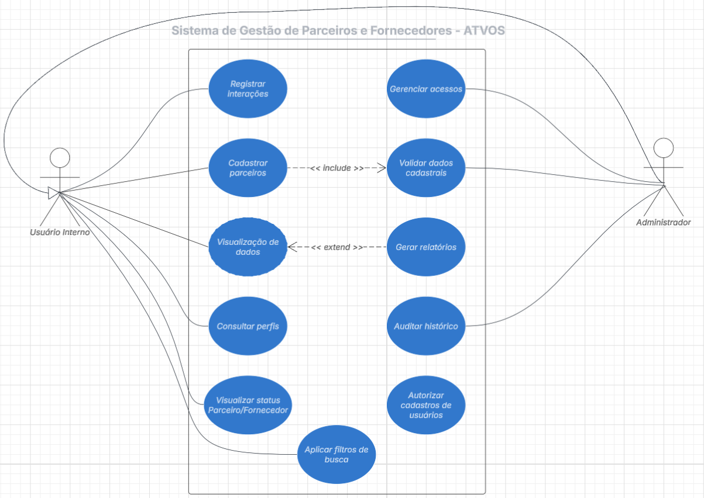<br>
  <sup>Fonte: Material produzido pelos autores, 2026. (Diagrama esquematizado no https://plantuml.com/)</sup>
</div>

> Observação: O diagrama apresenta uma visão inicial dos casos de uso e será refinado nas próximas sprints. A especificação textual a seguir detalha os atores, relações de include/extend, RFs e User Stories associadas de forma mais precisa.

---

#### Especificação dos Casos de Uso

Abaixo, detalham-se os casos de uso mapeados, descrevendo as responsabilidades de cada funcionalidade e seus respectivos fluxos de controle.


Identificação | UC01 - Enviar Parceiro/Fornecedor para validação.
--- | ---
**ATOR PRINCIPAL** |  Analista de Negócios Agrícolas
**ATOR(ES) SECUNDÁRIO(S)** | Sistema Web; Banco de Dados
**PRÉ-CONDIÇÕES** |  Usuário autenticado com perfil de analista.
**FLUXO PRINCIPAL** | 1. O analista acessa a tela de cadastro de parceiro.<br> 2. O sistema exibe o formulário de cadastro.<br> 3. O analista preenche os campos disponíveis. <br> 4. O analista salva o registro como rascunho. <br> 5. O sistema persiste o registro com status rascunho, sem exigir campos obrigatórios. <br> 6. O analista conclui o preenchimento. <br> 7. O sistema envia o registro com status pendente para os coordenadores.
**FLUXOS ALTERNATIVOS** | **FA01: Analista não envia o registro** <br> 6. Analista deixa a página de preenchimento. <br> 7. Sistema armazena registro rascunho do Analista no seu perfil. 
**PÓS-CONDIÇÕES** | Novo registro de parceiro criado com status rascunho, ou com status pendente caso tenha sido enviado para validação.
**US RELACIONADAS** | US01, US02
**RN RELACIONADAS** | RN04, RN16

Identificação | UC02 - Editar Parceiro/Fornecedor
--- | ---
**ATOR PRINCIPAL** | Analista de Negócios Agrícolas
**ATOR(ES) SECUNDÁRIO(S)** | Sistema Web; Banco de Dados
**PRÉ-CONDIÇÕES** | Usuário autenticado com perfil de analista; parceiro cadastrado com status rascunho, devolvido ou ativo. 
**FLUXO PRINCIPAL** | 1. O analista acessa o perfil do parceiro. <br> 2. O analista seleciona a opção de editar. <br> 3. O sistema exibe o formulário com os dados atuais preenchidos. <br> 4. O analista altera os campos desejados e confirma. <br> 5. O sistema valida os dados, persiste as alterações e registra data, hora e usuário responsável. <br> 6. O sistema preserva a versão anterior no histórico. <br> 7. O sistema exibe o perfil atualizado para o analista como rascunho.
**FLUXOS ALTERNATIVOS** | **FA01 — Analista envia para validação após edição:** <br> 1. Após confirmar a edição, o analista decide enviar para validação. <br> 2. O sistema executa UC01 <br> **FA02 — Registro com status incompatível:** <br> 1. O analista tenta editar um registro com status excluído. <br> 2. O sistema bloqueia a edição e exibe mensagem informando que o registro não pode ser editado neste status.<br> 3. O fluxo é encerrado.
**PÓS-CONDIÇÕES** | Dados do parceiro atualizados para o analista.
**US RELACIONADAS** | US05
**RN RELACIONADAS** | RN11, RN12, RN16, RN18

Identificação | UC03 - Consultar Registros Ativos do Parceiro
--- | ---
**ATOR PRINCIPAL** | Analista de Negócios Agrícolas ou Coordenador de Estratégia de Terras ou Gerente de Coordenadores
**ATOR(ES) SECUNDÁRIO(S)** | Sistema Web; Banco de Dados
**PRÉ-CONDIÇÕES** | Usuário autenticado; parceiro com status ativo existente no sistema. 
**FLUXO PRINCIPAL** | 1. O usuário acessa a listagem de parceiros. <br> 2. O usuário seleciona um parceiro. <br> 3. O sistema recupera e exibe todos os dados cadastrais e o histórico de interações do parceiro. <br> 4. A tela carrega em até 3 segundos.
**FLUXOS ALTERNATIVOS** | **FA01 — Parceiro não encontrado:** <br> 1. O registro buscado não existe. <br> 2. O sistema exibe mensagem informando que o parceiro não foi encontrado.<br> 3. O fluxo é encerrado. <br> **FA02 — Tempo de carregamento excedido:** <br> 1. A tela não carrega dentro do limite de 3 segundos. <br> 2. O sistema exibe mensagem de erro de tempo limite. <br> 3. O usuário pode tentar novamente.
**PÓS-CONDIÇÕES** | Dados do parceiro exibidos ao usuário.
**US RELACIONADAS** | US04, US06
**RN RELACIONADAS** | RN04, RN05

Identificação | UC04 - Validar Registro
--- | ---
**ATOR PRINCIPAL** | Coordenador de Estratégia de Terras
**ATOR(ES) SECUNDÁRIO(S)** | Sistema Web; Banco de Dados
**PRÉ-CONDIÇÕES** | Usuário autenticado com perfil de coordenador; ao menos um registro com status pendente na fila.
**FLUXO PRINCIPAL** | 1. O coordenador acessa a fila de validação.<br> 2. O sistema exibe os registros com status pendente, ordenados por data de envio.<br> 3. O coordenador seleciona um registro.<br> 4. O sistema exibe os dados completos do registro. <br>5. O coordenador revisa os dados e seleciona a opção de aprovar. <br>6. O sistema altera o status do registro para ativo.<br> 7. O registro passa a aparecer nas consultas normais do sistema.<br> 8. O sistema notifica o analista responsável sobre a aprovação.
**FLUXOS ALTERNATIVOS** | **FA01 — Coordenador devolve o registro:**<br> 1. O coordenador identifica inconsistências nos dados. <br>2. O coordenador seleciona a opção de devolver e preenche um comentário explicando o motivo. <br>3. O sistema altera o status do registro para devolvido. <br>4. O sistema notifica o analista responsável com o comentário do coordenador.<br> 5. O fluxo é encerrado. <br> **FA02 — Fila vazia:** <br> 1. O coordenador acessa a fila de validação sem registros pendentes. <br>2. O sistema exibe mensagem informando que não há registros aguardando validação.
**PÓS-CONDIÇÕES** | Registro aprovado com status ativo e visível no sistema, ou devolvido ao analista com comentário.
**US RELACIONADAS** | US11
**RN RELACIONADAS** | RN05, RN16, RN17, RN18

Identificação | UC05 - Cadastrar usuário
--- | ---
**ATOR PRINCIPAL** | Gerente de Coordenadores
**ATOR(ES) SECUNDÁRIO(S)** | Sistema Web; Banco de Dados
**PRÉ-CONDIÇÕES** |  Usuário autenticado com perfil de administrador.
**FLUXO PRINCIPAL** | 1. O administrador acessa a tela de cadastro de usuário.<br> 2. O sistema exibe o formulário com campos: nome, e-mail e perfil de acesso. <br> 3. O administrador preenche os campos e confirma. <br> 4. O sistema valida unicidade do e-mail. <br> 5. O sistema persiste o novo usuário e registra data, hora e responsável. <br> 6. O sistema exibe o usuário na listagem com status ativo.
**FLUXOS ALTERNATIVOS** | **FA01 — E-mail já cadastrado:** <br> 1. O administrador informa um e-mail já existente no sistema. <br> 2. O sistema exibe mensagem de erro informando duplicidade.<br> 3. O sistema não persiste o registro. <br> 4. O fluxo retorna ao passo 3 do fluxo principal.<br> **FA02 — Campo obrigatório não preenchido:** <br> 1. O administrador tenta confirmar sem preencher todos os campos. <br> 2. O sistema exibe mensagem indicando o campo ausente. <br> 3. O fluxo retorna ao passo 3 do fluxo principal.
**PÓS-CONDIÇÕES** | Novo usuário cadastrado e habilitado para login conforme perfil atribuído.
**US RELACIONADAS** | US08
**RN RELACIONADAS** | RN01, RN03, RN06, RN11

Identificação | UC06 - Editar Usuário
--- | ---
**ATOR PRINCIPAL** | Gerente de Coordenadores
**ATOR(ES) SECUNDÁRIO(S)** | Sistema Web; Banco de Dados; 
**PRÉ-CONDIÇÕES** | Usuário autenticado com perfil de administrador; usuário alvo existente e ativo no sistema.
**FLUXO PRINCIPAL** | 1. O administrador acessa o perfil do usuário na listagem. <br> 2. O administrador seleciona a opção de editar.<br> 3. O sistema exibe o formulário com os dados atuais preenchidos.<br> 4. O administrador altera os campos desejados e confirma.<br> 5. O sistema valida unicidade do e-mail caso tenha sido alterado.<br> 6. O sistema persiste as alterações e registra data, hora e responsável.
**FLUXOS ALTERNATIVOS** | **FA01 — E-mail já cadastrado por outro usuário:** <br> 1. O administrador altera o e-mail para um já existente no sistema. <br> 2. O sistema exibe mensagem de erro informando duplicidade. <br> 3. O sistema não persiste a alteração. <br> 4. O fluxo retorna ao passo 4 do fluxo principal.
**PÓS-CONDIÇÕES** | Dados do usuário atualizados no sistema.
**US RELACIONADAS** | US10
**RN RELACIONADAS** | RN01, RN11

Identificação | UC07 - Inativar Usuário
--- | ---
**ATOR PRINCIPAL** | Gerente de Coordenadores
**ATOR(ES) SECUNDÁRIO(S)** | Sistema Web; Banco de Dados
**PRÉ-CONDIÇÕES** | Usuário autenticado com perfil de administrador; usuário alvo existente e ativo no sistema.
**FLUXO PRINCIPAL** | 1. O administrador acessa o perfil do usuário na listagem. <br> 2. O administrador seleciona a opção de inativar. <br> 3. O sistema exibe confirmação da ação. <br> 4. O administrador confirma. <br> 5. O sistema altera o status do usuário para inativo.<br> 6. O sistema encerra imediatamente as sessões ativas do usuário. <br> 7. O sistema preserva o histórico de ações do usuário inativado.
**FLUXOS ALTERNATIVOS** | **FA01 — Administrador cancela a ação:** <br> 1. O administrador seleciona cancelar na tela de confirmação. <br> 2. O sistema não realiza nenhuma alteração. <br> 3. O fluxo é encerrado.
**PÓS-CONDIÇÕES** | Usuário inativado, sem acesso ao sistema, com histórico preservado.
**US RELACIONADAS** | US09
**RN RELACIONADAS** | RN06, RN07, RN15

Identificação | UC08 - Receber Notificação de Inatividade
--- | ---
**ATOR PRINCIPAL** | Sistema Web
**ATOR(ES) SECUNDÁRIO(S)** | Analista de Negócios Agrícolas; Coordenador de Estratégia de Terras; Gerente de Coordenadores; Banco de Dados
**PRÉ-CONDIÇÕES** | Existência de registros com status ativo sem alterações pelo período configurado
**FLUXO PRINCIPAL** | 1. O cronjob é executado automaticamente no período configurado. <br> 2. O sistema consulta registros ativos cuja última atualização é anterior ao limite de dias configurado. <br>3. Para cada registro identificado, o sistema verifica se já foi enviada notificação no ciclo atual. <br>4. O sistema gera uma notificação para o analista responsável pelo último registro e para o coordenador vinculado.<br> 5. O sistema persiste a notificação no banco com status não lida.<br> 6. A notificação aparece no painel dos usuários no próximo acesso.
**FLUXOS ALTERNATIVOS** | **FA01 — Notificação já enviada no ciclo atual:** <br> 1. O sistema identifica que já existe notificação para aquele registro no ciclo vigente.<br> 2. O sistema não gera nova notificação.<br> 3. O fluxo avança para o próximo registro. <br> **FA02 — Nenhum registro inativo encontrado:** <br> 1. Todos os registros ativos foram alterados dentro do período configurado. <br> 2. O sistema encerra o ciclo sem gerar notificações.
**PÓS-CONDIÇÕES** | Notificações geradas e disponíveis no painel dos usuários responsáveis.
**US RELACIONADAS** | ---
**RN RELACIONADAS** | RN18

Identificação | UC09 - Realizar Login
--- | ---
**ATOR PRINCIPAL** | Qualquer usuário cadastrado no sistema
**ATOR(ES) SECUNDÁRIO(S)** | Sistema Web; Banco de Dados
**PRÉ-CONDIÇÕES** | Usuário cadastrado e ativo no sistema.
**FLUXO PRINCIPAL** | 1. O usuário acessa a tela de login.<br> 2. O usuário preenche e-mail e senha.<br> 3. O usuário confirma.<br> 4. O sistema valida as credenciais no banco de dados.<br> 5. O sistema identifica o perfil de acesso do usuário.<br> 6. O sistema inicia a sessão e redireciona o usuário para a tela inicial correspondente ao seu perfil.
**FLUXOS ALTERNATIVOS** | **FA01 — Credenciais inválidas:** <br> 1. O sistema não encontra correspondência entre e-mail e senha.<br> 2. O sistema exibe mensagem de erro genérica sem especificar qual campo está incorreto.<br> 3. O fluxo retorna ao passo 2 do fluxo principal.<br> **FA02 — Usuário inativo:** <br> 1. O sistema identifica que o usuário está com status inativo.<br> 2. O sistema exibe mensagem informando que o acesso foi revogado.<br> 3. O fluxo é encerrado.<br> **FA03 — Campo não preenchido:** <br> 1. O usuário tenta confirmar sem preencher e-mail ou senha.<br> 2. O sistema exibe mensagem indicando o campo ausente.<br> 3. O fluxo retorna ao passo 2 do fluxo principal.
**PÓS-CONDIÇÕES** | Sessão iniciada; usuário redirecionado para a tela inicial do seu perfil.
**US RELACIONADAS** | ---
**RN RELACIONADAS** | RN01, RN02, RN15

Identificação | UC10 - Visualizar Rascunhos Próprios
--- | ---
**ATOR PRINCIPAL** | Analista de Negócios Agrícolas
**ATOR(ES) SECUNDÁRIO(S)** | Sistema Web; Banco de Dados
**PRÉ-CONDIÇÕES** | Usuário autenticado como Analista
**FLUXO PRINCIPAL** | 1. O analista acessa a seção de rascunhos. <br> 2. O sistema consulta os registros com status rascunho e devolvido vinculados ao usuário logado.<br> 3. O sistema exibe a listagem com nome do parceiro, status e data da última atualização.<br> 4. O analista seleciona um registro.<br> 5. O sistema exibe o perfil do parceiro com os dados preenchidos até o momento e, se houver, o comentário do coordenador.
**FLUXOS ALTERNATIVOS** | **FA01 — Nenhum rascunho encontrado:** <br> 1. O analista não possui registros com status rascunho ou devolvido.<br> 2. O sistema exibe mensagem informando que não há rascunhos salvos.<br> 3. O sistema exibe opção de criar novo cadastro.<br> **FA02 — Registro com status devolvido:** <br> 1. O analista seleciona um registro com status devolvido.<br> 2. O sistema exibe o comentário do coordenador em destaque junto aos dados do parceiro. <br> 3. O analista pode editar o registro (UC02) ou reenviar para validação (UC01).
**PÓS-CONDIÇÕES** | Rascunhos do analista exibidos; analista pode continuar editando ou enviar para validação.
**US RELACIONADAS** | US12
**RN RELACIONADAS** | RN04, RN16, RN17

Identificação | UC11 - Primeiro Acesso e Cadastro de Senha
--- | ---
**ATOR PRINCIPAL** | Qualquer usuário com e-mail cadastrado no sistema
**ATOR(ES) SECUNDÁRIO(S)** | Sistema Web; Banco de Dados
**PRÉ-CONDIÇÕES** | Usuário cadastrado pelo administrador com status ativo; usuário ainda não realizou o primeiro acesso
**FLUXO PRINCIPAL** | 1. O usuário acessa a tela de login.<br>2. O usuário clica no botão "Primeiro Cadastro".<br>3. O sistema exibe a tela de verificação de e-mail.<br>4. O usuário preenche seu e-mail e confirma.<br>5. O sistema consulta o banco e verifica se o e-mail está cadastrado e se a senha associada é nula.<br>6. O sistema redireciona o usuário para a tela de cadastro de senha.<br>7. O usuário preenche a nova senha e a confirmação.<br>8. O sistema valida se as senhas coincidem e atendem aos critérios mínimos de segurança.<br>9. O sistema persiste a senha de forma criptografada.<br>10. O sistema exibe mensagem de sucesso e redireciona o usuário para a tela de login.<br>11. O usuário realiza o login normalmente via UC09.
**FLUXOS ALTERNATIVOS** | **FA01 — E-mail não encontrado no sistema:**<br>1. O sistema não encontra nenhum cadastro associado ao e-mail informado.<br>2. O sistema exibe mensagem informando que o e-mail não está cadastrado.<br>3. O fluxo retorna ao passo 4 do fluxo principal.<br>**FA02 — Usuário já possui senha cadastrada:**<br>1. O sistema identifica que a senha associada ao e-mail não é nula.<br>2. O sistema exibe aviso informando que o usuário já está cadastrado no sistema.<br>3. O sistema sugere que o usuário acesse pela tela de login normalmente.<br>4. O fluxo é encerrado.<br>**FA03 — Senhas não coincidem:**<br>1. O usuário preenche senhas diferentes nos dois campos.<br>2. O sistema exibe mensagem informando que as senhas não coincidem.<br>3. O fluxo retorna ao passo 7 do fluxo principal.<br>**FA04 — Senha não atende aos critérios mínimos:**<br>1. O usuário preenche uma senha que não atende aos critérios definidos.<br>2. O sistema exibe mensagem listando os critérios não atendidos.<br>3. O fluxo retorna ao passo 7 do fluxo principal.
**PÓS-CONDIÇÕES** | Senha cadastrada e criptografada no banco; usuário apto a realizar login via UC09.
**US RELACIONADAS** | ---
**RN RELACIONADAS** | RN01, RN02


---

A modelagem funcional consolidada neste diagrama demonstra a viabilidade técnica da solução ao aplicar corretamente relações entre atores, casos de uso e semânticas de inclusão e extensão, permitindo que o sistema diferencie com rigor os níveis de acesso e responsabilidades entre a operação de campo, a consulta gerencial e a administração da plataforma. Conclui-se que a estrutura proposta atende aos objetivos iniciais da Sprint 1 e deverá ser refinada nas próximas sprints conforme a evolução dos requisitos, endpoints e testes, pois organiza o fluxo de dados mestres e parâmetros globais sob a custódia do Administrador e fornece ao Editor e ao Observador as ferramentas necessárias para a manutenção da integridade informacional, estabelecendo uma base sólida e auditável que servirá de alicerce para o desenvolvimento das interfaces e do banco de dados nas etapas subsequentes do projeto.

### 3.2.3. Diagrama de Classes do Domínio 

### Imagem do diagrama


[Acesse o diagrama de classes UML](https://editor.plantuml.com/uml/hLXRZ-Cq57xFhx261supmmw25LImmgGf1CqcLIyZBaB8axYjsSGEjZExWFO18O64n0iIFm1uG23nX7ZXDV-4Ny9nBctYf9qEeYjjEpuNV-Vu-3kstrAQI9sdYQEPJYWQCxAM92KefiXDY59KeLYWiKYBFpWJZlCiUdFV1sHk64pyTvOpN7nRV1sYAt--n9S7RHAwqaWB9Dbwer7C98qq4znnr2F6Cm9OK6HmOAqbkyurzIF1v-mBYkwrLDI6nE8nuskq8ecYBKd2EDMVPnG9gJUY9U0YfefcwEBrjYD9-AF-Q4RYs3Y_UBcD2qif7ay4roMSYrS7HVfpoEgrI69RkjYmw16dIg6By_ksq1M9aEYPbylFaDzQuLxvwIKBVUaWz3Q97gsbo7bSAqzUC_-CHCYOodhqrV83eost5-N7UTfsJ7cUxl4xcRpYtRVzOdmV0xHR_NAXwLw_hxklzFpUVytuVNfRANh1yg5N5kAFtloWRWOJapL59nw4I2KfVYt-eke4GC7SPTWBbeafB9KW9LA4ffFgwptuUjfHks8yoXDHwqt2MU2vtZYSVUBY09TZU3RpWZ4sOmjlDiCT5tDDTAwwJl32lmhBNtwm--q5hh4UXpq8OGP1HAGnTsS-Td5OkuBzw7-u_TjxtxrSpd7buzQKJl7CzVnPE4SUkYg-3zpbPNXaQgT4HfH9eH05qp_Ay1Ho1UGxOeGrsQwgjr6k0pXZyGWjb_wu-ek3qGWI9M57LYDwkpoZrb9LiYXRkJpxj6j0Ky8IomS59XBSyXmJJGAY8fPIhiK8ZOccEnGu4cb6-8PmRTbjcD92iaZu88B545G1DFf4L-Apykl5YCH4QKdaSyzN0x3s965V4EbM4j48WFDKdW1LZu7dL3dwT9UlkboQR2R3USlghFgTKRshsL6xW2kfAijnr2tBNMfypYBMIOiPdR2qFIIk5PKtTGxQIJfhWcOtknHG7b4vb98AWXrwKofBpc8Iqxj4dbSctK637qFrG1fX1xN3QD1MGcbDRECgrsaY9ASHZO6s1d7TLFdi8g3fDM5Fm5nsnzSvaJ4ZbdOgOaYFGU02pKfYYdGmntKMBLo3iA79K1wJky7kxyhRrxsDQJUfZMbXwk4EI0RNjG-FI4hgdC5cUnUeOqnXdvEaHf_1WQ5srHCQsodqBMvsMqyQKKua4zZ4TqJaPNnrqBTIy7A-BBwQ-U7y52q37xg8PyWOkzvy7Xx7n4kL5py1F0KUgl0C9-F8S6Q7XGzkgKZ4R6tLsa2EOMk3qjj299Jm0xiUGBG6slkRoXLBAdJ7jWD9Fykfn9aKDzKcximFKqN0p6HueyHqnJYJC6tAO4hQ8nn8drdSFKJJGdjR_Gtq84MXbxnBrERuBCA1c6k8fi-NkqvnABzrE0VNEgzq_a_sx4wxZzHTOGv-V3yJxI7s8Rp_MxkITCtAfjsWWqZjvcMBMh7DAdE14zqvfHsJSxFK9bzuHGrdMVLK2_ljlJaFZZgdmoO1XdlD8OK9QI9-Rnu6BL4WReGr2alSOA_oje3JqN2Ajeh7qjlCkyIk7mRueHSiu9mvdVc1wq-nRuwP6ALm1c9P0gjOLYk1zOS-XZXHA0CgXoyFxXD85dzgStm68WOKoS4vdUrXy-JY1BrmTePExfsVlt3IFrIDq1lN3oxGFz_yW8p66ozTFt2SdbRR2_oqpm5T9nUbawDyj9hoqJx4BfggYGw6q4d0pi8-MGtPDhAxM-un_Uymsrmn2BNcxVzclSVSOi_ZKtI4eTDfVOFcTu7Qvvr1uyFRS-nDuUfQV0Tx4i-H6puiRzc7hu2xXJi_Vz2-IOzGhaY_S1kjvWvyGArxMQuK-t4s3hVNuahnbb23S04XUkzFBttNNBhnBL6MpnZbOvPORSlA2H6fdgq46hWIefLWJaeCSGDPYHJ-8saca8QB8dJnKmUkVIiXKs0w9EcAok9tS-8q3t9n_I1txW0hb6yeDOHheRL83GWxPKwBXg3c8i897Fp8ZbTWK9lzv_3Y5m7OpEiCt2zeOlYdmgVowwXw5JnrCi4Koa65Af0qhHY86FnaGgcSIISj_YuP6-nljhV-Q7lhHuePIYz-vbIeSyS9geaPC3kGFBGuj85KyU9NOcYzn29WNWddEuElYQOJXG8VZcbxoWJKpBgTD3b5PNYbXhDYJogz1lw1V9RSv5GCPJ1Mbmy3alHoNMT7qHmcvcOzOSbe1hwfMRq6bRD5PJ3KGPHF3QSGL8cJW15HZYcG-aq0hIalVZELP5nD1u0VhknB_46uN20_kFBdnVTNtgLvry78cqznyMtLU0-NUciFdtsqOJ4GvyUnUCpFEky7xJrigNLV4xgxUC3ZziIoen9BgrVgFRgm3AosxDXjUgjUFakVsItOiLkohL_LIfV2BGWrJM_fUbXSTmZ7QXYMSe_qTltLqhHwisFtwZtghVxeE6z1r7cQ_0i0)

### Explicação textual detalhada do diagrama

O diagrama de classes do domínio representa a estrutura conceitual das principais entidades envolvidas na aplicação. Ele descreve quais informações são armazenadas, como essas informações se relacionam e quais responsabilidades cada classe possui dentro do sistema. A modelagem foi construída com foco no domínio da gestão de parceiros externos, vínculos comerciais, terras, usuários internos, unidades operacionais, interações e auditoria de alterações.

A classe central do modelo é `Parceiro`. Ela representa uma identidade externa, que pode ser pessoa física ou pessoa jurídica, com a qual a ATVOS mantém relacionamento comercial. Por isso, essa classe concentra dados gerais como nome, tipo de pessoa, CPF ou CNPJ, e-mail, telefone, data de nascimento e nome do acompanhante. O histórico de relacionamento do parceiro não foi tratado apenas como um atributo textual, pois as interações precisam ser registradas de forma estruturada, rastreável e vinculada ao usuário responsável pelo registro. Dessa forma, foi utilizada a classe `Interacao`, que permite representar contatos, reuniões, visitas, observações e demais registros associados ao parceiro.

A classe `Interacao` representa os registros de contato e acompanhamento realizados pela equipe interna em relação a um parceiro. Ela possui informações como identificador, parceiro relacionado, usuário responsável pelo registro, tipo de interação, descrição e data da interação. Essa modelagem permite que um parceiro possua várias interações ao longo do tempo, garantindo maior rastreabilidade do relacionamento e evitando que o histórico fique concentrado em um campo textual único e pouco estruturado.

A classe `Parceiro` não foi especializada diretamente em fornecedor de cana ou arrendador de terra. Em vez disso, foi criada a classe `VinculoComercial`, que representa o papel comercial exercido por um parceiro. Essa decisão é importante porque um mesmo parceiro pode exercer mais de um papel simultaneamente. Por exemplo, uma mesma pessoa ou empresa pode atuar como fornecedora de cana e também como arrendadora de terra. Dessa forma, o parceiro permanece como identidade única, enquanto seus papéis comerciais são representados por vínculos.

A classe `VinculoComercial` armazena informações sobre o tipo de vínculo, status, data de início, data de fim e observações. O atributo `tipoVinculo` indica se o vínculo é de fornecedor de cana ou de arrendador de terra. O atributo `status` indica a situação do vínculo, como ativo, inativo ou encerrado. Essa classe foi relacionada a `Parceiro` por composição, pois um vínculo comercial só faz sentido quando está associado a um parceiro existente.

Os dados específicos de cada tipo de vínculo foram separados em classes próprias. A classe `DadosFornecedor` representa informações adicionais quando o vínculo comercial é do tipo fornecedor de cana, como embaixador, guardião e modalidade de contrato. Já a classe `DadosArrendador` representa informações específicas do vínculo de arrendamento, como observações próprias desse tipo de relação. Essas duas classes foram ligadas a `VinculoComercial` por composição, pois seus dados dependem diretamente da existência do vínculo comercial correspondente.

A classe `Terra` representa uma propriedade ou área rural relacionada ao contexto de arrendamento. Ela possui atributos como nome, área contratada, oportunidade em hectares, área potencial e cenário atual. No modelo, `Terra` foi vinculada a `VinculoComercial`, e não diretamente a `Parceiro`, porque sua existência no sistema está relacionada ao vínculo comercial de arrendamento. Assim, a relação entre parceiro e terra é mediada pelo vínculo comercial, evitando duplicidade de associação e mantendo clareza sobre o papel exercido pelo parceiro em cada relação.

A classe `Unidade` representa uma unidade industrial ou operacional da ATVOS. Ela possui atributos como código, nome e status de atividade. Essa classe é usada para indicar onde a operação acontece, em quais unidades um parceiro atua e em quais unidades um usuário interno trabalha. Por isso, ela aparece relacionada a `Terra`, `ParceiroUnidade` e `UsuarioUnidade`.

A classe `Usuario` representa o colaborador interno da ATVOS que acessa e opera o sistema. Ela possui dados como nome, e-mail, senha criptografada, status ativo e referência ao perfil de acesso. O usuário é responsável por executar ações no sistema, como consultar registros, atualizar dados, registrar interações e gerar registros de alteração. No modelo, ele se relaciona com `PerfilAcesso`, `RegistroAlteracao`, `Interacao`, `ParceiroCoordenador` e `UsuarioUnidade`.

A classe `PerfilAcesso` representa o conjunto de permissões atribuído a um usuário. Ela não representa necessariamente um cargo formal da empresa, mas sim o papel de acesso dentro da aplicação. Por isso, perfis como administrador, analista e coordenador devem ser entendidos como níveis de permissão no sistema. O atributo `requerAprovacao` indica se ações realizadas por usuários desse perfil exigem algum tipo de validação ou aprovação, conforme a regra definida para a operação.

A classe `RegistroAlteracao` representa a trilha de auditoria do sistema. Ela registra qual usuário realizou determinada alteração, qual entidade foi afetada, qual registro foi modificado, qual tipo de operação ocorreu, quais eram os dados anteriores, quais são os novos dados e quando a alteração aconteceu. Essa classe é importante para rastreabilidade, pois permite acompanhar modificações feitas nos cadastros e identificar responsáveis pelas mudanças.

Também foram criadas classes associativas para representar relações muitos-para-muitos com atributos próprios. A classe `ParceiroCoordenador` registra o histórico de coordenação entre parceiros e usuários internos. Ela possui datas de início e fim, além de observações, permitindo acompanhar mudanças de coordenação ao longo do tempo. A classe `ParceiroUnidade` representa a associação entre parceiros e unidades, indicando em quais unidades um parceiro opera. A classe `UsuarioUnidade` representa a associação entre usuários e unidades, indicando em quais unidades cada colaborador atua.

Por fim, o diagrama usa enumerações para representar campos com valores limitados e pré-definidos. A enumeração `TipoPessoa` define se o parceiro é pessoa física ou jurídica. A enumeração `TipoVinculo` define os tipos possíveis de vínculo comercial. A enumeração `StatusVinculo` define os estados possíveis de um vínculo. A enumeração `TipoOperacao` define quais tipos de alteração podem ser registrados na auditoria.

### Tabela de classes do domínio

| Classe | Tipo | Papel no domínio |
|---|---|---|
| `Parceiro` | Classe principal | Representa a identidade externa, pessoa física ou jurídica, com a qual a ATVOS mantém relacionamento comercial. |
| `VinculoComercial` | Classe principal | Representa o papel comercial exercido por um parceiro, como fornecedor de cana ou arrendador de terra. |
| `DadosFornecedor` | Classe de detalhamento | Armazena informações específicas quando o vínculo comercial é do tipo fornecedor de cana. |
| `DadosArrendador` | Classe de detalhamento | Armazena informações específicas quando o vínculo comercial é do tipo arrendador de terra. |
| `Terra` | Classe principal | Representa propriedades ou áreas rurais associadas ao vínculo comercial de arrendamento e à unidade operacional. |
| `Interacao` | Classe principal | Registra contatos, reuniões, visitas, observações e demais interações entre a equipe interna e o parceiro. |
| `Usuario` | Classe principal | Representa o colaborador interno que acessa e utiliza o sistema. |
| `PerfilAcesso` | Classe de apoio | Define o nível de permissão do usuário dentro da aplicação. |
| `Unidade` | Classe principal | Representa uma unidade operacional ou industrial da ATVOS. |
| `RegistroAlteracao` | Classe de auditoria | Registra alterações feitas no sistema para garantir rastreabilidade. |
| `ParceiroCoordenador` | Classe associativa | Representa o histórico de coordenação entre parceiro e usuário. |
| `ParceiroUnidade` | Classe associativa | Representa a associação entre parceiro e unidade operacional. |
| `UsuarioUnidade` | Classe associativa | Representa a associação entre usuário interno e unidade operacional. |
| `TipoPessoa` | Enumeração | Define se o parceiro é pessoa física ou pessoa jurídica. |
| `TipoVinculo` | Enumeração | Define os tipos possíveis de vínculo comercial. |
| `StatusVinculo` | Enumeração | Define os estados possíveis de um vínculo comercial. |
| `TipoOperacao` | Enumeração | Define os tipos de operação registrados na auditoria. |

### Tabela de relacionamentos principais

| Relacionamento | Tipo UML | Multiplicidade | Interpretação |
|---|---|---|---|
| `Parceiro` — `VinculoComercial` | Composição | `1` para `0..*` | Um parceiro pode possuir nenhum, um ou vários vínculos comerciais. Cada vínculo comercial pertence a exatamente um parceiro. |
| `VinculoComercial` — `DadosFornecedor` | Composição | `1` para `0..1` | Um vínculo comercial pode ter dados de fornecedor quando seu tipo for fornecedor de cana. Cada conjunto de dados de fornecedor pertence a um único vínculo. |
| `VinculoComercial` — `DadosArrendador` | Composição | `1` para `0..1` | Um vínculo comercial pode ter dados de arrendador quando seu tipo for arrendador de terra. Cada conjunto de dados de arrendador pertence a um único vínculo. |
| `VinculoComercial` — `Terra` | Agregação | `1` para `0..*` | Um vínculo comercial de arrendamento pode agregar várias terras. A terra possui identidade própria, mas está vinculada ao contexto comercial do arrendamento. |
| `Parceiro` — `Interacao` | Associação | `1` para `0..*` | Um parceiro pode possuir várias interações registradas ao longo do tempo. Cada interação está associada a um único parceiro. |
| `Usuario` — `Interacao` | Associação | `1` para `0..*` | Um usuário pode registrar várias interações. Cada interação é registrada por um único usuário interno. |
| `Unidade` — `Terra` | Associação | `1` para `0..*` | Uma unidade pode possuir várias terras associadas. Cada terra está associada a uma unidade operacional. |
| `PerfilAcesso` — `Usuario` | Associação | `1` para `0..*` | Um perfil de acesso pode estar associado a vários usuários. Cada usuário possui exatamente um perfil de acesso. |
| `Usuario` — `RegistroAlteracao` | Associação | `1` para `0..*` | Um usuário pode realizar vários registros de alteração. Cada registro de alteração é realizado por um único usuário. |
| `Parceiro` — `ParceiroCoordenador` | Associação | `1` para `0..*` | Um parceiro pode ter vários registros históricos de coordenação. Cada registro de coordenação está associado a um parceiro. |
| `Usuario` — `ParceiroCoordenador` | Associação | `1` para `0..*` | Um usuário pode coordenar vários parceiros ao longo do tempo. Cada registro de coordenação está associado a um usuário. |
| `Parceiro` — `ParceiroUnidade` | Associação | `1` para `0..*` | Um parceiro pode estar associado a várias unidades. Cada associação pertence a um parceiro. |
| `Unidade` — `ParceiroUnidade` | Associação | `1` para `0..*` | Uma unidade pode receber vários parceiros. Cada associação pertence a uma unidade. |
| `Usuario` — `UsuarioUnidade` | Associação | `1` para `0..*` | Um usuário pode atuar em várias unidades. Cada associação pertence a um usuário. |
| `Unidade` — `UsuarioUnidade` | Associação | `1` para `0..*` | Uma unidade pode possuir vários usuários atuantes. Cada associação pertence a uma unidade. |
| `Parceiro` — `TipoPessoa` | Dependência | — | A classe `Parceiro` usa a enumeração `TipoPessoa` para indicar se a identidade externa é pessoa física ou jurídica. |
| `VinculoComercial` — `TipoVinculo` | Dependência | — | A classe `VinculoComercial` usa `TipoVinculo` para indicar o papel comercial exercido. |
| `VinculoComercial` — `StatusVinculo` | Dependência | — | A classe `VinculoComercial` usa `StatusVinculo` para indicar a situação atual do vínculo. |
| `RegistroAlteracao` — `TipoOperacao` | Dependência | — | A classe `RegistroAlteracao` usa `TipoOperacao` para indicar se a alteração foi criação, atualização ou exclusão. |

### Explicação dos tipos de relacionamento UML utilizados

No diagrama, foram utilizados diferentes tipos de relacionamento UML para representar corretamente as dependências entre as classes: associação simples, agregação, composição, dependência e classes associativas.

A associação simples foi usada quando duas classes se relacionam, mas uma não depende da outra para existir. Um exemplo é a relação entre `PerfilAcesso` e `Usuario`. Um usuário possui um perfil de acesso, mas o perfil não depende da existência de um usuário específico. O mesmo ocorre entre `Usuario` e `RegistroAlteracao`: o usuário realiza registros de alteração, mas a classe `Usuario` continua existindo independentemente de um registro específico. A relação entre `Parceiro` e `Interacao` também foi representada como associação, pois o parceiro pode possuir várias interações registradas, mas a interação é tratada como um registro próprio do sistema, com dados estruturados e vínculo com o usuário responsável.

A composição, representada pelo losango cheio, foi usada quando uma classe depende fortemente da outra para existir no contexto conceitual do sistema. A relação entre `Parceiro` e `VinculoComercial` foi modelada como composição, pois um vínculo comercial só faz sentido se estiver associado a um parceiro. Essa decisão representa que o vínculo comercial não é uma identidade externa independente, mas uma forma de expressar o papel comercial desempenhado pelo parceiro dentro da relação com a ATVOS.

A composição também foi utilizada nas relações entre `VinculoComercial` e as classes `DadosFornecedor` e `DadosArrendador`. Essas classes representam detalhamentos específicos de um vínculo comercial e, portanto, dependem diretamente da existência desse vínculo. Se o vínculo não existir, os dados específicos de fornecedor ou arrendador perdem o sentido dentro do domínio.

A agregação, representada pelo losango vazio, foi usada para indicar uma relação de todo-parte mais fraca, na qual a parte possui identidade própria. A relação entre `VinculoComercial` e `Terra` foi modelada como agregação, pois a terra possui identidade própria no domínio, mas é agrupada ao contexto do vínculo comercial quando ocorre uma relação de arrendamento.

As classes associativas foram utilizadas para representar relações muitos-para-muitos que possuem informações próprias. `ParceiroCoordenador`, `ParceiroUnidade` e `UsuarioUnidade` não são apenas ligações entre classes; elas também armazenam dados relevantes sobre a relação, como datas de associação, datas de início e fim, ou observações. Por isso, foram representadas como classes próprias no diagrama.

As dependências foram usadas para indicar o uso de enumerações por determinadas classes. `Parceiro` depende de `TipoPessoa`, `VinculoComercial` depende de `TipoVinculo` e `StatusVinculo`, e `RegistroAlteracao` depende de `TipoOperacao`. Essas enumerações limitam os valores possíveis de determinados atributos, reduzindo inconsistências e facilitando a validação das regras de negócio.

### Justificativa sobre herança

A herança não foi aplicada no diagrama porque os diferentes papéis comerciais de um parceiro não representam subclasses fixas de `Parceiro`. No domínio do sistema, um parceiro pode atuar como fornecedor de cana, arrendador de terra ou exercer mais de um papel ao mesmo tempo. Se fossem criadas subclasses como `Fornecedor` e `Arrendador`, haveria risco de duplicar a identidade do parceiro ou restringir indevidamente sua atuação.

Por esse motivo, a modelagem utiliza a classe `VinculoComercial` para representar o papel exercido pelo parceiro em cada relação. Essa abordagem é mais flexível, evita generalizações artificiais e permite que os tipos de vínculo sejam evoluídos sem alterar a identidade principal do parceiro. Assim, a ausência de herança é uma decisão de modelagem intencional, alinhada ao funcionamento real do domínio.

#### 3.2.3.1. Diagrama de Classes Arquitetural (sprint 3)


Esta seção apresenta o Diagrama de Classes Arquitetural do backend da solução. Enquanto o diagrama de domínio tem como foco representar as principais entidades de negócio e seus relacionamentos, o diagrama arquitetural evidencia a organização interna da aplicação e a separação de responsabilidades entre as camadas que compõem a WebAPI.
<br>
O diagrama contempla os componentes centrais das camadas Controller, Service, Repository e Model, seguindo o padrão arquitetural adotado no projeto. A camada Controller é responsável por receber as requisições HTTP e encaminhá-las para os serviços correspondentes. A camada Service concentra as regras de negócio e a orquestração dos fluxos da aplicação. A camada Repository encapsula o acesso aos dados e a comunicação com o banco PostgreSQL/Supabase. Por fim, a camada Model representa as entidades e estruturas de dados utilizadas pelo sistema.
<br>
Dessa forma, o diagrama permite visualizar como os principais fluxos identificados nos diagramas de sequência, como cadastro de usuários, login, gestão de parceiros, terras, interações, dashboards e exportação de dados, são organizados dentro da arquitetura do backend.
<br>

<div align="center">
  <sub>Figura 3.2.3.1.1 - Diagrama de Classes Arquitetural</sub><br>
  <br>
  <sup>Fonte: Material produzido pelos autores, 2026.</sup>
</div>


Portanto, o Diagrama de Classes Arquitetural complementa o Diagrama de Classes do Domínio ao demonstrar a estrutura interna do backend e a comunicação entre as camadas Controller, Service, Repository e Model. Essa representação evidencia a organização modular da WebAPI e reforça a separação de responsabilidades adotada no projeto, facilitando a manutenção, os testes e a evolução dos fluxos principais do sistema.

### 3.2.4. Diagrama de Sequência UML (sprint 3)

Os diagramas de sequência servem para detalhar o fluxo de dados e a governança das informações, sendo essenciais para visualizar a interação entre os objetos a cada ação e para garantir a integridade dos dados. Neste sistema, é adotada uma arquitetura de sistemas em camadas onde temos:
**Controller (UserController):** Atua como porta de entrada, recebendo as requisições dos endpoints e validando as ações do usuário.   *Endpoints: São rotas do sistema que permitem a comunicação entre o cliente e o sistema; no atual projeto, os endpoints se encontram descritos na matriz de rastreabilidade (seção 3.9).*   
**Service (UserService):** Decide como os dados devem ser manipulados de acordo com as regras de negócio.   
**Repository (UserRepository):** Isola a lógica de acesso aos dados e se comunica direto com o banco de dados.   
**Banco de dados (PostgreSQL):** Operado via Supabase, é um banco de dados relacional onde todas as informações são armazenadas de forma estruturada e segura.   
Tais diagramas são essenciais para mapear cenários de sucesso e falha, como erros de validação e duplicidade, para evitar a dispersão de dados antes mesmo de iniciar a programação do backend. 

#### Cadastro de usuários
No fluxo principal, o sistema valida e salva o novo usuário (201). Alternativamente, barra campos vazios (400) ou impede e-mails duplicados (409), garantindo a integridade da base Atvos.

<div align="center">
  <sub>Figura 3.2.4.1 - Primeiro fluxo: Cadastro de usuários</sub><br>
  <br>
  <sup>Fonte: Material produzido pelos autores, 2026. (Diagrama esquematizado no Mermaid)</sup>
</div>

Em suma, os diagramas de sequência apresentados consolidam a lógica operacional e de governança do sistema. Eles detalham a interação fluida entre as camadas de controle, serviço e persistência (PostgreSQL), garantindo que cada operação de CRUD — desde o cadastro de parceiros até a auditoria de terras — trate rigorosamente os fluxos de erro (400, 404, 409, 500) e as regras de negócio da Atvos.

#### Cadastro de usuários (nível de acesso)
O fluxo principal valida o nível de acesso e cadastra o usuário (201). Alternativas barram dados incompletos (400) ou evitam e-mails já existentes (409), mantendo a governança da base Atvos.

<div align="center">
  <sub>Figura 3.2.4.2 - Segundo fluxo: Cadastro de usuários (nivel de acesso)</sub><br>
  <br>
  <sup>Fonte: Material produzido pelos autores, 2026. (Diagrama esquematizado no Mermaid)</sup>
</div>

#### Login de usuários
No fluxo principal, o usuário acessa o sistema após validar credenciais (200). Alternativas barram senhas incorretas (401) ou e-mails não cadastrados (404), garantindo a segurança dos dados.

<div align="center">
  <sub>Figura 3.2.4.3 - Terceiro fluxo: Login de usuários</sub><br>
  <br>
  <sup>Fonte: Material produzido pelos autores, 2026. (Diagrama esquematizado no Mermaid)</sup>
</div>

#### Inativação usuários
O fluxo principal desativa o usuário com sucesso (200). Alternativas barram IDs inexistentes (404) ou falhas na conexão com o banco (500), preservando a segurança e a governança dos acessos Atvos.

<div align="center">
  <sub>Figura 3.2.4.4 - Quarto fluxo: Inativação usuários</sub><br>
  <br>
  <sup>Fonte: Material produzido pelos autores, 2026. (Diagrama esquematizado no Mermaid)</sup>
</div>

#### Cadastro de parceiros
No fluxo principal, o parceiro é validado e salvo (201). Alternativamente, o sistema barra campos obrigatórios vazios (400) ou impede o cadastro de CPF/CNPJ já existente (409) na base Atvos.

<div align="center">
  <sub>Figura 3.2.4.5- Quinto fluxo: Cadastro de parceiros</sub><br>
  <br>
  <sup>Fonte: Material produzido pelos autores, 2026. (Diagrama esquematizado no Mermaid)</sup>
</div>

#### Consulta histórico de parceiros
No fluxo principal, o administrador visualiza a trilha de auditoria e valores anteriores do parceiro (200). Alternativamente, o sistema barra IDs mal formatados (400) ou IDs inexistentes (404).

<div align="center">
  <sub>Figura 3.2.4.6 - Sexto fluxo: Consulta histórico de parceiros</sub><br>
  <br>
  <sup>Fonte: Material produzido pelos autores, 2026. (Diagrama esquematizado no Mermaid)</sup>
</div>

#### Edição dos dados do usuário
No fluxo principal, o administrador atualiza as informações e o sistema persiste as mudanças (200). Nos fluxos alternativos, a operação é bloqueada caso o usuário não seja localizado (404) ou se houver falha de infraestrutura (500).

<div align="center">
  <sub>Figura 3.2.4.7 - Sétimo fluxo: Edição dos dados do usuário</sub><br>
  <br>
  <sup>Fonte: Material produzido pelos autores, 2026. (Diagrama esquematizado no Mermaid)</sup>
</div>

#### Edição dos dados dos parceiros
No fluxo principal, o administrador edita os dados e o sistema salva as alterações no banco (200). Alternativamente, o fluxo é interrompido se o parceiro não for encontrado (404) ou se os dados enviados forem inválidos (400).

<div align="center">
  <sub>Figura 3.2.4.8 - Oitavo fluxo: Edição dos dados dos parceiros</sub><br>
  <br>
  <sup>Fonte: Material produzido pelos autores, 2026. (Diagrama esquematizado no Mermaid)</sup>
</div>

#### Cadastro de dados das terras
No fluxo principal, o analista cadastra a área e o sistema a vincula à unidade agrícola (201). Alternativamente, o cadastro é bloqueado se houver campos nulos (400) ou falha de conexão (500).

<div align="center">
  <sub>Figura 3.2.4.9 - Nono fluxo: Cadastro de dados das terras</sub><br>
  <br>
  <sup>Fonte: Material produzido pelos autores, 2026. (Diagrama esquematizado no Mermaid)</sup>
</div>

#### Edição de dados das terras
No fluxo principal, o sistema atualiza as métricas da terra e valida a unidade agrícola (200). Alternativamente, o fluxo é barrado caso o registro não exista (404) ou se os dados forem inválidos (400).

<div align="center">
  <sub>Figura 3.2.4.10 - Decimo fluxo: Edição de dados das terras</sub><br>
  <br>
  <sup>Fonte: Material produzido pelos autores, 2026. (Diagrama esquematizado no Mermaid)</sup>
</div>

#### Registro de interações
No fluxo principal, o analista registra o contato e o sistema vincula o histórico ao parceiro (201). Alternativamente, o registro é impedido caso o parceiro não exista (404) ou os dados estejam incompletos (400).

<div align="center">
  <sub>Figura 3.2.4.11 - Fluxo 11: Registro de interações</sub><br>
  <br>
  <sup>Fonte: Material produzido pelos autores, 2026. (Diagrama esquematizado no Mermaid)</sup>
</div>

#### Visualização dos dados dos parceiros
No fluxo principal, o administrador consulta o perfil detalhado do parceiro e seus vínculos ativos (200). Alternativamente, a visualização é impedida caso o ID esteja incorreto (400) ou o parceiro não esteja cadastrado (404).

<div align="center">
  <sub>Figura 3.2.4.12 - Fluxo 12: Visualização dos dados dos parceiros</sub><br>
  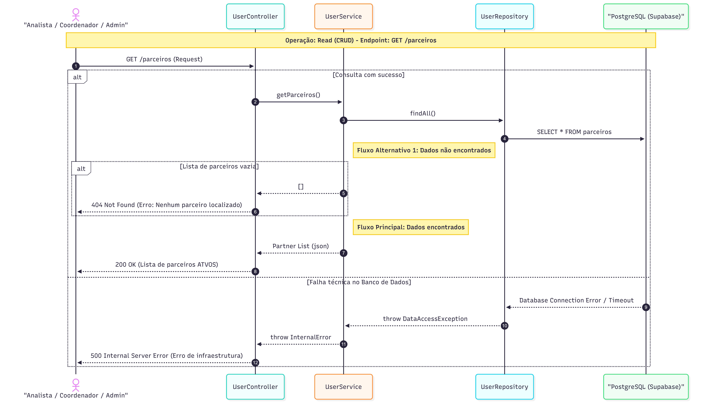<br>
  <sup>Fonte: Material produzido pelos autores, 2026. (Diagrama esquematizado no Mermaid)</sup>
</div>

#### Visualização dos parceiro por filtros
No fluxo principal, o sistema filtra a base de parceiros por região ou tipo e retorna os registros (200). Alternativamente, o fluxo falha se os parâmetros forem inválidos (400) ou se nenhum dado for encontrado (404).

<div align="center">
  <sub>Figura 3.2.4.13 - Fluxo 13: Visualização dos parceiros por filtros</sub><br>
  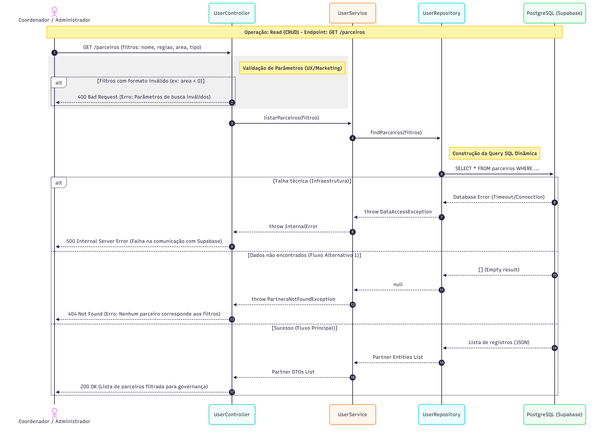<br>
  <sup>Fonte: Material produzido pelos autores, 2026. (Diagrama esquematizado no Mermaid)</sup>
</div>

#### Visualização do painel de dados dos parceiros
No fluxo principal, o coordenador acessa indicadores consolidados e gráficos estratégicos dos parceiros (200). Alternativamente, o acesso falha se o painel estiver indisponível (503) ou se não houver dados para exibir (404).

<div align="center">
  <sub>Figura 3.2.4.14 - Fluxo 14: Visualização do painel de dados dos parceiros</sub><br>
  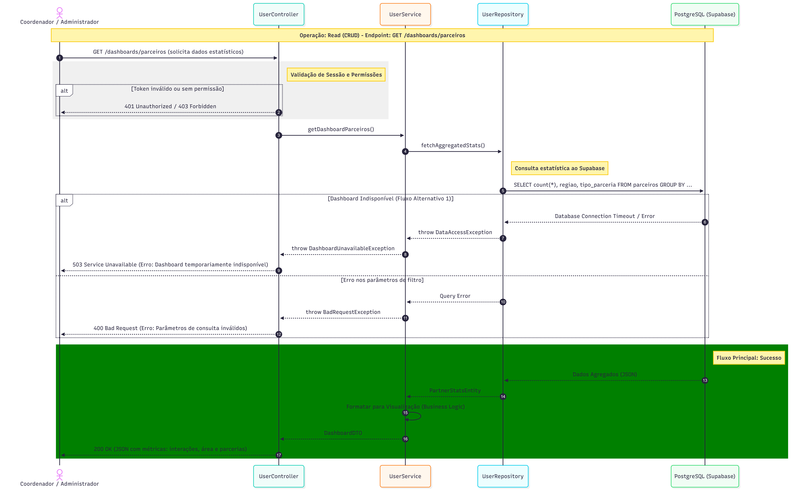<br>
  <sup>Fonte: Material produzido pelos autores, 2026. (Diagrama esquematizado no Mermaid)</sup>
</div>

#### Visualização do painel de dados das interações com os parceiros
No fluxo principal, o coordenador visualiza o engajamento e métricas de produtividade das interações (200). Alternativamente, o fluxo falha se o painel estiver indisponível (503) ou se não houver registros para o período (404).

<div align="center">
  <sub>Figura 3.2.4.15 - Fluxo 15: Visualização do painel de dados das interações com os parceiros</sub><br>
  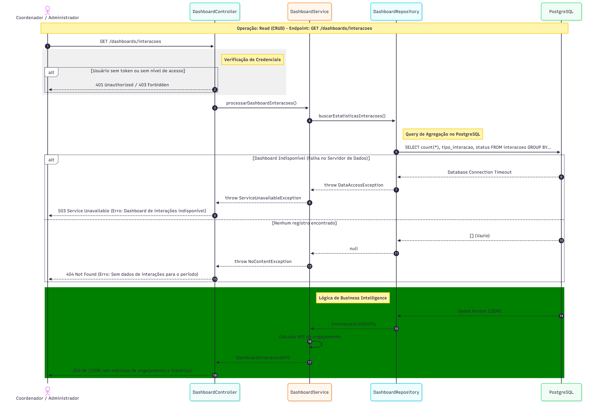<br>
  <sup>Fonte: Material produzido pelos autores, 2026. (Diagrama esquematizado no Mermaid)</sup>
</div>

#### Exporta Dados

O fluxo principal permite que o coordenador gere e exporte uma planilha com os dados dos parceiros (200). Alternativamente, a exportação falha se a lista estiver vazia (404) ou por erro técnico (500).

<div align="center">
  <sub>Figura 3.2.4.16 - Fluxo 16: exporta dados</sub><br>
  <br>
  <sup>Fonte: Material produzido pelos autores, 2026. (Diagrama esquematizado no Mermaid)</sup>
</div>

#### Encerra Sessão

O fluxo principal permite encerrar uma sessão ativa e persistir a revogação no banco (200). Alternativamente, a operação falha se a sessão já estiver encerrada (409), se a sessão não existir ou o ID for inválido (404), ou se o usuário revogador informado não existir (422).

<div align="center">
  <sub>Figura 3.2.4.17 - Fluxo 17: Encerra sessão</sub><br>
  <br>
  <sup>Fonte: Material produzido pelos autores, 2026. (Diagrama esquematizado no Mermaid)</sup>
</div>

#### Visualiza dados de pareciros

O fluxo principal permite que analistas, coordenadores e administradores consultem um parceiro existente pelo ID (200). Alternativamente, a consulta falha quando o parceiro não existe, está inativo ou o ID possui formato inválido (404).

<div align="center">
  <sub>Figura 3.2.4.18 - Fluxo 18: Visualiza dados de pareciros</sub><br>
  <br>
  <sup>Fonte: Material produzido pelos autores, 2026. (Diagrama esquematizado no Mermaid)</sup>
</div>

#### Aprovação de Parceiro Pendente

O fluxo principal permite que coordenadores ou administradores aprovem um parceiro pendente, alterando seu status para ativo e registrando a aprovação no histórico (200). Alternativamente, a operação falha por payload inválido (400), status incompatível (409), parceiro inexistente (404) ou aprovador inexistente (422).

<div align="center">
  <sub>Figura 3.2.4.19 - Fluxo 19: Aprova dados de pareciros pendentes</sub><br>
  <br>
  <sup>Fonte: Material produzido pelos autores, 2026. (Diagrama esquematizado no Mermaid)</sup>
</div>

#### Devolve dados de Parceiro

O fluxo principal permite que coordenadores ou administradores devolvam um parceiro pendente para ajustes, alterando seu status para devolvido e registrando a operação no histórico (200). Alternativamente, a operação falha por payload inválido (400), parceiro inexistente (404), status incompatível (409) ou usuário responsável inexistente (422).

<div align="center">
  <sub>Figura 3.2.4.20 - Fluxo 20: Devolve dados de pareciros</sub><br>
  <br>
  <sup>Fonte: Material produzido pelos autores, 2026. (Diagrama esquematizado no Mermaid)</sup>
</div>

#### Envio para validação

O fluxo principal permite que coordenadores ou administradores devolvam um parceiro pendente para ajustes, alterando seu status para devolvido e registrando a operação no histórico (200). Alternativamente, a operação falha por payload inválido (400), parceiro inexistente (404),O fluxo principal permite que analistas ou administradores enviem um parceiro em rascunho ou devolvido para validação, alterando seu status para pendente e registrando o envio no histórico (200). Alternativamente, a operação falha por payload ou cadastro incompleto (400), parceiro inexistente (404), status incompatível (409) ou usuário responsável inexistente ( status incompatível (409) ou usuário responsável inexistente (422).

<div align="center">
  <sub>Figura 3.2.4.21 - Fluxo 21: Envio para validação </sub><br>
  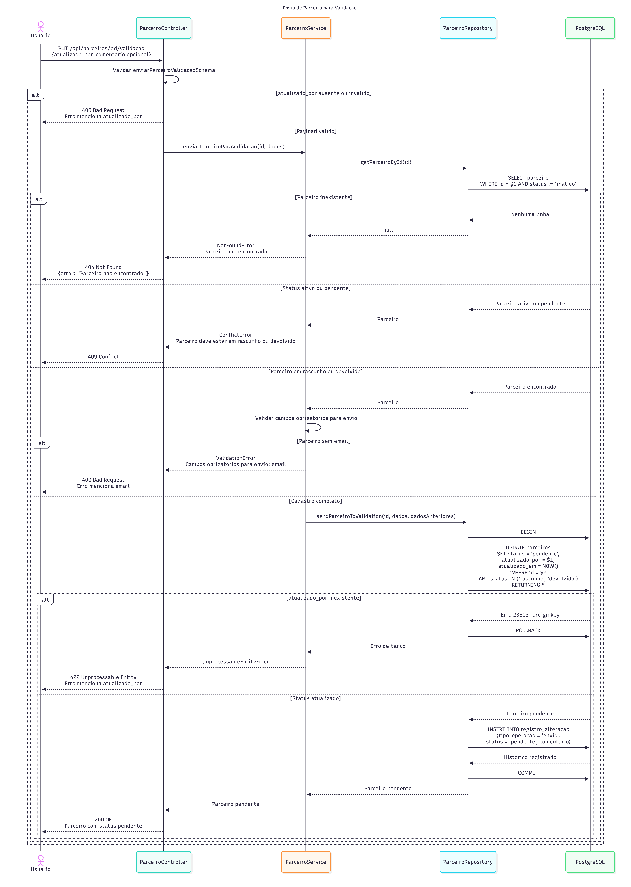<br>
  <sup>Fonte: Material produzido pelos autores, 2026. (Diagrama esquematizado no Mermaid)</sup>
</div>

#### Consulta rascunhos devolvidos

O fluxo principal permite que analistas ou administradores consultem os parceiros em rascunho ou devolvidos pertencentes ao analista, incluindo o comentário mais recente de devolução (200). Alternativamente, a consulta falha quando o analista não está identificado (400). Se não houver registros, o endpoint retorna uma lista vazia com 200.

<div align="center">
  <sub>Figura 3.2.4.22 - Fluxo 22: Consulta rascunhos devolvidos</sub><br>
  <br>
  <sup>Fonte: Material produzido pelos autores, 2026. (Diagrama esquematizado no Mermaid)</sup>
</div>

#### Vincula terra á parceiros

O fluxo principal permite que analistas ou administradores vinculem uma terra existente a um parceiro, registrem dados comerciais opcionais e gravem a operação no histórico (201). Alternativamente, a operação falha por payload inválido (400), parceiro inexistente (404), vínculo duplicado (409) ou terra inexistente (422).

<div align="center">
  <sub>Figura 3.2.4.23 - Fluxo 23: Vincula terra a parceiros</sub><br>
  <br>
  <sup>Fonte: Material produzido pelos autores, 2026. (Diagrama esquematizado no Mermaid)</sup>
</div>

#### Consulta das Terras Vinculadas

O fluxo principal permite que analistas, coordenadores ou administradores consultem as terras ativas vinculadas a um parceiro (200). Se o parceiro existir sem vínculos, retorna uma lista vazia (200). Alternativamente, a consulta falha quando o parceiro não existe ou o ID é inválido (404).

<div align="center">
  <sub>Figura 3.2.4.24 - Fluxo 24: Consulta das Terras Vinculadas</sub><br>
  <br>
  <sup>Fonte: Material produzido pelos autores, 2026. (Diagrama esquematizado no Mermaid)</sup>
</div>

#### Consulta das Terras Existentes

O fluxo principal permite que analistas, coordenadores ou administradores consultem as terras cadastradas que não estejam inativas (200). Quando nenhuma terra estiver disponível, o endpoint retorna uma lista vazia (200), e não 404.

<div align="center">
  <sub>Figura 3.2.4.25 - Fluxo 25: Consulta das Terras Existentes</sub><br>
  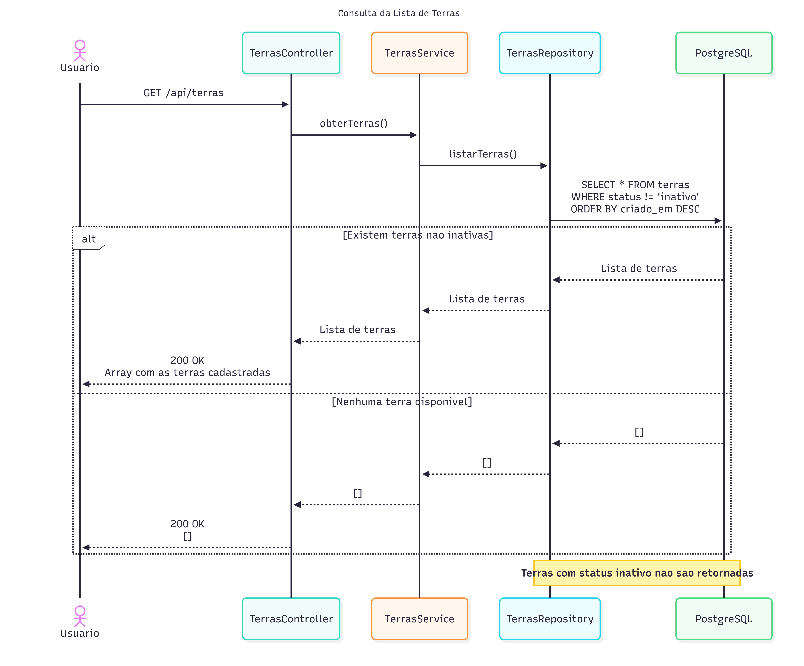<br>
  <sup>Fonte: Material produzido pelos autores, 2026. (Diagrama esquematizado no Mermaid)</sup>
</div>

#### Inativa Parceiro

O fluxo principal permite que analistas ou administradores realizem a exclusão lógica de um parceiro, alterando seu status para inativo e registrando a operação no histórico (200). Alternativamente, a operação falha por ausência do responsável (400), parceiro inexistente (404), parceiro já inativo (409) ou responsável inexistente (422).

<div align="center">
  <sub>Figura 3.2.4.26 - Fluxo 26: Inativa Parceiro </sub><br>
  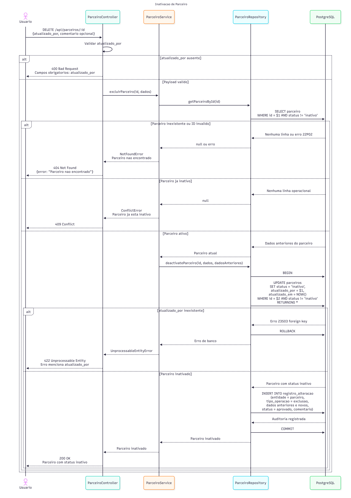<br>
  <sup>Fonte: Material produzido pelos autores, 2026. (Diagrama esquematizado no Mermaid)</sup>
</div>

#### Inativa terras

O fluxo principal permite que analistas ou administradores realizem a exclusão lógica de uma terra, alterando seu status para inativo e registrando a auditoria (200). Alternativamente, a operação pode falhar por ausência do responsável (400), terra inexistente (404), terra já inativa (409) ou responsável inexistente (422).

<div align="center">
  <sub>Figura 3.2.4.27 - Fluxo 27: Inativa terras </sub><br>
  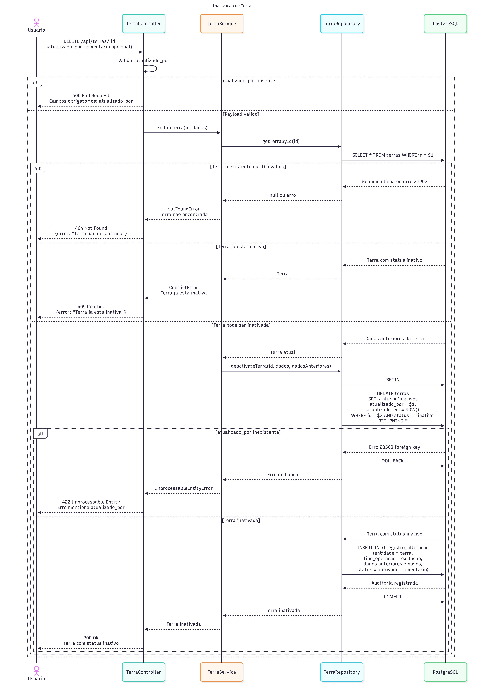<br>
  <sup>Fonte: Material produzido pelos autores, 2026. (Diagrama esquematizado no Mermaid)</sup>
</div>

### 3.2.5. Diagrama de Atividades ou Estados (sprint 3)

*Ao menos um fluxo relevante em UML ou BPMN. Use a notação da ferramenta escolhida de forma consistente (sem misturar convenções).*

### 3.2.6. Diagrama de Implantação (sprints 4 e 5)

*Diagrama UML de deployment mostrando nós físicos, artefatos e canais de comunicação. Representa a visão Engineering + Technology do RM-ODP.*

### 3.2.7. Padrões de Projeto Aplicados (sprints 3 a 5)

No desenvolvimento do backend, foram adotados padrões de projeto voltados à separação de responsabilidades, organização da regra de negócio e redução de acoplamento entre a API, o banco de dados e os fluxos de validação. A escolha desses padrões ocorreu a partir de necessidades reais do projeto, principalmente a complexidade do domínio de parceiros agrícolas, terras, usuários, interações e histórico de alterações.

No contexto da ATVOS, o problema central envolve a substituição de controles dispersos em planilhas, e-mails e registros manuais por uma base única, auditável e confiável para consulta e manutenção de dados de parceiros agrícolas. Por isso, o backend precisava ser organizado de forma que novas regras de governança, validação, rastreabilidade e autorização por perfil pudessem ser adicionadas sem comprometer os fluxos já existentes. Os padrões abaixo foram aplicados para responder diretamente a essa necessidade de padronização, controle e evolução gradual do sistema.

| Padrão aplicado | Onde aparece no backend | Justificativa de adoção |
| --- | --- | --- |
| **Repository** | `src/repositories`, como `userRepository.ts`, `parceiroRepository.ts`, `terraRepository.ts`, `interacaoRepository.ts`, `exportaRepository.ts` e `dashboardInteracoesRepository.ts`. | O sistema depende de várias consultas e operações SQL sobre entidades diferentes. O Repository foi usado para concentrar o acesso ao PostgreSQL/Supabase e evitar que controllers e services manipulassem SQL diretamente. No problema da ATVOS, isso é importante porque os dados de parceiros, terras, vínculos e interações precisam formar uma base única e consistente, substituindo consultas manuais em fontes espalhadas. |
| **Service Layer** | `src/services`, como `userService.ts`, `parceiroService.ts`, `terraService.ts`, `authService.ts` e `interacaoService.ts`. | As regras de negócio não ficam nas rotas. Validações como existência de perfil, usuário inexistente, duplicidade, vínculo entre parceiro e terra, inativação lógica e tratamento de erros de banco são coordenadas nos services. Essa camada reflete a necessidade da ATVOS de aplicar governança sobre cadastros e alterações, garantindo que operações críticas não dependam apenas da interface ou de decisões manuais do usuário. |
| **Controller** | `src/controllers`, como `userController.ts`, `parceiroController.ts`, `terraController.ts`, `authController.ts` e `dashboardInteracoesController.ts`. | Os controllers foram usados para receber requisições HTTP, chamar os services e devolver respostas com status codes adequados. Essa separação evita misturar regra de negócio com detalhes de Express, como `Request`, `Response`, headers e renderização. |
| **DTO / Schema de Validação** | `src/schemas`, com schemas Zod como `terra.schema.ts`, `parceiroFiltros.schema.ts`, `parceiroTerra.schema.ts` e `terraParceiro.schema.ts`; também nos tipos de entrada em `src/models`. | O backend recebe dados de cadastro, edição, filtros e vínculos. Os schemas funcionam como contratos de entrada, validando campos obrigatórios, enums, UUIDs e formatos antes de acessar o banco. Isso reduz inconsistência nos dados, uma dor relevante para a ATVOS, já que informações cadastrais divergentes prejudicam a análise de parceiros e a tomada de decisão operacional. |
| **Middleware de Tratamento de Erros** | `src/middlewares/errorHandler.ts` e `src/errors/AppError.ts`. | Como a API possui muitos cenários de falha (`400`, `404`, `409`, `422` e `500`), foi criado um tratamento centralizado para converter erros da aplicação em respostas HTTP consistentes. Em um sistema de uso interno e recorrente, isso ajuda a tornar falhas de cadastro, consulta e permissão mais previsíveis para os usuários e mais rastreáveis pela equipe técnica. |
| **Wrapper para handlers assíncronos** | `src/helpers/asyncHandler.ts`, usado em controllers como `terraController.ts`. | Rotas assíncronas podem lançar exceções durante validações, consultas ou persistência. O helper evita blocos repetitivos de `try/catch` e encaminha erros para o middleware central, simplificando os controllers. |
| **Composição de dependências** | Instanciação de repository, service e controller nas rotas, como em `user.routes.ts`, `auth.routes.ts`, `interacao.routes.ts`, `exporta.routes.ts` e `dashboardInteracoes.routes.ts`. | Cada rota monta explicitamente a cadeia necessária para executar seu módulo. Isso deixa claro o fluxo `Route -> Controller -> Service -> Repository` e reduz dependências globais escondidas. |

Esses padrões também apoiam princípios SOLID no backend:

| Princípio | Aplicação no projeto |
| --- | --- |
| **SRP - Single Responsibility Principle** | Rotas definem endpoints, controllers lidam com HTTP, services concentram regras de negócio, repositories acessam o banco e schemas validam entradas. |
| **OCP - Open/Closed Principle** | Novos módulos podem ser adicionados seguindo a mesma estrutura de camadas sem reescrever os módulos já existentes. Por exemplo, os fluxos de dashboard e exportação seguem a organização já usada em usuários e interações. |
| **DIP - Dependency Inversion Principle** | Services recebem repositories por construtor em módulos como usuários, autenticação e interações, reduzindo o acoplamento direto entre regra de negócio e implementação de persistência. |

Com isso, a arquitetura do backend ficou preparada para evolução nas próximas sprints, principalmente para integração com o frontend, ampliação dos testes automatizados e refinamento das regras de autorização por perfil.

## 3.3. Wireframes (sprint 2)

Wireframe é uma representação visual simplificada da interface, usada para planejar a navegação, a disposição dos elementos e a experiência do usuário antes do desenvolvimento final. Nesta seção, são apresentadas as telas do CRM da ATVOS, organizadas conforme os três perfis de acesso definidos no projeto: administrador, coordenador e analista. Cada wireframe foi desenvolvido no Excalidraw com uso de grids, garantindo consistência visual, espaçamento adequado e melhor organização entre as telas. Os quadrados com riscos dentro representam imagens ou espaços reservados para elementos visuais, como fotos de perfil, ícones ou ilustrações, servindo apenas como indicação visual no protótipo.

O fluxo da plataforma inicia na tela de login, onde o usuário acessa o sistema com e-mail e senha previamente cadastrados, sem possibilidade de autocadastro. O administrador controla esse acesso, além de gerenciar usuários, atribuir perfis e inativar contas, mantendo o histórico para auditoria. O coordenador atua no cadastro, edição e consulta de parceiros, além de aprovar registros enviados pelo analista. Já o analista pode cadastrar informações e consultar dados, mas depende de aprovação para alterações definitivas. Ao todo, sete fluxos principais foram desenvolvidos na sprint 2, atendendo às User Stories priorizadas.

#### Cadastro de fornecedores de cana
O fluxo da US01 permite ao analista cadastrar fornecedores de cana de forma padronizada, centralizando informações como CPF/CNPJ, inscrição estadual, área plantada, TCH e ATR médios, histórico de cumprimento de cota, certificações e usina de referência. O sistema valida os campos obrigatórios e, caso algum esteja em branco, bloqueia o envio e sinaliza o erro, conforme o critério CR2. Após a confirmação, o fornecedor passa a constar na listagem.

A interface do Administrador é focada na governança da plataforma, especialmente na Gestão de Usuários, que atende às US08 e US09. Nela, é possível cadastrar colaboradores, definir perfis de acesso (administrador, coordenador e analista) e inativar contas sem perder o histórico de ações, garantindo rastreabilidade. Também há acesso ao histórico de auditoria, permitindo consultar alterações por data, usuário e registro modificado.

Já a interface do Coordenador concentra o cadastro, edição e acompanhamento de parceiros. Ele pode cadastrar fornecedores e proprietários, visualizar listagens com filtros combinados, acessar perfis detalhados e registrar interações. As edições cadastrais e novas interações ficam registradas automaticamente com data, hora e responsável, assegurando controle, histórico e rastreabilidade das informações.


<div align="center">
  <sub>Figura 3.3.2 - Fluxo de cadastro de proprietários cedentes (US02)</sub><br>
  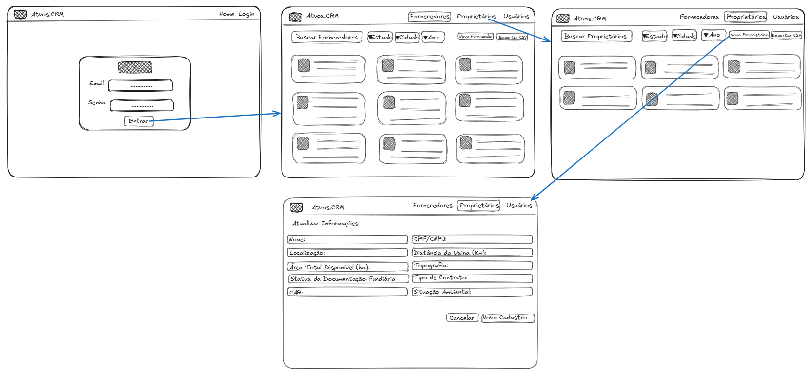<br>
  <sup>Fonte: Material produzido pelos autores, 2026. (Wireframe construído no Excalidraw)</sup>
</div>

#### Atualização de fornecedores de cana
Este fluxo cobre a US05 aplicada ao perfil de fornecedor de cana. O analista acessa o perfil de um fornecedor existente, altera um ou mais campos cadastrais e confirma a edição; o sistema registra automaticamente data, hora e identificação do usuário responsável pela alteração, atendendo ao critério de rastreabilidade definido na história. As telas reaproveitam os mesmos campos do formulário de cadastro, agora preenchidos com os dados atuais do parceiro, reduzindo a curva de aprendizado para quem já utiliza o fluxo de criação.

<div align="center">
  <sub>Figura 3.3.3 - Fluxo de atualização de fornecedores de cana (US05)</sub><br>
  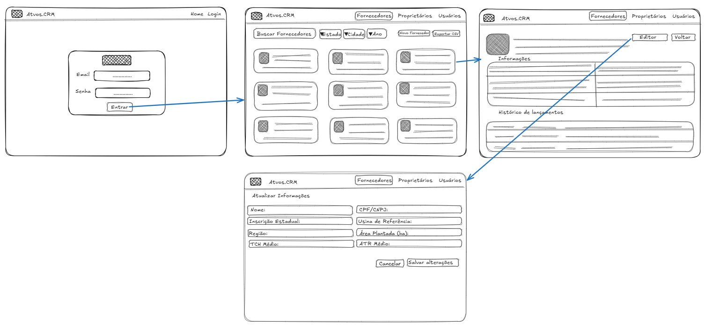<br>
  <sup>Fonte: Material produzido pelos autores, 2026. (Wireframe construído no Excalidraw)</sup>
</div>

#### Atualização de proprietários cedentes
A versão da US05 voltada a proprietários cedentes funciona de forma análoga ao fluxo de fornecedores, mas atua sobre os campos específicos do contrato e da terra: localização, área disponível, status da documentação fundiária, CAR e tipo de contrato. Manter esses dados atualizados é o que permite ao time de Estratégia de Terras planejar a expansão de safra com base em informação confiável, em vez de depender de consultas pontuais aos coordenadores responsáveis por cada região.

<div align="center">
  <sub>Figura 3.3.4 - Fluxo de atualização de proprietários cedentes (US05)</sub><br>
  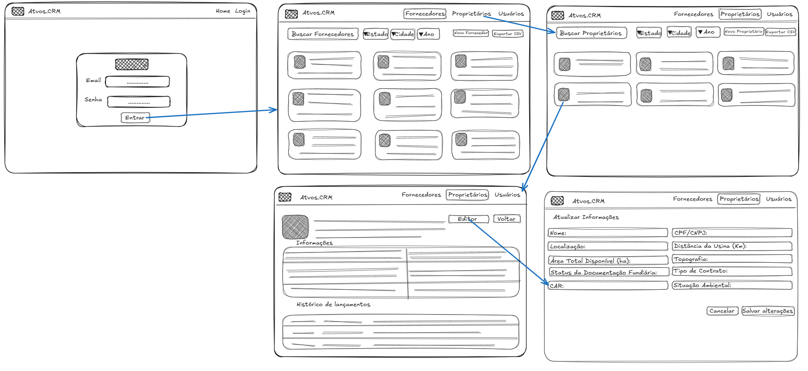<br>
  <sup>Fonte: Material produzido pelos autores, 2026. (Wireframe construído no Excalidraw)</sup>
</div>

#### Detalhes e histórico de interações dos fornecedores de cana
Este fluxo atende simultaneamente à US04, visualização do perfil detalhado do parceiro pelo coordenador, e à US03, na qual o analista registra interações para documentar o relacionamento. A tela de perfil concentra os dados cadastrais e o histórico de interações em ordem cronológica, com a interação mais recente no topo, conforme o critério CR2 da US03. O formulário de nova interação solicita data, tipo e descrição, e o registro passa a compor o histórico do parceiro imediatamente após a confirmação.

<div align="center">
  <sub>Figura 3.3.5 - Fluxo de detalhes e histórico de interações dos fornecedores de cana (US03 e US04)</sub><br>
  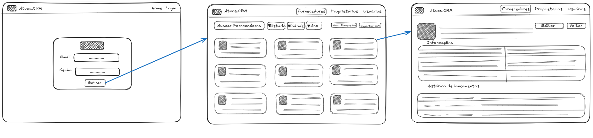<br>
  <sup>Fonte: Material produzido pelos autores, 2026. (Wireframe construído no Excalidraw)</sup>
</div>

#### Detalhes e histórico de interações dos proprietários cedentes
A versão equivalente para proprietários cedentes atende às mesmas US03 e US04, com a diferença de que os dados exibidos no perfil refletem os campos próprios do tipo proprietário, incluindo informações da terra e do contrato vigente. O histórico de interações compartilha a estrutura usada no fluxo de fornecedores, garantindo que coordenadores e analistas naveguem por uma experiência consistente, independentemente do tipo de parceiro consultado.

<div align="center">
  <sub>Figura 3.3.6 - Fluxo de detalhes e histórico de interações dos proprietários cedentes (US03 e US04)</sub><br>
  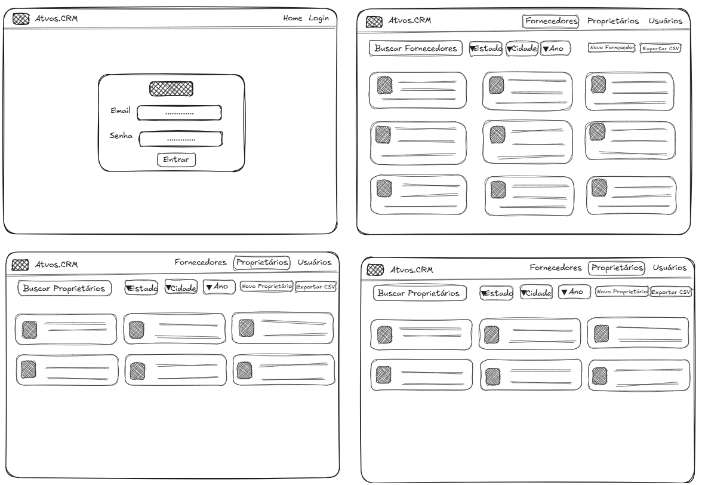<br>
  <sup>Fonte: Material produzido pelos autores, 2026. (Wireframe construído no Excalidraw)</sup>
</div>

#### Exportação de lista de contatos em CSV
Este fluxo atende à US07, em que o coordenador exporta a lista de contatos dos parceiros para compartilhar informações com pessoas que não têm acesso ao sistema. A partir da listagem de parceiros, o usuário aciona a exportação e o sistema gera um arquivo CSV contendo nome, contato, tipo e região de cada parceiro ativo, conforme o critério CR1 da história. O download é disponibilizado logo após a confirmação e o arquivo pode ser aberto sem erros em qualquer ferramenta de planilha, atendendo ao CR2 e permitindo que a informação circule fora do CRM sem comprometer o controle de acesso interno.

<div align="center">
  <sub>Figura 3.3.7 - Fluxo de exportação de lista de contatos em CSV (US07)</sub><br>
  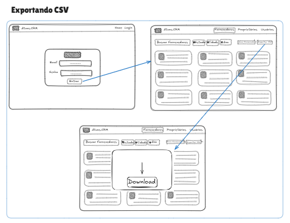<br>
  <sup>Fonte: Material produzido pelos autores, 2026. (Wireframe construído no Excalidraw)</sup>
</div>

Os wireframes apresentados cobrem os fluxos de maior prioridade do CRM da ATVOS, US01, US02, US03, US04, US05 e US07, e traduzem em interface as decisões de modelagem registradas nas seções 3.2.3 (Diagrama de Classes) e 3.2.4 (Diagramas de Sequência). A separação entre cadastro, edição e consulta para cada tipo de parceiro foi desenhada para refletir o trabalho que hoje é feito em planilhas distintas pelos coordenadores, evitando confusão entre fornecedores de cana e proprietários cedentes mesmo quando o mesmo parceiro exerce os dois papéis. Cada alteração realizada pelo usuário é registrada com data, hora e identificação do responsável, garantindo a rastreabilidade exigida pelo time de Negócios Agrícolas e preparando o terreno para os fluxos secundários, filtros combinados na listagem (US06) e gestão de usuários internos (US09 e US10), que serão prototipados nas próximas sprints.

A seguir, o link dos wireframes:
https://excalidraw.com/#json=5HLRZVY2n7lELvcKSG7r3,M0e1IsL3CvTZeFLNSC1-ww

## 3.4. Guia de estilos (sprint 3)

O guia de estilos consolida os padrões visuais do **Safra Control**, sistema voltado à gestão de fornecedores, proprietários de terra, usuários internos e histórico de relacionamento agrícola. Ele serve como referência direta para o protótipo de alta fidelidade apresentado na seção 3.5, garantindo que as telas mantenham consistência visual, previsibilidade de interação e alinhamento com a identidade institucional da **ATVOS**.

Este guia padroniza cores, tipografia, espaçamentos, grid, radius, sombras, componentes, ícones, estados visuais e exemplos de aplicação. A proposta não é apenas registrar a aparência da interface, mas também explicar **onde cada elemento deve ser usado** e **por que aquela escolha visual foi feita** no contexto do **Safra Control**. A identidade visual estruturada pelo grupo **Atwatts** foi alinhada ao contexto operacional da **ATVOS**, preservando a leitura corporativa necessária para uma plataforma de relacionamento agrícola.

### 3.4.1. Cores

A paleta visual do **Safra Control** foi definida a partir da identidade institucional da **ATVOS**. Ela combina laranjas, amarelo e azul institucional para diferenciar ações, navegação, estados e informações de apoio. Essa separação ajuda o usuário a identificar rapidamente o que é ação principal, o que é estrutura da interface e o que representa atenção, validação ou status.

<div align="center">
  <sub>Figura 3.4.1 - Paleta visual derivada da identidade da ATVOS</sub><br>
  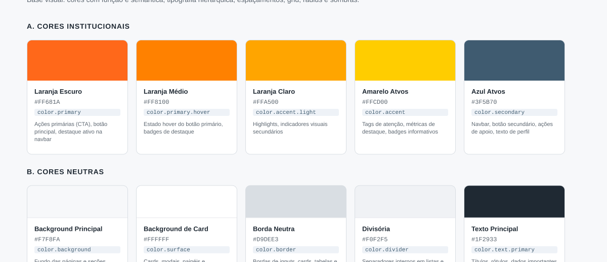<br>
  <sup>Fonte: Material produzido pelos autores, 2026.</sup>
</div>

O **laranja escuro `#FF681A`** é usado em CTAs, botões primários e ações de destaque, como "Entrar", "Novo Fornecedor" e "Salvar Fornecedor". Ele foi escolhido por remeter à energia, movimento e identidade institucional da **ATVOS**, além de orientar a ação prioritária do usuário. O **laranja médio `#FF8100`** aparece em estados de hover e variações de destaque, indicando interatividade sem romper a consistência da ação principal. O **laranja claro `#FFA500`** é usado em highlights e indicadores visuais secundários, principalmente quando é necessário destacar uma informação sem transformá-la em CTA.

O **amarelo ATVOS `#FFCD00`** é utilizado com moderação em estados de atenção, indicadores e badges informativos. Sua função é chamar atenção para pendências, prazos ou avisos sem competir com o botão primário. O **azul ATVOS `#3F5B70`** aparece em navbar, botões secundários, avatar, textos de apoio e componentes corporativos, pois transmite confiança, estabilidade e clareza operacional.

<div align="center">
  <sub>Figura 3.4.2 - Cores neutras, semânticas e status</sub><br>
  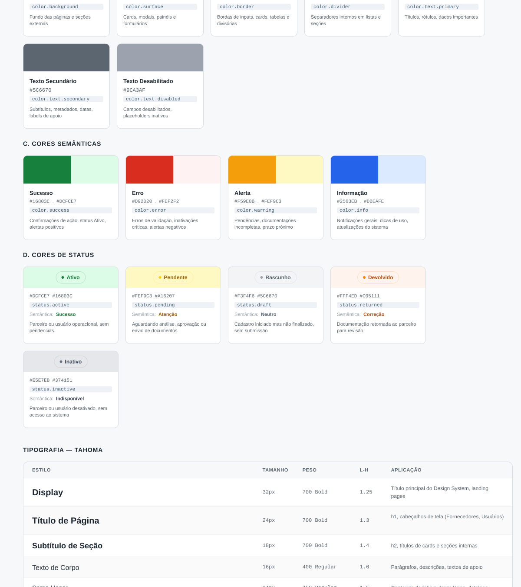<br>
  <sup>Fonte: Material produzido pelos autores, 2026.</sup>
</div>

As cores neutras estruturam a interface. O fundo principal `#F7F8FA` separa a área da página dos cards brancos `#FFFFFF`; as bordas `#D9DEE3` delimitam inputs, tabelas e cards; os divisores `#E5E7EB` separam linhas e grupos de conteúdo; e os textos `#1F2933`, `#5C6670` e `#9CA3AF` criam hierarquia entre informação principal, apoio e conteúdo desabilitado.

As cores semânticas indicam feedbacks do sistema. Sucesso usa `#16803C` com fundo `#DCFCE7`; erro usa `#D92D20` com fundo `#FEF2F2`; alerta usa `#F59E0B` com fundo `#FEF9C3`; informação usa `#2563EB` com fundo `#DBEAFE`. Em todos os casos, a cor deve aparecer acompanhada de texto e, quando possível, ícone, evitando que o usuário dependa apenas da cor para compreender a mensagem.

| Grupo | Cor | Código | Uso na interface | Justificativa |
|---|---|---|---|---|
| Institucional | Laranja escuro | `#FF681A` | Botões primários e CTAs | Reforça ação principal e identidade da ATVOS |
| Institucional | Laranja médio | `#FF8100` | Hover de botões primários e destaques | Comunica interatividade mantendo a paleta institucional |
| Institucional | Laranja claro | `#FFA500` | Highlights e indicadores secundários | Destaca informações sem competir com o CTA |
| Institucional | Amarelo ATVOS | `#FFCD00` | Atenção, métricas e badges informativos | Chama atenção para pendências e prazos |
| Institucional | Azul ATVOS | `#3F5B70` | Navbar, botões secundários e elementos estruturais | Transmite confiança e estabilidade |
| Neutra | Background | `#F7F8FA` | Fundo geral das telas | Diferencia a página dos cards e formulários |
| Neutra | Surface | `#FFFFFF` | Cards, modais e painéis | Garante leitura limpa do conteúdo |
| Neutra | Border | `#D9DEE3` | Inputs, cards, tabelas e divisórias | Organiza blocos sem excesso visual |
| Neutra | Divisor | `#E5E7EB` | Linhas de tabela e separadores internos | Separa informações sem criar peso visual excessivo |
| Neutra | Texto principal | `#1F2933` | Títulos, rótulos e dados importantes | Prioriza informações essenciais |
| Neutra | Texto secundário | `#5C6670` | Descrições, metadados e textos de apoio | Mantém contexto sem competir com o conteúdo principal |
| Neutra | Texto desabilitado | `#9CA3AF` | Placeholders, campos bloqueados e ações indisponíveis | Comunica limitação de uso sem parecer erro |
| Semântica | Sucesso | `#16803C` / `#DCFCE7` | Confirmações e status ativo | Indica conclusão positiva |
| Semântica | Erro | `#D92D20` / `#FEF2F2` | Validações e falhas | Indica necessidade de correção |
| Semântica | Alerta | `#F59E0B` / `#FEF9C3` | Pendências, prazos e documentação incompleta | Sinaliza atenção sem indicar erro crítico |
| Semântica | Informação | `#2563EB` / `#DBEAFE` | Avisos gerais e atualizações | Comunica orientação ou novidade do sistema |
| Status | Rascunho | `#F3F4F6` / `#5C6670` | Cadastros iniciados e não enviados | Indica estado temporário e neutro |
| Status | Pendente | `#FEF9C3` / `#A16207` | Cadastros aguardando validação | Sinaliza atenção sem indicar falha |
| Status | Ativo | `#DCFCE7` / `#16803C` | Registros aprovados e disponíveis | Comunica normalidade operacional |
| Status | Devolvido | `#FFF4ED` / `#C05111` | Registros retornados para correção | Indica retrabalho necessário |
| Status | Inativo | `#E5E7EB` / `#374151` | Usuários ou registros desabilitados | Comunica indisponibilidade |

### 3.4.2. Tipografia

A fonte principal do Safra Control é **Tahoma**, adotada por sua alta legibilidade, boa compatibilidade em ambientes web, aparência limpa e adequação a sistemas com formulários, tabelas e grande volume de informação. A escolha favorece a leitura contínua em telas operacionais e mantém coerência com a identidade visual definida para o projeto.

<div align="center">
  <sub>Figura 3.4.3 - Escala tipográfica do Safra Control</sub><br>
  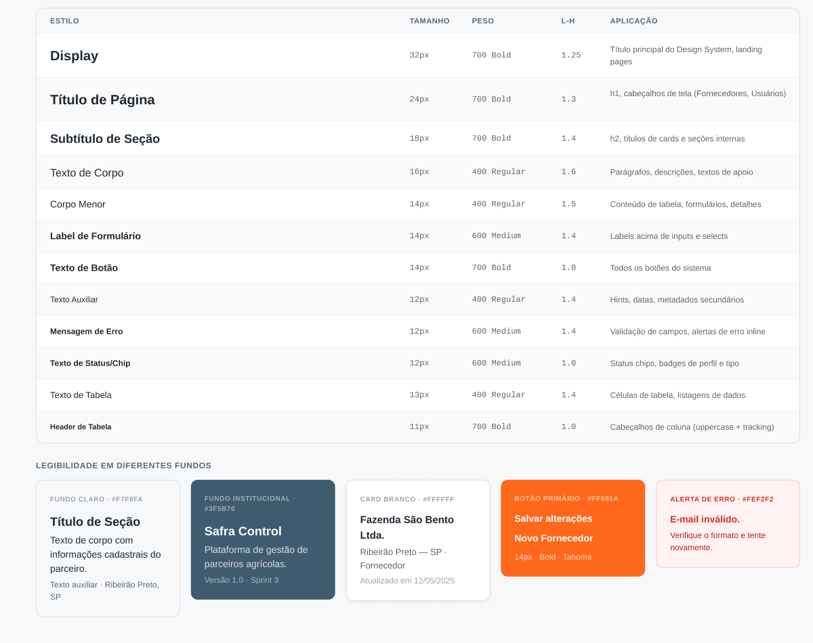<br>
  <sup>Fonte: Material produzido pelos autores, 2026.</sup>
</div>

| Estilo | Tamanho | Peso | Aplicação | Justificativa |
|---|---:|---|---|---|
| Display | `32px` | Bold `700` | Títulos principais do design system e telas de apresentação | Cria destaque máximo sem uso excessivo na interface |
| Título de página | `24px` | Bold `700` | Cabeçalhos de telas como Fornecedores, Proprietários e Usuários | Garante hierarquia visual clara |
| Subtítulo de seção | `18px` | Bold `700` | Blocos como Dados Cadastrais, Dados Agrícolas e Histórico | Facilita varredura da tela |
| Corpo | `16px` | Regular `400` | Descrições, instruções e textos corridos | Garante leitura contínua |
| Corpo menor | `14px` | Regular `400` | Células, formulários e detalhes cadastrais | Permite densidade sem perder legibilidade |
| Label | `14px` | Medium `600` | Rótulos de inputs, selects e filtros | Ajuda a identificar campos |
| Botão | `14px` | Bold `700` | Ações clicáveis | Reforça interatividade |
| Texto auxiliar | `12px` | Regular `400` | Hints, metadados, datas e mensagens de apoio | Reduz ruído visual |
| Erro | `12px` | Medium `600` | Validação de campos | Destaca necessidade de correção |
| Status/Chip | `12px` | Medium `600` | Chips de status e badges de perfil | Mantém estados legíveis em espaços reduzidos |
| Texto de tabela/listagem | `13px` | Regular `400` | Células de tabelas, listagens e resultados de busca | Permite comparação de registros com boa densidade |

A tipografia aparece no login, nas listagens de parceiros, nos formulários de cadastro, nos detalhes do parceiro, no histórico de interações, na gestão de usuários e nos modais. O uso consistente dos tamanhos evita que telas densas pareçam desorganizadas e permite que o usuário diferencie rapidamente título, dado cadastral, metadado e mensagem de erro.

A aplicação tipográfica também foi definida para manter contraste em diferentes fundos. Em fundo claro `#F7F8FA`, títulos e dados principais usam `#1F2933`; em fundo institucional ou escuro, o texto deve usar branco ou neutro muito claro para preservar leitura; em cards brancos, labels e valores mantêm hierarquia por peso e tamanho; em botões primários, o texto branco em bold reforça a ação clicável; em alertas de erro, o texto vermelho acompanha borda e fundo sem depender apenas da cor; em chips de status, pesos médios e textos curtos garantem legibilidade mesmo em áreas reduzidas.

### 3.4.3. Espaçamento, grid, radius e sombras

O design system utiliza uma estrutura baseada em múltiplos de 4px, com uso recorrente de múltiplos de 8px para compor espaçamentos de interface. Essa escolha melhora alinhamento, consistência e organização visual, especialmente em telas com muitos campos e registros. O grid desktop possui largura de referência de `1440px`, 12 colunas, gutter de `24px` e margem horizontal de `80px`.

<div align="center">
  <sub>Figura 3.4.4 - Espaçamento, radius, sombras e grid</sub><br>
  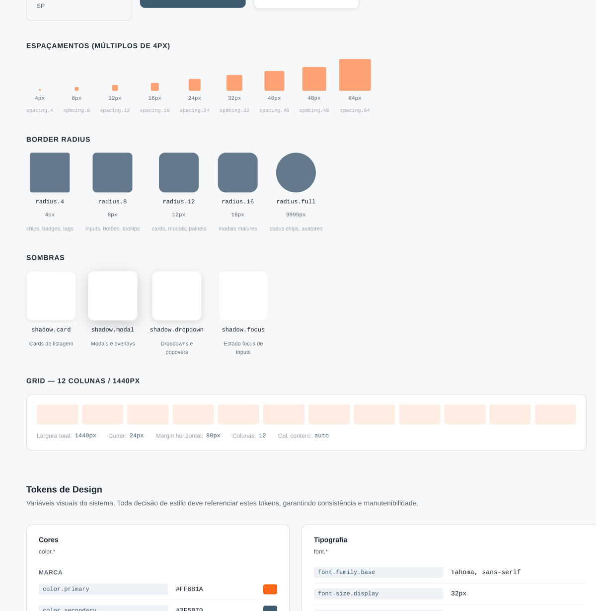<br>
  <sup>Fonte: Material produzido pelos autores, 2026.</sup>
</div>

O espaçamento pequeno é usado entre ícones, labels e elementos próximos; o médio organiza campos de formulário, botões e linhas internas de cards; e o grande separa seções, como filtros, tabelas, dados cadastrais e histórico de interações. O radius de `8px` aparece em inputs e botões; o de `12px` em cards e painéis; e valores maiores são reservados para modais e elementos circulares, como avatares e chips.

As sombras são leves e funcionais. Elas não têm papel decorativo principal, mas ajudam a separar camadas, como cards, dropdowns, modais e estados de foco. Isso mantém a interface clara para uso corporativo e evita excesso visual em telas de consulta.

| Token visual | Aplicação | Justificativa |
|---|---|---|
| Espaçamento pequeno | Ícones, labels e elementos próximos | Mantém compactação sem poluir |
| Espaçamento médio | Campos de formulário e botões | Melhora leitura e área de clique |
| Espaçamento grande | Separação entre seções | Cria hierarquia visual |
| Grid 12 colunas | Listagens, formulários e páginas internas | Mantém alinhamento entre módulos |
| Radius 8px | Inputs e botões | Mantém aparência moderna e clara |
| Radius 12px | Cards e modais | Diferencia blocos de conteúdo |
| Sombra leve | Cards, dropdowns e modais | Cria profundidade sem excesso decorativo |

### 3.4.4. Botões

Os botões foram padronizados para diferenciar ações principais, secundárias, exportação e ações críticas. Essa distinção é importante porque o **Safra Control** possui fluxos com consequências diferentes, como salvar um fornecedor, cancelar um cadastro, exportar CSV ou inativar um usuário.

<div align="center">
  <sub>Figura 3.4.5 - Botões e estados de interação</sub><br>
  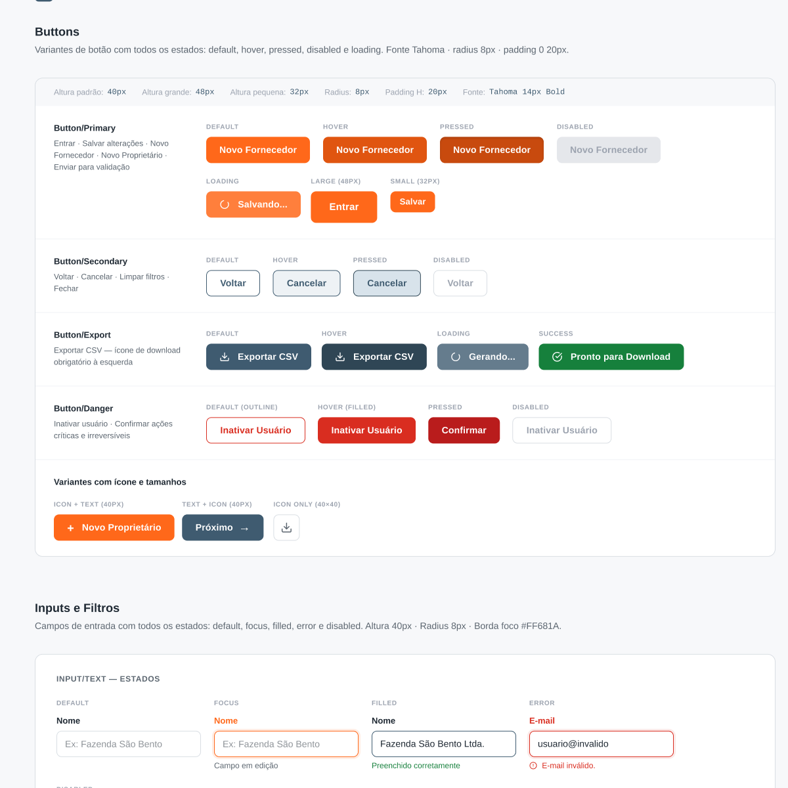<br>
  <sup>Fonte: Material produzido pelos autores, 2026.</sup>
</div>

| Componente | Uso | Exemplo no sistema | Justificativa |
|---|---|---|---|
| Button/Primary | Ações principais | Entrar, Salvar alterações, Novo Fornecedor, Enviar para validação | Direciona a ação prioritária do usuário |
| Button/Secondary | Ações auxiliares | Voltar, Cancelar, Limpar filtros | Evita competição com o CTA principal |
| Button/Export | Exportação de dados | Exportar CSV | Diferencia ação de download das demais ações |
| Button/Danger | Ações críticas | Inativar usuário, Confirmar inativação | Sinaliza impacto e necessidade de cautela |
| Button/Disabled | Ações indisponíveis | Formulário incompleto ou operação bloqueada | Evita erro de uso |

Os estados documentados são **default**, **hover**, **pressed**, **disabled**, **loading** e **success**. O estado loading deve aparecer em ações assíncronas, como salvar cadastro ou gerar CSV. O estado success é usado quando uma operação é concluída, por exemplo, quando a exportação está pronta para download. A padronização dos estados reduz dúvida durante operações críticas e melhora a percepção de resposta do sistema.

### 3.4.5. Formulários, inputs e filtros

Os formulários foram desenhados para suportar cadastros longos de fornecedores, proprietários e usuários, mantendo legibilidade e validação clara. Como o Safra Control depende de dados cadastrais confiáveis, os campos precisam orientar o preenchimento e indicar erros sem ambiguidade.

<div align="center">
  <sub>Figura 3.4.6 - Inputs, filtros, searchbar e textarea</sub><br>
  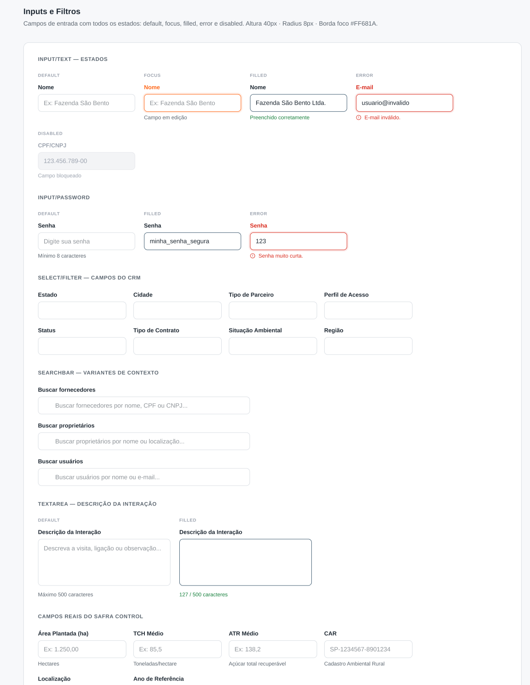<br>
  <sup>Fonte: Material produzido pelos autores, 2026.</sup>
</div>

| Componente | Uso no Safra Control | Exemplo | Justificativa |
|---|---|---|---|
| Input/Text | Dados cadastrais | Nome, CPF/CNPJ, e-mail, telefone | Padroniza entrada de dados |
| Input/Password | Autenticação | Senha no login | Mantém segurança visual do acesso |
| Select/Filter | Filtros e seleção de perfil | Estado, região, tipo de parceiro, perfil de acesso | Reduz erro de digitação |
| SearchBar | Busca em listagens | Buscar fornecedores ou proprietários | Facilita localização rápida |
| TextArea | Campos livres | Observações e descrição da interação | Permite contexto textual maior |
| Input/Error | Validação | CPF duplicado, e-mail inválido, campo obrigatório | Indica correção necessária |

Os estados previstos são **default**, **focus**, **filled**, **error** e **disabled**. O foco usa destaque laranja para indicar edição ativa. O erro usa borda e mensagem em vermelho para orientar correção imediata. Campos desabilitados aparecem em cinza para indicar que a informação não pode ser editada naquele momento, como dados bloqueados por permissão ou status de validação.

### 3.4.6. Navegação e cards

A navegação principal organiza os módulos centrais do **Safra Control**: **Fornecedores**, **Proprietários**, **Usuários**, além da área de perfil e saída. A navbar aparece nas telas internas para manter o usuário orientado durante consulta, cadastro, edição e gestão de acesso.

<div align="center">
  <sub>Figura 3.4.7 - Navbar e cards de informação</sub><br>
  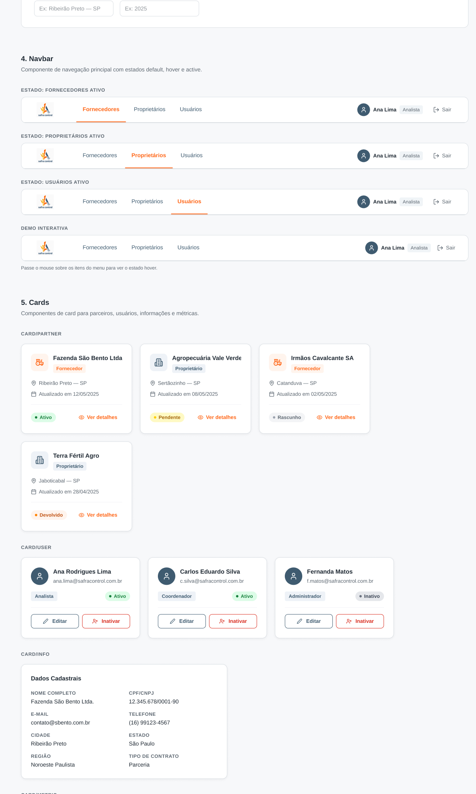<br>
  <sup>Fonte: Material produzido pelos autores, 2026.</sup>
</div>

O item ativo da navbar usa laranja e linha inferior para indicar localização atual. Essa escolha é relevante porque fornecedores e proprietários possuem telas parecidas; o estado ativo reduz risco de navegação equivocada. O hover indica interatividade, e a área de perfil mostra nome, papel e ação de sair, reforçando controle de sessão.

Os cards organizam informações em blocos reconhecíveis. O **Card/Partner** resume dados essenciais de fornecedores e proprietários; o **Card/User** mostra dados de usuários, permissões e status; e o **Card/Info** agrupa informações cadastrais na tela de detalhe do parceiro.

| Componente | Uso | Onde aparece | Justificativa |
|---|---|---|---|
| Navigation/Header | Navegação global | Todas as telas internas | Mantém orientação do usuário |
| Card/Partner | Listagem resumida de parceiros | Fornecedores e proprietários | Resume dados essenciais para consulta |
| Card/User | Gestão de usuários | Tela de usuários | Exibe permissões, status e ações |
| Card/Info | Detalhes do parceiro | Perfil detalhado | Agrupa informações por categoria |
| Card/Metric | Indicadores quantitativos | Dashboards e resumos | Facilita leitura rápida de números relevantes |

### 3.4.7. Tabelas, listagens e status

Tabelas e listagens são usadas para leitura comparativa de dados, validação de registros, gestão de usuários e acompanhamento de parceiros. Elas aparecem em fluxos nos quais o usuário precisa comparar muitos registros, aplicar filtros e executar ações por linha.

<div align="center">
  <sub>Figura 3.4.8 - Tabelas, listagens e chips de status</sub><br>
  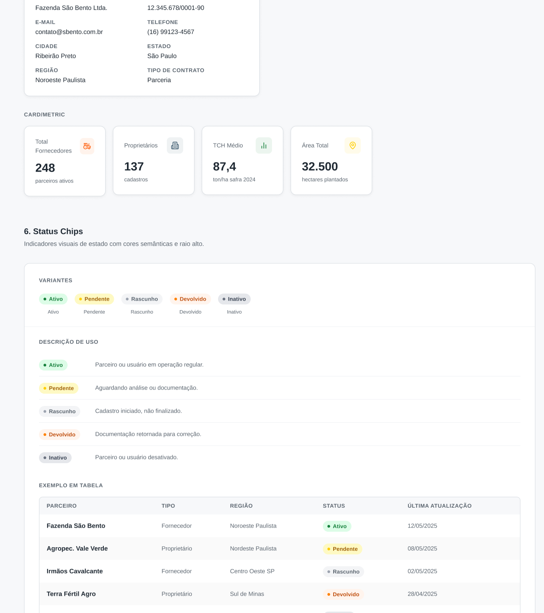<br>
  <sup>Fonte: Material produzido pelos autores, 2026.</sup>
</div>

As tabelas utilizam cabeçalhos em caixa alta, células compactas e divisórias claras, favorecendo varredura visual. Os chips de status aparecem em cards, tabelas e telas de detalhe para sintetizar o estado do registro sem exigir leitura de campos longos.

| Status | Uso | Significado | Justificativa visual |
|---|---|---|---|
| Rascunho | Cadastros incompletos | Registro salvo, mas não enviado | Cor neutra indica estado temporário |
| Pendente | Fila de validação | Aguardando análise ou documentação | Cor de atenção indica ação necessária |
| Ativo | Registro aprovado | Disponível nas consultas e operações | Cor positiva indica normalidade |
| Devolvido | Correção necessária | Retornado pelo coordenador | Cor de alerta indica retrabalho |
| Inativo | Usuário ou registro desabilitado | Acesso ou uso bloqueado | Cor neutra escura indica indisponibilidade |

### 3.4.8. Histórico de interações

O histórico de interações é um componente essencial do Safra Control, pois responde diretamente à dor de perda de histórico entre analistas, coordenadores e gestores. Ele transforma contatos, visitas, reuniões e observações em memória institucional consultável.

<div align="center">
  <sub>Figura 3.4.9 - Histórico de interações em timeline</sub><br>
  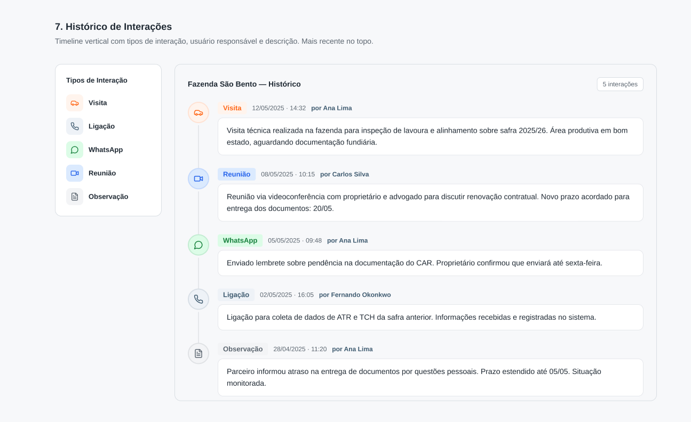<br>
  <sup>Fonte: Material produzido pelos autores, 2026.</sup>
</div>

O componente **Timeline/InteractionItem** apresenta data, tipo de interação, responsável, descrição, ícone e ordem cronológica. As interações mais recentes ficam no topo para facilitar consulta antes de reuniões, negociações ou atualizações cadastrais.

Esse componente deve ser usado na tela de detalhes do fornecedor, na tela de detalhes do proprietário e em qualquer fluxo de acompanhamento de relacionamento. A timeline torna o histórico mais rastreável, legível e institucional, reduzindo dependência de conhecimento individual ou registros dispersos em planilhas e mensagens.

### 3.4.9. Modais, alertas e estados vazios

Modais, alertas e empty states são usados para feedback de ações importantes. Eles ajudam o usuário a entender se uma operação foi concluída, se houve erro, se existe pendência ou se uma lista não possui resultados.

<div align="center">
  <sub>Figura 3.4.10 - Modais, alertas e estado vazio</sub><br>
  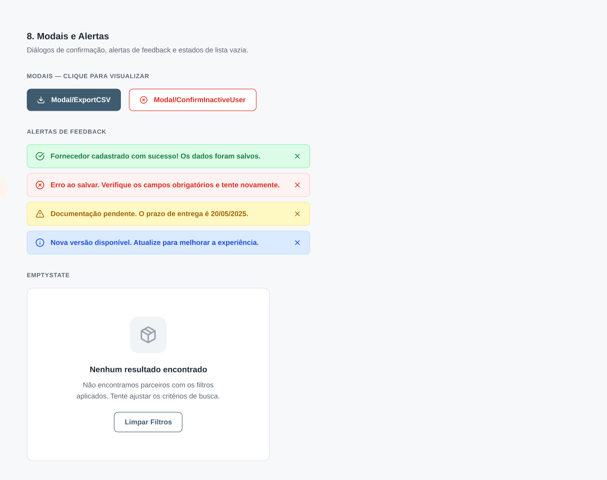<br>
  <sup>Fonte: Material produzido pelos autores, 2026.</sup>
</div>

| Componente | Uso | Exemplo | Justificativa |
|---|---|---|---|
| Modal/ExportCSV | Confirmação de exportação | Arquivo CSV gerado | Dá retorno claro ao usuário |
| Modal/ConfirmInactiveUser | Ação crítica | Inativar usuário | Evita ações acidentais |
| Alert/Success | Confirmação | Cadastro salvo | Reforça conclusão da tarefa |
| Alert/Error | Falha ou validação | Campo obrigatório ou erro ao salvar | Direciona correção |
| Alert/Warning | Atenção operacional | Documentação pendente | Sinaliza necessidade de acompanhamento |
| Alert/Info | Informação geral | Nova versão disponível | Comunica orientação sem bloquear fluxo |
| EmptyState | Lista vazia | Nenhum parceiro encontrado | Evita tela sem contexto |

Modais devem ser usados apenas quando a ação exige confirmação ou atenção concentrada, como exportar dados ou inativar usuários. Alertas aparecem após ações ou em situações de validação. Empty states devem explicar o motivo da ausência de dados e oferecer uma ação de recuperação, como limpar filtros.

### 3.4.10. Iconografia e imagens

A iconografia usa estilo uniforme, preferencialmente outline/linear, com traço regular, proporção consistente e cor padronizada. O design system adota a família Lucide React, com ícones vetoriais de aparência leve, espessura aproximada de `1.5px` a `2px` e aplicação em botões, inputs, cards, tabelas, modais e timeline. A cor base segue o azul institucional ou tons neutros; cores semânticas são reservadas para sucesso, erro, alerta e informação.

<div align="center">
  <sub>Figura 3.4.11 - Biblioteca de ícones do Safra Control</sub><br>
  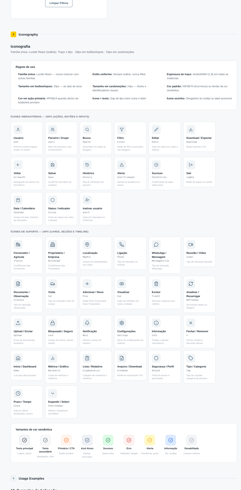<br>
  <sup>Fonte: Material produzido pelos autores, 2026.</sup>
</div>

| Ícone | Função | Onde usar | Justificativa |
|---|---|---|---|
| Busca | Pesquisar registros | SearchBar | Ícone reconhecido universalmente |
| Filtro | Refinar listagem | Filtros de parceiros e usuários | Representa seleção de critérios |
| Download/Exportação | Exportar dados | Exportar CSV | Associação direta com baixar arquivo |
| Editar | Alterar dados | Detalhes, cards e formulários | Indica modificação |
| Histórico | Ver interações | Perfil do parceiro | Relaciona-se à linha do tempo |
| Alerta | Problemas ou atenção | Erros, warnings e pendências | Comunica risco ou pendência |
| Sucesso | Confirmação positiva | Alertas e status ativo | Reforça conclusão da ação |
| Usuário | Representar conta interna | Navbar, gestão de usuários e avatar | Identifica perfil logado e permissões |
| Parceiro | Representar grupo ou parceiro | Módulos de fornecedores e proprietários | Comunica entidade principal do Safra Control |
| Calendário | Representar data | Histórico e atualização | Facilita leitura temporal |
| Status | Indicador visual | Chips e tabelas | Reforça estado do registro |
| Inativar | Bloquear usuário | Gestão de usuários | Sinaliza ação administrativa crítica |
| Sair | Encerrar sessão | Navbar | Comunica logout |
| Voltar | Retornar tela | Formulários e detalhes | Facilita navegação reversa |
| Salvar | Confirmar formulário | Cadastro e edição | Comunica persistência de dados |

A uniformidade dos ícones reduz ruído visual e ajuda o usuário a reconhecer ações recorrentes. Ícones podem aparecer sozinhos apenas em ações frequentes e de baixo risco, desde que haja contexto visual suficiente. Em ações sensíveis, como inativar usuário, exportar dados, salvar alterações ou sair do sistema, o ícone deve aparecer acompanhado de label textual, pois a clareza da ação é mais importante do que a economia de espaço.

## 3.5. Protótipo de alta fidelidade (sprint 3)

O mapeamento dos fluxos apresentados na seção 3.3 tem como objetivo definir quais wireframes devem ser evoluídos para o protótipo de alta fidelidade da aplicação web CRM da ATVOS. Essa seleção considera o escopo do MVP, as User Stories priorizadas, os requisitos funcionais relacionados e a relevância de cada fluxo para a gestão de parceiros agrícolas, especialmente fornecedores de cana e proprietários cedentes/proprietários de terra.

Dessa forma, o protótipo de alta fidelidade deve representar, com maior nível de detalhamento visual e interativo, os fluxos centrais do sistema: cadastro, consulta, atualização, histórico de interações, listagem, filtragem e exportação de informações de parceiros ativos. Fluxos relacionados à gestão de usuários, embora relevantes para a administração do sistema, são tratados como secundários nesta etapa, pois não compõem o núcleo funcional principal do CRM agrícola.

| Nome do fluxo | User Story relacionada | Tipo de usuário/persona | Prioridade | Entra no protótipo de alta fidelidade? | Justificativa |
|---|---|---|---|---|---|
| Cadastro de fornecedores de cana | US01 | Usuário interno responsável pelo relacionamento com parceiros agrícolas | Alta | Sim | Representa um dos fluxos centrais do MVP, relacionado ao RF004, pois permite o cadastro centralizado de fornecedores de cana no CRM. |
| Cadastro de proprietários cedentes/proprietários de terra | US02 | Usuário interno responsável pelo relacionamento com parceiros agrícolas | Alta | Sim | É essencial para contemplar o segundo tipo principal de parceiro agrícola do sistema, atendendo ao RF004 e ao objetivo de centralização cadastral. |
| Atualização de fornecedores de cana | US05 | Usuário interno responsável pela manutenção cadastral | Alta | Sim | Está diretamente associado ao RF005 e permite manter os dados cadastrais dos fornecedores atualizados, garantindo confiabilidade às informações do CRM. |
| Atualização de proprietários cedentes/proprietários de terra | US05 | Usuário interno responsável pela manutenção cadastral | Alta | Sim | Complementa o fluxo de edição cadastral dos parceiros agrícolas, assegurando que proprietários de terra também possam ter seus dados atualizados no sistema. |
| Visualização de detalhes e histórico de interações dos fornecedores | US03 e US04 | Usuário interno responsável pelo acompanhamento do relacionamento | Alta | Sim | Reúne informações detalhadas do parceiro e seu histórico de interações, atendendo aos RF006 e RF008, pilares fundamentais para a gestão do relacionamento. |
| Visualização de detalhes e histórico de interações dos proprietários cedentes | US03 e US04 | Usuário interno responsável pelo acompanhamento do relacionamento | Alta | Sim | Permite consultar o perfil detalhado e as interações registradas com proprietários de terra, reforçando o controle e a rastreabilidade do relacionamento. |
| Listagem e filtros de parceiros ativos | US06 | Usuário interno que consulta e acompanha a base de parceiros | Alta | Sim | Está relacionado aos RF007 e RF016, sendo necessário para localizar parceiros ativos, consultar informações e aplicar filtros de forma eficiente. |
| Exportação de lista de contatos em CSV | US07 | Usuário interno que utiliza dados de parceiros para consulta, análise ou comunicação | Média | Sim | Atende ao RF017 e permite exportar informações de contatos e parceiros ativos, apoiando atividades operacionais e de acompanhamento fora do sistema. |
| Gestão de usuários | US08 | Administrador do sistema | Baixa | Opcional | Embora relevante para a administração da aplicação, não faz parte do núcleo funcional do MVP voltado à gestão de parceiros agrícolas. Pode ser prototipado apenas se houver tempo disponível. |
| Inativação de contas de usuários | US09 | Administrador do sistema | Baixa | Opcional | Trata-se de um fluxo administrativo secundário. Sua inclusão no protótipo de alta fidelidade não deve ter prioridade sobre os fluxos ligados a parceiros agrícolas. |

Com base nesse mapeamento, os fluxos que devem ser priorizados no protótipo de alta fidelidade são aqueles relacionados diretamente à gestão de parceiros agrícolas: cadastro, atualização, listagem, filtragem, visualização de detalhes, histórico de interações e exportação de contatos. Esses fluxos correspondem aos principais pilares do MVP, pois viabilizam o cadastro centralizado de parceiros, o acompanhamento do relacionamento e a consulta estruturada das informações.

A gestão de usuários e a inativação de contas devem ser tratadas como fluxos secundários ou opcionais nesta etapa. Apesar de contribuírem para a administração da aplicação, elas não representam o valor principal do CRM para a ATVOS no contexto do MVP, cujo foco está na melhoria da gestão de fornecedores de cana e proprietários cedentes/proprietários de terra.

Na evolução para alta fidelidade, os fluxos foram organizados em uma experiência única e coerente, partindo do acesso ao sistema, passando pela gestão de parceiros agrícolas e chegando aos processos administrativos de validação, exportação e controle de usuários. As telas utilizam a identidade visual definida no guia de estilos, com predominância das cores institucionais, componentes padronizados, hierarquia visual clara e organização voltada à consulta rápida de dados operacionais.

O protótipo inicia pela autenticação do usuário e conduz para a listagem principal de parceiros, que funciona como ponto de entrada para cadastro, consulta, filtragem e exportação. A partir dela, o usuário pode registrar novos fornecedores de cana ou proprietários cedentes, acompanhar solicitações pendentes de validação e revisar registros antes da aprovação. Embora a gestão de usuários tenha sido classificada como fluxo secundário no mapeamento, suas telas também foram prototipadas em alta fidelidade para demonstrar como o administrador mantém o controle de acesso, cria novos usuários e edita dados de colaboradores internos.

<div align="center">
  <sub>Figura 3.5.1 - Tela de login do protótipo de alta fidelidade</sub><br>
  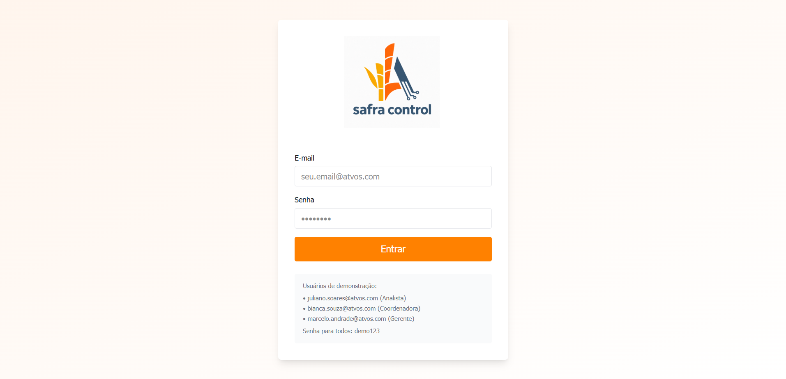<br>
  <sup>Fonte: Material produzido pelos autores, 2026.</sup>
</div>

<div align="center">
  <sub>Figura 3.5.2 - Listagem de parceiros do protótipo de alta fidelidade</sub><br>
  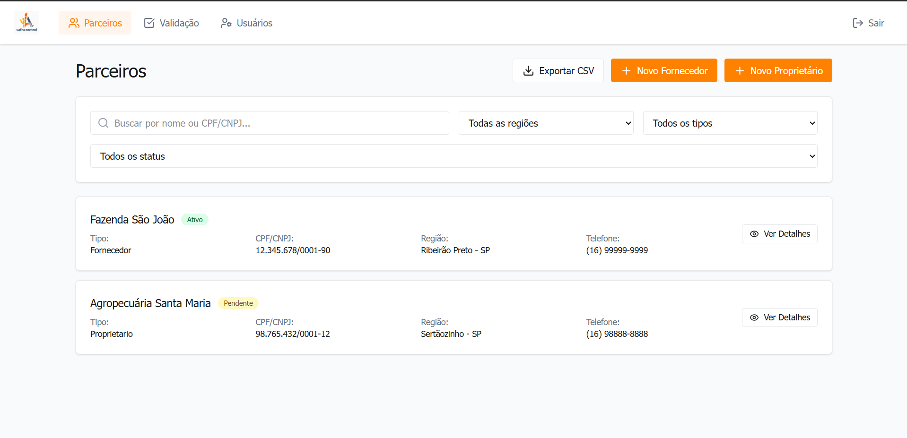<br>
  <sup>Fonte: Material produzido pelos autores, 2026.</sup>
</div>

<div align="center">
  <sub>Figura 3.5.3 - Cadastro de novo fornecedor de cana</sub><br>
  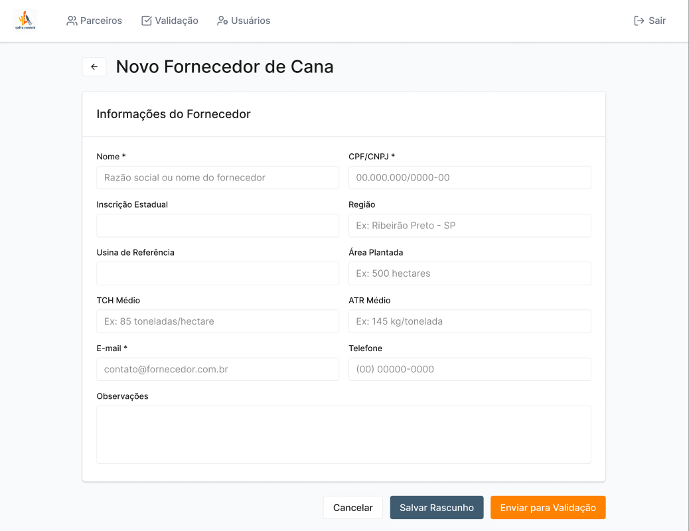<br>
  <sup>Fonte: Material produzido pelos autores, 2026.</sup>
</div>

<div align="center">
  <sub>Figura 3.5.4 - Cadastro de novo proprietário cedente</sub><br>
  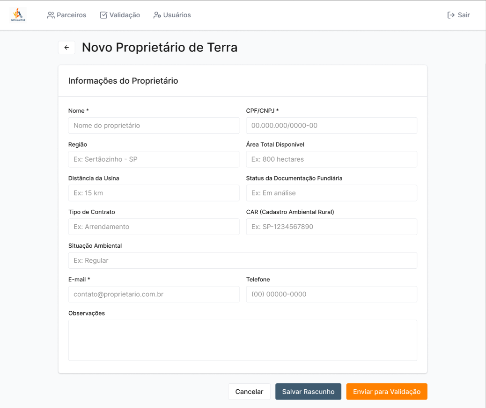<br>
  <sup>Fonte: Material produzido pelos autores, 2026.</sup>
</div>

<div align="center">
  <sub>Figura 3.5.5 - Validação de registros pendentes</sub><br>
  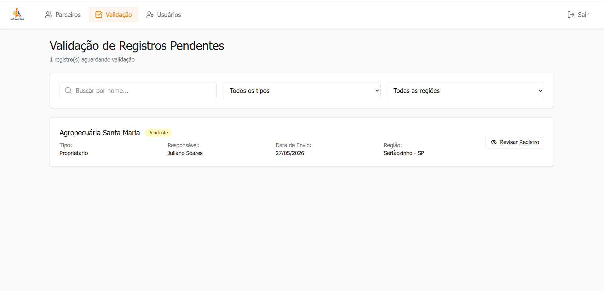<br>
  <sup>Fonte: Material produzido pelos autores, 2026.</sup>
</div>

<div align="center">
  <sub>Figura 3.5.6 - Revisão de registro antes da aprovação</sub><br>
  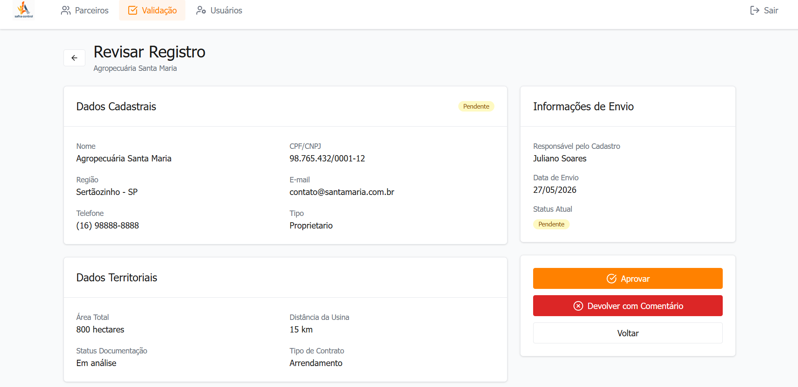<br>
  <sup>Fonte: Material produzido pelos autores, 2026.</sup>
</div>

<div align="center">
  <sub>Figura 3.5.7 - Exportação de dados em CSV</sub><br>
  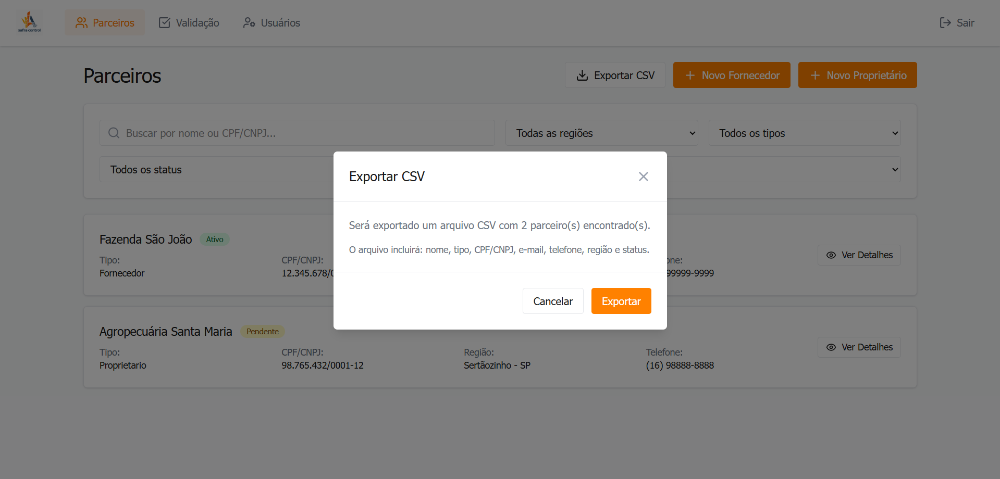<br>
  <sup>Fonte: Material produzido pelos autores, 2026.</sup>
</div>

<div align="center">
  <sub>Figura 3.5.8 - Gestão de usuários do sistema</sub><br>
  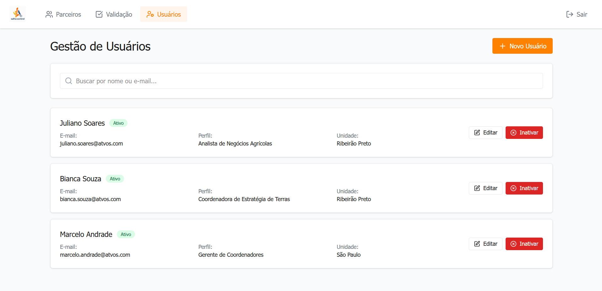<br>
  <sup>Fonte: Material produzido pelos autores, 2026.</sup>
</div>

<div align="center">
  <sub>Figura 3.5.9 - Cadastro de novo usuário</sub><br>
  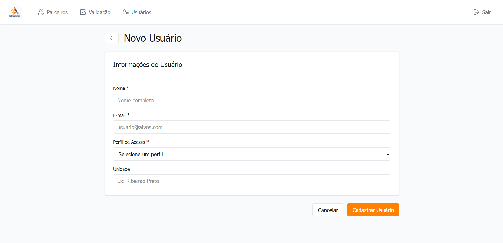<br>
  <sup>Fonte: Material produzido pelos autores, 2026.</sup>
</div>

<div align="center">
  <sub>Figura 3.5.10 - Edição de usuário existente</sub><br>
  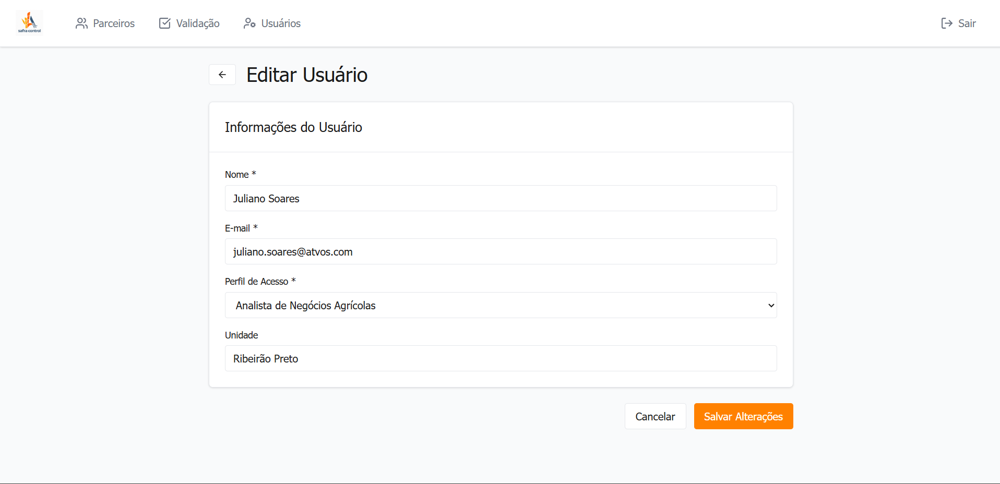<br>
  <sup>Fonte: Material produzido pelos autores, 2026.</sup>
</div>

Assim, o protótipo de alta fidelidade consolida o percurso principal do CRM da ATVOS em uma interface mais próxima da experiência final de uso. As telas representam tanto os fluxos prioritários de parceiros agrícolas quanto os pontos de apoio administrativo necessários para governança, rastreabilidade e controle de acesso, mantendo alinhamento com os requisitos funcionais, as User Stories priorizadas e o guia visual definido para o produto.

Para acesso ao caminho de telas do protótipo de alta fidelidade, utilize o link a seguir: [Protótipo de alta fidelidade](https://www.figma.com/design/MgdDm59N5bybkU1zABfx6w/Prot%C3%B3tipo-de-alta-fidelidade?node-id=127-91&t=tSRinjXp2u4CddDl-1).


## 3.6. Modelagem do banco de dados (sprints 2 e 4)

### 3.6.1. Modelo Entidade-Relacionamento (ER) (sprint 2)


### Introdução

O Modelo Entidade-Relacionamento Conceitual representa a **fundação lógica** do sistema CRM da ATVOS: descreve **quais entidades existem no domínio**, **quais informações cada uma carrega** e **como elas se relacionam**, sem comprometer-se ainda com decisões de implementação técnica.

Esta seção tem como objetivo oferecer uma visão abstrata e compreensível por todos os envolvidos no projeto, incluindo equipe técnica, professor, time da ATVOS e demais stakeholders, sobre **como a realidade operacional da gestão de parceiros agrícolas será traduzida em estrutura de dados**. As decisões aqui tomadas servem de base direta para o Diagrama de Classes (3.2.3), o DER Lógico (3.6.2) e o Modelo Físico (3.6.3), garantindo coerência ao longo de todo o projeto.

A modelagem foi conduzida com base em **dois pilares complementares**: (1) o **minimundo** descrito no início deste documento, com regras de negócio, fluxos prioritários e personas; e (2) os **dados reais** disponibilizados pela ATVOS, em particular as planilhas operacionais utilizadas hoje pela equipe (Base de Dados Oficial, Contatos de Parceiros e Fornecedores, Base Geral de Fornecedores de Cana e Estrutura de Cadastro). O princípio adotado foi **modelar o que tem evidência de uso**: todo atributo presente neste modelo possui origem identificável (planilha, regra de negócio ou requisito do WAD), evitando especulação ou complexidade desnecessária.


### Notação e visão geral

A notação adotada é **Chen**, com retângulos para entidades, losangos para relacionamentos e elipses para atributos, mantida coerente nas seções 3.6.2 e 3.2.3. Foram identificadas **14 entidades** distribuídas em três grupos lógicos, conforme apresentado a seguir:

- **Núcleo do parceiro externo**: Parceiro, Interacao, VinculoComercial, DadosFornecedor, DadosArrendador, Terra e ParceiroTerra. Representa as identidades externas com as quais a ATVOS se relaciona comercialmente, separando conceitualmente **identidade** (a pessoa física ou jurídica) do **papel comercial** (Fornecedor de Cana ou Arrendador de Terra) que essa identidade exerce. Interacao centraliza o histórico de contatos com cada parceiro de forma estruturada e consultável. ParceiroTerra é a entidade associativa N:N que reflete a regra de negócio de que múltiplos parceiros podem vincular-se à mesma terra (RN13, RN14, RF015).

- **Núcleo de operação interna**: Usuario, Cargo e Unidade. Representa os colaboradores internos da ATVOS, sua estrutura organizacional e as unidades industriais onde a operação acontece.

- **Auditoria e associações**: RegistroAlteracao, ParceiroCoordenador, ParceiroUnidade e UsuarioUnidade. Implementa o **fluxo de aprovação de alterações** (RN11, RN12), o **histórico de coordenação** entre parceiros e colaboradores, e os **relacionamentos N:N** entre as entidades dos outros dois grupos. RegistroAlteracao mantém relacionamentos explícitos e opcionais com cada entidade auditável, tornando todos os elos de rastreabilidade visíveis no próprio diagrama conceitual.


### Decisões estruturais relevantes

Quatro decisões de modelagem merecem destaque por serem fundamentais para a robustez do sistema:

1. **Separação entre identidade e papel comercial.** Uma mesma pessoa física ou jurídica pode atuar simultaneamente como Fornecedor e Arrendador (caso real observado nas planilhas). Por isso, a entidade Parceiro mantém apenas dados de identidade (nome, CPF/CNPJ, contatos), enquanto VinculoComercial concretiza cada papel exercido. Esta separação evita duplicação de cadastro e garante consistência de dados de contato.

2. **Especialização para vínculos com atributos próprios.** As entidades DadosFornecedor e DadosArrendador são especializações de VinculoComercial: existem apenas quando o vínculo é do tipo correspondente. DadosFornecedor concentra atributos específicos de fornecimento de cana (modalidade contratual, embaixador, guardião). DadosArrendador, neste momento, está modelada como entidade preparada para receber atributos próprios conforme retorno da ATVOS. A separação foi mantida por solicitação do cliente, prevendo divergência de atributos em iterações futuras.

3. **Auditoria via relacionamentos explícitos e opcionais.** A entidade RegistroAlteracao implementa **simultaneamente** o fluxo de aprovação (RN11, RN12) e a trilha de auditoria do sistema. No modelo conceitual, cada registro de auditoria se relaciona de forma **explícita e opcional** com cada entidade auditável (Parceiro, VinculoComercial, DadosFornecedor, DadosArrendador e Terra) por meio de relacionamentos individuais com cardinalidade `[0..1]`. A constraint de negócio é que **exatamente um** desses relacionamentos é não-nulo por registro, validada em camada de aplicação (Service). Esta representação torna todos os elos de auditoria visíveis no diagrama conceitual, coerente com a notação Chen adotada. A implementação física desta restrição, via cinco chaves estrangeiras opcionais individuais para cada entidade auditável, está detalhada na seção 3.6.3.

4. **Histórico de interações como entidade independente.** O campo de texto livre que registrava interações com parceiros foi extraído para a entidade Interacao, com atributos mínimos identificados: `tipo` (visita, ligação, WhatsApp, reunião), `data`, `texto` e `nome_responsavel`. Esta decisão atende à Primeira Forma Normal: um campo de texto que concatena múltiplos eventos heterogêneos não é atômico e impede consultas estruturadas como "todas as visitas de um parceiro no mês" ou "interações por tipo". Os atributos definitivos de Interacao serão validados com a ATVOS e poderão incluir campos adicionais como resultado, próximo passo ou duração, dependendo das necessidades operacionais levantadas com o cliente.

Adicionalmente, a relação entre Parceiro e Terra foi modelada como **N:N** via entidade associativa ParceiroTerra, refletindo diretamente as regras RN13, RN14 e RF015: herdeiros, meeiros ou coproprietários podem compartilhar a mesma gleba, e um mesmo parceiro pode vincular-se a múltiplas terras.


### Modelos Entidade Relacionamento (MER)

**Grupo 1 — Núcleo do parceiro externo**

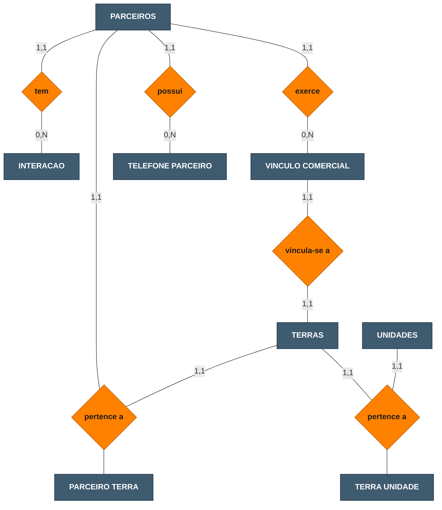

**Grupo 2 — Núcleo de operação interna**

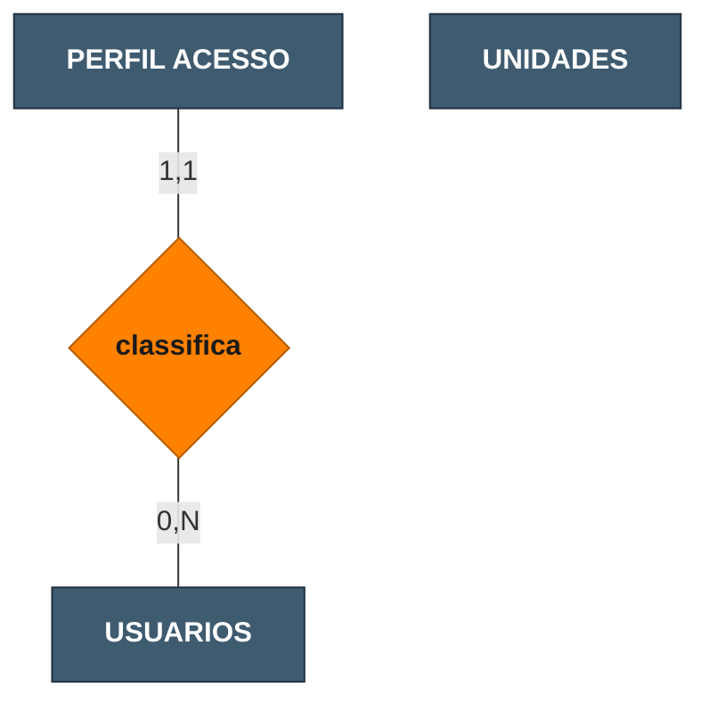

**Grupo 3 — Auditoria e associações**

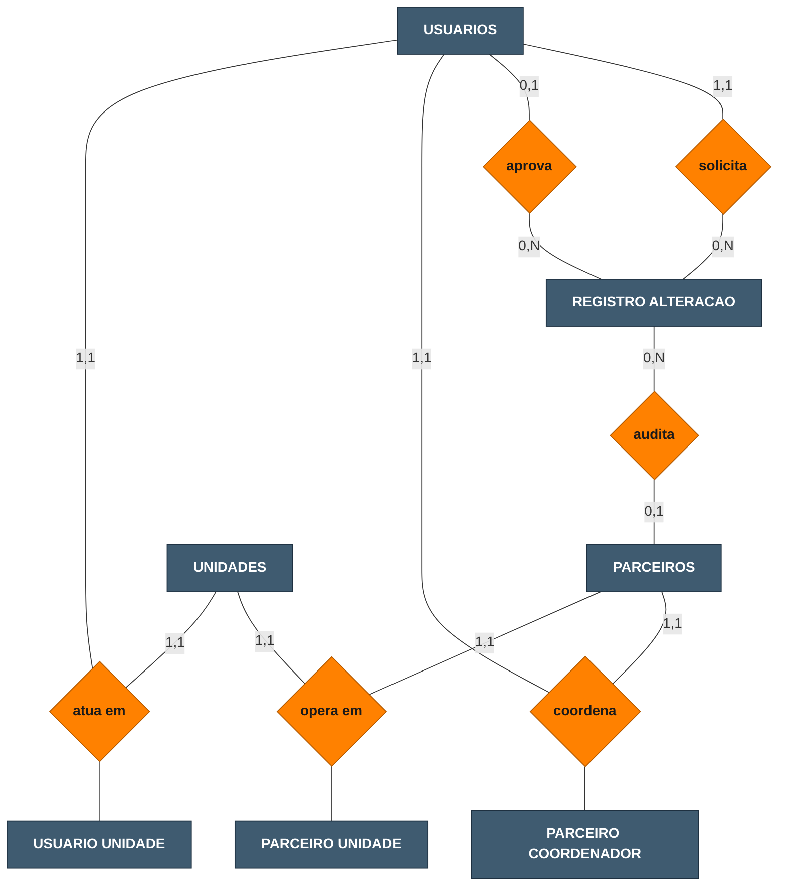

**Grupo 4 — MER Completo**

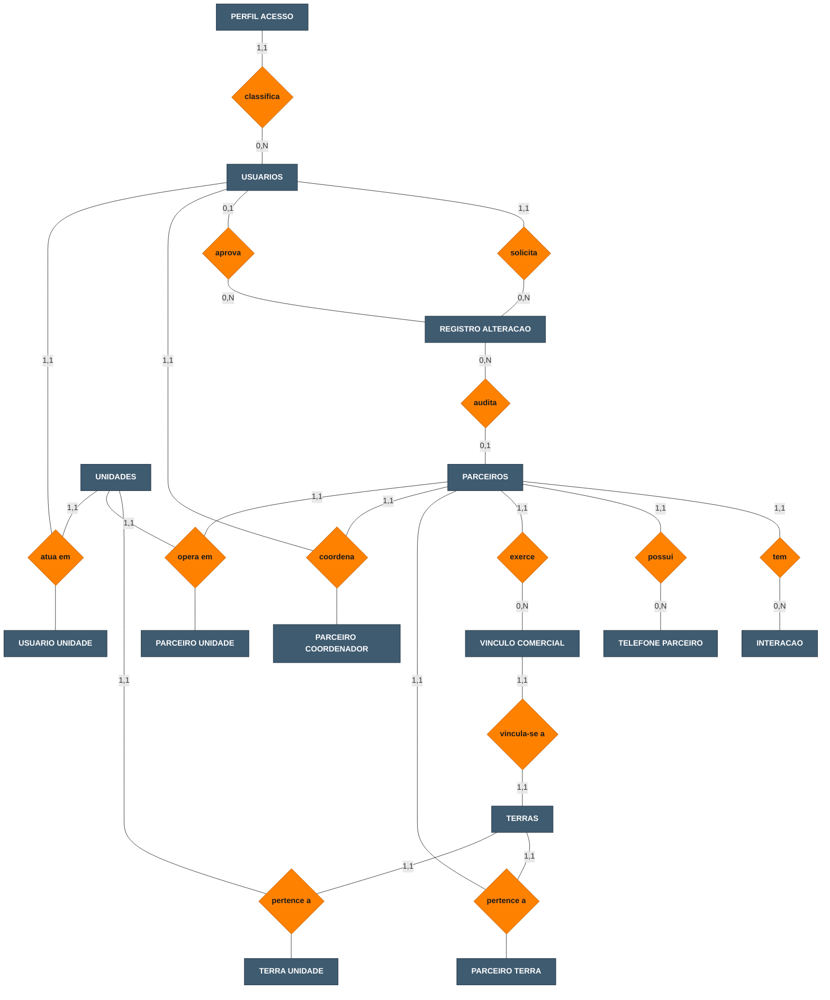


> **Nota sobre relacionamentos entre grupos:** Os relacionamentos entre Usuario e VinculoComercial (embaixador e guardião) vinculam entidades do Grupo 2 (Usuario) ao Grupo 1 (VinculoComercial). Por atravessarem dois grupos distintos, não são representados graficamente nos diagramas acima — estão detalhados na tabela a seguir e poderão ser implementados como chaves estrangeiras opcionais em VinculoComercial em iteração futura, conforme validação com a ATVOS.

### Resumo dos relacionamentos

| # | Relacionamento | Cardinalidade | Descrição |
|---|---|---|---|
| 0 | Parceiro / Interacao | `[1..1] :: [0..N]` | Um Parceiro pode ter zero ou muitas interações registradas. Toda interação pertence a exatamente um Parceiro. Os atributos definitivos de Interacao serão validados com a ATVOS. |
| 1 | Parceiro / VinculoComercial | `[1..1] :: [0..N]` | Um Parceiro pode exercer múltiplos vínculos comerciais simultaneamente. Todo vínculo pertence a exatamente um Parceiro. O campo `tipo_parceiro` define se o parceiro atua como arrendador ou fornecedor naquele vínculo específico. |
| 2 | VinculoComercial / Terra | `[1..1] :: [1..1]` | Todo vínculo comercial está associado a exatamente uma terra. Uma terra pode ter múltiplos vínculos com parceiros diferentes. |
| 3 | Parceiro / TelefoneParceiro | `[1..1] :: [0..N]` | Um parceiro pode ter zero ou muitos telefones cadastrados. Todo telefone pertence a exatamente um parceiro. |
| 4a | Parceiro / ParceiroTerra | `[1..1] :: [0..N]` | Cada registro de ParceiroTerra pertence a exatamente um Parceiro; um Parceiro pode vincular-se a zero ou muitas terras. |
| 4b | Terra / ParceiroTerra | `[1..1] :: [0..N]` | Cada registro de ParceiroTerra pertence a exatamente uma Terra; uma Terra pode ter zero ou muitos parceiros vinculados (herdeiros, meeiros, coproprietários). Reflete diretamente RN13, RN14 e RF015. |
| 5a | Terra / TerraUnidade | `[1..1] :: [0..N]` | Cada registro de TerraUnidade pertence a exatamente uma Terra; uma Terra pode estar associada a zero ou muitas Unidades. |
| 5b | Unidade / TerraUnidade | `[1..1] :: [0..N]` | Cada registro de TerraUnidade pertence a exatamente uma Unidade; uma Unidade pode ter zero ou muitas Terras vinculadas. |
| 6 | PerfilAcesso / Usuario | `[1..1] :: [0..N]` | Cada usuário possui exatamente um perfil de acesso. Um perfil pode classificar zero ou muitos usuários. |
| 7 | Usuario / RegistroAlteracao (solicitante) | `[1..1] :: [0..N]` | Toda solicitação possui um solicitante obrigatório. Um usuário pode solicitar zero ou muitas alterações. |
| 8 | Usuario / RegistroAlteracao (aprovador) | `[0..1] :: [0..N]` | O aprovador é opcional — permanece NULL enquanto a solicitação está pendente. |
| 9 | RegistroAlteracao / Parceiro | `[0..N] :: [0..1]` | Um RegistroAlteracao pode auditar zero ou um Parceiro; um Parceiro pode ter zero ou muitos registros de auditoria. |
| 10 | RegistroAlteracao / VinculoComercial | `[0..N] :: [0..1]` | Idem para VinculoComercial. |
| 11 | RegistroAlteracao / Terra | `[0..N] :: [0..1]` | Idem para Terra. |
| ★ | Constraint 9 a 11 | exclusividade | Exatamente um dos três relacionamentos acima é não-nulo por registro de RegistroAlteracao. Validada em camada de aplicação (Service); os demais ficam NULL. |
| 12 | Parceiro / Usuario via ParceiroCoordenador | N:N com histórico | Múltiplos coordenadores podem atender o mesmo parceiro ao longo do tempo (data_inicio / data_fim). |
| 13 | Parceiro / Unidade via ParceiroUnidade | N:N | Um parceiro pode operar em múltiplas unidades industriais simultaneamente. |
| 14 | Usuario / Unidade via UsuarioUnidade | N:N | Um colaborador pode atuar em múltiplas unidades industriais. |


### Boas práticas aplicadas no modelo

- **Modelagem dirigida por evidência.** Cada atributo de negócio possui origem identificável: ou está presente nas planilhas operacionais da ATVOS, ou deriva diretamente de regra de negócio explicitada no minimundo. Atributos especulativos do WAD (US01, US02) sem evidência nas planilhas, como TCH, ATR, CAR e demais, foram conscientemente excluídos do modelo e documentados como pendências para validação direta com o cliente, evitando inflar a estrutura com dados que talvez nunca sejam preenchidos. A entidade Interacao segue o mesmo princípio: os atributos mínimos (tipo, data, descricao) foram identificados com base no uso atual das planilhas, e os atributos adicionais aguardam validação com a ATVOS antes de serem incorporados.

- **Normalização até a Terceira Forma Normal.** O campo de texto livre que registrava interações com parceiros foi extraído para a entidade Interacao, atendendo à Primeira Forma Normal: cada linha de Interacao armazena um evento atômico e consultável individualmente. A entidade é referenciada por uma chave estrangeira para Parceiro, sem dependências parciais ou transitivas, garantindo conformidade com 2NF e 3NF.

- **Separação clara entre identidade e papel comercial.** A divisão Parceiro / VinculoComercial elimina duplicação de identidade quando uma pessoa exerce múltiplos papéis — uma mesma empresa pode ser simultaneamente fornecedora de cana e arrendadora de terra. O campo `tipo_parceiro` em VinculoComercial controla o papel exercido em cada vínculo, garantindo consistência sem necessidade de entidades de especialização para o MVP. Caso a ATVOS confirme atributos específicos por tipo de vínculo em iterações futuras, a separação em entidades distintas pode ser introduzida sem refatoração do núcleo.

- **Perfil de acesso como entidade.** A entidade PerfilAcesso define os três níveis de permissão do sistema: analista, coordenador e administrador. O campo `requer_aprovacao` determina se alterações feitas por usuários daquele perfil precisam de aprovação antes de se tornarem ativas, internalizando a regra de negócio no dado em vez de no código. Isso permite que a ATVOS altere a política de aprovação no futuro sem necessidade de redeploy.

- **Auditoria estrutural via RegistroAlteracao.** O fluxo de aprovação obrigatório para alterações feitas por Analistas (RN11) e a necessidade de trilha de versionamento (RN12) foram resolvidos com **uma única entidade**, que serve simultaneamente como fila de aprovação e log de auditoria. No modelo conceitual, RegistroAlteracao mantém relacionamentos explícitos e opcionais com cada entidade auditável (Parceiro, VinculoComercial e Terra), com a constraint de que exatamente um desses vínculos é não-nulo por registro. O campo `status` opera em dois modos: registros originados de Analistas iniciam como `pendente` e aguardam aprovação de Coordenador; registros originados de Administrador recebem `aprovado` imediatamente. Essa unificação reduz redundância e centraliza a lógica de governança em um único ponto do modelo.

- **Histórico modelado apenas onde tem valor de negócio.** Optou-se por manter histórico (`data_inicio`/`data_fim`) apenas em ParceiroCoordenador, onde a troca de coordenador ao longo do tempo é uma necessidade real do CRM. As demais associações N:N (ParceiroUnidade, UsuarioUnidade, ParceiroTerra) guardam apenas o estado atual ou o momento de associação, evitando complexidade desnecessária.

- **Soft delete como padrão.** As entidades sujeitas a ciclo de vida operacional (Parceiro, Terra, Usuario, Unidade) possuem o campo `status` ou `ativo`, permitindo inativação lógica sem perda de histórico, alinhado à RN15 e à boa prática de preservação de dados auditáveis.

- **Documentação de pendências.** Decisões que dependem de validação com a ATVOS (Top 15, Portal PMF, definições de áreas, atributos específicos por tipo de vínculo, entre outras) foram explicitamente preservadas como questões em aberto, evitando que sejam modeladas precipitadamente e demonstrando rigor metodológico.


### Conclusão

A modelagem ER Conceitual apresentada nesta seção não é apenas um artefato formal de documentação: é a **espinha dorsal técnica** que viabiliza concretamente os requisitos do sistema CRM da ATVOS. Cada decisão tomada aqui responde a uma necessidade operacional específica e mensurável.

A separação entre Parceiro e VinculoComercial é o que permite que **uma mesma empresa cadastrada uma vez** apareça simultaneamente como fornecedora de cana e arrendadora de terra, situação real observada em diversas linhas das planilhas, e que sem esse cuidado de modelagem geraria duplicação cadastral e inconsistência de contato. O campo `tipo_parceiro` em VinculoComercial controla o papel exercido em cada vínculo de forma simples e direta, adequada ao escopo do MVP. A separação em entidades de especialização permanece documentada como evolução futura caso a ATVOS confirme atributos distintos por tipo de vínculo.

A entidade ParceiroTerra, introduzida como associativa N:N entre Parceiro e Terra, resolve diretamente a contradição que existiria em um modelo 1:N diante das regras RN13, RN14 e RF015: uma gleba pode ser compartilhada por herdeiros, meeiros ou coproprietários, e um mesmo parceiro pode vincular-se a múltiplas propriedades. Ambos os sentidos do relacionamento precisam ser "muitos para muitos".

A entidade RegistroAlteracao concretiza diretamente as regras RN11 (auditoria), RN12 (versionamento) e o fluxo de aprovação obrigatória: alterações de Analistas vão para fila, são revisadas por Coordenadores, e o histórico é preservado. Os relacionamentos explícitos e opcionais com cada entidade auditável, representados no diagrama conceitual com cardinalidade `[0..1]` em cada elo, permitem que **uma única estrutura** atenda todo o domínio auditável do sistema, sem multiplicação de entidades de auditoria.

A entidade ParceiroCoordenador com histórico responde ao caso, observado em campo, de coordenadores que se aposentam, mudam de função ou são realocados, preservando a memória institucional de "quem cuidou de quem e quando". As associações N:N entre Parceiro, Usuario e Unidade refletem a realidade multissítio da ATVOS, em que um mesmo parceiro pode entregar cana a duas unidades e um mesmo coordenador atende parceiros em mais de uma planta.

Por fim, o princípio de **modelagem dirigida por evidência**, com cada atributo justificado por planilha real ou regra de negócio explícita, torna este modelo não apenas tecnicamente sólido, mas também **negocialmente honesto**: ele entrega exatamente o que a ATVOS precisa hoje, com pontos de extensão claramente sinalizados para o que ainda virá, e zero complexidade especulativa. As próximas seções (3.6.2 DER Lógico e 3.6.3 Modelo Físico) detalharão como esta estrutura conceitual será concretizada em chaves, constraints e SQL executável, mantendo total coerência com o que foi estabelecido aqui.


### 3.6.2. Diagrama Entidade-Relacionamento (DER) (sprint 2)

Um Diagrama de Entidade-Relacionamento (DER) é uma representação visual da estrutura de dados de um sistema, que mapeia as entidades envolvidas, seus atributos e os relacionamentos entre elas. Criado na fase de modelagem do banco de dados, o DER serve como ponte entre os requisitos do negócio e a implementação técnica, permitindo que tanto desenvolvedores quanto stakeholders não técnicos compreendam como os dados se organizam e se relacionam.

A importância do DER em qualquer projeto de software está na clareza e na prevenção de erros que ele proporciona. Ao visualizar o modelo antes de implementá-lo, a equipe consegue identificar inconsistências, redundâncias e lacunas na estrutura de dados ainda na fase de planejamento — quando o custo de correção é muito menor do que durante ou após o desenvolvimento. Além disso, o DER serve como documentação viva do sistema, facilitando a integração de novos membros na equipe, a manutenção futura e a comunicação entre times de negócio e tecnologia.


<div align="center">
  <sub>Figura 3.6.2.1 - Diagrama Entidade-Relacionamento (DER)</sub><br>
  <br>
  <sup>Fonte: Material produzido pelos autores, 2026. (Diagrama esquematizado no Mermaid)</sup>
</div>

No contexto do sistema de gestão de parceiros agrícolas da ATVOS, o DER é especialmente relevante por se tratar de um domínio com relacionamentos complexos e múltiplos perfis de usuário. Ele torna explícita a distinção entre vínculos contratuais formais e associações informais entre parceiros e terras, evidencia o fluxo de validação de cadastros entre analistas e coordenadores, e garante que a rastreabilidade de alterações — central para a integridade do sistema — esteja corretamente estruturada desde a concepção do banco de dados.

### 3.6.3.1 Modelo Relacional e Modelo Físico (sprints 2 e 4)
<br>
O modelo relacional tem como objetivo representar de forma lógica as entidades do sistema, seus atributos e os relacionamentos existentes entre elas. Nessa etapa, as entidades foram convertidas em tabelas relacionais, com definição de chaves primárias e estrangeiras, além da normalização necessária para reduzir redundâncias e garantir maior integridade dos dados.

A modelagem relacional serve como base estrutural para a implementação do banco de dados, permitindo visualizar de maneira organizada como as informações do sistema serão armazenadas e relacionadas no ambiente computacional.

<div align="center">
  <sub>Figura 3.6.3.1.1</sub><br>
  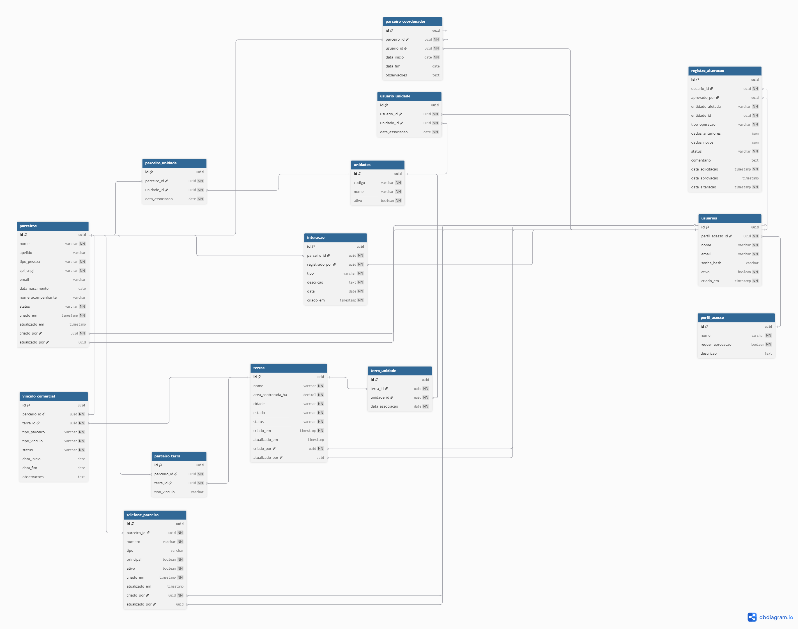<br>
  <sup>Fonte: Material produzido pelos autores, 2026. (Modelo Relacional feito no bddiagram)</sup>
</div>

<br><br> 

### 3.6.3.2 Modelo Físico
<br>
Com base no modelo relacional apresentado anteriormente, foi desenvolvido o modelo físico do banco de dados utilizando o PostgreSQL. Nessa etapa, as estruturas lógicas foram convertidas em comandos SQL executáveis (DDL), incluindo a criação de tabelas, tipos personalizados, restrições de integridade (NOT NULL, CHECK, UNIQUE e FOREIGN KEY) e índices para otimização de consultas.

Além de representar a implementação prática do banco de dados, o modelo físico garante maior consistência, desempenho e confiabilidade no armazenamento das informações utilizadas pelo sistema.
<br><br>

#### Pré requistos:
<br>
1. Para utilizar a função opcional gen_random_uuid() pertencente a extensão pgcrypto (já existente no PostgreSQL), precisamos adicionar essa extensão no banco de dados.
<br><br>

```SQL
CREATE EXTENSION IF NOT EXISTS pgcrypto;
```
<br>
2. Aqui foi criado um ENUM status_validacao, já que esse mesmo padrão será utilizado em muitas outras entidades.
<br><br>

```SQL
CREATE TYPE status_validacao AS ENUM (
  'rascunho', 'pendente', 'ativo', 'devolvido', 'inativo'
);
```

<br><br>


#### 01. TABELA perfil_acesso 
<br>
É a tabela responsável por definir os possíveis níveis de acesso do usuário, podendo ser 'analista', 'coordenador' ou 'administrador'. Ela é referenciada na tabela usuario.
<br><br>

```SQL
CREATE TABLE perfil_acesso (
  id          UUID PRIMARY KEY DEFAULT gen_random_uuid(),
  nome        VARCHAR NOT NULL UNIQUE
                CHECK (nome IN ('analista', 'coordenador', 'administrador')),
  requer_aprovacao BOOLEAN NOT NULL DEFAULT FALSE,
  descricao   TEXT
);
```
<br><br>

#### 02. TABELA usuarios
<br>
É a tabela que armazena os usuários internos do sistema e seus respectivos dados. Note que o campo senha_hash permite ausência de valor (null). Isso acontece devido ao modo de como o sistema interpreta novos usuários: é verificado se o campo senha_hash desse usuário possui valor nulo e, caso positivo, o usuário é direcionado para uma tela de criar sua senha.
<br><br>
Além da tabela, aqui já são explícitados os índices relacionados à tabela usuarios, sendo eles relacionados ao nome e ao perfil_acesso_id.
<br><br>

``` SQL
CREATE TABLE usuarios (
  id                UUID PRIMARY KEY DEFAULT gen_random_uuid(),
  perfil_acesso_id  UUID NOT NULL REFERENCES perfil_acesso(id),
  nome              VARCHAR NOT NULL,
  email             VARCHAR NOT NULL UNIQUE,
  senha_hash        VARCHAR,
  ativo             BOOLEAN NOT NULL DEFAULT TRUE,
  criado_em         TIMESTAMP NOT NULL DEFAULT NOW()
);

CREATE INDEX idx_usuario_perfil ON usuarios(perfil_acesso_id);
CREATE INDEX idx_usuario_nome ON usuarios(nome);
```
<br><br>

#### 03. TABELA unidades
<br>
A tabela unidade representa as unidades operacionais - as usinas - da ATVOS. O campo codigo é único e identifica a unidade internamente.
<br><br>

``` SQL
CREATE TABLE unidades (
  id      UUID PRIMARY KEY DEFAULT gen_random_uuid(),
  codigo  VARCHAR NOT NULL UNIQUE,
  nome    VARCHAR NOT NULL,
  ativo   BOOLEAN NOT NULL DEFAULT TRUE
);
```
<br><br>

#### 04. TABELA parceiros
<br>
A tabela parceiro é a principal do sistema. Ela quem armazena os principais dados cadastrais dos parceiros agrícolas — tanto fornecedores de cana quanto arrendadores de terra. O campo status controla o ciclo de validação do cadastro, desde o rascunho até a aprovação ou devolução pelo coordenador.
<br><br>
Além disso, já foram também explicitados os índices para os parceiros, sendo eles relacionados ao status, ao cpf_cnpj, ao nome e ao tipo_pessoa.
<br>

```SQL
CREATE TABLE parceiros (
  id               UUID PRIMARY KEY DEFAULT gen_random_uuid(),
  nome             VARCHAR NOT NULL,
  apelido          VARCHAR,
  tipo_pessoa      VARCHAR NOT NULL
                     CHECK (tipo_pessoa IN ('fisica', 'juridica')),
  cpf_cnpj         VARCHAR NOT NULL UNIQUE,
  email            VARCHAR,
  data_nascimento  DATE,
  nome_acompanhante VARCHAR,
  status           status_validacao NOT NULL DEFAULT 'rascunho',
  criado_em        TIMESTAMP NOT NULL DEFAULT NOW(),
  atualizado_em    TIMESTAMP,
  criado_por       UUID NOT NULL REFERENCES usuarios(id),
  atualizado_por   UUID REFERENCES usuarios(id)
);

CREATE INDEX idx_parceiro_status   ON parceiros(status);
CREATE INDEX idx_parceiro_cpf_cnpj ON parceiros(cpf_cnpj);
CREATE INDEX idx_parceiro_nome ON parceiros(nome);
CREATE INDEX idx_parceiro_tipo_pessoa ON parceiros(tipo_pessoa);
```
<br><br>

#### 05. TABELA terras
<br>
A tabela terra armazena os dados das propriedades rurais. Assim como parceiro, passa pelo mesmo ciclo de validação via status. O campo area_contratada_ha representa a área física da terra disponível para contrato. Note algumas considerações, como estado aceitar apenas dois caracteres, para que seja forçada a padronização (SP, MG, RJ etc) e como a area_contratada_ha poder ter até 12 dígitos com até 4 casas decimais.
<br><br>
Além disso, note que os índices escolhidos foram relacionados ao status, à cidade e ao estado.
<br><br>

```SQL
CREATE TABLE terras (
  id                 UUID PRIMARY KEY DEFAULT gen_random_uuid(),
  nome               VARCHAR NOT NULL,
  area_contratada_ha DECIMAL(12,4) NOT NULL
                     CHECK (area_contratada_ha > 0),
  cidade             VARCHAR NOT NULL,
  estado             VARCHAR(2) NOT NULL,
  status             status_validacao NOT NULL DEFAULT 'rascunho',
  criado_em          TIMESTAMP NOT NULL DEFAULT NOW(),
  atualizado_em      TIMESTAMP,
  criado_por         UUID NOT NULL REFERENCES usuarios(id),
  atualizado_por     UUID REFERENCES usuarios(id)
);

CREATE INDEX idx_terra_status ON terras(status);
CREATE INDEX idx_terra_cidade ON terras(cidade);
CREATE INDEX idx_terra_estado ON terras(estado);
```

<br><br>

#### 06. TABELA vinculo_comercial
<br>
A tabela vinculo_comercial representa o contrato formal entre um parceiro e uma terra. Um parceiro pode ter múltiplos vínculos com terras diferentes, e uma terra pode ter múltiplos vínculos com parceiros diferentes. O campo tipo_parceiro define se o parceiro atua como arrendador ou fornecedor naquele vínculo específico.
<br><br>
Os índices escolhidos foram relacionados ao parceiro_id, à terra_id e ao tipo_parceiro. Esse último principalmente ajuda bastante nas filtragens.
<br><br>

```SQL
CREATE TABLE vinculo_comercial (
  id               UUID PRIMARY KEY DEFAULT gen_random_uuid(),
  parceiro_id      UUID NOT NULL REFERENCES parceiros(id),
  terra_id         UUID NOT NULL REFERENCES terras(id),
  tipo_parceiro    VARCHAR NOT NULL DEFAULT 'arrendador'
                     CHECK (tipo_parceiro IN ('arrendador', 'fornecedor')),
  tipo_vinculo     VARCHAR NOT NULL,
  status           VARCHAR NOT NULL DEFAULT 'ativo'
                     CHECK (status IN ('ativo', 'inativo', 'encerrado')),
  modalidade_contrato VARCHAR,
  data_inicio      DATE,
  data_fim         DATE,
  observacoes      TEXT
);

CREATE INDEX idx_vinculo_parceiro         ON vinculo_comercial(parceiro_id);
CREATE INDEX idx_vinculo_terra            ON vinculo_comercial(terra_id);
CREATE INDEX idx_vinculo_tipo_parceiro    ON vinculo_comercial(tipo_parceiro);
```

<br><br>

#### 07. TABELA parceiro_terra
<br>
A tabela parceiro_terra resolve a relação N:M entre parceiros e terras, isso sem necessidade de vínculo comercial formal, isto é, de um contrato. Um parceiro pode estar associado a uma terra sem contrato com a Atvos, e uma terra pode ter múltiplos parceiros associados.
<br><br>
Apesar de ter a mesma associação que vinculo_comercial, essa tabela representa mais situações como a de uma família possuir uma terra, mas nem toda família está presente no contrato/vínculo comercial com a Atvos.
<br><br>

```SQL
CREATE TABLE parceiro_terra (
  id          UUID PRIMARY KEY DEFAULT gen_random_uuid(),
  parceiro_id UUID NOT NULL REFERENCES parceiros(id),
  terra_id    UUID NOT NULL REFERENCES terras(id),
  tipo_vinculo VARCHAR,
  UNIQUE (parceiro_id, terra_id)
);
```

<br><br>

#### 08. TABELA terra_unidade
<br>
Essa tabela resolve a relação N:M entre terras e unidades operacionais da ATVOS (Uma terra pode ter mais de uma unidade e vice-versa).
<br><br>

```SQL
CREATE TABLE terra_unidade (
  id          UUID PRIMARY KEY DEFAULT gen_random_uuid(),
  terra_id    UUID NOT NULL REFERENCES terras(id),
  unidade_id  UUID NOT NULL REFERENCES unidades(id),
  data_associacao DATE NOT NULL,
  UNIQUE (terra_id, unidade_id)
);
```

<br><br>

#### 09. TABELA parceiro_unidade
<br>
A tabela parceiro_unidade associa parceiros às unidades operacionais da ATVOS com as quais se relacionam.
<br><br>

```SQL
CREATE TABLE parceiro_unidade (
  id          UUID PRIMARY KEY DEFAULT gen_random_uuid(),
  parceiro_id UUID NOT NULL REFERENCES parceiros(id),
  unidade_id  UUID NOT NULL REFERENCES unidades(id),
  data_associacao DATE NOT NULL,
  UNIQUE (parceiro_id, unidade_id)
);
```

<br><br>

#### 10. TABELA usuario_unidade
<br>
A tabela usuario_unidade associa usuários internos às unidades em que atuam.
<br><br>

```SQL
CREATE TABLE usuario_unidade (
  id          UUID PRIMARY KEY DEFAULT gen_random_uuid(),
  usuario_id  UUID NOT NULL REFERENCES usuarios(id),
  unidade_id  UUID NOT NULL REFERENCES unidades(id),
  data_associacao DATE NOT NULL,
  UNIQUE (usuario_id, unidade_id)
);
```

<br><br>

#### 11. TABELA parceiro_coordenador
<br>
A tabela parceiro_coordenador registra qual coordenador/analista é responsável por cada parceiro. O campo data_fim nulo indica que o vínculo está ativo, o que dispensa um campo ativo separado.
<br><br>
O indíce criado a partir dessa tabela é relacionado ao parceiro_id.
<br><br>

```SQL
CREATE TABLE parceiro_coordenador (
  id          UUID PRIMARY KEY DEFAULT gen_random_uuid(),
  parceiro_id UUID NOT NULL REFERENCES parceiros(id),
  usuario_id  UUID NOT NULL REFERENCES usuarios(id),
  data_inicio DATE NOT NULL,
  data_fim    DATE,
  observacoes TEXT
);

CREATE INDEX idx_parceiro_coordenador_parceiro ON parceiro_coordenador(parceiro_id);
```

<br><br>

#### 12. TABELA interacao
<br>
A tabela interacao registra o histórico de contatos entre a equipe interna e os parceiros - visitas, ligações, reuniões e outros tipos de interação. Não passa por fluxo de validação.
<br><br>
Os índices escolhidos se relacionam com parceiro_id e tipo.
<br><br>

```SQL
CREATE TABLE interacao (
  id            UUID PRIMARY KEY DEFAULT gen_random_uuid(),
  parceiro_id   UUID NOT NULL REFERENCES parceiros(id),
  registrado_por UUID NOT NULL REFERENCES usuarios(id),
  tipo          VARCHAR NOT NULL,
  descricao     TEXT NOT NULL,
  data          DATE NOT NULL,
  criado_em     TIMESTAMP NOT NULL DEFAULT NOW()
);

CREATE INDEX idx_interacao_parceiro ON interacao(parceiro_id);
CREATE INDEX idx_interacao_tipo     ON interacao(tipo);
```

<br><br>

#### 13. TABELA telefone_parceiro
<br>
A tabela telefone_parceiro permite que um parceiro tenha múltiplos telefones cadastrados. O campo principal indica o número preferencial de contato.
<br>
<br><br>

```SQL
CREATE TABLE telefone_parceiro (
  id          UUID PRIMARY KEY DEFAULT gen_random_uuid(),
  parceiro_id UUID NOT NULL REFERENCES parceiros(id),
  numero      VARCHAR NOT NULL,
  tipo        VARCHAR CHECK (tipo IN ('celular', 'fixo', 'whatsapp')),
  principal   BOOLEAN NOT NULL DEFAULT FALSE,
  ativo       BOOLEAN NOT NULL DEFAULT TRUE,
  criado_em   TIMESTAMP NOT NULL DEFAULT NOW(),
  atualizado_em TIMESTAMP,
  criado_por  UUID NOT NULL REFERENCES usuarios(id),
  atualizado_por UUID REFERENCES usuarios(id)
);

CREATE INDEX idx_telefone_parceiro ON telefone_parceiro(parceiro_id);
```

<br><br>

#### 14. TABELA registro_alteracao
<br>
Essa tabela registra as alterações de qualquer entidade do sistema através dos campos entidade_afetada e entidade_id. Também controla o fluxo de aprovação entre analista e coordenador. Além disso, ela também armazena os dados anteriores e os dados novos em JSONB.
<br><br>
Os índices criados a partir dessa tabela estão relacionados à entidade_afetada, à entidade_id, ao usuario_id, ao status e ao tipo_operacao.
<br><br>

```SQL
CREATE TABLE registro_alteracao (
  id               UUID PRIMARY KEY DEFAULT gen_random_uuid(),
  usuario_id       UUID NOT NULL REFERENCES usuarios(id),
  aprovado_por     UUID REFERENCES usuarios(id),
  entidade_afetada VARCHAR NOT NULL,
  entidade_id      UUID NOT NULL,
  tipo_operacao    VARCHAR NOT NULL
                     CHECK (tipo_operacao IN (
                       'criacao', 'edicao', 'envio',
                       'aprovacao', 'devolucao', 'exclusao'
                     )),
  dados_anteriores JSONB,
  dados_novos      JSONB,
  status           VARCHAR NOT NULL
                     CHECK (status IN ('pendente', 'aprovado', 'devolvido')),
  comentario       TEXT,
  data_solicitacao TIMESTAMP NOT NULL DEFAULT NOW(),
  data_aprovacao   TIMESTAMP,
  data_alteracao   TIMESTAMP NOT NULL DEFAULT NOW()
);

CREATE INDEX idx_registro_entidade  ON registro_alteracao(entidade_afetada, entidade_id);
CREATE INDEX idx_registro_usuario   ON registro_alteracao(usuario_id);
CREATE INDEX idx_registro_status    ON registro_alteracao(status);
CREATE INDEX idx_registro_operacao    ON registro_alteracao(tipo_operacao);
```

## 3.6.4. Consultas SQL e lógica proposicional

Esta seção apresenta consultas SQL compostas realizadas pelo back-end da aplicação web, acompanhadas de sua respectiva lógica proposicional. As consultas foram elaboradas a partir das entidades modeladas no banco de dados, em especial, `parceiros`, `usuarios`, `perfil_acesso`, `terras`, `parceiro_terra`, `vinculo_comercial` e `registro_alteracao`.

As consultas cobrem operações de diferentes tipos — `INSERT`, `UPDATE` e `SELECT` — e representam fluxos reais do sistema, como cadastro de usuários e parceiros, inativação lógica, edição de dados cadastrais, visualização de perfis, listagem com filtros, envio para validação e exportação de dados.

Cada fluxo possui condições de controle ou filtragem, combinadas por operadores lógicos como `AND`, `OR`, `NOT`, `LIKE`/`ILIKE` e `IN` quando aplicável. Para formalizar essas regras, cada condição booleana foi transformada em uma proposição lógica identificada por letras como $A$, $B$, $C$ ou $D$. Em seguida, a estrutura de controle da consulta foi convertida para uma expressão lógica proposicional equivalente, utilizando os conectivos $\land$ para conjunção, $\lor$ para disjunção e $\lnot$ para negação. Por fim, cada expressão foi validada por meio de tabela verdade.

As cláusulas `JOIN` foram utilizadas para combinar entidades relacionadas no domínio, mas não foram tratadas como proposições principais. Isso ocorre porque o objetivo da lógica proposicional nesta seção é representar as condições booleanas de filtragem, controle ou validação de retorno efetivamente avaliadas pelo back-end em cada operação.


### Rastreabilidade das consultas

| Consulta | Tipo | Tabelas envolvidas | Finalidade no back-end |
|---|---|---|---|
| 01 | INSERT | `usuarios`, `perfil_acesso` | Cadastrar novo usuário com perfil válido, garantindo unicidade de e-mail. |
| 02 | UPDATE | `usuarios` | Inativar logicamente um usuário sem remover seu histórico do banco. |
| 03 | INSERT | `parceiros` | Cadastrar novo parceiro como rascunho, verificando duplicidade de CPF/CNPJ. |
| 04 | UPDATE | `parceiros` | Editar dados cadastrais de um parceiro com payload válido e autoria da alteração. |
| 05 | SELECT | `parceiros` | Exibir perfil detalhado de um parceiro não inativo. |
| 06 | SELECT | `parceiros`, `parceiro_terra`, `terras`, `vinculo_comercial` | Listar parceiros não inativos com filtros opcionais de nome, região e tipo. |
| 07 | UPDATE | `parceiros`, `registro_alteracao` | Enviar parceiro para validação quando estiver em status permitido. |
| 08 | SELECT | `parceiros` | Gerar lista de parceiros ativos para exportação em CSV. |


### Regras de negócio representadas pelas consultas

| Consulta | Regra representada | Regras de Negócio associadas |
|---|---|---|
| 01 | Usuários só podem ser cadastrados com perfil existente no sistema e e-mail único, iniciando sem senha até o primeiro acesso. | RN01, RN03 |
| 02 | A inativação de usuários é lógica — o registro é preservado e o acesso é revogado imediatamente. | RN07, RN15 |
| 03 | Novos parceiros são criados com status rascunho e têm o CPF/CNPJ validado contra duplicatas. | RN09, RN16 |
| 04 | A edição de parceiros exige registro existente, ao menos um campo editável e identificação do usuário responsável pela alteração. | RN05, RN11, RN12 |
| 05 | A visualização do perfil detalhado de um parceiro exige que ele exista e não esteja inativo. | RN04, RN08 |
| 06 | A listagem de parceiros exibe apenas registros não inativos, com suporte a filtros opcionais que não comprometem o retorno quando não informados. | RN04, RN08 |
| 07 | Parceiros só podem ser enviados para validação quando existem e estão em rascunho ou devolvidos. | RN16, RN17 |
| 08 | A exportação de dados inclui apenas parceiros ativos, omitindo dados sensíveis de auditoria. | RN04, RN08, RF017 |


As consultas foram elaboradas com duas a quatro proposições para permitir a construção de tabelas verdade completas sem comprometer a legibilidade da seção. Consultas com muitas proposições aumentariam exponencialmente o número de combinações possíveis, dificultando a validação manual.

---

### 01 — Cadastro de um novo usuário


| 01 | --- |
|---|---|
| **Expressão SQL** | ```SQL SELECT id FROM perfil_acesso WHERE id = :perfil_acesso_id; SELECT id, nome, email, senha_hash, ativo, perfil_acesso_id FROM usuarios WHERE email = LOWER(:email); INSERT INTO usuarios (perfil_acesso_id, nome, email, senha_hash, ativo) VALUES (:perfil_acesso_id, :nome, LOWER(:email), NULL, TRUE) RETURNING id, perfil_acesso_id, nome, email, senha_hash, ativo, criado_em; ``` |
| **Proposições lógicas** | $A$ : O perfil informado existe na tabela perfil_acesso (SELECT de perfil retorna linha) <br> $B$ : O e-mail ainda não está cadastrado no sistema (SELECT por e-mail não retorna linha) |
| **Expressão lógica proposicional** | $A \land B$ |
| **Tabela Verdade** | <table><thead><tr><th> $A$ </th><th> $B$ </th><th> $A \land B$ </th></tr></thead><tbody><tr><td>F</td><td>F</td><td>F</td></tr><tr><td>F</td><td>V</td><td>F</td></tr><tr><td>V</td><td>F</td><td>F</td></tr><tr><td>V</td><td>V</td><td>V</td></tr></tbody></table> |


#### Explicação do que significa essa consulta:


Essa consulta representa a regra de cadastro de novos usuários no sistema. Em termos práticos, o sistema só permite criar um usuário quando duas condições forem verdadeiras ao mesmo tempo: o perfil informado precisa existir e o e-mail não pode já estar cadastrado.
<br>
A lógica proposicional $A \land B$ mostra exatamente isso: o cadastro somente acontece quando há simultaneamente um perfil válido e um e-mail disponível. Caso uma das condições falhe, o sistema bloqueia a operação para evitar inconsistências, como usuários associados a perfis inexistentes ou duplicidade de contas com o mesmo e-mail.
<br>
Na prática, essa consulta implementa uma validação de integridade e unicidade antes da criação do usuário.
<br>

#### Explicação da consulta SQL:


O backend executa duas consultas de validação antes do INSERT: uma para confirmar se o perfil informado existe e outra para verificar se o e-mail normalizado com LOWER já está cadastrado. Se qualquer uma dessas condições falhar, o service bloqueia a operação antes da persistência. Quando ambas são verdadeiras, o repository executa o INSERT real, criando o usuário ativo, com senha_hash NULL e retornando os dados persistidos. 


#### Combinações relevantes da tabela verdade:


1- $(A=V, B=F) \rightarrow A \land B = F$ : perfil válido mas e-mail já cadastrado implica em cadastro bloqueado, respeitando a RN01 que garante a unicidade do e-mail. <br>
2- $(A=F, B=V) \rightarrow A \land B = F$ : e-mail disponível mas perfil inválido, ou seja, o cadastro é bloqueado, impedindo vínculos com perfis inexistentes. <br>
3- $(A=V, B=V) \rightarrow A \land B = V$ : perfil válido e e-mail disponível implica em cadastro de novo usuário efetuado.<br>

---

### 02 — Inativação de usuários 


| 02 | --- |
|---|---|
| **Expressão SQL** | ```SQL UPDATE usuarios SET ativo = FALSE WHERE id = :usuario_id RETURNING id, perfil_acesso_id, nome, email, senha_hash, ativo, criado_em; ``` |
| **Proposições lógicas** | $A$ : O id corresponde ao usuário alvo (id = :usuario_id) <br> $B$ : O registro retornado fica com acesso inativo (ativo = FALSE) |
| **Expressão lógica proposicional** | $A \land B$ |
| **Tabela Verdade** | <table><thead><tr><th> $A$ </th><th> $B$ </th><th> $A \land B$ </th></tr></thead><tbody><tr><td>F</td><td>F</td><td>F</td></tr><tr><td>F</td><td>V</td><td>F</td></tr><tr><td>V</td><td>F</td><td>F</td></tr><tr><td>V</td><td>V</td><td>V</td></tr></tbody></table> |


#### Explicação do que significa essa consulta:


Essa consulta representa a inativação lógica de usuários do sistema. Em vez de apagar o usuário do banco de dados, o sistema apenas altera seu status para inativo, preservando o histórico de auditoria e rastreabilidade.
<br>
A operação só acontece quando o usuário alvo existe e o `UPDATE` encontra uma linha correspondente ao id informado.
<br>
A expressão lógica $A \land B$ demonstra que a inativação depende da correspondência entre o id informado e um registro existente, além da confirmação de que o acesso foi efetivamente marcado como inativo. Quando nenhuma linha é retornada, o service interpreta o resultado como usuário não encontrado.
<br>


#### Explicação da consulta SQL:


O comando UPDATE realiza a inativação lógica de um usuário, alterando o campo ativo para FALSE. O comando WHERE aplica a condição de identificação do registro: o id deve corresponder ao usuário alvo. O registro não é removido do banco, preservando o histórico conforme a RN07 e a RN15.  


#### Combinações relevantes da tabela verdade:


1- $(A=F, B=V) \rightarrow A \land B = F$ : id não corresponde a nenhum usuário, portanto nenhuma linha é afetada. <br>
2- $(A=V, B=F) \rightarrow A \land B = F$ : usuário existe, mas o registro não foi retornado como inativo, logo a operação não é considerada concluída. <br>
3- $(A=V, B=V) \rightarrow A \land B = V$ : usuário existe e o registro retornado está inativo, portanto a inativação lógica é executada com sucesso. <br>

---

### 03 — Cadastro de parceiros


| 03 | --- |
|---|---|
| **Expressão SQL** | ```SQL INSERT INTO parceiros (nome, apelido, tipo_pessoa, cpf_cnpj, email, data_nascimento, nome_acompanhante, criado_por) VALUES (:nome, :apelido, :tipo_pessoa, :cpf_cnpj, :email, :data_nascimento, :nome_acompanhante, :usuario_id) RETURNING *; ``` |
| **Proposições lógicas** | $A$ : O CPF/CNPJ não viola a unicidade do banco (erro 23505 não ocorre) <br> $B$ : O tipo de pessoa informado respeita os valores aceitos pelo modelo (`fisica` ou `juridica`) |
| **Expressão lógica proposicional** | $A \land B$ |
| **Tabela Verdade** | <table><thead><tr><th> $A$ </th><th> $B$ </th><th> $A \land B$ </th></tr></thead><tbody><tr><td>F</td><td>F</td><td>F</td></tr><tr><td>F</td><td>V</td><td>F</td></tr><tr><td>V</td><td>F</td><td>F</td></tr><tr><td>V</td><td>V</td><td>V</td></tr></tbody></table> |


#### Explicação do que significa essa consulta:


Essa consulta controla o cadastro inicial de parceiros no sistema. O parceiro é criado inicialmente com status de rascunho, permitindo que seus dados sejam posteriormente revisados e validados.
<br>
A lógica proposicional $A \land B$ determina que o cadastro só é concluído quando o CPF/CNPJ não viola a regra de unicidade e quando o tipo de pessoa informado é aceito pelo contrato de entrada do backend.
<br>
Isso garante duas regras importantes: evitar duplicidade de parceiros e manter consistência entre os dados cadastrais. Assim, o sistema impede registros repetidos e também evita classificações inválidas entre pessoa física e pessoa jurídica.
<br>

#### Explicação da consulta SQL:


O comando INSERT utilizado no repository cria o parceiro e retorna o registro persistido. Campos como status e data de criação seguem os padrões definidos no banco. A duplicidade de CPF/CNPJ é tratada pelo backend a partir da violação de unicidade do PostgreSQL (`23505`), convertida pelo service em erro de conflito, enquanto o tipo de pessoa é validado pelo contrato de entrada antes da persistência.


#### Combinações relevantes da tabela verdade:


1- $(A=F, B=V) \rightarrow A \land B = F$ : CPF/CNPJ já cadastrado gera conflito de unicidade, resultando no bloqueio do cadastro, respeitando a RN09.<br>
2- $(A=V, B=F) \rightarrow A \land B = F$ : tipo de pessoa inválido ou nulo, o que implica no cadastro rejeitado, devido à constraint do banco.  <br>
3- $(A=V, B=V) \rightarrow A \land B = V$ : CPF/CNPJ disponível e tipo_pessoa válido, portanto, o parceiro é cadastrado como rascunho. <br>

---

### 04 — Edição dos dados dos parceiros


| 04 | --- |
|---|---|
| **Expressão SQL** | ```SQL UPDATE parceiros SET nome = :nome, email = :email, atualizado_por = :usuario_id, atualizado_em = NOW() WHERE id = :parceiro_id RETURNING *; ``` |
| **Proposições lógicas** | $A$ : id corresponde ao parceiro alvo (id = :parceiro_id) <br> $B$ : Há ao menos um campo editável informado no payload <br> $C$ : O responsável pela atualização foi informado (atualizado_por não é nulo) |
| **Expressão lógica proposicional** | $A \land B \land C$ |
| **Tabela Verdade** | <table><thead><tr><th> $A$ </th><th> $B$ </th><th> $C$ </th><th> $A \land B \land C$ </th></tr></thead><tbody><tr><td>F</td><td>F</td><td>F</td><td>F</td></tr><tr><td>F</td><td>F</td><td>V</td><td>F</td></tr><tr><td>F</td><td>V</td><td>F</td><td>F</td></tr><tr><td>F</td><td>V</td><td>V</td><td>F</td></tr><tr><td>V</td><td>F</td><td>F</td><td>F</td></tr><tr><td>V</td><td>F</td><td>V</td><td>F</td></tr><tr><td>V</td><td>V</td><td>F</td><td>F</td></tr><tr><td>V</td><td>V</td><td>V</td><td>V</td></tr></tbody></table> |


#### Explicação do que significa essa consulta:


Essa consulta representa a atualização cadastral de parceiros já existentes. No backend atual, os campos alterados são montados dinamicamente conforme o payload enviado pelo usuário.
<br>
A expressão lógica $A \land B \land C$ mostra que a edição só é realizada quando o parceiro existe, há dados a alterar e a autoria da atualização está informada.
<br>
A terceira condição é importante porque garante a rastreabilidade da alteração, registrando o usuário responsável pela atualização. Dessa forma, a consulta atua tanto na atualização das informações quanto na preservação da autoria da mudança.
<br>

#### Explicação da consulta SQL:


O comando UPDATE edita os dados cadastrais de um parceiro, registrando automaticamente a data e o responsável pela alteração nos campos atualizado_em e atualizado_por. No repository, a lista de campos do SET é montada conforme os atributos enviados. A cláusula WHERE identifica o parceiro alvo pelo id, e as demais validações de payload e autoria são tratadas antes da execução da atualização.   


#### Combinações relevantes da tabela verdade:


1- $(A=V, B=F, C=V) \rightarrow A \land B \land C = F$ : parceiro existe, mas nenhum campo editável foi informado; portanto, a edição é rejeitada.  <br>
2- $(A=V, B=V, C=F) \rightarrow A \land B \land C = F$ : parceiro existe e há campos editáveis, mas não há responsável pela alteração; portanto, a operação é rejeitada. <br>
3- $(A=F, B=V, C=V) \rightarrow A \land B \land C = F$ : id não corresponde a nenhum parceiro, portanto nada é afetado. <br>
4- $(A=V, B=V, C=V) \rightarrow A \land B \land C = V$ : parceiro encontrado, campos informados e responsável válido; logo, a edição é executada com sucesso. <br>

---

### 05 — Visualização dos dados de um parceiro


| 05 | --- |
|---|---|
| **Expressão SQL** | ```SQL SELECT * FROM parceiros WHERE id = :parceiro_id AND status != 'inativo'; ``` |
| **Proposições lógicas** | $A$ : O id corresponde ao parceiro buscado (id = :parceiro_id) <br> $B$ : O parceiro não está inativo (status != 'inativo')  |
| **Expressão lógica proposicional** | $A \land B$ |
| **Tabela Verdade** | <table><thead><tr><th> $A$ </th><th> $B$ </th><th> $A \land B$ </th></tr></thead><tbody><tr><td>F</td><td>F</td><td>F</td></tr><tr><td>F</td><td>V</td><td>F</td></tr><tr><td>V</td><td>F</td><td>F</td></tr><tr><td>V</td><td>V</td><td>V</td></tr></tbody></table> |


#### Explicação do que significa essa consulta:


Essa consulta recupera os dados detalhados de um parceiro específico para visualização no sistema.
<br>
A lógica $A \land B$ estabelece que os dados somente serão exibidos se o parceiro procurado existir e não estiver inativo. Isso impede que parceiros removidos logicamente apareçam para consulta operacional.
<br>
Na prática, essa regra garante que apenas parceiros válidos e disponíveis para operação possam ser visualizados pelos usuários do sistema, respeitando as regras de disponibilidade das informações.
<br>

#### Explicação da consulta SQL:


A consulta retorna os dados de um parceiro específico. A cláusula WHERE exige que o id corresponda ao parceiro buscado e que o status não seja inativo, refletindo a exclusão lógica usada no backend. 


#### Combinações relevantes da tabela verdade:


1- $(A=V, B=F) \rightarrow A \land B = F$ : parceiro encontrado mas com status inativo, portanto, não é exibido conforme RN08.<br> 
2- $(A=F, B=V) \rightarrow A \land B = F$ : id não corresponde a nenhum parceiro, portanto nenhum dado é retornado.<br>
3- $(A=V, B=V) \rightarrow A \land B = V$ : parceiro não inativo encontrado, resultando no perfil exibido corretamente. <br>

---

### 06 — Visualização dos parceiros por filtros 


| 06 | --- |
|---|---|
| **Expressão SQL** | ```SQL SELECT p.* FROM parceiros p WHERE p.status != 'inativo' AND (p.nome ILIKE :nome OR p.apelido ILIKE :nome) AND EXISTS (SELECT 1 FROM parceiro_terra pt JOIN terras t ON t.id = pt.terra_id WHERE pt.parceiro_id = p.id AND t.status != 'inativo' AND (t.cidade ILIKE :regiao OR t.estado ILIKE :regiao)) AND EXISTS (SELECT 1 FROM vinculo_comercial vc WHERE vc.parceiro_id = p.id AND vc.status = 'ativo' AND vc.tipo_parceiro = :tipo) ORDER BY p.criado_em DESC; ``` |
| **Proposições lógicas** | $A$ : O parceiro não está inativo (p.status != 'inativo') <br> $B$ : O nome ou apelido corresponde ao filtro informado <br> $C$ : A região corresponde a uma terra vinculada não inativa <br> $D$ : O parceiro possui vínculo comercial ativo do tipo informado |
| **Expressão lógica proposicional** | $A \land B \land C \land D$ |
| **Tabela Verdade** | <table><thead><tr><th> $A$ </th><th> $B$ </th><th> $C$ </th><th> $D$ </th><th> $A \land B \land C \land D$ </th></tr></thead><tbody><tr><td>F</td><td>F</td><td>F</td><td>F</td><td>F</td></tr><tr><td>F</td><td>F</td><td>F</td><td>V</td><td>F</td></tr><tr><td>F</td><td>F</td><td>V</td><td>F</td><td>F</td></tr><tr><td>F</td><td>F</td><td>V</td><td>V</td><td>F</td></tr><tr><td>F</td><td>V</td><td>F</td><td>F</td><td>F</td></tr><tr><td>F</td><td>V</td><td>F</td><td>V</td><td>F</td></tr><tr><td>F</td><td>V</td><td>V</td><td>F</td><td>F</td></tr><tr><td>F</td><td>V</td><td>V</td><td>V</td><td>F</td></tr><tr><td>V</td><td>F</td><td>F</td><td>F</td><td>F</td></tr><tr><td>V</td><td>F</td><td>F</td><td>V</td><td>F</td></tr><tr><td>V</td><td>F</td><td>V</td><td>F</td><td>F</td></tr><tr><td>V</td><td>F</td><td>V</td><td>V</td><td>F</td></tr><tr><td>V</td><td>V</td><td>F</td><td>F</td><td>F</td></tr><tr><td>V</td><td>V</td><td>F</td><td>V</td><td>F</td></tr><tr><td>V</td><td>V</td><td>V</td><td>F</td><td>F</td></tr><tr><td>V</td><td>V</td><td>V</td><td>V</td><td>V</td></tr></tbody></table>  |


#### Explicação do que significa essa consulta:


Essa consulta permite realizar buscas de parceiros utilizando filtros opcionais, como nome, região e tipo. O sistema adapta automaticamente a pesquisa conforme os filtros preenchidos pelo usuário.
<br>
A expressão lógica $A \land B \land C \land D$ representa o caso em que todos esses filtros foram informados. Um parceiro só aparece nos resultados quando não está inativo e atende simultaneamente aos filtros aplicados.
<br>
Isso torna a busca flexível e dinâmica, permitindo desde pesquisas amplas sem filtros até buscas específicas. Mesmo assim, a condição de parceiro não inativo permanece obrigatória, garantindo que registros inativos nunca sejam exibidos.
<br>

#### Explicação da consulta SQL:


A consulta implementa a busca filtrada de parceiros não inativos. O filtro de nome compara nome e apelido com `ILIKE`; o filtro de região usa `EXISTS` sobre terras vinculadas não inativas; e o filtro de tipo pode consultar o vínculo comercial ativo quando o tipo informado representa a relação comercial do parceiro. Quando um parâmetro não é informado, o repository simplesmente não adiciona aquela condição ao WHERE. A condição p.status != 'inativo' é sempre obrigatória, garantindo conformidade com a RN08.    


#### Combinações relevantes da tabela verdade:


1- $(A=V, B=F, C=V, D=V) \rightarrow A \land B \land C \land D = F$ : nenhum parceiro corresponde ao filtro de nome, o que implica em uma listagem vazia para esse critério.   <br>
2- $(A=V, B=V, C=V, D=V) \rightarrow A \land B \land C \land D = V$ : todos os filtros ativos ou ignorados são satisfeitos, retornando os parceiros presentes.  <br>
3- $(A=F, B=V, C=V, D=V) \rightarrow A \land B \land C \land D = F$ : independente dos filtros, parceiros inativos nunca devem ser retornados.<br>


---

### 07 — Envio de parceiro para validação 


| 07 | --- |
|---|---|
| **Expressão SQL** | ```SQL UPDATE parceiros SET status = 'pendente', atualizado_por = :usuario_id, atualizado_em = NOW() WHERE id = :parceiro_id AND status IN ('rascunho', 'devolvido') RETURNING *; ``` |
| **Proposições lógicas** | $A$ : O id corresponde ao parceiro alvo (id = :parceiro_id) <br> $B$ : O parceiro está em status rascunho ou devolvido (status IN ('rascunho', 'devolvido')) <br> $C$ : O responsável pela atualização foi informado (atualizado_por não é nulo) |
| **Expressão lógica proposicional** | $A \land B \land C$ |
| **Tabela Verdade** | <table><thead><tr><th> $A$ </th><th> $B$ </th><th> $C$ </th><th> $A \land B \land C$ </th></tr></thead><tbody><tr><td>F</td><td>F</td><td>F</td><td>F</td></tr><tr><td>F</td><td>F</td><td>V</td><td>F</td></tr><tr><td>F</td><td>V</td><td>F</td><td>F</td></tr><tr><td>F</td><td>V</td><td>V</td><td>F</td></tr><tr><td>V</td><td>F</td><td>F</td><td>F</td></tr><tr><td>V</td><td>F</td><td>V</td><td>F</td></tr><tr><td>V</td><td>V</td><td>F</td><td>F</td></tr><tr><td>V</td><td>V</td><td>V</td><td>V</td></tr></tbody></table> |


#### Explicação do que significa essa consulta:


Essa consulta representa o envio de um parceiro para validação. Ela é usada quando o cadastro ainda está em rascunho ou foi devolvido para correção e precisa entrar novamente no fluxo de análise.
<br>
A lógica proposicional $A \land B \land C$ define que a alteração só é válida quando o parceiro existe, está em um status permitido para envio e possui responsável pela atualização.
<br>
Dessa forma, o backend impede que parceiros ativos, pendentes ou inativos sejam reenviados indevidamente para validação, mantendo o fluxo de governança cadastral da ATVOS.
<br>

#### Explicação da consulta SQL:


A consulta atualiza o status do parceiro para pendente e registra o usuário responsável pela operação. A cláusula WHERE combina a identificação do parceiro com a restrição de status permitidos por meio de `IN`. No repository, essa operação ocorre dentro de transação e é acompanhada do registro correspondente em `registro_alteracao`.   


#### Combinações relevantes da tabela verdade:


1- $(A=V, B=F, C=V) \rightarrow A \land B \land C = F$ : parceiro existe, mas está em status que não permite envio para validação, portanto a operação é bloqueada.<br>
2- $(A=V, B=V, C=F) \rightarrow A \land B \land C = F$ : parceiro existe e está em status permitido, mas não há responsável informado, logo a rastreabilidade fica inválida. <br>
3- $(A=F, B=V, C=V) \rightarrow A \land B \land C = F$ : id não corresponde a nenhum parceiro, portanto nenhuma linha é atualizada.  <br>
4- $(A=V, B=V, C=V) \rightarrow A \land B \land C = V$ : parceiro encontrado, status permitido e responsável informado. O envio para validação é concluído.<br>

---

### 08 — Exportação de dados


| 08 | --- |
|---|---|
| **Expressão SQL** | ```SQL SELECT p.id, p.nome, p.tipo_pessoa, p.cpf_cnpj, p.email, p.status, p.criado_em FROM parceiros p WHERE p.status = 'ativo' ORDER BY p.criado_em DESC; ``` |
| **Proposições lógicas** | $A$ : O parceiro está ativo (p.status = 'ativo') <br> $B$ : A consulta retorna ao menos um registro para geração do CSV (lista de parceiros não vazia no service) |
| **Expressão lógica proposicional** | $A \land B$ |
| **Tabela Verdade** | <table><thead><tr><th> $A$ </th><th> $B$ </th><th> $A \land B$ </th></tr></thead><tbody><tr><td>F</td><td>F</td><td>F</td></tr><tr><td>F</td><td>V</td><td>F</td></tr><tr><td>V</td><td>F</td><td>F</td></tr><tr><td>V</td><td>V</td><td>V</td></tr></tbody></table> |


#### Explicação do que significa essa consulta:


Essa consulta prepara os dados de parceiros para exportação em CSV. O objetivo é permitir compartilhamento e análise das informações fora do sistema.
<br>
A expressão lógica $A \land B$ indica que apenas parceiros ativos são exportados e que o arquivo CSV só é gerado quando a consulta retorna ao menos um registro.
<br>
A consulta seleciona apenas os campos necessários para o arquivo de exportação, mantendo a saída limitada a registros válidos para uso externo.
<br>

#### Explicação da consulta SQL:


A consulta gera a lista de dados para exportação em CSV conforme o RF017. A cláusula WHERE restringe a exportação a parceiros ativos, enquanto o ORDER BY organiza os registros mais recentes primeiro. Apenas os campos relevantes para compartilhamento externo são selecionados, omitindo dados sensíveis de auditoria.  


#### Combinações relevantes da tabela verdade:


1- $(A=F, B=V) \rightarrow A \land B = F$ : parceiro inativo, portanto, nunca é exportado (preservando a RN08).  <br>
2- $(A=V, B=F) \rightarrow A \land B = F$ : existem apenas condições individuais de parceiro ativo, mas a lista final está vazia; nesse caso, o service retorna erro de ausência de dados. <br>
3- $(A=V, B=V) \rightarrow A \land B = V$ : há parceiros ativos retornados pela consulta, portanto o CSV é gerado. <br>

---

### Síntese de validação lógica

As tabelas verdade confirmam que as expressões proposicionais preservam a lógica das consultas SQL. Cada consulta introduz uma estrutura proposicional distinta, refletindo diferentes padrões de filtragem e controle utilizados pelo back-end.
<br>
As consultas 01 e 03, ambas do tipo `INSERT`, utilizam a estrutura $A \land B$, isto é, a conjunção simples de duas proposições obrigatoriamente verdadeiras. Em 01, as duas condições verificam perfil válido e unicidade de e-mail antes de inserir o usuário. Em 03, a operação só é considerada válida quando não há violação de unicidade de CPF/CNPJ e o tipo de pessoa é aceito pelo contrato de entrada. Nas duas situações, a falha em qualquer uma das condições impede ou invalida a inserção.
<br>
As consultas 02 e 04, do tipo `UPDATE`, representam níveis de validação sobre registros alteráveis. Em 02, a expressão $A \land B$ indica que a inativação depende da existência do usuário alvo e da confirmação do status inativo retornado. Em 04, a expressão $A \land B \land C$ confirma que a edição de parceiro depende de registro existente, payload com campo editável e responsável informado. Em ambos os casos, a tabela verdade confirma quando o `UPDATE` afeta uma linha válida.
<br>
As consultas 05 e 08, do tipo `SELECT`, utilizam filtros diretos sobre o status do parceiro. Em 05, $A \land B$ verifica identidade e exclusão lógica antes de exibir o perfil detalhado. Em 08, $A \land B$ restringe a exportação aos parceiros ativos e à existência de dados retornados para montagem do CSV.
<br>
A consulta 06 apresenta a estrutura $A \land B \land C \land D$, a de maior número de proposições de toda a seção. As quatro condições representam o caso em que filtros de nome, região e tipo foram informados simultaneamente. No backend, esses filtros são adicionados dinamicamente ao WHERE apenas quando existem no payload, mantendo sempre a obrigatoriedade da condição de status não inativo em $A$.
<br>
A consulta 07 apresenta $A \land B \land C$ aplicada a uma transição de status com `UPDATE`. Ela demonstra o uso de `IN` para restringir a operação aos estados permitidos pelo fluxo de validação, além de exigir identificação do parceiro e autoria da alteração.
<br>
As oito consultas apresentadas atendem ao objetivo da seção ao relacionar operações reais do back-end com lógica proposicional formal, cobrindo os principais fluxos do sistema CRM da ATVOS - do cadastro à exportação - e demonstrando, por meio das respectivas tabelas verdade, que as condições compostas se comportam exatamente como as regras de negócio exigem.
<br>

## 3.7. WebAPI e endpoints (sprints 3 e 4)

A documentação completa da WebAPI, incluindo endereços, métodos HTTP, headers, bodies, formatos de resposta e status codes, está disponível em: [`public/docs/index.html`](../public/docs/index.html).

Base URL local: `http://localhost:3000` (ou a porta definida pela variável `PORT`).

Comandos de execução do backend:

```bash
npm install
cp .env.example .env
npm run migrate
npm run seed
npm run dev
```

Rotas JSON seguem a convenção `/api/...` para recursos de API, enquanto rotas como `/login`, `/parceiros`, `/validacao` e `/usuarios/:id/editar` renderizam views HTML ou processam formulários. As rotas de formulário podem usar `POST` como alternativa prática a `PUT/PATCH`, mantendo os métodos HTTP JSON documentados para os contratos de API.

A autenticação é estabelecida em `POST /login`: no fluxo web o backend define cookies `HttpOnly` (`auth_token` e `auth_session_id`) e redireciona para a área logada; no fluxo de API a mesma rota responde em JSON com token, usuário e sessão. Todas as rotas internas (parceiros, usuários, terras, interações, validação, exportação e dashboard) são protegidas pelo middleware `requireAuth`, permanecendo públicas apenas a home, a tela de login e o processamento do login. O fluxo de sessão e a proteção de rotas estão detalhados na seção 3.7.4.

| Módulo | Endpoints principais | RFs relacionados | Status |
| --- | --- | --- | --- |
| Autenticação e sessão | `GET /login`, `POST /login`, `POST /logout`, `PUT /auth/sessoes/:id` | RF011, RF020 | Implementado |
| Usuários | `POST /api/usuarios`, `GET /usuarios`, `GET /usuarios/novo`, `POST /usuarios`, `PUT /usuarios/:id`, `PUT /usuarios/:id/inativar`, `PUT /usuarios/:id/perfil` e rotas HTML auxiliares | RF001, RF002, RF003, RF009, RF010, RF020 | Implementado |
| Parceiros | `POST /api/parceiros`, `GET /api/parceiros`, `GET /api/parceiros/:id`, `PATCH /api/parceiros/:id`, `PUT /api/parceiros/:id/validacao`, `PUT /api/parceiros/:id/aprovar`, `PUT /api/parceiros/:id/devolver`, `GET /api/parceiros/:id/historico` | RF004, RF005, RF007, RF008, RF009, RF010, RF013, RF021, RF022, RF023 | Implementado |
| Validação (views) | `GET /validacao`, `GET /validacao/:id`, `POST /validacao/:id/aprovar`, `POST /validacao/:id/devolver` | RF011, RF022, RF023 | Implementado |
| Terras e vínculos | `POST /api/terras`, `GET /api/terras`, `PUT /api/terras/:id`, `GET/POST /api/parceiros/:id/terras`, `GET/POST /api/terras/:id/parceiros` | RF010, RF012, RF015, RF018, RF019 | Implementado |
| Interações | `POST /parceiros/:id/interacoes` | RF006, RF018, RF019 | Implementado |
| Exportação e dashboard | `GET /parceiros/exportar`, `GET /dashboards/interacoes` | RF017 e indicadores do fluxo 15 | Implementado |

### 3.7.1. Tabela detalhada de endpoints da WebAPI

As rotas internas exigem autenticação via `requireAuth`; as rotas públicas estão sinalizadas na coluna "Acesso" (ver seção 3.7.4).

| Método | Rota | Objetivo | Entrada | Saída esperada | Acesso | RF relacionado |
| --- | --- | --- | --- | --- | --- | --- |
| GET | `/` | Renderizar a página inicial da aplicação. | Sem body. | HTML da home. | Pública | — |
| GET | `/login` | Renderizar a tela de login. | Sem body. | HTML da tela de login. | Pública | RF011 |
| POST | `/login` | Autenticar usuário por e-mail e senha. | Body JSON ou formulário com `email` e `senha`. | `200` com token, usuário e sessão para JSON; cookies HttpOnly e redirecionamento para `/parceiros` no formulário web; `400`, `401` (mensagem genérica) ou `500` em erro. | Pública | RF011 |
| POST | `/logout` | Encerrar a sessão do usuário autenticado no fluxo web. | Cookies de autenticação ativos. | Sessão revogada quando existir, cookies limpos e redirecionamento para `/login`. | `requireAuth` | RF020 |
| PUT | `/auth/sessoes/:id` | Encerrar/revogar uma sessão autenticada. | Path `id`; body opcional com `revogada_por`. | `200` com sessão encerrada; `404`, `409`, `422` ou `500` em erro. | `requireAuth` | RF020 |
| POST | `/api/usuarios` | Cadastrar usuário interno com perfil de acesso. | Body JSON com `nome`, `email` e `perfil_acesso_id`. | `201` com usuário criado; `400`, `409`, `422` ou `500` em erro. | `requireAuth` | RF001, RF009, RF010 |
| GET | `/usuarios` | Renderizar listagem HTML de usuários cadastrados. | Sem body. | HTML com lista de usuários; `500` em erro. | `requireAuth` | RF002, RF009 |
| GET | `/usuarios/novo` | Renderizar formulário de cadastro de usuário. | Sem body. | HTML do formulário com perfis disponíveis; `500` em erro. | `requireAuth` | RF001 |
| POST | `/usuarios` | Processar cadastro de usuário via formulário HTML. | Body de formulário com `nome`, `email` e `perfil_acesso_id`. | Redirect para `/usuarios` ou HTML do formulário com erro. | `requireAuth` | RF001, RF009, RF010 |
| GET | `/usuarios/:id/editar` | Renderizar formulário de edição de usuário. | Path `id`. | HTML do formulário; `404` se usuário não existir. | `requireAuth` | RF002 |
| PUT | `/usuarios/:id` | Atualizar dados cadastrais de usuário. | Path `id`; body JSON com `nome`, `email`, `ativo` e/ou `perfil_acesso_id`. | `200` com usuário atualizado; `400`, `404` ou `500` em erro. | `requireAuth` | RF002, RF018, RF019 |
| POST | `/usuarios/:id` | Processar edição de usuário via formulário HTML. | Path `id`; body de formulário com campos editáveis. | Redirect para `/usuarios/:id/editar` ou HTML com erro. | `requireAuth` | RF002 |
| GET | `/usuarios/:id/inativar` | Renderizar confirmação de inativação de usuário. | Path `id`. | HTML de confirmação; `404` se usuário não existir. | `requireAuth` | RF020 |
| PUT | `/usuarios/:id/inativar` | Inativar usuário por exclusão lógica. | Path `id`; headers `Authorization` e perfil administrador. | `200` com usuário inativado; `401`, `403`, `404` ou `500` em erro. | `requireAuth` | RF002, RF020 |
| POST | `/usuarios/:id/inativar` | Processar inativação via formulário HTML. | Path `id`; body de formulário. | Redirect para `/usuarios/:id/inativar` ou HTML com erro. | `requireAuth` | RF020 |
| GET | `/usuarios/:id/perfil` | Renderizar formulário de alteração de perfil. | Path `id`. | HTML do formulário; `404` se usuário não existir. | `requireAuth` | RF003 |
| PUT | `/usuarios/:id/perfil` | Alterar perfil de acesso de usuário. | Path `id`; body JSON com `role_id` ou `perfil_acesso_id`. | `200` com perfil atualizado; `400`, `404` ou `500` em erro. | `requireAuth` | RF003 |
| POST | `/usuarios/:id/perfil` | Processar alteração de perfil via formulário HTML. | Path `id`; body de formulário com perfil. | Redirect para `/usuarios/:id/perfil` ou HTML com erro. | `requireAuth` | RF003 |
| POST | `/api/parceiros` | Cadastrar parceiro agrícola. | Body JSON com `nome`, `tipo_pessoa`, `cpf_cnpj`, `criado_por` e campos opcionais. | `201` com parceiro criado; `400`, `409` ou `500` em erro. | `requireAuth` | RF004, RF009, RF010, RF018, RF019 |
| GET | `/api/parceiros` | Listar parceiros ativos/não inativos com filtros opcionais. | Query opcional `nome`, `regiao`, `area`, `tipo`. | `200` com array de parceiros; `400` se filtro inválido. | `requireAuth` | RF007, RF012, RF016 |
| GET | `/api/parceiros/:id` | Consultar detalhe de parceiro. | Path `id`. | `200` com parceiro; `404` se não encontrado ou inativo. | `requireAuth` | RF008, RF012 |
| PATCH | `/api/parceiros/:id` | Editar parcialmente dados de parceiro. | Path `id`; body JSON com `atualizado_por` e ao menos um campo editável. | `200` com parceiro atualizado; `400`, `404`, `409` ou `500` em erro. | `requireAuth` | RF005, RF009, RF010, RF018, RF019 |
| PUT | `/api/parceiros/:id/validacao` | Enviar parceiro para validação. | Path `id`; body JSON com `atualizado_por` e `comentario` opcional. | `200` com status `pendente`; `400`, `404`, `409` ou `422` em erro. | `requireAuth` | RF021 |
| PUT | `/api/parceiros/:id/aprovar` | Aprovar parceiro pendente. | Path `id`; body JSON com `aprovado_por` e `comentario` opcional. | `200` com status `ativo`; `400`, `404`, `409` ou `422` em erro. | `requireAuth` | RF022 |
| PUT | `/api/parceiros/:id/devolver` | Devolver parceiro pendente para ajustes. | Path `id`; body JSON com `devolvido_por` e `comentario` opcional. | `200` com status `devolvido`; `400`, `404`, `409` ou `422` em erro. | `requireAuth` | RF023 |
| GET | `/api/parceiros/:id/historico` | Consultar histórico de alterações de parceiro. | Path `id`. | `200` com array de histórico; `404` se parceiro não existir. | `requireAuth` | RF013 |
| GET | `/api/parceiros/:id/terras` | Listar terras vinculadas a um parceiro. | Path `id`. | `200` com array de terras; `404` se parceiro não existir. | `requireAuth` | RF015 |
| POST | `/api/parceiros/:id/terras` | Vincular uma terra a um parceiro. | Path `id`; body JSON com `terra_id` e `tipo_vinculo` opcional. | `201` com vínculo criado; `400`, `404`, `409` ou `422` em erro. | `requireAuth` | RF015 |
| GET | `/parceiros` | Renderizar listagem HTML de parceiros. | Sem body. | HTML com lista de parceiros. | `requireAuth` | RF007 |
| GET | `/parceiros/novo` | Renderizar formulário de cadastro de parceiro. | Sem body. | HTML do formulário de cadastro. | `requireAuth` | RF004 |
| POST | `/parceiros` | Processar cadastro de parceiro via formulário HTML. | Body de formulário com dados do parceiro. | Redirect para `/parceiros` ou HTML com erro. | `requireAuth` | RF004, RF010 |
| GET | `/parceiros/:id` | Renderizar detalhe HTML de parceiro. | Path `id`. | HTML de detalhe; `404` se parceiro não existir. | `requireAuth` | RF008 |
| GET | `/parceiros/:id/editar` | Renderizar formulário de edição de parceiro. | Path `id`. | HTML do formulário de edição. | `requireAuth` | RF005 |
| POST | `/parceiros/:id/editar` | Processar edição de parceiro via formulário HTML. | Path `id`; body de formulário com campos editáveis. | Redirect para `/parceiros` ou HTML com erro. | `requireAuth` | RF005 |
| GET | `/validacao` | Renderizar a lista de parceiros pendentes de validação. | Sem body. | HTML com parceiros pendentes. | `requireAuth` | RF011 |
| GET | `/validacao/:id` | Renderizar a tela de revisão de um parceiro pendente. | Path `id`. | HTML de revisão; `404` se parceiro não encontrado. | `requireAuth` | RF011 |
| POST | `/validacao/:id/aprovar` | Aprovar parceiro pendente via formulário de validação. | Path `id`; body de formulário com `comentario` opcional. | Redirect para `/validacao` ou HTML da revisão com erro. | `requireAuth` | RF022 |
| POST | `/validacao/:id/devolver` | Devolver parceiro pendente via formulário de validação. | Path `id`; body de formulário com `comentario`/motivo opcional. | Redirect para `/validacao` ou HTML da revisão com erro. | `requireAuth` | RF023 |
| POST | `/api/terras` | Cadastrar terra. | Body JSON com `nome`, `area_contratada_ha`, `cidade`, `estado`, `criado_por` e `status` opcional. | `201` com terra criada; `400`, `422` ou `500` em erro. | `requireAuth` | RF010, RF018, RF019 |
| GET | `/api/terras` | Listar terras não inativas. | Sem body. | `200` com array de terras. | `requireAuth` | RF012 |
| PUT | `/api/terras/:id` | Editar dados de terra. | Path `id`; body JSON com `atualizado_por` e ao menos um campo editável. | `200` com terra atualizada; `400`, `404` ou `422` em erro. | `requireAuth` | RF010, RF014, RF018, RF019 |
| GET | `/api/terras/:id/parceiros` | Listar parceiros vinculados a uma terra. | Path `id`. | `200` com array de parceiros; `404` se terra não existir. | `requireAuth` | RF015 |
| POST | `/api/terras/:id/parceiros` | Vincular parceiro a uma terra. | Path `id`; body JSON com `parceiro_id` e `tipo_vinculo` opcional. | `201` com vínculo criado; `400`, `404`, `409` ou `422` em erro. | `requireAuth` | RF015 |
| POST | `/parceiros/:id/interacoes` | Registrar interação/histórico de relacionamento com parceiro. | Path `id`; body JSON com `registrado_por`, `tipo`, `descricao` e `data`. | `201` com interação criada; `400`, `404` ou `500` em erro. | `requireAuth` | RF006, RF018, RF019 |
| GET | `/parceiros/exportar` | Exportar parceiros ativos em CSV. | Sem body. | `200` com CSV; `404` se não houver dados; `500` em erro. | `requireAuth` | RF017 |
| GET | `/dashboards/interacoes` | Consultar métricas consolidadas de interações. | Sem body. | `200` com DTO de métricas; `404`, `503` ou `500` em erro. | `requireAuth` | Fluxo 15 |

### 3.7.2. Exemplos de requisições

Login (API JSON) — retorna token, usuário e sessão no corpo da resposta:

```bash
curl -X POST http://localhost:3000/login \
  -H "Content-Type: application/json" \
  -d '{"email":"admin@safracontrol.com","senha":"123456"}'
```

Login (fluxo web) — envia o formulário e grava os cookies `HttpOnly` em `cookies.txt`, redirecionando para `/parceiros`:

```bash
curl -i -c cookies.txt -X POST http://localhost:3000/login \
  -d "email=admin@safracontrol.com&senha=123456"
```

Listar parceiros (rota protegida) — reaproveita o cookie de sessão obtido no login web:

```bash
curl -X GET http://localhost:3000/api/parceiros -b cookies.txt
```

Logout (encerra a sessão e limpa os cookies):

```bash
curl -i -b cookies.txt -X POST http://localhost:3000/logout
```

Criar parceiro:

```bash
curl -X POST http://localhost:3000/api/parceiros \
  -H "Content-Type: application/json" \
  -d '{
    "nome": "Fornecedor Teste",
    "tipo_pessoa": "juridica",
    "cpf_cnpj": "12345678000199",
    "criado_por": "00000000-0000-0000-0000-000000000001",
    "email": "fornecedor.teste@example.com"
  }'
```

Resposta esperada para criação de parceiro: `201 Created`, com objeto JSON do parceiro criado e status inicial `rascunho`.

Enviar parceiro para validação:

```bash
curl -X PUT http://localhost:3000/api/parceiros/ID_DO_PARCEIRO/validacao \
  -H "Content-Type: application/json" \
  -d '{
    "atualizado_por": "00000000-0000-0000-0000-000000000001",
    "comentario": "Cadastro pronto para validacao."
  }'
```

Registrar interação:

```bash
curl -X POST http://localhost:3000/parceiros/ID_DO_PARCEIRO/interacoes \
  -H "Content-Type: application/json" \
  -d '{
    "registrado_por": "00000000-0000-0000-0000-000000000001",
    "tipo": "visita",
    "descricao": "Visita tecnica registrada para acompanhamento do parceiro.",
    "data": "2026-06-02"
  }'
```

### 3.7.3. Suporte aos fluxos principais

A WebAPI suporta os fluxos principais da aplicação separando contratos JSON de rotas HTML. A autenticação ocorre por `POST /login` (com cookie no fluxo web ou JSON no fluxo de API), o `POST /logout` encerra a sessão pelo front-end e o `PUT /auth/sessoes/:id` permite revogar sessões específicas. A gestão de usuários é coberta por listagem, criação, edição, inativação e alteração de perfil. O fluxo de parceiros cobre cadastro, listagem, detalhe, edição, envio para validação, aprovação, devolução e histórico de alterações; a validação em si é operada pelas telas `GET /validacao`, `GET /validacao/:id` e pelas ações `POST /validacao/:id/aprovar` e `POST /validacao/:id/devolver`. Terras e vínculos N:N são tratados por rotas específicas sob `/api/terras` e `/api/parceiros/:id/terras`. O histórico de relacionamento é registrado por `/parceiros/:id/interacoes`, e os fluxos de consulta analítica e saída de dados são suportados por dashboard e exportação CSV.

As rotas foram revisadas contra `src/app.ts` e `src/routes/`, evitando duplicidade de montagem. A duplicidade anterior de `app.use(routes)` foi removida, mantendo ativas as rotas gerais, `/api/parceiros`, `/parceiros` e `/api/terras`.

### 3.7.4. Autenticação e proteção de rotas

O acesso à aplicação é controlado por uma combinação de JWT, sessão persistida no banco e cookies `HttpOnly`, descrita em maior profundidade na seção 3.8.

**Estabelecimento de sessão (`POST /login`).** Após validar as credenciais com bcrypt, o backend gera um JWT (`expiresIn` de 8h) e persiste a sessão na tabela `auth_sessoes`. No fluxo web, dois cookies `HttpOnly` são definidos — `auth_token` (JWT) e `auth_session_id` (identificador da sessão) — com `sameSite: 'lax'`, `secure` em produção e expiração alinhada ao token; em seguida o usuário é redirecionado para `/parceiros`. No fluxo de API, a mesma rota responde em JSON com token, usuário e sessão, preservando o contrato anterior.

**Mensagem de erro genérica.** Para credenciais inválidas, a resposta é sempre a mesma (`E-mail ou senha inválidos` / `Credenciais inválidas`, status `401`), independentemente de o e-mail existir ou não, evitando enumeração de usuários.

**Middleware `requireAuth`.** Toda rota interna passa por `requireAuth`, que: (1) lê o token do cookie `auth_token` ou do header `Authorization: Bearer`; (2) valida assinatura e expiração do JWT; (3) confirma que a sessão correspondente continua ativa no banco (bloqueando sessões revogadas); (4) confirma que o usuário ainda está ativo; e (5) anexa os dados mínimos do usuário autenticado à requisição. Quando a autenticação falha, rotas de view redirecionam para `/login` e rotas de API respondem `401` em JSON, sem expor detalhes técnicos do token.

**Encerramento (`POST /logout`).** Revoga a sessão correspondente no banco, limpa os cookies de autenticação e redireciona para `/login`.

| Acesso | Rotas |
| --- | --- |
| Pública | `GET /`, `GET /login`, `POST /login`, arquivos estáticos (`/css`, `/js`, `/docs`) |
| Protegida (`requireAuth`) | Demais rotas: parceiros (`/api/parceiros`, `/parceiros`), usuários (`/usuarios`, `/api/usuarios`), terras (`/api/terras`), validação (`/validacao`), interações, exportação, dashboard, `POST /logout` e `PUT /auth/sessoes/:id` |

## 3.8. Autenticação, Autorização e Resiliência (sprint 5)

### 3.8.1. Autenticação

*Descreva o fluxo de autenticação implementado: persistência de senha com hash bcrypt/argon2 (parâmetros de custo explícitos e justificados), validação de credenciais e criação de sessão. Senhas em texto plano no banco não são aceitas.*

### 3.8.2. Controle de sessão

*Descreva o controle de sessão baseado em `session id` persistido em tabela própria, com expiração. Se optar por JWT, justifique a escolha explicando os trade-offs (stateless, não revogável, payload exposto).*

### 3.8.3. Autorização

*Descreva as regras de autorização por rota e por operação, baseadas no perfil do usuário autenticado. A verificação deve ocorrer no backend — o frontend nunca é fonte de verdade para autorização.*

### 3.8.4. Estratégias de Resiliência

*Descreva as estratégias aplicadas no tratamento de falhas de rede: timeout, retry com backoff exponencial, circuit breaker e idempotência em operações críticas (`PUT`, `DELETE`, operações de pagamento etc.).*

## 3.9. Matriz de Rastreabilidade (RTM) (sprints 3 a 5)

*A RTM consolida a rastreabilidade completa do sistema. Um elo quebrado invalida toda a cadeia — mantenha-a atualizada a cada sprint. A partir da sprint 3 não deve haver lacunas nos fluxos centrais.*

| Persona | RF | RN | Endpoint | Tela | Teste | Evidência |
|---|---|---|---|---|---|---|
| Gerente de coordenadores | RF001 | RN01, RN03 | POST /api/usuarios | Cadastro de Usuário | src/tests/userCreateController.spec.ts | Testes de criação de usuário: 201 com usuário ativo sem senha, 409 para e-mail duplicado, 400 para payload inválido, 422 para perfil inexistente e persistência no banco |
| Gerente de coordenadores | RF002 | RN01, RN06 | PUT /usuarios/:id | Gestão de Usuários | src/tests/userUpdateController.spec.ts; src/tests/userUpdateService.spec.ts | Testes de atualização de usuário: 200 com persistência, 400 para payload inválido, 404 para usuário inexistente, validação de perfil e falha técnica controlada |
| Gerente de coordenadores | RF003 | RN03, RN06 | PUT /usuarios/:id/perfil | Cadastro / Gestão de Usuário | src/tests/userController.spec.ts; src/tests/userService.spec.ts | Testes de atualização de perfil: sucesso com persistência, perfil inexistente, campos obrigatórios e usuário inexistente |
| Gerente de coordenadores | RF011 | RN02 | POST /login | Login | src/tests/auth.test.ts | Testes de login: credenciais válidas, senha incorreta, e-mail inexistente, campos ausentes e senha hasheada |
| Gerente de coordenadores | RF020 | RN15 | PUT /usuarios/:id/inativar | Listagem / Gestão de Usuários | src/tests/userInactivateController.spec.ts; src/tests/userInactivateService.spec.ts | Testes de inativação: sucesso, 401 sem token, 403 sem perfil administrador, 404 usuário inexistente e 500 falha técnica |
| Gerente de coordenadores | RF013 | RN12 | GET /api/parceiros/:id/historico | Auditoria / Histórico | src/tests/parceiroHistoricoController.spec.ts | Testes de histórico: retorno em ordem cronológica decrescente, isolamento por entidade, parceiro sem histórico com array vazio e 404 para parceiro inexistente ou ID inválido |
| Gerente de coordenadores | RF014 | RN06, RN07, RN08 | PATCH /api/parceiros/:id; PUT /api/terras/:id | Gestão de Parceiros e Terras | src/test/parceiroController.patch.spec.ts; src/tests/terraController.spec.ts | Testes de edição: parceiro atualizado com persistência, CPF/CNPJ duplicado, payload sem campos editáveis, edição de terra válida, terra inexistente e validações de responsável |
| Analista de Negócios Agrícolas | RF004 | RN09, RN10, RN11 | POST /api/parceiros | Cadastro de Parceiro | src/test/parceiroController.spec.ts | Testes de cadastro: 201 com rascunho, 409 CPF/CNPJ duplicado, 400 tipo_pessoa inválido e persistência no banco |
| Analista de Negócios Agrícolas | RF005 | RN09, RN11, RN19, RN20 | PATCH /api/parceiros/:id | Edição de Parceiro | src/test/parceiroController.patch.spec.ts | Testes de edição: 200 com registro atualizado, 409 CPF/CNPJ duplicado, 400 sem campos editáveis e persistência no banco |
| Analista de Negócios Agrícolas | RF006 | RN11 | POST /parceiros/:id/interacoes | Perfil do Parceiro | src/tests/interacao.test.ts | Testes de interação: 201 com dados válidos, 400 campos ausentes, 404 parceiro inexistente e persistência no banco |
| Analista de Negócios Agrícolas | RF009 | RN09 | POST /api/usuarios; POST /api/parceiros; PATCH /api/parceiros/:id | Cadastro de Usuário / Cadastro e Edição de Parceiro | src/tests/userCreateController.spec.ts; src/test/parceiroController.spec.ts; src/test/parceiroController.patch.spec.ts | Testes de unicidade: e-mail duplicado em usuário e CPF/CNPJ duplicado no cadastro e edição de parceiro |
| Analista de Negócios Agrícolas | RF010 | RN10 | POST /api/usuarios; POST /api/parceiros; PATCH /api/parceiros/:id; POST /api/terras; PUT /api/terras/:id | Cadastro / Edição de Usuário, Parceiro e Terra | src/tests/userCreateController.spec.ts; src/test/parceiroController.spec.ts; src/test/parceiroController.patch.spec.ts; src/tests/terraController.spec.ts | Testes de validação contratual: campos obrigatórios, enums inválidos, ausência de campos editáveis, área positiva, UF com dois caracteres e responsáveis válidos |
| Analista de Negócios Agrícolas | RF015 | RN13, RN14 | GET /api/parceiros/:id/terras; POST /api/parceiros/:id/terras; GET /api/terras/:id/parceiros; POST /api/terras/:id/parceiros | Cadastro de Parceiro / Cadastro de Terras | src/tests/parceiroTerraController.spec.ts; src/tests/terraParceiroController.spec.ts | Testes de vínculo bidirecional: criação de vínculo, payload ausente, entidade inexistente, vínculo duplicado, listagem, ocultação de registros inativos e persistência no banco |
| Analista de Negócios Agrícolas | RF018 | RN11 | POST /api/usuarios; PUT /usuarios/:id; POST /api/parceiros; PATCH /api/parceiros/:id; POST /parceiros/:id/interacoes; POST /api/terras; PUT /api/terras/:id | Cadastro / Edição de registros | src/tests/userCreateController.spec.ts; src/tests/userUpdateController.spec.ts; src/test/parceiroController.spec.ts; src/test/parceiroController.patch.spec.ts; src/tests/interacao.test.ts; src/tests/terraController.spec.ts | Testes de auditoria e persistência: criação/edição com dados gravados, timestamps de criação/atualização, persistência de interações e conferência direta no banco |
| Analista de Negócios Agrícolas | RF019 | RN11 | POST /api/usuarios; PUT /usuarios/:id; POST /api/parceiros; PATCH /api/parceiros/:id; POST /parceiros/:id/interacoes; POST /api/terras; PUT /api/terras/:id | Cadastro / Edição de registros | src/tests/userCreateController.spec.ts; src/tests/userUpdateController.spec.ts; src/test/parceiroController.spec.ts; src/test/parceiroController.patch.spec.ts; src/tests/interacao.test.ts; src/tests/terraController.spec.ts | Testes de autoria: criado_por/atualizado_por válidos, rejeição de responsáveis inexistentes e persistência do usuário responsável nas operações cobertas |
| Coordenador de Estratégia de Terras | RF007 | RN04, RN08 | GET /api/parceiros | Listagem de Parceiros | src/test/parceiroController.get.spec.ts | Testes de listagem: retorno de parceiros ativos, array vazio, exclusão de inativos e conferência com dados persistidos |
| Coordenador de Estratégia de Terras | RF008 | RN04, RN08 | GET /api/parceiros/:id | Perfil do Parceiro | src/tests/parceiroDetalheController.spec.ts; src/test/parceiroController.get.spec.ts | Testes de detalhe: retorno por ID, 404 para inexistente, 404 para UUID inválido, ocultação de parceiro inativo e persistência após cadastro |
| Coordenador de Estratégia de Terras | RF012 | RN07, RN08 | GET /api/parceiros; GET /api/parceiros?nome=&regiao=&area=&tipo=; GET /api/terras | Listagem de Parceiros / Terras | src/test/parceiroController.get.spec.ts; src/tests/parceiroFiltrosController.spec.ts; src/tests/terraController.spec.ts | Testes de consulta: listagem de parceiros e terras, ocultação de inativos, filtros combinados por nome/região/área/tipo e conferência com o banco |
| Coordenador de Estratégia de Terras | RF016 | RN04, RN08 | GET /api/parceiros?nome=&regiao=&area=&tipo= | Listagem de Parceiros | src/tests/parceiroFiltrosController.spec.ts | Testes de filtros: sem filtros, nome parcial case-insensitive, combinação de região e área mínima, tipo de parceiro comercial e exclusão de inativos |
| Coordenador de Estratégia de Terras | RF017 | RN04 | GET /parceiros/exportar | Exportação de Lista | src/tests/exporta.test.ts | Testes de exportação: 200 com CSV, 404 sem parceiros, dados corretos e múltiplos parceiros no arquivo |
| Coordenador de Estratégia de Terras | RF021 | RN16 | PUT /api/parceiros/:id/validacao | Validação de Parceiros | src/tests/parceiroValidacaoController.spec.ts | Testes de validação: rascunho para pendente, devolvido para pendente, bloqueio de ativo/pendente, payload inválido, parceiro inexistente e usuário inexistente |
| Coordenador de Estratégia de Terras | RF022 | RN17 | PUT /api/parceiros/:id/aprovar | Fila de Validação | src/tests/parceiroAprovacaoController.spec.ts | Testes de aprovação: pendente para ativo, aprovação sem registro prévio, bloqueio de status inválidos, payload inválido, parceiro inexistente e usuário inexistente |
| Coordenador de Estratégia de Terras | RF023 | RN17 | PUT /api/parceiros/:id/devolver | Fila de Validação | src/tests/parceiroDevolucaoController.spec.ts | Testes de devolução: pendente para devolvido, devolução sem registro prévio, bloqueio de status inválidos, payload inválido, parceiro inexistente e usuário inexistente |
| Todos | RF012 | RN07, RN08 | GET /api/parceiros; GET /api/terras | Consultas gerais do sistema | src/test/parceiroController.get.spec.ts; src/tests/terraController.spec.ts | Testes de consultas gerais: listagem de parceiros e terras, retorno de arrays, ocultação de registros inativos e conferência de dados persistidos |

# <a name="c4"></a>4. Desenvolvimento da Aplicação Web

## 4.1. Primeira versão da aplicação web (sprint 3)

O desenvolvimento da primeira versão da aplicação web concentrou-se na construção do backend do CRM da ATVOS. O foco principal foi transformar os requisitos e fluxos definidos nas etapas anteriores em endpoints, regras de negócio, acesso ao banco de dados e testes automatizados, deixando a aplicação preparada para receber a interface na sprint seguinte. A camada de frontend ainda não foi implementada como experiência final do usuário; portanto, os resultados desta sprint devem ser avaliados principalmente pela API, pela estrutura do servidor e pela integração com o banco.

### 4.1.1. O que foi implementado

Foi estruturada uma aplicação Node.js com Express e TypeScript, organizada em camadas de rotas, controllers, services, repositories, schemas e models. Essa separação permitiu isolar responsabilidades: as rotas recebem as requisições, os controllers tratam o fluxo HTTP, os services concentram as regras de negócio e os repositories fazem a comunicação com o banco PostgreSQL (SupaBase).

Foram implementados endpoints para os principais módulos do backend:

| Módulo | Funcionalidades implementadas no backend |
| --- | --- |
| Autenticação | Login de usuário, validação de credenciais e encerramento de sessão. |
| Usuários | Criação, edição, alteração de perfil de acesso e inativação lógica. |
| Parceiros | Cadastro, listagem, consulta por ID, edição, envio para validação, aprovação, devolução e histórico. |
| Terras | Cadastro, listagem, edição e relacionamento com parceiros. |
| Vínculos parceiro-terra | Associação de terras a parceiros e de parceiros a terras, com tratamento de duplicidade e validação de existência. |
| Interações | Registro de interações vinculadas a parceiros. |
| Exportação | Geração de CSV com dados de parceiros. |
| Dashboard de interações | Consulta de métricas consolidadas sobre interações registradas. |

Também foram criados schemas de validação para padronizar os dados recebidos pela API, reduzindo o risco de registros inconsistentes. Além disso, o backend passou a contar com tratamento centralizado de erros, configuração de conexão com banco de dados via variáveis de ambiente e scripts de migração/seed para apoiar a preparação da base.

Os testes automatizados com Jest e Supertest foram desenvolvidos para validar fluxos de integração dos endpoints e regras de negócio dos services. Eles cobrem cenários de sucesso, validações de campos obrigatórios, registros inexistentes, conflitos de duplicidade, persistência no banco e respostas HTTP esperadas.

<div align="center">
  <sub>Figura 4.1.1.1</sub><br>
  <br>
  <sup>Fonte: Material produzido pelos autores, 2026.</sup>
</div><br>

<div align="center">
  <sub>Figura 4.1.1.1</sub><br>
  <br>
  <sup>Fonte: Material produzido pelos autores, 2026.</sup>
</div><br>

### 4.1.2. O que não foi concluído

A interface final do sistema ainda não foi implementada nesta sprint. Embora existam estruturas auxiliares de views no projeto, a entrega da sprint 3 deve ser considerada como uma primeira versão funcional do backend, não como a aplicação web completa do ponto de vista visual e de experiência do usuário.

Também permaneceram pontos de consolidação para as próximas etapas, como ajustes finos na integração entre todos os fluxos, revisão final dos retornos de erro, padronização completa das mensagens da API e validação dos endpoints em conjunto com as telas que serão construídas posteriormente.

Além disso, parte dos testes depende diretamente da correta configuração do ambiente local e da conexão com o banco. Por isso, a estabilidade da suíte automatizada ainda exige atenção à padronização das variáveis de ambiente, da base de teste e da organização dos arquivos de teste.

### 4.1.3. Dificuldades técnicas enfrentadas

Uma das principais dificuldades foi alinhar a modelagem do banco de dados com os fluxos reais do sistema, especialmente nos relacionamentos entre parceiros, terras, vínculos comerciais, usuários responsáveis e histórico de alterações. Como o domínio possui regras de validação e rastreabilidade, foi necessário organizar o backend para evitar duplicação de lógica entre controllers, services e repositories.

Outro desafio foi lidar com a integração dos testes automatizados com banco real. Os testes de integração precisam preparar dados, executar requisições, validar persistência e limpar registros criados, o que aumenta a complexidade em comparação com testes unitários isolados.

Também houve dificuldade na padronização dos contratos da API, principalmente em endpoints com múltiplos cenários de erro, como cadastro, edição, vinculação de entidades e autenticação. Esses fluxos exigiram tratamento cuidadoso para retornar status HTTP coerentes, como `400`, `401`, `403`, `404`, `409` e `422`.


### 4.1.4. Próximos passos

O principal próximo passo para a próxima versão é implementar o frontend da aplicação, conectando as telas aos endpoints já construídos no backend. Essa etapa deve transformar os fluxos disponíveis via API em uma experiência navegável para os perfis de usuário definidos no projeto.

Também devem ser priorizados os seguintes pontos:

| Próximo passo | Objetivo |
| --- | --- |
| Implementar as telas principais do sistema | Criar a interface para login, gestão de usuários, cadastro/listagem/edição de parceiros, terras, interações, exportação e dashboard. |
| Integrar frontend e backend | Consumir os endpoints implementados e validar o fluxo completo da aplicação. |
| Revisar autenticação e autorização nas rotas | Garantir que cada perfil acesse apenas as funcionalidades permitidas. |
| Padronizar feedbacks de erro e sucesso | Exibir mensagens claras para validações, conflitos e ações concluídas. |
| Consolidar a suíte de testes | Garantir que todos os testes esperados sejam descobertos e executados no ambiente local e no ambiente dos demais integrantes. |
| Refinar documentação técnica | Atualizar endpoints, exemplos de uso e evidências de execução conforme a evolução da aplicação. |

Com isso, a primeira versão entrega a base técnica do sistema: banco integrado, API estruturada, regras de negócio implementadas e testes automatizados iniciados. As próximas versões deverão se concentrar principalmente na implementação da interface e na integração completa entre frontend e backend.

## 4.2. Segunda versão da aplicação web (sprint 4)

Na sprint 4, a aplicação evoluiu da primeira versão centrada em backend para uma versão web navegável, com telas renderizadas no servidor, navegação entre módulos, autenticação por sessão e integração parcial dos fluxos principais com os services e repositories já implementados. O objetivo desta segunda versão foi transformar os endpoints e regras de negócio consolidados na sprint anterior em uma experiência operacional mínima para os perfis internos da ATVOS, permitindo visualizar, cadastrar, editar, validar e administrar registros a partir de páginas HTML.

A implementação utilizou Express com EJS para renderização server-side, mantendo a arquitetura em camadas já adotada no backend. As rotas de interface chamam os mesmos controllers e services usados pela API, evitando duplicidade de regra de negócio entre frontend e backend. Também foram adicionados arquivos públicos de estilo e comportamento (`public/css/atvos.css` e `public/js/app.js`), responsáveis por padronizar componentes visuais, navegação, formulários, busca client-side, máscaras de CPF/CNPJ e telefone, modais e mensagens de feedback.

### 4.2.1. Melhorias em relação à primeira versão

A principal melhoria em relação à sprint 3 foi a criação de uma camada visual funcional. Na primeira versão, o sistema estava estruturado principalmente como WebAPI, com endpoints, testes automatizados e integração com banco. Na segunda versão, esses recursos passaram a ser acessíveis por telas, formulários e fluxos de navegação.

| Aspecto | Primeira versão (sprint 3) | Segunda versão (sprint 4) |
| --- | --- | --- |
| Experiência do usuário | Predominantemente API e backend. | Interface web navegável com páginas EJS. |
| Acesso ao sistema | Login implementado no backend. | Tela de login, criação de sessão, cookie HttpOnly e logout. |
| Parceiros | Endpoints de cadastro, listagem, edição e detalhe. | Telas de listagem, cadastro, edição e detalhe conectadas aos services. |
| Validação | Transições de status implementadas por API. | Fila de validação com revisão, aprovação e devolução via formulário. |
| Usuários | Endpoints e services de gestão. | Telas de listagem, cadastro, edição, alteração de perfil e inativação. |
| Exportação | Service e endpoint de CSV. | Ação de exportar CSV disponível na tela de parceiros. |
| Usabilidade | Sem experiência visual consolidada. | Guia visual aplicado com navegação, botões, cards, estados vazios, badges e feedbacks. |

### 4.2.2. Fluxos funcionais disponíveis

Os fluxos implementados nesta segunda versão cobrem os módulos mais importantes para a operação inicial do CRM:

| Fluxo | Telas/rotas envolvidas | Integração com backend | RFs relacionados | User Stories / casos de uso relacionados |
| --- | --- | --- | --- | --- |
| Autenticação e sessão | `/login`, `/logout` | `AuthController`, `AuthService`, `AuthSessionRepository`, JWT e cookie `auth_token`. | RF011, RF020 | UC09 |
| Navegação inicial | `/` | Renderização EJS com links para os módulos principais. | RF007, RF011, RF022 | US04, US06, US08, US11 |
| Listagem e busca de parceiros | `/parceiros` | Consulta de parceiros pelo `ParceiroService`; busca visual client-side sobre a lista carregada. | RF007, RF012, RF016, RF017 | US04, US06, US07 |
| Cadastro de parceiros | `/parceiros/novo`, `POST /parceiros` | Persistência via `cadastrarParceiro`, com validação de campos obrigatórios e duplicidade. | RF004, RF009, RF010, RF018, RF019 | US01, US02 |
| Edição e detalhe de parceiros | `/parceiros/:id`, `/parceiros/:id/editar` | Consulta e atualização via `obterParceiroPorId` e `editarParceiro`. | RF005, RF008, RF013, RF018, RF019 | US04, US05 |
| Validação de registros | `/validacao`, `/validacao/:id`, ações de aprovar/devolver | Transições de status usando services de aprovação e devolução. | RF021, RF022, RF023 | US11, US12 |
| Gestão de usuários | `/usuarios`, `/usuarios/novo`, `/usuarios/:id/editar`, `/usuarios/:id/perfil`, `/usuarios/:id/inativar` | `UserController` e `UserService` para CRUD, perfil e inativação lógica. | RF001, RF002, RF003, RF009, RF010, RF020 | US08, US09, US10 |
| Exportação CSV | `/parceiros/exportar` | `ExportaController`, `ExportaService` e `ExportaRepository`. | RF017 | US07 |
| Dashboard de interações | `/dashboards/interacoes` | Endpoint JSON com métricas agregadas de interações. | Fluxo 15, RF006, RF018, RF019 | US03 |

### 4.2.3. Telas atualizadas e evidências visuais

As evidências abaixo foram capturadas com a aplicação em execução local na porta `3100`, em `NODE_ENV=test`, para permitir a navegação pelas views sem depender de uma sessão manual durante a geração dos prints. As páginas principais retornaram status `200` durante a verificação manual: `/login`, `/`, `/parceiros`, `/parceiros/novo`, `/validacao` e `/usuarios`.

<div align="center">
  <sub>Figura 4.2.3.1 - Tela de login do Safra Control</sub><br>
  <br>
  <sup>Fonte: Material produzido pelos autores, 2026.</sup>
</div><br>

A tela de login centraliza o acesso por e-mail e senha e exibe usuários de demonstração, facilitando a validação acadêmica do fluxo. No backend, o login cria uma sessão persistida e retorna token/cookie para acesso às rotas protegidas.

<div align="center">
  <sub>Figura 4.2.3.2 - Tela inicial com atalhos para os módulos</sub><br>
  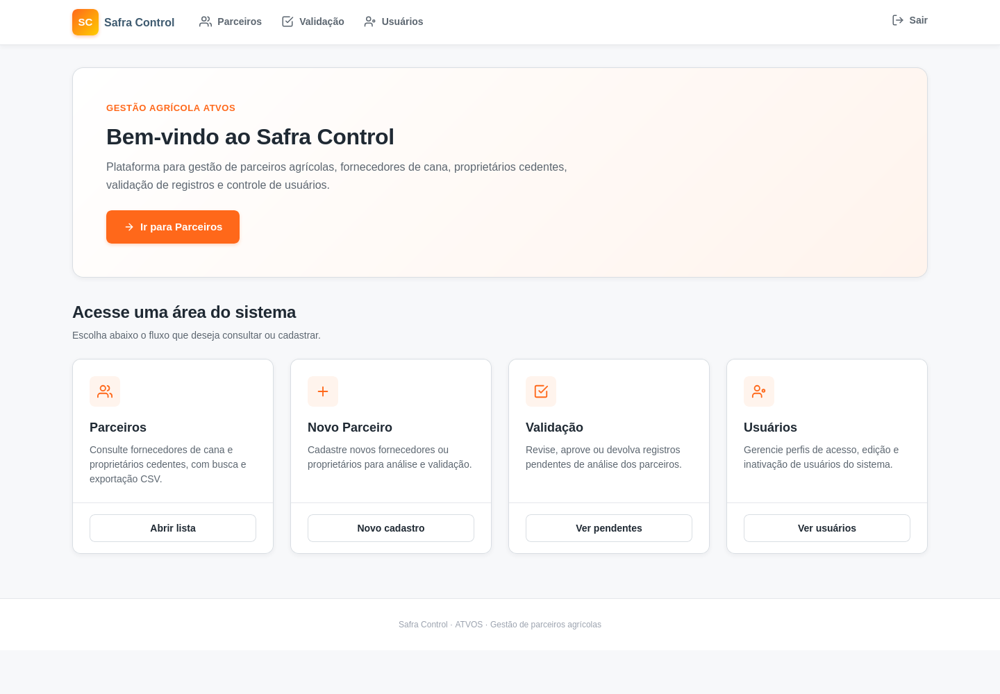<br>
  <sup>Fonte: Material produzido pelos autores, 2026.</sup>
</div><br>

A tela inicial funciona como ponto de entrada para os principais fluxos: parceiros, novo cadastro, validação e usuários. Ela substitui a necessidade de navegar diretamente por endpoints e organiza a aplicação de acordo com as tarefas dos usuários internos.

<div align="center">
  <sub>Figura 4.2.3.3 - Listagem de parceiros com busca e exportação</sub><br>
  <br>
  <sup>Fonte: Material produzido pelos autores, 2026.</sup>
</div><br>

A listagem de parceiros apresenta busca por nome ou CPF/CNPJ, ações de cadastro de fornecedor ou proprietário e exportação CSV. No ambiente usado para a captura, a base não possuía parceiros ativos, portanto a tela exibe corretamente o estado vazio e orienta o usuário a cadastrar o primeiro parceiro.

<div align="center">
  <sub>Figura 4.2.3.4 - Formulário de cadastro de novo parceiro</sub><br>
  <br>
  <sup>Fonte: Material produzido pelos autores, 2026.</sup>
</div><br>

O formulário de parceiro permite cadastrar fornecedores e proprietários, usando campos padronizados e máscaras no frontend para reduzir erros de digitação. A submissão é processada pelo backend e reaproveita as validações de campos obrigatórios e unicidade já cobertas pelos testes.

<div align="center">
  <sub>Figura 4.2.3.5 - Fila de validação de registros</sub><br>
  <br>
  <sup>Fonte: Material produzido pelos autores, 2026.</sup>
</div><br>

A tela de validação apresenta os registros pendentes e permite acessar a revisão individual para aprovar ou devolver cadastros. No ambiente da evidência não havia registros pendentes, por isso o estado vazio confirma o comportamento previsto para uma fila sem itens.

<div align="center">
  <sub>Figura 4.2.3.6 - Gestão de usuários</sub><br>
  <br>
  <sup>Fonte: Material produzido pelos autores, 2026.</sup>
</div><br>

A gestão de usuários exibe colaboradores cadastrados, status ativo, perfil de acesso, data de cadastro e ações de edição e inativação. Esse fluxo atende à necessidade de governança de acesso, permitindo que o administrador mantenha os perfis coerentes com as responsabilidades de cada colaborador.

### 4.2.4. Decisões técnicas relevantes

A segunda versão manteve a decisão de arquitetura em camadas. As views não acessam o banco diretamente; elas passam por rotas, controllers, services e repositories. Essa escolha reduz o risco de divergência entre comportamento da API e comportamento da interface, pois os dois pontos de entrada compartilham as mesmas regras de negócio.

Outra decisão relevante foi o uso de renderização server-side com EJS. Para esta fase do projeto, essa abordagem reduziu a complexidade de infraestrutura, dispensou a criação de uma aplicação frontend separada e permitiu entregar rapidamente telas funcionais conectadas ao backend Express. Os arquivos públicos de CSS e JavaScript ficaram concentrados em `public/`, mantendo a interface simples de servir e compatível com a estrutura atual.

Também foi consolidado o middleware `requireAuth` para proteger rotas internas. O middleware valida token JWT, consulta a sessão ativa no banco, verifica se o usuário continua ativo e diferencia respostas HTML e JSON: páginas web redirecionam para `/login`, enquanto chamadas de API recebem `401`. Essa separação é importante para manter coerência entre uso por navegador e uso por cliente HTTP.

### 4.2.5. O que foi implementado

Foram implementadas as seguintes entregas de aplicação web:

| Entrega | Descrição |
| --- | --- |
| Layout e navegação global | Cabeçalho com marca Safra Control, links para parceiros, validação e usuários, além de ação de logout. |
| Tela de login | Formulário de acesso com e-mail e senha, mensagens de erro e usuários de demonstração. |
| Home operacional | Página inicial com atalhos para módulos centrais do sistema. |
| Módulo de parceiros | Listagem, busca client-side, estado vazio, cadastro, edição, detalhe e exportação CSV. |
| Módulo de validação | Fila de pendentes, revisão de registro, aprovação e devolução com comentário. |
| Módulo de usuários | Listagem, cadastro, edição, alteração de perfil e inativação lógica. |
| Componentes de interface | Botões, cards, badges de status, formulários, modais, flash messages, máscaras e busca em listas. |
| Integração com backend | Reuso dos controllers/services/repositories existentes para persistência, validação, autenticação e exportação. |

### 4.2.6. O que não foi concluído

Apesar de a aplicação já estar navegável, alguns pontos permanecem incompletos para a versão final:

| Pendência | Impacto |
| --- | --- |
| Autorização por perfil mais granular nas views | O backend já autentica o usuário, mas a restrição fina por perfil ainda precisa ser consolidada em todas as rotas e ações da interface. |
| Telas completas de terras e vínculos | Os endpoints de terras e relacionamento parceiro-terra existem, mas ainda não há uma experiência web completa para cadastro, edição e associação diretamente pela interface. |
| Dashboard visual | O endpoint de dashboard de interações existe em JSON, porém ainda não foi transformado em uma tela com gráficos e indicadores. |
| Histórico/auditoria em tela | A API de histórico está implementada, mas a visualização amigável do histórico de alterações ainda deve ser integrada ao perfil do parceiro. |
| Notificações e processo periódico | O RF025 permanece como evolução futura, sem tela ou rotina operacional final nesta versão. |
| Base de demonstração para parceiros | Na captura das evidências, a base local não possuía parceiros ativos nem pendentes, resultando em estados vazios nas telas de parceiros e validação. |

### 4.2.7. Dificuldades técnicas enfrentadas

Uma dificuldade relevante foi integrar a interface EJS aos services existentes sem duplicar regras de validação. Como parte da API já estava testada, a solução foi reutilizar os controllers e services para as ações de formulário, adaptando apenas os retornos para HTML, redirecionamentos e mensagens de erro.

Outro desafio foi conciliar autenticação, sessão e renderização por navegador. A aplicação precisa responder de forma diferente para rotas HTML e endpoints JSON, pois uma falha de autenticação em tela deve redirecionar para o login, enquanto uma falha em API deve retornar status HTTP adequado. O middleware `requireAuth` foi ajustado para tratar esses dois contextos.

Também houve complexidade na documentação das evidências visuais, porque algumas telas dependem do estado do banco. Para manter a transparência, os prints foram registrados com a base disponível no ambiente local, incluindo estados vazios quando não havia parceiros ou registros pendentes.

### 4.2.8. Próximos ajustes

Para a versão final da aplicação web, os próximos ajustes recomendados são:

| Próximo ajuste | Objetivo |
| --- | --- |
| Consolidar autorização por perfil | Garantir que analistas, coordenadores e administradores acessem apenas as ações permitidas. |
| Criar telas de terras e vínculos | Permitir a gestão completa do relacionamento entre parceiros e terras pela interface web. |
| Adicionar dashboard visual | Transformar o endpoint de métricas de interações em uma tela com indicadores e gráficos. |
| Integrar histórico ao perfil do parceiro | Exibir alterações anteriores e responsáveis diretamente na interface. |
| Popular uma base de demonstração | Facilitar validação acadêmica e apresentação com parceiros, pendências e interações de exemplo. |
| Revisar responsividade e acessibilidade | Validar a experiência em telas menores, navegação por teclado, contraste e textos alternativos. |

Com isso, a segunda versão atende ao objetivo da sprint 4: entregar uma aplicação web funcional mínima, integrada ao backend em seus fluxos principais, com evidências visuais, rastreabilidade para RFs e User Stories e registro transparente das limitações que devem ser endereçadas na versão final.

## 4.3. Versão final da aplicação web (sprint 5)

*Descreva e ilustre aqui o desenvolvimento da versão final do sistema web, com foco em refatorações, correções finais e na camada de autenticação/autorização entregue. Utilize prints de tela para ilustrar. Indique obrigatoriamente: (a) o que foi refinado ou adicionado desde a sprint 4, (b) pendências remanescentes, (c) dificuldades técnicas enfrentadas.*

# <a name="c5"></a>5. Testes

## 5.1. Relatório de testes de integração de endpoints automatizados (sprint 4)

*Liste e descreva os testes automatizados dos endpoints criados e planejados para sua solução, implementados com **Jest**. Cubra as duas abordagens:*

- ***White-box*** *— testes unitários de Service que exercitam ramos internos, exceções e regras de negócio (conhecimento da implementação).*
- ***Black-box*** *— testes de integração dos endpoints via Jest + Supertest, verificando apenas o contrato HTTP (status, body, efeito observável), sem depender da implementação interna.*

*Posicione aqui também o relatório de cobertura de testes Jest se houver (através de link ou transcrito para estrutura markdown).*

### 5.1.1 Estratégia de Testes

O CRM da ATVOS centraliza o cadastro de parceiros, o histórico de interações e o controle de acesso por perfil, de modo que qualquer falha na WebAPI afeta diretamente registros que a empresa usa para tomar decisão. Por esse motivo, definiu-se uma estratégia de testes automatizados que verifica cada endpoint e cada regra de negócio antes do código chegar à produção, organizada em camadas para que cada tipo de teste responda a uma pergunta diferente sobre o sistema.

Na camada de Service, utilizou-se a abordagem white-box, com testes unitários. Eles conhecem a implementação e chamam o método do service direto, sem passar pelo HTTP, para verificar se a regra de negócio está correta. Um exemplo é o arquivo userService.spec.ts, que chama o método atualizaPerfilDeAcesso e confere o resultado tanto no retorno quanto no banco. Esses testes encontram erros de lógica de negócio cedo e de forma barata.

Na camada de Controller, utilizou-se a abordagem black-box, com testes de integração. Eles não conhecem a implementação interna, batem no endpoint por meio do Supertest e verificam apenas o contrato HTTP, ou seja, o status da resposta, o corpo retornado e o efeito observável no banco. Um exemplo é o arquivo parceiroController.spec.ts, que envia um POST para /api/parceiros e confere o status e o registro gravado. Esses testes garantem que a pilha inteira, da rota até o banco, funciona junta.

Para o Repository, adotou-se um critério de necessidade: quando há lógica de consulta que não seja trivial, escreve-se teste próprio; quando a consulta é direta, esse teste fica opcional, porque o comportamento já é coberto pelos testes de Service e de Controller.

Em todas as camadas, seguiu-se o padrão AAA, que organiza cada teste em três blocos. No Arrange o cenário é preparado, em geral dentro do beforeEach, criando os dados que o teste precisa. No Act é executada uma única ação, que é a que está sendo testada. No Assert o resultado é verificado com expect, que faz o teste falhar quando o valor não bate. Estabeleceu-se ainda que a verificação nunca fica só no retorno: depois de uma escrita, lê-se o banco com pool.query para provar que o dado foi realmente gravado.

A suíte também foi construída para ser determinística, ou seja, para dar sempre o mesmo resultado. Para isso, foram adotados os seguintes critérios:

- O estado é limpo entre os testes, com beforeEach e afterEach que removem ou recriam os dados, sem que nenhum teste dependa do que outro deixou.
- Não há dependência da ordem de execução, porque cada teste monta o próprio cenário no Arrange.
- Não há dependência do relógio do sistema, de rede externa ou de aleatoriedade não controlada. Para os casos limite, utilizam-se identificadores fixos, como o UUID inexistente 00000000-0000-0000-0000-0000000000ff.
- Ao final de cada arquivo, a conexão com o banco é fechada com afterAll e pool.end, evitando estado residual e conexões abertas.

Concluiu-se que a estratégia de testes contribui diretamente para o CRM da ATVOS ao proteger justamente os fluxos críticos do produto: o cadastro de parceiros com CPF e CNPJ únicos, a atualização de perfil de acesso e as transições de status do parceiro. Ao cobrir esses fluxos nas camadas de Service e de Controller, a suíte impede que mudanças futuras quebrem em silêncio a integridade dos dados de parceiros, e dá ao grupo segurança para evoluir a WebAPI sem medo de regressão.

### 5.1.2 Testes Unitários de Service (white-box)

Esta seção apresenta os testes unitários da camada de Service, que conhecem a implementação e chamam o método do service direto, sem passar pelo HTTP, para verificar se a regra de negócio está correta. Ela traz a cobertura alcançada na camada, a lista de casos de teste com a regra de negócio que cada um cobre e o detalhamento dos cinco casos prioritários.

#### Cobertura da camada de Service

A cobertura é medida com o comando npm test -- --coverage, que gera o relatório do Jest por arquivo. O service principal do produto, o parceiroService, alcança cobertura acima do mínimo de 80% exigido, com cerca de 81% das linhas e 100% das funções exercitadas pelos testes. Os services de usuário também têm testes unitários dedicados. O relatório completo de cobertura por camada está transcrito na seção 5.1.4.

#### Casos de teste vinculados às regras de negócio

Cada caso de teste unitário está ligado de forma explícita a uma regra de negócio. As tabelas abaixo listam os casos já implementados na camada de Service, ordenados pela sequência das RN definidas no artefato 1. A coluna Caminho indica se o caso cobre o fluxo de sucesso ou o de falha. O mapeamento completo que liga cada caso à RN e ao RF está consolidado na seção 5.1.4.

Casos do parceiroService:

| CT | RN | Caminho | Descrição |
|---|---|---|---|
| CT02 | RN04 | feliz | edita um parceiro em rascunho |
| CT03 | RN04 | feliz | retorna um parceiro existente pelo id |
| CT20 | RN04 | feliz | lista os parceiros existentes |
| CT09 | RN08 | falha | consulta de parceiro inexistente |
| CT10 | RN08 | falha | consulta com id malformado |
| CT07 | RN09 | falha | cadastro com cpf ou cnpj duplicado |
| CT23 | RN09 | falha | edição que deixaria o cpf duplicado |
| CT01 | RN10 | feliz | cadastra um parceiro novo em rascunho |
| CT14 | RN12 | falha | histórico de parceiro inexistente |
| CT21 | RN12 | feliz | histórico de parceiro existente |
| CT24 | RN12 | falha | histórico com id malformado |
| CT15 | RN13 | falha | terras de parceiro inexistente |
| CT22 | RN13 | feliz | terras de parceiro existente |
| CT25 | RN13 | falha | terras com id malformado |
| CT16 | RN14 | falha | vínculo com terra inexistente |
| CT04 | RN16 | feliz | envio para validação de rascunho para pendente |
| CT11 | RN16 | falha | envio a partir de status inválido |
| CT17 | RN16 | falha | envio de parceiro inexistente |
| CT26 | RN16 | falha | envio com id malformado |
| CT05 | RN17 | feliz | aprovação de pendente para ativo |
| CT06 | RN17 | feliz | devolução de pendente para devolvido |
| CT12 | RN17 | falha | aprovação com status diferente de pendente |
| CT13 | RN17 | falha | devolução com status diferente de pendente |
| CT18 | RN17 | falha | aprovação de parceiro inexistente |
| CT19 | RN17 | falha | devolução de parceiro inexistente |
| CT27 | RN17 | falha | aprovação com id malformado |
| CT28 | RN17 | falha | devolução com id malformado |
| CT08 | RN20 | falha | edição de parceiro inexistente |

Casos dos services de usuário (userService, userUpdateService e userInactivateService):

| CT | RN | Caminho | Descrição |
|---|---|---|---|
| CT29 | RN03 | feliz | atualiza o perfil de acesso de um usuário |
| CT30 | RN03 | falha | bloqueia a atualização para um perfil inexistente |
| CT31 | RN03 | falha | valida os campos obrigatórios antes de consultar o banco |
| CT39 | RN03 | falha | valida o perfil quando perfil_acesso_id é enviado |
| CT32 | RN06 | falha | informa quando o usuário do perfil não existe |
| CT33 | RN06 | feliz | inativa o usuário e grava ativo como falso |
| CT34 | RN06 | falha | rejeita a inativação quando o id não é informado |
| CT35 | RN06 | falha | rejeita a inativação de usuário inexistente |
| CT36 | RN06 | feliz | atualiza o usuário com dados válidos |
| CT37 | RN06 | falha | rejeita a atualização com payload mal formatado |
| CT38 | RN06 | falha | rejeita a atualização de usuário inexistente |

#### Cinco casos prioritários em detalhe

Os cinco casos abaixo foram escolhidos por cobrirem os três fluxos críticos do produto citados na 5.1.1: o cadastro de parceiros com CPF e CNPJ únicos, as transições de status do parceiro e a atualização de perfil de acesso. Para cada um descreve-se a regra coberta, o tipo de caminho e a estrutura AAA.

CT01 Cadastro de parceiro. Regra coberta RN10. Caminho feliz. No Arrange, o beforeEach cria um usuário analista no banco, que será o autor do cadastro, e o teste gera um CPF único com randomUUID para evitar colisão entre execuções. No Act, o teste chama o método cadastrarParceiro do service, passando nome, tipo de pessoa, CPF, e-mail e o autor. No Assert, o teste confere primeiro o retorno do método, verificando que o parceiro recebeu um identificador e que o status inicial é rascunho, e depois lê a tabela parceiros com pool.query para provar que o registro foi gravado com esse nome e status. O determinismo vem da limpeza no afterEach e do CPF único por execução.

CT07 Cadastro com CPF ou CNPJ duplicado. Regra coberta RN09. Caminho de falha. No Arrange, o teste cadastra um primeiro parceiro e guarda o CPF usado. No Act, chama cadastrarParceiro de novo com o mesmo CPF. No Assert, o teste espera que a chamada seja rejeitada com a mensagem cpf_cnpj já cadastrado, usando rejects.toThrow. Aqui o teste não lê o banco depois, porque o comportamento esperado é o bloqueio: o service lança a exceção antes de gravar, então não existe registro novo para conferir. O resultado do teste é a própria exceção correta. O determinismo vem do CPF gerado com randomUUID a cada execução e da limpeza no afterEach, de modo que a segunda chamada sempre encontra o mesmo cenário de duplicidade, sem depender de ordem nem de dados residuais.

CT05 Aprovação de parceiro pendente. Regra coberta RN17. Caminho feliz. No Arrange, o teste insere um parceiro já no status pendente direto no banco. No Act, chama o método aprovarParceiro passando o autor da aprovação. No Assert, confere no retorno que o status passou para ativo e depois lê a tabela parceiros para confirmar que a transição foi persistida. O determinismo vem de o parceiro ser criado no próprio Arrange já no status pendente e removido no afterEach, então o teste não herda estado de nenhum outro caso e roda igual em qualquer ordem.

CT11 Envio para validação a partir de status inválido. Regra coberta RN16. Caminho de falha. A RN16 determina que apenas registros em rascunho ou devolvido podem ir para pendente. No Arrange, o teste cria um parceiro no status ativo, que não permite a transição. No Act, chama enviarParceiroParaValidacao. No Assert, espera a rejeição com mensagem que cita rascunho ou devolvido, provando que o service bloqueia a transição proibida. Como é um bloqueio, o teste não lê o banco, e sim verifica a exceção. O determinismo vem de o parceiro ativo ser montado no próprio Arrange e limpo no afterEach, sem dependência de relógio, rede ou de dados deixados por outro teste.

CT29 Atualização de perfil de acesso. Regra coberta RN03. Caminho feliz. Este caso vem do arquivo userService.spec.ts. No Arrange, o beforeEach cria um usuário com perfil de analista e o teste recupera o identificador do perfil de coordenador. No Act, chama o método atualizaPerfilDeAcesso passando o usuário e o novo perfil. No Assert, confere no retorno que o campo perfil_acesso_id passou a apontar para o coordenador e depois lê a tabela usuarios com pool.query para provar que a troca de perfil ficou gravada. O determinismo vem do beforeEach que recria o usuário e do afterEach que o remove, com os identificadores de perfil vindo do helper garantirPerfis, que é idempotente, de modo que o teste roda igual em qualquer ordem de execução.

Os cinco casos cobrem os três fluxos críticos citados na 5.1.1 e equilibram caminho feliz e caminho de falha. Os casos de sucesso provam a persistência lendo o banco depois da ação, e os casos de falha provam o bloqueio verificando a exceção correta, sem efeito no banco. Dessa forma, a seção mostra que cada regra de negócio central tem um teste que a defende.

## 5.2. Testes de usabilidade (sprint 5)

### 5.2.1. Relatório de testes de guerrilha

*Posicione aqui as tabelas com enunciados de tarefas, etapas e resultados de testes de usabilidade. Ou utilize um link para seu relatório de testes (mantenha o link sempre público para visualização).*

### 5.2.2. Relatório de testes SUS (System Usability Scale)

*Posicione aqui o relatório dos testes SUS realizados.*

# <a name="c6"></a>6. Estudo de Mercado e Plano de Marketing (sprint 4)

## 6.1 Resumo Executivo

A aplicação web proposta foi desenvolvida para apoiar a ATVOS na gestão do relacionamento com parceiros de terras e fornecedores de cana-de-açúcar. Identificou-se como principal oportunidade de mercado a crescente necessidade de digitalização, rastreabilidade e centralização de informações no setor sucroenergético, especialmente em um contexto no qual a eficiência operacional, a governança de dados e a continuidade dos relacionamentos agrícolas tornam-se fatores estratégicos para a competitividade.

Foi observado que o modelo atual, baseado em planilhas, e-mails e registros individuais, compromete a padronização dos cadastros, dificulta a consulta rápida de informações e gera perda de histórico quando há mudanças na equipe responsável. Diante desse cenário, a solução proposta busca transformar dados dispersos em uma base única, confiável e acessível aos usuários internos da empresa.

Como diferencial competitivo, a aplicação reúne funcionalidades de cadastro centralizado, registro de histórico de interações, filtros de consulta, exportação de listas e controle de acesso por perfil. Dessa forma, o sistema contribui para reduzir retrabalho operacional, preservar informações estratégicas ao longo das safras e fortalecer a rastreabilidade das ações realizadas.

Os objetivos estratégicos pretendidos envolvem aumentar a eficiência da gestão de parceiros, apoiar decisões baseadas em dados estruturados, melhorar a continuidade dos relacionamentos agrícolas e oferecer uma solução alinhada às demandas de transformação digital do agronegócio. Concluiu-se que o CRM proposto agrega valor ao tornar o relacionamento com parceiros um ativo institucional, e não dependente apenas do conhecimento individual dos colaboradores. 

## 6.2 Análise de Mercado

### 6.2.1 Visão Geral do Setor (até 250 palavras)

O setor sucroenergético brasileiro está inserido em uma cadeia estratégica para a matriz energética, para o agronegócio e para o mercado global de commodities agrícolas. Identificou-se que a cana-de-açúcar sustenta a produção de açúcar, etanol e bioenergia, com forte concentração produtiva nas regiões Centro-Sul, Sudeste e Centro-Oeste. Na safra 2025/2026, a produção nacional de cana-de-açúcar foi estimada em 673,2 milhões de toneladas, mesmo diante de redução de produtividade causada por condições climáticas adversas (CONAB, 2026).

No campo regulatório, observou-se que o Programa RenovaBio amplia a relevância da rastreabilidade produtiva e da eficiência ambiental. Em 2026, as metas compulsórias das distribuidoras foram calculadas a partir da meta anual de 48,09 milhões de CBIOs, sendo cada CBIO equivalente a uma tonelada de gases de efeito estufa evitada pelo uso de biocombustível em substituição a combustíveis fósseis (ANP, 2026).

Nesse contexto, concluiu-se que soluções digitais de gestão, como o CRM proposto, tornam-se relevantes para empresas que precisam centralizar cadastros, preservar histórico de relacionamento e garantir rastreabilidade nas interações com fornecedores e parceiros agrícolas.


### 6.2.2 Tamanho e Crescimento do Mercado (até 250 palavras)

O mercado envolve duas dimensões principais: o setor sucroenergético e as soluções digitais de CRM.

No setor produtivo, a estimativa para a safra 2025/2026 é de 44,2 milhões de toneladas de açúcar e 37,5 bilhões de litros de etanol (provenientes de cana-de-açúcar e milho). A área de colheita projetada em 8,95 milhões de hectares evidencia a grande escala operacional da cadeia e a consequente necessidade de uma gestão estruturada de dados agrícolas (CONAB, 2026).

No segmento de tecnologia, as soluções de relacionamento apresentam crescimento expressivo. O mercado global de CRM foi avaliado em US$ 73,40 bilhões em 2024 e projeta atingir US$ 163,16 bilhões até 2030, mantendo uma taxa composta anual de crescimento de 14,6% entre 2025 e 2030 (GRAND VIEW RESEARCH, 2025).
Na América Latina, esse mercado gerou US$ 4,944 bilhões em 2024, com previsão de alcançar US$ 10,931 bilhões até 2030 e expansão anual de 14,5%. O Brasil deve liderar esse crescimento na região, o que reforça a oportunidade para a adoção de ferramentas digitais de relacionamento voltadas ao agronegócio (GRAND VIEW RESEARCH, 2025).

### 6.2.3 Tendências de Mercado (até 300 palavras)

Identificou-se que a digitalização do agronegócio é uma das principais tendências que influenciam o mercado da aplicação proposta. O Plano de Transformação Digital do Ministério da Agricultura e Pecuária aponta como objetivos a modernização de serviços, a integração de sistemas, a ampliação da transparência e a implementação de soluções inovadoras para atender às demandas do setor agropecuário (MAPA, 2026).

Também foi observado avanço nas tecnologias de agricultura digital. Segundo estudo divulgado pelo INPI, os depósitos de patentes em agricultura digital crescem em média 9,4% ao ano, taxa três vezes superior à média geral das tecnologias. O mesmo levantamento destaca que ferramentas digitais, bancos de dados, sistemas de monitoramento e aplicativos contribuem para melhorar a tomada de decisão, a gestão e o acompanhamento da produção agrícola (INPI, 2025).

Outra tendência relevante é a valorização da rastreabilidade e da governança de dados. No setor sucroenergético, essas práticas tornam-se ainda mais importantes em razão do RenovaBio, dos CBIOs e da necessidade de comprovar eficiência produtiva e ambiental. Dessa forma, concluiu-se que a aplicação web proposta está alinhada às demandas atuais do mercado, pois transforma informações dispersas em uma base centralizada, auditável e útil para decisões estratégicas.

## 6.3 Análise da Concorrência
## 6.3.1 Principais Concorrentes

A análise da concorrência foi organizada em dois eixos: empresas do setor sucroenergético que concorrem diretamente com a ATVOS e soluções digitais que poderiam substituir parcialmente a aplicação proposta. No primeiro grupo, foram identificadas Raízen, BP Bioenergy e São Martinho. A Raízen foi considerada concorrente direta por atuar de forma integrada na produção de açúcar, etanol e bioenergia, além da distribuição de combustíveis sob a marca Shell (RAÍZEN, 2026). A BP Bioenergy também foi considerada relevante, pois a bp passou a deter 100% da antiga BP Bunge Bioenergia, fortalecendo sua presença no mercado brasileiro de biocombustíveis (BUNGE, 2024). A São Martinho foi incluída pela sua atuação em açúcar, etanol, energia elétrica e subprodutos da cana-de-açúcar (SÃO MARTINHO, 2026).

No segundo grupo, foram analisados concorrentes indiretos ligados à gestão de relacionamento e dados. Salesforce, Microsoft Dynamics 365 e SAP Customer Experience oferecem recursos de CRM, unificação de dados de clientes, jornadas e suporte à experiência do cliente (SALESFORCE, 2026; MICROSOFT, 2026; SAP, 2026). O Aegro também foi considerado por oferecer gestão rural com controle financeiro, operacional, fiscal, dados de campo e integrações (AEGRO, 2026). Apesar disso, essas soluções não foram concebidas especificamente para o relacionamento entre usinas, fornecedores de cana e proprietários de terra.

## 6.3.2 Vantagens Competitivas da Aplicação Web

Identificou-se que a principal vantagem competitiva da aplicação web está na especialização ao contexto da ATVOS. Enquanto CRMs generalistas são desenvolvidos para múltiplos setores e demandam parametrizações, a solução proposta foi estruturada para atender diretamente à gestão de parceiros agrícolas, fornecedores de cana-de-açúcar e proprietários de terra. Assim, o sistema não se limita ao registro de contatos, mas organiza cadastros, histórico de interações, status de validação, permissões de acesso e rastreabilidade de alterações.

Foi observado que essa aderência ao domínio do negócio reduz uma fragilidade operacional já identificada no projeto: a dispersão de informações em planilhas, e-mails e registros individuais. Com a centralização dos dados, o histórico do relacionamento passa a ser preservado como ativo institucional, e não como conhecimento dependente de cada analista. Esse diferencial fortalece a continuidade das negociações ao longo das safras e melhora a confiabilidade das consultas internas.

Também se destaca o recorte do MVP. A aplicação foi planejada para uso via navegador, sem exigir integração inicial com ERP, SharePoint ou outros sistemas corporativos. Com isso, a implantação tende a ser menos complexa do que a adoção de plataformas amplas de CRM ou gestão rural. Concluiu-se que a vantagem competitiva da aplicação está na combinação entre simplicidade, rastreabilidade, controle de acesso, alinhamento às regras de negócio da ATVOS e foco no relacionamento agrícola estratégico.

## 6.4 Público-Alvo

### 6.4.1 Segmentação de Mercado (até 250 palavras)

A proposta de aplicação web atende ao mercado no setor agroindustrial e de bioenergia brasileiro, sendo segmentado com base em critérios institucionais e operacionais especificos da área. A macro-segmentação é voltada para o ambiente de grandes corporações agrícolas que gerenciam altos contratos com arrendadores de terras, fornecedores de insumos e parceiros agrícolas. Nossa pesquisa tomou a ATVOS como referência, sendo o mercado analisado em grande escala, composta por 8 unidades agroindustriais e 2 escritórios corporativos espalhados pelas regiões sudeste e centro-oeste do país. 
Já na micro-segmentação nossa solução direciona-se de forma exclusiva para os departamentos internos dessas corporações. Sendo os segmentos prioritários as áreas de Estratégia de Terras e Fornecedores e os times de Negócios Agrícolas. A aplicação web foi pensada para atender uma média de 20 a 30 usuários simultâneos, que atuam na governança dos dados cadastrais e no relacionamento em campo dos mais de 1.137 parceiros agrícolas e 108 fornecedores, distribuídos em mais de 180mil hectares de terras cultivadas (ATVOS, 2026).
Com a União da Indústria de Cana-de-Açúcar e Bioenergia (ÚNICA) e o Centro de Estudos Avançados em Economia Aplicada (CEPEA-ESALQ/USP) sendo fontes confiáveis para validar essa segmentação, que demandam ferramentas de gestão mais complexas e completas do que as usadas atualmente, que não atendem a competitividade e alta regulamentação do mercado sucroenergético.

### 6.4.2 Perfil do Público-Alvo (até 250 palavras)

#### Aspectos Demográficos
Analisando os profissionais das áreas de Estratégias de Terras e Fornecedores, é notórios, em ambos os genêros, que a média de idade varia predominantemente de 25 a 55 anos. 
Em relação a formação acadêmica, há certa concentração dos times nas áreas de Engenharia Agronômica, Administração de Empresas, Análise de Dados e Gestão Comercial. Já geograficamente, as equipes estão divididas entre os escritórios na cidade de São Paulo e nas 8 unidades nos estados de Goiás, Mato Grosso, Mato Grosso do Sul e São Paulo (ATVOS,2026).

#### Aspectos Psicográficos e Comportamentais
Durante as pesquisas foi observado uma forte busca cultural pela manutenção das ferramentas e dos métodos tradicionais de controle, as equipes são historicamente dependentes de planilhas eletrônicas e cadernos de campo para o registro dos dados e informções. Os times demonstram alto senso de responsabilidade e urgência, entretanto também demonstram sofrimento com fadiga operacional advinda do retrabalho.

#### Dores e Necessidades
As principais dores se voltam para a falta de governança de dados e na perda do histórico de relacionamento com fornecedores e parceiros agrícolas. No TAPI acordado entre a instituição e a ATVOS foi indicada a necessidade de uma interface intuitiva e amigável (UX/UI), capaz de fornecer uma centralização dos cadastros e integrar paineis de dados estatísticos integrados, já que 100% dos parceiros possuem dados críticos e essenciais para negociações e tomadas de decisões, a visualização agíl dos dados é essencial para o perfil avaliado.

## 6.5 Posicionamento

#### 6.5.1 Proposta de Valor Única (até 250 palavras)
A aplicação proposta tem como principal objetivo garantir a centralização e a governança dos dados de relacionamento de parceiros e fornecedores da cadeia agrícola. A construção da proposta de solução foi baseada no Value Proposition Canvas de Alexander Osterwalder, por meio do qual as dores dos usuários são alinhadas à solução tecnológica desenvolvida (Osterwalder et al., 2014). A aplicação web soluciona um problema crônico do mercado: a dependência de planilhas dispersas e de controles manuais para o gerenciamento de dados (Inteli, 2026). Com a nova plataforma, a preservação das informações sobre os 1.137 parceiros de terras e 108 fornecedores é garantida de forma integral (Atvos, 2026). Quando analisado sob a ótica do framework, o valor gerado atinge, principalmente, duas frentes de alinhamento com o cliente corporativo:

**a) Minimizadores de Dores (Pain Relievers):**
O risco de perda de dados e de informações essenciais para negociações e para a manutenção de relacionamentos de longo prazo com parceiros e fornecedores é mitigado. Dessa forma, o retrabalho ligado à distribuição de dados em múltiplos arquivos individuais é evitado (Inteli, 2026)

**b) Criadores de ganhos (Gain Creators):**
A aplicação é dotada de uma interface amigável e intuitiva (UX/UI) e de painéis de visualização de dados estatísticos nativos. Tais ferramentas dão suporte direto para a realização de consultas rápidas e para a geração de listas segmentadas (Osterwalder et al., 2014).

#### 6.5.2 Posicionamento e Diferenciação
No mercado, o sistema posiciona-se como um Hub Estratégico de Governança de Relacionamento Agrícola, moldado estritamente como uma solução Business-to-Employee (B2E), visando à ocupação de um espaço mental e funcional único na rotina operacional (Ries & Trout, 2001). Dessa maneira, identificou-se que a principal diferenciação da aplicação desenvolvida está na modernização das alternativas utilizadas no mercado, diferentemente de planilhas e outros sistemas corporativos tradicionais, os quais podem gerar erros e dispersão de dados, além de possuírem telas genéricas e custos altos (Inteli, 2026). O desenvolvimento do protótipo foi voltado especificamente para agilizar o trabalho do setor sucroenergético (Atvos, 2026). Diante disso, o produto aposta em uma identidade eficiente, ágil e sustentável, para garantir que a ferramenta facilite a rotina diária dos times de Negócios Agrícolas (Ries & Trout, 2001). Conclui-se, portanto, que essa entrega consolida um produto completo, com um banco de dados estruturado e painéis de visualização autênticos, que funciona de forma independente e não exige contratação ou custos à parte com softwares externos.

## 6.6 Estratégia de Marketing 

#### 6.6.1 Produto/Serviço
O produto desenvolvido é uma aplicação web voltada para a gestão, visualização e cadastro dos dados de parceiros de terras e fornecedores do setor sucroenergético, constituído por uma arquitetura full-stack com banco de dados SQL nativo. O sistema tem como principais funções: o cadastro de dados de parceiros e fornecedores, o registro de interações e negociações e a visualização de informações através de painéis dinâmicos que permitem uma análise estatística. A plataforma busca eliminar a dependência completa em planilhas eletrônicas e controles manuais informais, que podem acarretar falhas crônicas, inconsistência entre os dados e perda do histórico de relacionamentos. A principal diferenciação em relação aos outros sistemas CRM disponíveis no mercado, que são caros e com interfaces rígidas, é que toda a proposta foi baseada na experiência do usuário (UX/UI), voltada especialmente para o fluxo de governança e homologação de 100% das informações dos parceiros agrícolas. Segundo os autores Kotler e Keller (2021), o protótipo é classificado como um bem de assistência corporativa, que tem um valor central na transformação de dados dispersos em ativos estratégicos.

#### 6.6.2 Preço
Como a plataforma foi projetada para ser uma solução somente corporativa e voltada para uso interno do tipo B2E, o modelo de monetização de licenciamento comercial ou assinatura (SaaS) não foi considerado o mais adequado. Sendo assim, a estratégia de precificação adotada foi planejada a partir do modelo de Desenvolvimento Interno Proprietário (In-house Software). A aplicação desse determinado modelo é baseada na eliminação de empecilhos financeiros e custos frequentes com fornecedores de softwares externos; o valor de investimento foi centrado no custo do desenvolvimento de software pelas equipes e na manutenção preventiva.
Sob a ótica de Kotler e Armstrong (2015), o preço deve ser avaliado com base no valor percebido pela organização, em que o custo de implementação é compensado pelo retorno financeiro indireto. Tal retorno é materializado pelo ganho de até 35% na produtividade das equipes agrícolas e de campo, além de mitigar os riscos jurídicos e prejuízos operacionais decorrentes da perda de contratos com parceiros e fornecedores.

#### 6.6.3 Praça
Tendo como base uma estratégia de Canal Direto Intracorporativo, focado de forma exclusiva no ambiente digital fechado para definir a Praça. O sistema web será disponibilizado através de servidores de nuvem privada integrados à estrutura tecnológica interna da companhia. Os usuários terão acesso de forma restrita e segura através de qualquer navegador web que seja o padrão da empresa, sendo exigida a autenticação corporativa única (SSO) e perfis específicos para cada nível de acesso e atuação. As oito unidades agroindustriais e os dois escritórios corporativos da Atvos são formalizados como os canais de entrega.
A distribuição digital direta garante a governança sobre os dados e a sincronização das interações em tempo real. Segundo a teoria dos canais dos autores Kotler e Keller (2012), tal configuração de nível zero garante o controle sobre a governança de informações e a segurança das informações sensíveis da Atvos e seus 1.137 parceiros de terras e 108 fornecedores.

#### 6.6.4 Promoção
O plano estratégico de promoção da solução foi construída sob a ótica do Endomarketing Estratégico e Gestão de Mudança Corporativa, já que o público-alvo se resume a colaboradores nas áreas de Negócios Agrícolas e Estratégias de Terras. Campanhas de publicidade públicas ou marketing digital (como redes sociais e mídia paga) não se alinham ao escopo da aplicação e tornam-se irrelevantes para a promoção do produto.

O plano de divulgação interna será estruturado em três fases distintas:

**Fase de Sensibilização (Teasers e Eventos de Lançamento):** A proposta é realizar seminários e videoconferências institucionais e comunicados internos nas plataformas oficiais de comunicação da empresa, apresentando a solução.

**Fase de Capacitação (Workshops de Engajamento):** Também será necessário realizar treinamentos técnicos  e orientações práticas nas 8 unidades agroindustriais para mitigar a resistência na susbtituíção de ferramentas antigas.

**Fase de Sustentação (Marketing de Conteúdo Interno):** Manuais de usuário e guias interativos de UX/UI  disponibilizados no sistema corporativo.


# <a name="c7"></a>7. Conclusões e trabalhos futuros (sprint 5)

*Escreva de que formas a solução da aplicação web atingiu os objetivos descritos na seção 2 deste documento. Indique pontos fortes e pontos a melhorar de maneira geral.*

*Relacione os pontos de melhorias evidenciados nos testes com planos de ações para serem implementadas. O grupo não precisa implementá-las, pode deixar registrado aqui o plano para ações futuras*

*Relacione também quaisquer outras ideias que o grupo tenha para melhorias futuras*

# <a name="c8"></a>8. Referências (sprints 1 a 5)

Agência Brasil. (2022, 4 de janeiro). Sancionada lei que autoriza postos a comprarem etanol de produtores. https://agenciabrasil.ebc.com.br/politica/noticia/2022-01/sancionada-lei-que-autoriza-postos-comprarem-etanol-de-produtores

Agência Nacional do Petróleo, Gás Natural e Biocombustíveis. (2024, 1 de fevereiro). Vendas de gasolina, diesel e etanol cresceram em 2023. https://www.poder360.com.br/energia/vendas-de-gasolina-diesel-e-etanol-cresceram-em-2023-diz-anp/

Agência Nacional do Petróleo, Gás Natural e Biocombustíveis. (2026, 31 de março). RenovaBio: ANP divulga metas definitivas para as distribuidoras em 2026. https://www.gov.br/anp/pt-br/canais_atendimento/imprensa/noticias-comunicados/renovabio-anp-divulga-metas-definitivas-para-as-distribuidoras-em-2026
Aegro. (2026). Aegro: sistema de gestão rural. https://aegro.com.br/

AgFeed. (2023). Fora da RJ, ATVOS refaz planos e mira biometano, etanol de milho e de aviação. https://agfeed.com.br/negocios/fora-da-rj-atvos-refaz-planos-e-mira-biometano-etanol-de-milho-e-de-aviacao/

Agroadvance. (2025). 15 maiores grupos do setor sucroalcooleiro no Brasil em 2024/25. https://agroadvance.com.br/blog-maiores-grupos-do-setor-sucroalcooleiro/

Agroadvance. (2025). Preço do ATR no CONSECANA-SP. https://agroadvance.com.br/blog-consecana-preco-do-atr/
ATVOS. (2023). Reuters: ATVOS aposta em etanol, não em açúcar, em novo investimento em cana no Brasil. https://atvos.com/reuters-atvos-aposta-em-etanol-nao-em-acucar-em-novo-investimento-em-cana-no-brasil/

ATVOS. (2023). Guia da marca Atvos [Material institucional]. Disponibilizado pelo Instituto de Tecnologia e Liderança (Inteli).

ATVOS. (2025, 14 de janeiro). Relatório anual da safra 2023/2024. https://www.udop.com.br/noticia/2025/01/14/atvos-divulga-relatorio-anual-da-safra-2023-2024.html

Atvos Agroindustrial Participações S.A. (2026). Atvos: Apresentação institucional 2026 [Documento interno corporativo].

Brasilagro. (2021). País terá dilema com carros elétricos em 2030: o que fazer com tanto etanol? https://www.brasilagro.com.br/conteudo/pais-tera-dilema-com-carros-eletricos-em-2030o-que-fazer-com-tanto-etanol.html

Broto Notícias. (2026, abril). Pressão da safra 2026/27 e demanda retraída forçam queda nas cotações de etanol e açúcar em SP. https://noticias.broto.com.br/cotacoes/queda-cotacoes-etanol-acucar-safra-2026-27

Bunge. (2024). Bunge completes sale of its ownership share in BP Bunge Bioenergia joint venture in Brazil. https://www.bunge.com/Press-Releases/
Bunge-Completes-Sale-of-its-Ownership-Share-in-BP-Bunge-Bioenergia-Joint-Venture-in-Brazil

Canal Rural. (2026). Usinas ampliam canaviais por arrendamento. https://www.canalrural.com.br/agricultura/cana/usinas-ampliam-canaviais-por-arrendamento-e-mudam-estrutura-fundiaria-em-sao-paulo/

Centro de Estudos Avançados em Economia Aplicada. (2026). Indicadores econômicos e pesquisas sobre o setor sucroenergético e arrendamento de terras. Escola Superior de Agricultura Luiz de Queiroz, Universidade de São Paulo. https://cepea.esalq.usp.br

Companhia Nacional de Abastecimento. (2026, 17 de abril). Produção de cana-de-açúcar chega a 673,2 milhões de toneladas na safra 2025/26. https://www.gov.br/conab/pt-br/assuntos/noticias/producao-de-cana-de-acucar-chega-a-673-2-milhoes-de-toneladas-na-safra-2025-26

Eixo. (2025). Hidrogênio e biometano: os gases do futuro. https://eixos.com.br/hidrogenio/hidrogenio-e-biometano-os-gases-do-futuro/

Grand View Research. (2025). Customer relationship management market size, share & trends analysis report, 2030. https://www.grandviewresearch.com/industry-analysis/customer-relationship-management-crm-market

Grand View Research. (2025). Latin America customer relationship management market size & outlook, 2030. https://www.grandviewresearch.com/horizon/outlook/customer-relationship-management-market/latin-america

Grupo 6. (2026). Value Proposition Canvas ATVOS [Diagrama]. Canva. https://canva.link/towo8wkfnm7kd6v

Grupo 6. (2026). Diagrama de Classes UML do Domínio ATVOS [Diagrama]. PlantUML. https://editor.plantuml.com/uml/hLXRZ-Cq57xFhx261supmmw25LImmgGf1CqcLIyZBaB8axYjsSGEjZExWFO18O64n0iIFm1uG23nX7ZXDV-4Ny9nBctYf9qEeYjjEpuNV-Vu-3kstrAQI9sdYQEPJYWQCxAM92KefiXDY59KeLYWiKYBFpWJZlCiUdFV1sHk64pyTvOpN7nRV1sYAt--n9S7RHAwqaWB9Dbwer7C98qq4znnr2F6Cm9OK6HmOAqbkyurzIF1v-mBYkwrLDI6nE8nuskq8ecYBKd2EDMVPnG9gJUY9U0YfefcwEBrjYD9-AF-Q4RYs3Y_UBcD2qif7ay4roMSYrS7HVfpoEgrI69RkjYmw16dIg6By_ksq1M9aEYPbylFaDzQuLxvwIKBVUaWz3Q97gsbo7bSAqzUC_-CHCYOodhqrV83eost5-N7UTfsJ7cUxl4xcRpYtRVzOdmV0xHR_NAXwLw_hxklzFpUVytuVNfRANh1yg5N5kAFtloWRWOJapL59nw4I2KfVYt-eke4GC7SPTWBbeafB9KW9LA4ffFgwptuUjfHks8yoXDHwqt2MU2vtZYSVUBY09TZU3RpWZ4sOmjlDiCT5tDDTAwwJl32lmhBNtwm--q5hh4UXpq8OGP1HAGnTsS-Td5OkuBzw7-u_TjxtxrSpd7buzQKJl7CzVnPE4SUkYg-3zpbPNXaQgT4HfH9eH05qp_Ay1Ho1UGxOeGrsQwgjr6k0pXZyGWjb_wu-ek3qGWI9M57LYDwkpoZrb9LiYXRkJpxj6j0Ky8IomS59XBSyXmJJGAY8fPIhiK8ZOccEnGu4cb6-8PmRTbjcD92iaZu88B545G1DFf4L-Apykl5YCH4QKdaSyzN0x3s965V4EbM4j48WFDKdW1LZu7dL3dwT9UlkboQR2R3USlghFgTKRshsL6xW2kfAijnr2tBNMfypYBMIOiPdR2qFIIk5PKtTGxQIJfhWcOtknHG7b4vb98AWXrwKofBpc8Iqxj4dbSctK637qFrG1fX1xN3QD1MGcbDRECgrsaY9ASHZO6s1d7TLFdi8g3fDM5Fm5nsnzSvaJ4ZbdOgOaYFGU02pKfYYdGmntKMBLo3iA79K1wJky7kxyhRrxsDQJUfZMbXwk4EI0RNjG-FI4hgdC5cUnUeOqnXdvEaHf_1WQ5srHCQsodqBMvsMqyQKKua4zZ4TqJaPNnrqBTIy7A-BBwQ-U7y52q37xg8PyWOkzvy7Xx7n4kL5py1F0KUgl0C9-F8S6Q7XGzkgKZ4R6tLsa2EOMk3qjj299Jm0xiUGBG6slkRoXLBAdJ7jWD9Fykfn9aKDzKcximFKqN0p6HueyHqnJYJC6tAO4hQ8nn8drdSFKJJGdjR_Gtq84MXbxnBrERuBCA1c6k8fi-NkqvnABzrE0VNEgzq_a_sx4wxZzHTOGv-V3yJxI7s8Rp_MxkITCtAfjsWWqZjvcMBMh7DAdE14zqvfHsJSxFK9bzuHGrdMVLK2_ljlJaFZZgdmoO1XdlD8OK9QI9-Rnu6BL4WReGr2alSOA_oje3JqN2Ajeh7qjlCkyIk7mRueHSiu9mvdVc1wq-nRuwP6ALm1c9P0gjOLYk1zOS-XZXHA0CgXoyFxXD85dzgStm68WOKoS4vdUrXy-JY1BrmTePExfsVlt3IFrIDq1lN3oxGFz_yW8p66ozTFt2SdbRR2_oqpm5T9nUbawDyj9hoqJx4BfggYGw6q4d0pi8-MGtPDhAxM-un_Uymsrmn2BNcxVzclSVSOi_ZKtI4eTDfVOFcTu7Qvvr1uyFRS-nDuUfQV0Tx4i-H6puiRzc7hu2xXJi_Vz2-IOzGhaY_S1kjvWvyGArxMQuK-t4s3hVNuahnbb23S04XUkzFBttNNBhnBL6MpnZbOvPORSlA2H6fdgq46hWIefLWJaeCSGDPYHJ-8saca8QB8dJnKmUkVIiXKs0w9EcAok9tS-8q3t9n_I1txW0hb6yeDOHheRL83GWxPKwBXg3c8i897Fp8ZbTWK9lzv_3Y5m7OpEiCt2zeOlYdmgVowwXw5JnrCi4Koa65Af0qhHY86FnaGgcSIISj_YuP6-nljhV-Q7lhHuePIYz-vbIeSyS9geaPC3kGFBGuj85KyU9NOcYzn29WNWddEuElYQOJXG8VZcbxoWJKpBgTD3b5PNYbXhDYJogz1lw1V9RSv5GCPJ1Mbmy3alHoNMT7qHmcvcOzOSbe1hwfMRq6bRD5PJ3KGPHF3QSGL8cJW15HZYcG-aq0hIalVZELP5nD1u0VhknB_46uN20_kFBdnVTNtgLvry78cqznyMtLU0-NUciFdtsqOJ4GvyUnUCpFEky7xJrigNLV4xgxUC3ZziIoen9BgrVgFRgm3AosxDXjUgjUFakVsItOiLkohL_LIfV2BGWrJM_fUbXSTmZ7QXYMSe_qTltLqhHwisFtwZtghVxeE6z1r7cQ_0i0

Instituto de Tecnologia e Liderança. (2023). Adalove. https://adalove.inteli.edu.br/feed

Instituto de Tecnologia e Liderança. (2026). Projeto parceiro ATVOS: Aplicação web para gestão de relacionamento agrícola — 1AMD2 [Documento de escopo de projeto].

Instituto Nacional da Propriedade Industrial. (2025, 18 de setembro). Tecnologias de agricultura digital crescem três vezes mais rápido que a média, diz estudo da OEP. https://www.gov.br/inpi/pt-br/central-de-conteudo/noticias/tecnologias-de-agricultura-digital-crescem-tres-vezes-mais-rapido-que-a-media-diz-estudo-da-oep

Microsoft. (2026). Dynamics 365 Customer Insights. https://www.microsoft.com/pt-br/dynamics-365/products/customer-insights

Ministério da Agricultura e Pecuária. (2025, 23 de janeiro). Plano de Transformação Digital — PTD. https://www.gov.br/agricultura/pt-br/acesso-a-informacao/tecnologia-da-informacao/plano-de-transformacao-digital-ptd

Modesto, F., Farina, M., & colaboradores. (2011). Psicodinâmica das cores em comunicação. Blucher. https://search.worldcat.org/pt/title/1295699137

NPagro. (2024). Investimentos em usinas de etanol de milho somam R$ 23 bilhões no país. https://www.npagro.com.br/materias/investimentos-em-usinas-de-etanol-de-milho-somam-r-23-bilhoes-no-pais/

Osterwalder, A., Pigneur, Y., Bernarda, G., & Smith, A. (2014). Value proposition design: How to create products and services customers want. John Wiley & Sons.

Portal da Indústria. (2023). Setor sucroenergético precisa de investimentos de US$ 31 bilhões para contribuir com metas de redução de emissões de CO₂. Confederação Nacional da Indústria. https://noticias.portaldaindustria.com.br/noticias/economia/setor-sucroenergetico-precisa-de-investimentos-de-us-31-bilhoes-para-contribuir-com-metas-de-reducao-de-emissoes-de-co2/

Porter, M. E. (1979). How competitive forces shape strategy. Harvard Business Review, 57(2), 137–145.

Porter, M. E. (2008). The five competitive forces that shape strategy. Harvard Business Review, 86(1), 78–93.

<<<<<<< HEAD
UDOP. (2025, 26 de março). ATVOS obtém licença de instalação para sua primeira fábrica de biometano em Mato Grosso do Sul. União Nacional da Bioenergia. https://www.udop.com.br/noticia/2025/3/26/atvos-obtem-licenca-de-instalacao-para-sua-primeira-fabrica-de-biometano-em-mato-grosso-do-sul

INTELI — INSTITUTO DE TECNOLOGIA E LIDERANÇA. Projeto Parceiro ATVOS: 1AMD2 — Aplicação Web. São Paulo, 2026.

Grupo 6. (2026). Value Proposition Canvas ATVOS. Canva. https://canva.link/towo8wkfnm7kd6v

Grupo 6. (2026). Diagrama de Classes UML do Domínio ATVOS. 
https://editor.plantuml.com/uml/hLXRZ-Cq57xFhx261supmmw25LImmgGf1CqcLIyZBaB8axYjsSGEjZExWFO18O64n0iIFm1uG23nX7ZXDV-4Ny9nBctYf9qEeYjjEpuNV-Vu-3kstrAQI9sdYQEPJYWQCxAM92KefiXDY59KeLYWiKYBFpWJZlCiUdFV1sHk64pyTvOpN7nRV1sYAt--n9S7RHAwqaWB9Dbwer7C98qq4znnr2F6Cm9OK6HmOAqbkyurzIF1v-mBYkwrLDI6nE8nuskq8ecYBKd2EDMVPnG9gJUY9U0YfefcwEBrjYD9-AF-Q4RYs3Y_UBcD2qif7ay4roMSYrS7HVfpoEgrI69RkjYmw16dIg6By_ksq1M9aEYPbylFaDzQuLxvwIKBVUaWz3Q97gsbo7bSAqzUC_-CHCYOodhqrV83eost5-N7UTfsJ7cUxl4xcRpYtRVzOdmV0xHR_NAXwLw_hxklzFpUVytuVNfRANh1yg5N5kAFtloWRWOJapL59nw4I2KfVYt-eke4GC7SPTWBbeafB9KW9LA4ffFgwptuUjfHks8yoXDHwqt2MU2vtZYSVUBY09TZU3RpWZ4sOmjlDiCT5tDDTAwwJl32lmhBNtwm--q5hh4UXpq8OGP1HAGnTsS-Td5OkuBzw7-u_TjxtxrSpd7buzQKJl7CzVnPE4SUkYg-3zpbPNXaQgT4HfH9eH05qp_Ay1Ho1UGxOeGrsQwgjr6k0pXZyGWjb_wu-ek3qGWI9M57LYDwkpoZrb9LiYXRkJpxj6j0Ky8IomS59XBSyXmJJGAY8fPIhiK8ZOccEnGu4cb6-8PmRTbjcD92iaZu88B545G1DFf4L-Apykl5YCH4QKdaSyzN0x3s965V4EbM4j48WFDKdW1LZu7dL3dwT9UlkboQR2R3USlghFgTKRshsL6xW2kfAijnr2tBNMfypYBMIOiPdR2qFIIk5PKtTGxQIJfhWcOtknHG7b4vb98AWXrwKofBpc8Iqxj4dbSctK637qFrG1fX1xN3QD1MGcbDRECgrsaY9ASHZO6s1d7TLFdi8g3fDM5Fm5nsnzSvaJ4ZbdOgOaYFGU02pKfYYdGmntKMBLo3iA79K1wJky7kxyhRrxsDQJUfZMbXwk4EI0RNjG-FI4hgdC5cUnUeOqnXdvEaHf_1WQ5srHCQsodqBMvsMqyQKKua4zZ4TqJaPNnrqBTIy7A-BBwQ-U7y52q37xg8PyWOkzvy7Xx7n4kL5py1F0KUgl0C9-F8S6Q7XGzkgKZ4R6tLsa2EOMk3qjj299Jm0xiUGBG6slkRoXLBAdJ7jWD9Fykfn9aKDzKcximFKqN0p6HueyHqnJYJC6tAO4hQ8nn8drdSFKJJGdjR_Gtq84MXbxnBrERuBCA1c6k8fi-NkqvnABzrE0VNEgzq_a_sx4wxZzHTOGv-V3yJxI7s8Rp_MxkITCtAfjsWWqZjvcMBMh7DAdE14zqvfHsJSxFK9bzuHGrdMVLK2_ljlJaFZZgdmoO1XdlD8OK9QI9-Rnu6BL4WReGr2alSOA_oje3JqN2Ajeh7qjlCkyIk7mRueHSiu9mvdVc1wq-nRuwP6ALm1c9P0gjOLYk1zOS-XZXHA0CgXoyFxXD85dzgStm68WOKoS4vdUrXy-JY1BrmTePExfsVlt3IFrIDq1lN3oxGFz_yW8p66ozTFt2SdbRR2_oqpm5T9nUbawDyj9hoqJx4BfggYGw6q4d0pi8-MGtPDhAxM-un_Uymsrmn2BNcxVzclSVSOi_ZKtI4eTDfVOFcTu7Qvvr1uyFRS-nDuUfQV0Tx4i-H6puiRzc7hu2xXJi_Vz2-IOzGhaY_S1kjvWvyGArxMQuK-t4s3hVNuahnbb23S04XUkzFBttNNBhnBL6MpnZbOvPORSlA2H6fdgq46hWIefLWJaeCSGDPYHJ-8saca8QB8dJnKmUkVIiXKs0w9EcAok9tS-8q3t9n_I1txW0hb6yeDOHheRL83GWxPKwBXg3c8i897Fp8ZbTWK9lzv_3Y5m7OpEiCt2zeOlYdmgVowwXw5JnrCi4Koa65Af0qhHY86FnaGgcSIISj_YuP6-nljhV-Q7lhHuePIYz-vbIeSyS9geaPC3kGFBGuj85KyU9NOcYzn29WNWddEuElYQOJXG8VZcbxoWJKpBgTD3b5PNYbXhDYJogz1lw1V9RSv5GCPJ1Mbmy3alHoNMT7qHmcvcOzOSbe1hwfMRq6bRD5PJ3KGPHF3QSGL8cJW15HZYcG-aq0hIalVZELP5nD1u0VhknB_46uN20_kFBdnVTNtgLvry78cqznyMtLU0-NUciFdtsqOJ4GvyUnUCpFEky7xJrigNLV4xgxUC3ZziIoen9BgrVgFRgm3AosxDXjUgjUFakVsItOiLkohL_LIfV2BGWrJM_fUbXSTmZ7QXYMSe_qTltLqhHwisFtwZtghVxeE6z1r7cQ_0i0

MODESTO, Farina et al, Psicodinâmica das cores em comunicação. In: BLUCHER, [S.l.], 2011. Disponível em: https://search.worldcat.org/pt/title/1295699137. Acesso em: 20 maio 2026.

ATVOS. *Guia da marca Atvos*. São Paulo: Atvos, 2023. Material institucional disponibilizado pelo Instituto de Tecnologia e Liderança (Inteli) por meio do Google Drive da disciplina. Acesso em: 20 maio 2026.

Atvos Agroindustrial Participações S.A. (2026). Atvos: Apresentação institucional 2026 (Documento interno corporativo). Estratégia de Terras e Fornecedores.

AGÊNCIA NACIONAL DO PETRÓLEO, GÁS NATURAL E BIOCOMBUSTÍVEIS (ANP). RenovaBio: ANP divulga metas definitivas para as distribuidoras em 2026. Brasília, DF: ANP, 31 mar. 2026. Disponível em: https://www.gov.br/anp/pt-br/canais_atendimento/imprensa/noticias-comunicados/renovabio-anp-divulga-metas-definitivas-para-as-distribuidoras-em-2026. Acesso em: 2 jun. 2026.

COMPANHIA NACIONAL DE ABASTECIMENTO (CONAB). Produção de cana-de-açúcar chega a 673,2 milhões de toneladas na safra 2025/26. Brasília, DF: Conab, 17 abr. 2026. Disponível em: https://www.gov.br/conab/pt-br/assuntos/noticias/producao-de-cana-de-acucar-chega-a-673-2-milhoes-de-toneladas-na-safra-2025-26. Acesso em: 2 jun. 2026.

GRAND VIEW RESEARCH. Customer Relationship Management Market Size, Share & Trends Analysis Report, 2030. San Francisco: Grand View Research, 2025. Disponível em: https://www.grandviewresearch.com/industry-analysis/customer-relationship-management-crm-market. Acesso em: 2 jun. 2026.

GRAND VIEW RESEARCH. Latin America Customer Relationship Management Market Size & Outlook, 2030. San Francisco: Grand View Research, 2025. Disponível em: https://www.grandviewresearch.com/horizon/outlook/customer-relationship-management-market/latin-america. Acesso em: 2 jun. 2026.

Instituto de Tecnologia e Liderança [Inteli]. (2026). Projeto Parceiro ATVOS: Aplicação web para gestão de relacionamento agrícola — 1AMD2 (Documento de escopo de projeto). Campus Inteli.

INSTITUTO NACIONAL DA PROPRIEDADE INDUSTRIAL (INPI). Tecnologias de agricultura digital crescem três vezes mais rápido que a média, diz estudo da OEP. Brasília, DF: INPI, 18 set. 2025. Disponível em: https://www.gov.br/inpi/pt-br/central-de-conteudo/noticias/tecnologias-de-agricultura-digital-crescem-tres-vezes-mais-rapido-que-a-media-diz-estudo-da-oep. Acesso em: 2 jun. 2026.

Kotler, P., & Armstrong, G. (2015). Princípios de marketing (15a ed.). Pearson Education.

Kotler, P., & Keller, K. L. (2012). Administração de marketing (14a ed.). Pearson Education.

AEGRO. Aegro: sistema de gestão rural. Porto Alegre: Aegro, 2026. Disponível em: https://aegro.com.br/. Acesso em: 8 jun. 2026.

BUNGE. Bunge completes sale of its ownership share in BP Bunge Bioenergia joint venture in Brazil. St. Louis: Bunge, 2024. Disponível em: https://www.bunge.com/Press-Releases/Bunge-Completes-Sale-of-its-Ownership-Share-in-BP-Bunge-Bioenergia-Joint-Venture-in-Brazil. Acesso em: 8 jun. 2026.

MICROSOFT. Dynamics 365 Customer Insights. Redmond: Microsoft, 2026. Disponível em: https://www.microsoft.com/pt-br/dynamics-365/products/customer-insights. Acesso em: 8 jun. 2026.

RAÍZEN. Sobre a Raízen. São Paulo: Raízen, 2026. Disponível em: https://www.raizen.com.br/sobre-a-raizen. Acesso em: 8 jun. 2026.

SALESFORCE. What is CRM Software? San Francisco: Salesforce, 2026. Disponível em: https://www.salesforce.com/crm/what-is-crm/software/. Acesso em: 8 jun. 2026.

SAP. Customer Experience and Customer Relationship Management. Walldorf: SAP, 2026. Disponível em: https://www.sap.com/products/crm.html. Acesso em: 8 jun. 2026.

SÃO MARTINHO. São Martinho. São Paulo: São Martinho, 2026. Disponível em: https://www.saomartinho.com.br/. Acesso em: 8 jun. 2026.
=======
Raízen. (2026). Sobre a Raízen. https://www.raizen.com.br/sobre-a-raizen

Ries, A., & Trout, J. (2001). Positioning: The battle for your mind (20th anniversary ed.). McGraw-Hill.

Salesforce. (2026). What is CRM software? https://www.salesforce.com/crm/what-is-crm/software/

SAP. (2026). Customer experience and customer relationship management. https://www.sap.com/products/crm.html

São Martinho. (2026). São Martinho. https://www.saomartinho.com.br/

União Nacional da Bioenergia. (2025, 26 de março). ATVOS obtém licença de instalação para sua primeira fábrica de biometano em Mato Grosso do Sul. https://www.udop.com.br/noticia/2025/3/26/atvos-obtem-licenca-de-instalacao-para-sua-primeira-fabrica-de-biometano-em-mato-grosso-do-sul
>>>>>>> 800ed0a1d13753481425f5c3beea963ff1aed89e

# <a name="c9"></a>Anexos

## Classificação de Impacto, Probabilidade e Matriz de Risco

https://canva.link/1vkfsz6nre0h1iq
