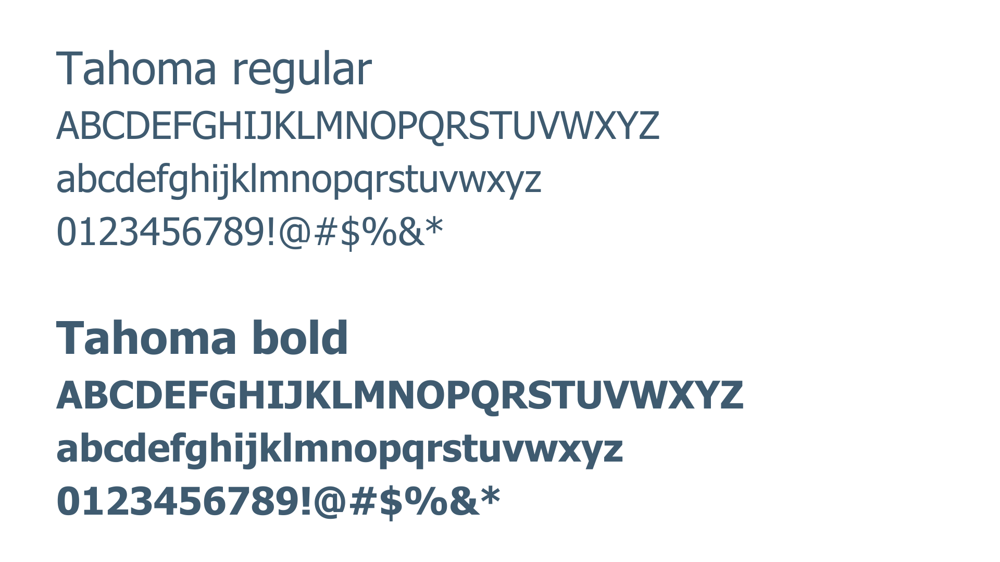
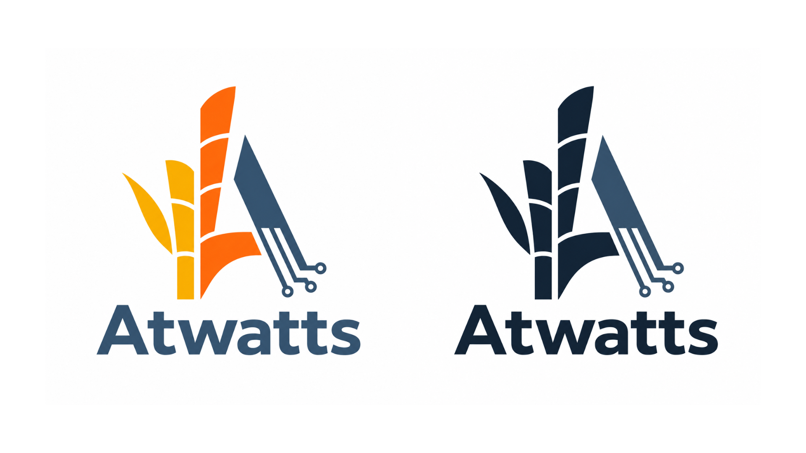
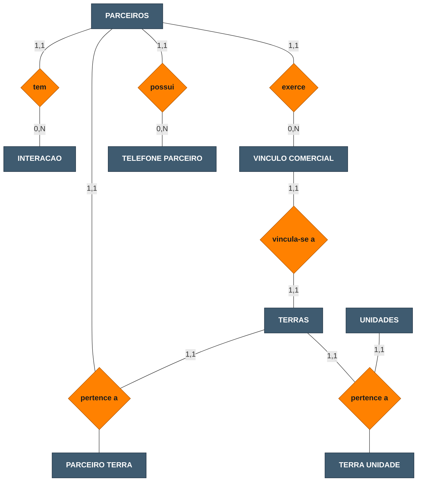
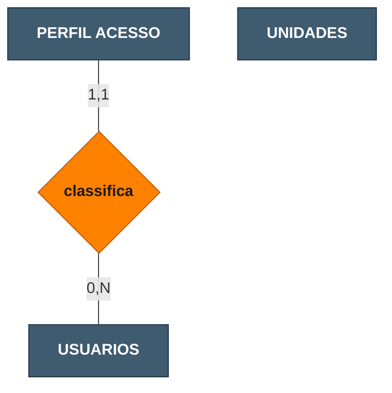
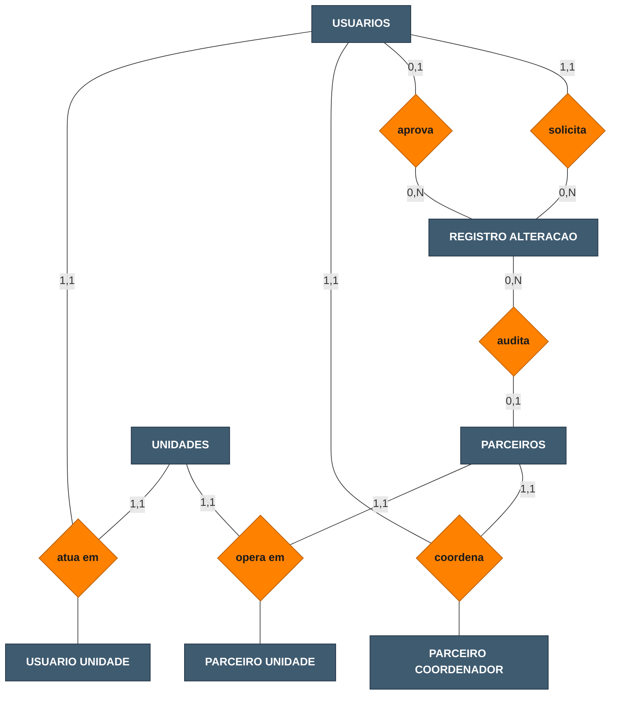
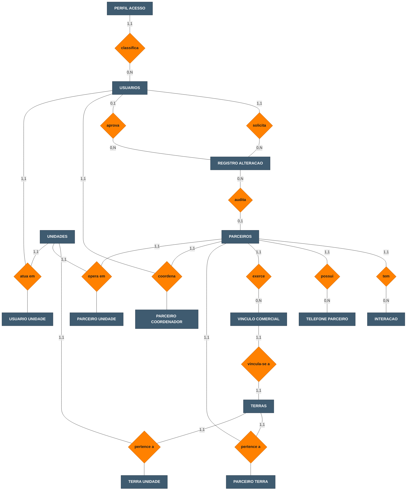

```mermaid
flowchart TB
    classDef client fill:#AED6F1,stroke:#2E86C1,color:#1a1a1a,font-weight:bold
    classDef controller fill:#2E75B6,stroke:#1F4E79,color:#fff,font-weight:bold
    classDef service fill:#FF8100,stroke:#b35a00,color:#1a1a1a,font-weight:bold
    classDef repository fill:#70AD47,stroke:#4a7a2e,color:#1a1a1a,font-weight:bold
    classDef model fill:#E1EB80,stroke:#96B400,color:#1a1a1a,font-weight:bold
    classDef helper fill:#D5D8DC,stroke:#717D7E,color:#1a1a1a,font-style:italic
    classDef banco fill:#3F5B70,stroke:#1e3040,color:#fff,font-weight:bold
    classDef layer fill:#F2F3F4,stroke:#BDC3C7,color:#1a1a1a,font-weight:bold

    %% Cliente
    USER(["👤 Usuário\nNavegador / Cliente HTTP"]):::client

    %% Helpers
    subgraph HELPERS["🔧 Helpers (Auxiliar)"]
        direction LR
        H1["formatarData"]:::helper
        H2["validarEmail"]:::helper
        H3["validarCpfCnpj"]:::helper
        H4["gerarLogAuditoria"]:::helper
        H5["paginador"]:::helper
    end

    %% Camada 1 - Controllers
    subgraph LAYER1["1. Controller"]
        direction LR
        C1["AprovacaoController"]:::controller
        C2["VinculoController"]:::controller
        C3["UsuarioController"]:::controller
        C4["InteracaoController"]:::controller
        C5["ParceirosController"]:::controller
        C6["ImportacaoController"]:::controller
        C7["AuditoriaController"]:::controller
    end

    %% Camada 2 - Services
    subgraph LAYER2["2. Service"]
        direction LR
        S1["AprovacaoService"]:::service
        S2["VinculoService"]:::service
        S3["UsuarioService"]:::service
        S4["InteracaoService"]:::service
        S5["ParceirosService"]:::service
        S6["ImportacaoService"]:::service
        S7["AuditoriaService"]:::service
    end

    %% Camada 3 - Repositories
    subgraph LAYER3["3. Repository"]
        direction LR
        R1["SolicitacaoAprovacaoRepository"]:::repository
        R2["VinculoRepository"]:::repository
        R3["UsuarioRepository"]:::repository
        R4["InteracaoRepository"]:::repository
        R5["ParceirosRepository"]:::repository
        R6["AuditoriaRepository"]:::repository
        R7["DestinoAgricolaRepository"]:::repository
        R8["ComentarioRepository"]:::repository
    end

    %% Camada 4 - Models
    subgraph LAYER4["4. Model"]
        direction LR
        M1["SolicitacoesAprovacao"]:::model
        M2["VinculoUnidade"]:::model
        M3["Interacoes"]:::model
        M4["Usuario"]:::model
        M5["Parceiro"]:::model
        M6["LogsAuditoria"]:::model
        M7["DestinoAgricola"]:::model
        M8["Comentarios"]:::model
    end

    %% Banco
    DB[("🐘 Banco de Dados\nPostgreSQL")]:::banco

    %% Fluxo principal top-down
    USER -->|"HTTP Request"| LAYER1

    C1 --> S1
    C2 --> S2
    C3 --> S3
    C4 --> S4
    C5 --> S5
    C6 --> S6
    C7 --> S7

    S1 --> R1
    S2 --> R2
    S3 --> R3
    S4 --> R4
    S5 --> R5
    S6 --> R5
    S7 --> R6

    R1 --> M1
    R2 --> M2
    R3 --> M4
    R4 --> M3
    R5 --> M5
    R6 --> M6
    R7 --> M7
    R8 --> M8

    LAYER4 --> DB

    %% Helpers usados pelos Services
    S3 -.->|"usa"| H2
    S5 -.->|"usa"| H3
    S7 -.->|"usa"| H4
    S1 -.->|"usa"| H4
    S5 -.->|"usa"| H1
    S3 -.->|"usa"| H5
```

# WAD - Web Application Document - Módulo 2 - Inteli

## Grupo Atwatts

#### Integrantes

- Antônio de Souza Dantas Neto
- Gabriel Gomes Pimentel
- Haila Thauane Falcão Novaes
- João Paulo Barreto Ferreira Andrade Rodrigues de Paula
- Mariana Pires de Carvalho Moussa
- Tiago Brun de Arruda
- William Junior dos Santos Maia


## Sumário

[1. Introdução](#c1)

[2. Visão Geral da Aplicação Web](#c2)

[3. Projeto Técnico da Aplicação Web](#c3)

[4. Desenvolvimento da Aplicação Web](#c4)

[5. Testes da Aplicação Web](#c5)

[6. Estudo de Mercado e Plano de Marketing](#c6)

[7. Conclusões e trabalhos futuros](#c7)

[8. Referências](#c8)

[Anexos](#c9)

<br>


# <a name="c1"></a>1. Introdução (sprints 1 a 5)

A ATVOS, empresa do setor sucroenergético, enfrenta dificuldades na gestão do relacionamento com seus parceiros de terras e fornecedores de cana. As informações encontram-se dispersas em planilhas, e-mails e anotações individuais, sem padronização ou centralização, o que torna o histórico de interações dependente do conhecimento de cada analista. Na prática, quando um coordenador de campo deixa a equipe, os registros de negociações e visitas com determinado parceiro simplesmente desaparecem, obrigando o substituto a reconstruir o relacionamento do zero a cada safra. Dessa forma, a continuidade dos relacionamentos é comprometida, assim como a capacidade de tomada de decisão estratégica por parte da gestão.

Diante dessa problemática, será desenvolvida uma aplicação web do tipo CRM, sigla para Customer Relationship Management, isto é, uma ferramenta voltada à gestão centralizada do relacionamento com clientes e parceiros de negócio. No contexto deste projeto, a solução permitirá que a ATVOS registre, acompanhe e analise suas interações com parceiros de terras e fornecedores de cana em um único ambiente digital, substituindo o modelo atual fragmentado por um fluxo estruturado e rastreável de informações.

A aplicação será construída sobre três pilares principais. O primeiro é o cadastro centralizado, por meio do qual parceiros e fornecedores serão registrados com informações detalhadas de perfil, localização e oportunidades associadas. O segundo é o histórico de alterações e interações, que garantirá rastreabilidade e continuidade das relações independente de mudanças no time responsável. O terceiro é o controle de acesso por perfil, com três níveis distintos de permissão, assegurando que cada usuário interaja com o sistema de acordo com seu papel e responsabilidade dentro da organização.

Com a adoção dessa solução, espera-se que a ATVOS consolide uma visão única e confiável de seus parceiros estratégicos, reduza o retrabalho operacional e fortaleça a tomada de decisões com base em dados estruturados e históricos preservados ao longo das safras.

# <a name="c2"></a>2. Visão Geral da Aplicação Web (sprint 1)

## 2.1. Escopo do Projeto (sprints 1 e 4)

### 2.1.1. Modelo de 5 Forças de Porter (sprint 1)
 
A análise das 5 Forças de Porter permite compreender a dinâmica competitiva do setor sucroenergético e os desafios estruturais enfrentados pela ATVOS, terceira maior empresa de moagem de cana-de-açúcar do Brasil, atrás de Raízen e BP Bunge (AGROADVANCE, 2025). A ausência de governança de dados compromete a tomada de decisão rápida e a continuidade das interações (INTELI, 2026), tornando o CRM proposto uma resposta direta às vulnerabilidades competitivas identificadas em cada força.

A ameaça de novos entrantes é baixa a moderada. O setor demanda US$31 bilhões para metas de descarbonização (Portal da Indústria, 2023), as melhores regiões produtivas já estão ocupadas e as licenças ambientais dificultam novos players (UDOP, 2025). O etanol de milho, que já mobilizou R$23 bilhões em investimentos, expande as fronteiras competitivas do setor (NPagro, 2024; Porter, 2008).

O poder de barganha dos fornecedores é moderado e distinto. A necessidade de processar a cana em até 50 km do corte cria dependência geográfica dos fornecedores de terra (Canal Rural, 2026). Já os fornecedores de cana têm poder limitado, com preços regulados pelo Consecana (AGROADVANCE, 2025). O CRM permite registrar histórico de negociações por fornecedor, reduzindo a assimetria de informação nessas tratativas.

O poder de barganha dos clientes é alto. Distribuidoras como Raízen, Vibra e Ipiranga concentram mais de 53% do mercado de etanol e açúcar VHP (ANP, 2024), diminuindo o poder de precificação da ATVOS (Porter, 1979). A venda direta a postos (Lei n.º 14.292/2022) e a liderança em CBIOs via RenovaBio (ATVOS, 2025) oferecem diferenciação parcial junto a compradores com metas climáticas (Agência Brasil, 2022).

A rivalidade entre concorrentes é alta. O setor disputa terras, fornecedores e CBIOs em um mercado consolidado, onde ineficiências internas ampliam a vulnerabilidade frente a concorrentes mais estruturados. Cadastro centralizado e histórico preservado são vantagens operacionais diretas nesse contexto.

A ameaça de produtos substitutos é moderada e crescente. Com 80% da cana destinada ao etanol (ATVOS, 2023), a empresa é vulnerável a veículos elétricos, que podem reduzir a demanda em até 40% até 2035 (Brasilagro, 2021), ao etanol de milho (AgFeed, 2023) e ao biometano para transporte pesado (Eixo, 2025).

Em resumo, o CRM proposto atua diretamente na redução de vulnerabilidades operacionais da ATVOS: preserva o histórico com parceiros estratégicos, padroniza cadastros e viabiliza decisões mais ágeis frente à concorrência.

### 2.1.2. Análise SWOT da Instituição Parceira (sprint 1)

No mercado nacional de etanol, a ATVOS compete com Raízen e Biosev, diferenciando-se pela diversificação produtiva.

| FORÇAS | FRAQUEZAS |
| :------------------------------------------------------------------------------------------------------------------------- | :----------------------------------------------------------------------------------------------------------------------------- |
| Terceira maior empresa de moagem de cana do Brasil, com portfólio em etanol, açúcar VHP e CBIOs.           | Gestão de parceiros fragmentada em planilhas, gerando perda de histórico a cada troca de analista. |


<br>


| OPORTUNIDADES                                                                                                                                                                                                                 | AMEAÇAS                                                                                                                                                                                                                   |
| :------------------------------------------------------------------------------------------------------------------------------------------------------------------------------------------------------------------------------------------- | :----------------------------------------------------------------------------------------------------------------------------------------------------------------------------------------------------------------------------------- |
| Expansão do SAF e metas de CBIOs via RenovaBio fortalecem a relevância de relacionamentos agrícolas estruturados.|Mudanças climáticas comprometem safras e a dependência de conhecimento individual agrava a gestão de crises. |

O CRM converte o histórico de parceiros em ativo institucional, fortalecendo a competitividade da ATVOS.


---

### 2.1.3. Solução (sprints 1 a 5)

#### a) Problema a ser resolvido

Os dados de gestão de parceiros de terras e fornecedores de cana-de-açúcar encontram-se dispersos em planilhas, sem governança adequada. Essa fragmentação compromete a preservação do histórico de relacionamento, dificulta a padronização dos cadastros e prejudica a tomada de decisão ágil e a continuidade das relações de longo prazo.

#### b) Dados disponíveis

Os dados estão disponíveis no SharePoint da área de Estratégia de Terras da ATVOS, de caráter confidencial. Os arquivos incluem bases cadastrais de fornecedores de cana, registros de contatos de parceiros e proprietários de terra, estruturas de cadastro existentes e informações de acesso ao portal de gestão de parceiros.

#### c) Solução proposta

Será desenvolvida uma aplicação web full stack com front-end em HTML, CSS e JavaScript, back-end em Node.js e banco de dados SQLite. A solução centralizará cadastros de parceiros, registrará o histórico de interações. O acesso será controlado por três perfis distintos: administrador, editor e observador.

#### d) Forma de utilização da solução

A aplicação será utilizada via navegador web pelos times internos da área de Negócios Agrícolas. Cada perfil terá acesso às funcionalidades correspondentes ao seu nível de permissão: cadastro e edição de parceiros, registro de interações, aplicação de filtros por nome, região e tipo de parceiro e exportação de listas.

#### e) Benefícios esperados

Centralização e padronização dos cadastros de parceiros; eliminação de planilhas dispersas e redução de retrabalho operacional; preservação do histórico de relacionamento ao longo das safras independente de mudanças no time; e agilidade na consulta e análise de dados para suporte à tomada de decisão estratégica.

#### f) Critério de sucesso e como será avaliado

O sucesso será avaliado pela entrega do MVP funcional com os três módulos operacionais (cadastro, histórico e controle de acesso); pela redução mensurável do tempo de consulta a dados de parceiros frente ao modelo de planilhas; e pela validação com usuários internos da ATVOS em testes de usabilidade, com taxa de conclusão de tarefas acima de 80%.

### 2.1.4. Value Proposition Canvas (sprint 1)

O Value Proposition Canvas foi construído a partir das informações levantadas no Kick Off com a ATVOS, tendo como segmento-cliente os coordenadores de campo e gerentes regionais da área de Negócios Agrícolas responsáveis pela gestão de parceiros de terras e fornecedores de cana.

<br>
<div align="center">
  <sub>Figura 2.1.4 - Value Proposition Canvas</sub><br>
  <br>
  <sup>Fonte: Material produzido pelos autores, 2026.</sup>
</div><br>

---

#### 1. O Perfil do Cliente

O segmento-cliente é composto pelos coordenadores de campo e gerentes regionais da ATVOS que atuam na área de Negócios Agrícolas. O trabalho diário desses profissionais envolve manter o relacionamento com parceiros estratégicos (fornecedores de cana-de-açúcar e proprietários de terra) ao longo das safras, garantindo a continuidade dos contratos e a qualidade das informações para a tomada de decisão. No entanto, o modelo atual de gestão apresenta limitações estruturais que comprometem diretamente esse trabalho.

**Tarefas do Cliente**

As principais atividades que esse profissional precisa realizar são: cadastrar e manter atualizados os dados de fornecedores de cana e proprietários de terra; registrar e consultar o histórico de interações com cada parceiro; acessar rapidamente perfis e informações relevantes para negociações; e controlar quem da equipe pode visualizar ou editar cada informação.

**Dores**

A maior frustração é a dispersão dos dados em planilhas, e-mails e anotações individuais, sem qualquer padronização. Na prática, um coordenador que precisa consultar o histórico de um parceiro antes de uma visita de renovação contratual frequentemente não encontra registros organizados — ou depende de ligar para o colega que tratou o assunto anteriormente. Quando um profissional sai da equipe, o histórico vai junto. Além disso, a falta de padronização nos cadastros dificulta a consulta ágil, gera retrabalho constante e expõe informações sensíveis a acessos não controlados.

**Ganhos Esperados**

Esse profissional espera ter uma visão única e confiável de todos os parceiros, com o histórico de relacionamento preservado independentemente de mudanças no time. Espera também agilidade na consulta de dados para suportar decisões estratégicas e rastreabilidade completa de todas as alterações realizadas no sistema.

---

#### 2. O Mapa de Valor

Para responder diretamente à realidade desse cliente, a solução proposta é um CRM web desenvolvido sob medida para a área de Negócios Agrícolas da ATVOS. A aplicação é estruturada em torno de três pilares: o cadastro centralizado de parceiros, o histórico rastreável de interações e o controle de acesso por perfil. Juntos, esses pilares substituem o modelo fragmentado atual por um fluxo estruturado, padronizado e auditável de informações.

**Produtos e Serviços**

A solução entrega: um CRM web centralizado para gestão de parceiros agrícolas; indicadores-chave de desempenho da base de parceiros para suporte gerencial; exportação de listas de contatos para uso externo ao sistema; e controle de acesso segmentado por perfil: administrador, editor e observador.

**Aliviadores de Dor**

Para eliminar a dependência do conhecimento individual, o sistema preserva o histórico de interações por parceiro de forma permanente e cronológica. Para acabar com a despadronização, o cadastro conta com campos validados e obrigatórios que garantem consistência nos dados. A substituição das planilhas por um fluxo rastreável resolve a fragmentação, e a inativação de usuários sem exclusão de histórico mantém o controle de acesso sem perda de informações.

**Criadores de Ganho**

O sistema permite filtrar parceiros por nome, região, área e tipo, reduzindo o tempo de busca. A visão gerencial via indicadores-chave de desempenho entrega consolidação dos dados sem exportações manuais. O registro de auditoria de todas as alterações garante rastreabilidade completa. O acesso centralizado via navegador, sem instalação, torna o sistema acessível de qualquer ponto. Por fim, a continuidade operacional independente de mudanças no time é o ganho mais estratégico da solução: o relacionamento com o parceiro deixa de estar na memória do analista e passa a estar no sistema.


---

#### Conclusão do Alinhamento

O problema central da ATVOS é mais relacional do que transacional: o risco não está em não ter dados, mas em perdê-los quando a equipe muda. A solução responde diretamente a essa dor ao tornar o histórico de relacionamento um ativo institucional, e não individual. Cada funcionalidade entregue, do cadastro padronizado ao controle de acesso, foi definida a partir de uma dor ou ganho identificado no canvas, o que garantiu que o escopo do MVP fosse construído com foco real no valor percebido pelo usuário.


### 2.1.5. Matriz de Riscos do Projeto (sprint 1)

A matriz de riscos é uma ferramenta fundamental de gestão de projetos, utilizada para identificar, classificar e planejar respostas a eventos que possam impactar negativamente (ameaças) ou positivamente (oportunidades) o desenvolvimento da aplicação Web. Ela permite visualizar, de forma estruturada, os principais riscos do projeto, avaliando sua probabilidade de ocorrência e o impacto potencial sobre os resultados. A análise e o acompanhamento contínuo desses riscos são essenciais para garantir a entrega do MVP no prazo, com qualidade e alinhamento aos objetivos do grupo.

#### 2.1.5.1 Classificação de Impacto, Probabilidade e Matriz de Risco

Os critérios de classificação de impacto seguem uma escala de cinco níveis: Muito Baixo (impacto desprezível sobre prazo, escopo ou qualidade), Baixo (impacto isolado e facilmente contornável), Médio (impacto moderado que exige esforço de mitigação), Alto (impacto significativo sobre a entrega do MVP ou a satisfação do parceiro) e Muito Alto (impacto crítico que pode inviabilizar o projeto ou causar dano grave ao parceiro). A probabilidade segue escala análoga: Muito Baixa (evento improvável dado o contexto atual), Baixa, Média, Alta e Muito Alta (evento esperado se nenhuma ação preventiva for tomada). A combinação de impacto e probabilidade determina o nível de criticidade de cada risco na matriz, orientando a priorização das respostas.


<div align="center">
  <sub>Figura 2.1.5.1 - Classificação de Impacto</sub><br>
  <br>
  <sup>Fonte: Material produzido pelos autores, 2026.</sup>
</div>

<div align="center">
  <sub>Figura 2.1.5.2 - Classificação de Probabilidade</sub><br>
  <br>
  <sup>Fonte: Material produzido pelos autores, 2026.</sup>
</div>

<div align="center">
  <sub>Figura 2.1.5.3 - Matriz de Risco</sub><br>
  <br>
  <sup>Fonte: Material produzido pelos autores, 2026.</sup>
</div>

#### 2.1.5.2 Lista de Riscos (Ameaças)

##### A. Informações não atualizadas

Há o risco das informações sobre os parceiros não serem mantidas atualizadas após o cadastro inicial, comprometendo a confiabilidade do sistema como fonte única de verdade.

**Responsáveis:** Antônio, Gabriel, Haila, João, Mariana, Tiago, William

**Impacto:** Alto

**Probabilidade:** Média

**Plano de Resposta ao Risco:** Implementar alertas automáticos para cadastros sem atualização há mais de 90 dias; validar a consistência dos dados em testes de integração durante o desenvolvimento; e estabelecer com a ATVOS um responsável interno pelo monitoramento periódico da base após a entrega do MVP.

##### B. Atraso na entrega do MVP

Atrasos nas funcionalidades da aplicação web podem comprometer a entrega ao parceiro no prazo acordado.

**Responsáveis:** Antônio, Gabriel, Haila, João, Mariana, Tiago, William

**Impacto:** Alto

**Probabilidade:** Baixa

**Plano de Resposta ao Risco:** Manter divisão de tarefas equilibrada com acompanhamento semanal de progresso; priorizar funcionalidades core (cadastro, histórico, controle de acesso) nas primeiras sprints; e acionar plano de contingência de redistribuição de tarefas caso algum membro enfrente impedimento técnico ou de disponibilidade.

##### C. Exposição de dados confidenciais

As informações dos parceiros e fornecedores da ATVOS não devem ser expostas, visto que é conteúdo estratégico e restrito da empresa.

**Responsáveis:** Antônio, Gabriel, Haila, João, Mariana, Tiago, William

**Impacto:** Muito Alto

**Probabilidade:** Baixa

**Plano de Resposta ao Risco:** Não publicar o sistema em URL pública sem controle de acesso; manter arquivos de dados reais fora do repositório git, utilizando dados anonimizados para desenvolvimento e testes; revisar permissões de acesso ao repositório antes de cada entrega; e registrar formalmente o protocolo de manuseio de dados confidenciais com o time.

##### D. UX inadequada

Interfaces pouco intuitivas podem inviabilizar o uso pela equipe da ATVOS, que precisa de consulta rápida ao perfil de parceiros.

**Responsáveis:** Antônio, Gabriel, Haila, João, Mariana, Tiago, William

**Impacto:** Médio

**Probabilidade:** Média

**Plano de Resposta ao Risco:** Realizar testes de usabilidade com pelo menos 5 usuários representativos do perfil da ATVOS, registrando erros, hesitações e tempo de conclusão de tarefas; incorporar os resultados em ciclo de melhoria antes da entrega final; e validar protótipos de tela com a orientação da professora de UX ao longo das sprints.

#### 2.1.5.3 Lista de Riscos (Oportunidades)

##### E. Eliminação de planilhas

A centralização dos dados de parceiros facilita muito para a ATVOS, diminuindo o tempo de trabalho deles e eliminando a perda de histórico de informações dos parceiros e produtores.

**Responsáveis:** Antônio, Gabriel, Haila, João, Mariana, Tiago, William

**Impacto:** Alto

**Probabilidade:** Muito Alta

**Plano de Resposta ao Risco:** Demonstrar a qualidade do projeto durante a apresentação do MVP, comparando o tempo médio de consulta entre o modelo de planilhas e a aplicação, e documentando a redução de etapas operacionais para tarefas-chave como cadastro e consulta de histórico.

##### F. Fortalecimento do relacionamento com parceiro

Com o histórico de interações centralizado e acessível para a ATVOS, ela pode personalizar o relacionamento com fornecedores e parceiros, fortalecendo a fidelidade a longo prazo.

**Responsáveis:** Antônio, Gabriel, Haila, João, Mariana, Tiago, William

**Impacto:** Alto

**Probabilidade:** Alta

**Plano de Resposta ao Risco:** Priorizar a funcionalidade de registro e consulta do histórico de interações nas primeiras sprints do MVP, garantindo que o módulo esteja funcional e validado com usuários reais antes das funcionalidades secundárias.

---

A matriz de riscos permite à equipe antecipar ameaças, planejar respostas e aproveitar oportunidades. O acompanhamento dos riscos contribui para a organização do grupo, a entrega do MVP no prazo e a elevação da qualidade do produto. Aliada à comunicação eficiente e à definição clara de responsabilidades, é fundamental para o sucesso da aplicação web.

## 2.2. Personas (sprint 1)

Personas são representações fictícias dos usuários da aplicação, construídas com base nas informações coletadas durante entrevistas e workshops com os clientes. Elas são um recurso fundamental para que as equipes de desenvolvimento, design e marketing se sensibilizem com o usuário, entendam suas dores e expectativas e moldem uma solução voltada para quem realmente vai usá-la. No presente projeto, foram construídas três personas (apresentadas nas figuras 2.2.1, 2.2.2 e 2.2.3), com base nas informações coletadas durante o workshop com o parceiro (ATVOS) e no mapeamento dos perfis envolvidos na problemática. As personas representam os principais usuários internos da aplicação: o analista responsável pelo cadastro e atualização dos dados, a coordenadora responsável pela consulta e análise gerencial, e o gerente responsável pela governança de acessos e supervisão da base.

<div align="center">
  <sub>Figura 2.2.1 - Persona 1: Juliano Soares</sub><br>
  <br>
  <sup>Fonte: Material produzido pelos autores, 2026. (Imagem de pessoa produzida por IA generativa)</sup>
</div><br>

<div align="center">
  <sub>Figura 2.2.2 - Persona 2: Bianca Souza</sub><br>
  <br>
  <sup>Fonte: Material produzido pelos autores, 2026. (Imagem de pessoa produzida por IA generativa)</sup>
</div><br>

<div align="center">
  <sub>Figura 2.2.3 - Persona 3: Marcelo Andrade</sub><br>
  <br>
  <sup>Fonte: Material produzido pelos autores, 2026. (Imagem de pessoa produzida por IA generativa)</sup>
</div><br>

| Persona | Papel no sistema | Dores principais | Necessidades | Relação com a solução |
|---|---|---|---|---|
| Juliano Soares | Editor / Analista de Negócios Agrícolas | Perde tempo buscando informações dispersas em planilhas e e-mails, correndo o risco de trabalhar com dados desatualizados ou duplicados, o que compromete a confiabilidade dos registros. | Ter um ponto central e confiável para registrar e atualizar dados de parceiros, de modo que possa trabalhar com informações sempre corretas sem depender de fontes fragmentadas. | Usa o sistema para centralizar cadastros, atualizar informações e registrar interações com parceiros. |
| Bianca Souza | Observadora / Coordenadora de Estratégia de Terras | Chega a reuniões e negociações sem visão completa do portfólio, pois precisa consolidar manualmente dados de fontes distintas, o que reduz a qualidade das decisões estratégicas. | Acessar rapidamente uma visão consolidada e atualizada dos parceiros para embasar decisões estratégicas e conduzir negociações com informação confiável. | Usa o sistema para análise gerencial, consulta de dados e acompanhamento da base de parceiros. |
| Marcelo Andrade | Administrador do Sistema / Gerente de coordenadores | Não consegue rastrear quem alterou dados críticos nem revogar acessos com agilidade, expondo a empresa a inconsistências e a riscos de uso indevido das informações. | Saber exatamente quem pode acessar e alterar dados, e ter rastreabilidade suficiente para identificar e corrigir inconsistências antes que causem problemas operacionais. | Usa o sistema para garantir governança, segurança, rastreabilidade e controle de acesso. |

Ao analisar as três personas do projeto, observa-se que suas dores possuem uma mesma origem: a descentralização dos dados dos parceiros e fornecedores. No entanto, essa problemática impacta cada perfil de forma distinta. O analista é afetado pelo retrabalho operacional no cadastro e atualização das informações; a coordenadora é impactada pela dificuldade de consulta, análise e acompanhamento dos parceiros; e o administrador enfrenta riscos relacionados ao controle de acesso, auditoria e governança da base. Dessa forma, a solução deve contemplar funcionalidades operacionais, analíticas e administrativas para sustentar a gestão do relacionamento agrícola da ATVOS.


## 2.3. User Stories (sprints 1 a 5)

---

User Stories são descrições simples de funcionalidades escritas do ponto de vista do usuário, no formato "como [perfil], posso [ação], para [benefício]". Para garantir a qualidade de cada história, foi aplicado o método INVEST, que avalia se a história é Independente, Negociável, Valiosa, Estimável, Pequena e Testável. As User Stories a seguir estão ordenadas por prioridade de desenvolvimento.

---

Identificação | US01
--- | ---
Persona | Juliano Soares — Analista de Negócios Agrícolas
Prioridade | Alta
User Story | "Como analista de negócios agrícolas, posso cadastrar fornecedores de cana salvando o registro como rascunho e enviando para validação, para que os dados de cada agricultor parceiro sejam revisados e ativados de forma padronizada no sistema."
Critério de aceite 1 | CR1: Dado que o analista está autenticado e acessa o formulário de cadastro de fornecedor de cana, quando preenche os campos disponíveis e salva como rascunho, então o registro é persistido com status rascunho e fica disponível na seção de rascunhos do analista.
Critério de aceite 2 | CR2: Dado que o analista concluiu o preenchimento do formulário de fornecedor de cana, quando aciona o envio para validação, então o registro muda para status pendente e aparece na fila de validação do coordenador.
Critérios INVEST | Independente: pode ser desenvolvida sem depender do cadastro de proprietários ou de interações. Negociável: os campos do formulário podem ser revistos com a equipe da ATVOS sem alterar o objetivo central. Valiosa: resolve diretamente a dispersão dos dados de fornecedores em planilhas, centralizando as informações em um único sistema com fluxo de validação rastreável. Estimável: envolve formulário, validação, persistência e fluxo de status, com escopo claro para estimar o esforço. Pequena: abrange apenas o fluxo de criação e envio de um novo fornecedor de cana para validação, sem integrações externas. Testável: verifica-se se o registro aparece como rascunho após salvar e se muda para pendente após o envio para validação.

---

Identificação | US02
--- | ---
Persona | Juliano Soares — Analista de Negócios Agrícolas
Prioridade | Alta
User Story | "Como analista de negócios agrícolas, posso cadastrar proprietários de terra salvando o registro como rascunho e enviando para validação, para que os dados de cada proprietário parceiro sejam revisados e ativados de forma padronizada no sistema."
Critério de aceite 1 | CR1: Dado que o analista está autenticado e acessa o formulário de cadastro de proprietário de terra, quando preenche os campos disponíveis e salva como rascunho, então o registro é persistido com status rascunho e fica disponível na seção de rascunhos do analista.
Critério de aceite 2 | CR2: Dado que o analista concluiu o preenchimento do formulário de proprietário de terra, quando aciona o envio para validação, então o registro muda para status pendente e aparece na fila de validação do coordenador.
Critérios INVEST | Independente: pode ser desenvolvida em paralelo à US01, com formulário e lógica próprios para o perfil de proprietário. Negociável: os campos podem ser ajustados conforme as necessidades da área de Estratégia de Terras. Valiosa: centraliza os dados de proprietários que hoje estão dispersos em planilhas, eliminando retrabalho e padronizando o cadastro com fluxo de validação. Estimável: reutiliza a estrutura da US01 com campos distintos para o perfil de proprietário, com esforço bem delimitado. Pequena: escopo restrito ao fluxo de criação e envio de um proprietário de terra para validação. Testável: verifica-se se o registro aparece como rascunho após salvar e se muda para pendente após o envio para validação.

---

Identificação | US03
--- | ---
Persona | Juliano Soares — Analista de Negócios Agrícolas
Prioridade | Alta
User Story | "Como analista de negócios agrícolas, posso registrar o histórico de interações com parceiros, para que o relacionamento seja documentado e acessível a toda a equipe."
Critério de aceite 1 | CR1: Dado que o analista está autenticado e acessa o perfil de um parceiro com status ativo, quando preenche os campos de interação (data, tipo e descrição) e confirma, então a interação é salva e exibida no histórico do parceiro em ordem cronológica.
Critério de aceite 2 | CR2: Dado que o analista registrou uma ou mais interações com um parceiro, quando acessa o histórico desse parceiro, então todos os registros são exibidos com data, tipo e descrição visíveis, e a interação mais recente aparece no topo da lista.
Critérios INVEST | Independente: pode ser construída separadamente das funcionalidades de visualização e filtro, com lógica própria de persistência. Negociável: os tipos de interação e os campos do formulário podem ser ajustados conforme o fluxo de trabalho real da equipe. Valiosa: resolve a perda de histórico de relacionamento, uma das principais dores identificadas no briefing da ATVOS. Estimável: envolve formulário de registro e listagem cronológica, com escopo claro e bem delimitado. Pequena: funcionalidade focada em um único fluxo, registrar e listar interações por parceiro. Testável: verifica-se se a interação registrada aparece no histórico do parceiro correto e na ordem cronológica esperada.

---

Identificação | US04
--- | ---
Persona | Bianca Souza — Coordenadora de Estratégia de Terras
Prioridade | Alta
User Story | "Como coordenadora de estratégia de terras, posso visualizar o perfil detalhado de cada parceiro com status ativo, para que eu possa consultar rapidamente as informações necessárias para a tomada de decisão."
Critério de aceite 1 | CR1: Dado que a coordenadora está autenticada e visualiza a listagem de parceiros com status ativo, quando clica em um parceiro, então o sistema exibe todos os dados cadastrais e o histórico de interações na tela de perfil.
Critério de aceite 2 | CR2: Dado que a coordenadora acessa a tela de perfil de um parceiro ativo, quando a página é carregada, então todos os dados são exibidos em até 3 segundos, conforme o requisito de desempenho definido.
Critérios INVEST | Independente: a tela de visualização pode ser prototipada e desenvolvida antes mesmo de todas as funcionalidades de edição estarem concluídas. Negociável: o layout e as informações exibidas no perfil podem ser ajustados com base no feedback dos usuários internos. Valiosa: permite que coordenadoras consultem dados de parceiros ativos de forma centralizada, eliminando a necessidade de buscar planilhas dispersas. Estimável: tela somente de leitura, sem formulários complexos, com esforço menor que as User Stories de edição. Pequena: escopo limitado a exibir dados de parceiros ativos de forma organizada e legível. Testável: verifica-se se todos os dados do parceiro ativo são exibidos corretamente e se o tempo de carregamento está dentro do limite definido.

---

Identificação | US05
--- | ---
Persona | Juliano Soares — Analista de Negócios Agrícolas
Prioridade | Alta
User Story | "Como analista de negócios agrícolas, posso editar os dados cadastrais de parceiros com status rascunho, devolvido ou ativo, para que as informações estejam sempre atualizadas e confiáveis para a equipe."
Critério de aceite 1 | CR1: Dado que o analista está autenticado e acessa o perfil de um parceiro com status rascunho, devolvido ou ativo, quando altera um ou mais dados cadastrais e confirma, então as mudanças são salvas, o sistema registra data, hora e usuário responsável, e a versão anterior é preservada no histórico.
Critério de aceite 2 | CR2: Dado que o analista tenta editar um parceiro com status excluído, quando tenta acessar a opção de edição, então o sistema bloqueia a ação e exibe mensagem informando que o registro não pode ser editado neste status.
Critérios INVEST | Independente: pode ser desenvolvida em paralelo às User Stories de cadastro, compartilhando o formulário com lógica de edição. Negociável: os campos editáveis e as regras de validação podem ser revistos conforme o feedback dos usuários. Valiosa: garante que as informações dos parceiros reflitam a realidade atual, mantendo a confiabilidade e a rastreabilidade dos dados no sistema. Estimável: reutiliza a interface das User Stories de cadastro com adaptações para edição e controle de status, com esforço bem delimitado. Pequena: fluxo limitado a buscar, alterar e salvar dados de um parceiro existente com status compatível. Testável: verifica-se se as alterações são salvas com rastreabilidade e se a edição é bloqueada para registros excluídos.

---

Identificação | US06
--- | ---
Persona | Bianca Souza — Coordenadora de Estratégia de Terras
Prioridade | Média
User Story | "Como coordenadora de estratégia de terras, posso filtrar a lista de parceiros ativos por nome, região, área ou tipo de parceiro, para que eu encontre rapidamente o parceiro que procuro sem precisar percorrer toda a lista."
Critério de aceite 1 | CR1: Dado que a coordenadora está autenticada e visualiza a listagem de parceiros com status ativo, quando aplica um ou mais filtros (nome, região, área ou tipo de parceiro), então a listagem exibe apenas os parceiros ativos que correspondem ao critério selecionado.
Critério de aceite 2 | CR2: Dado que a coordenadora aplicou um filtro na listagem de parceiros ativos, quando adiciona um segundo critério de filtro, então o resultado é atualizado combinando os dois filtros sem necessidade de recarregar a página.
Critérios INVEST | Independente: pode ser implementada de forma isolada após a listagem básica de parceiros ativos estar disponível, sem depender de funcionalidades de edição ou cadastro. Negociável: os critérios de filtro (nome, região, área, tipo de parceiro) podem ser ajustados conforme as prioridades operacionais da equipe da ATVOS. Valiosa: reduz o tempo de busca por parceiros ativos específicos, aumentando a eficiência da coordenadora na consulta e na tomada de decisão. Estimável: envolve parâmetros de consulta ao banco de dados sobre registros já existentes, sem lógica de negócio complexa. Pequena: funcionalidade restrita à aplicação de filtros sobre a listagem de parceiros ativos, sem impacto nas funcionalidades de edição ou cadastro. Testável: verifica-se se, ao aplicar um filtro, apenas os parceiros ativos correspondentes ao critério selecionado são exibidos na listagem.

---

Identificação | US07
--- | ---
Persona | Bianca Souza — Coordenadora de Estratégia de Terras
Prioridade | Média
User Story | "Como coordenadora de estratégia de terras, posso exportar a lista de contatos dos parceiros ativos, para que eu possa compartilhar informações com pessoas que não têm acesso ao sistema."
Critério de aceite 1 | CR1: Dado que a coordenadora está autenticada e acessa a funcionalidade de exportação, quando aciona a exportação da lista de contatos, então o sistema gera um arquivo contendo nome, contato, tipo e região de cada parceiro com status ativo.
Critério de aceite 2 | CR2: Dado que o sistema gerou o arquivo de exportação, quando a coordenadora faz o download e abre o arquivo, então o arquivo está em formato CSV ou XLSX e pode ser aberto sem erros em ferramentas de planilha.
Critérios INVEST | Independente: pode ser desenvolvida separadamente das funcionalidades de filtro, com lógica própria de geração de arquivo. Negociável: o formato do arquivo exportado (CSV ou XLSX) e os campos incluídos podem ser definidos conforme as necessidades da equipe e os sistemas de destino utilizados pela ATVOS. Valiosa: permite que informações dos parceiros ativos sejam compartilhadas com pessoas sem acesso ao sistema, ampliando o alcance dos dados sem comprometer o controle de acesso interno. Estimável: envolve consulta ao banco de dados e geração de arquivo estruturado, com lógica bem delimitada e sem dependências externas. Pequena: funcionalidade restrita à exportação de uma lista de contatos de parceiros ativos já existente no sistema. Testável: verifica-se se o arquivo gerado contém todos os dados esperados de parceiros ativos, está no formato correto e pode ser aberto sem erros em ferramentas de planilha.

---

Identificação | US08
--- | ---
Persona | Marcelo Andrade — Gerente de Coordenadores
Prioridade | Alta
User Story | "Como gerente de coordenadores, posso cadastrar usuários com perfis de acesso definidos, para que o sistema seja utilizado de forma segura e com acessos controlados."
Critério de aceite 1 | CR1: Dado que o gerente de coordenadores está autenticado e acessa o formulário de cadastro de usuário, quando preenche nome, e-mail e perfil de acesso (gerente de coordenadores, analista de negócios agrícolas ou coordenador de estratégia de terras) e confirma, então o usuário é salvo e exibido na listagem com status ativo.
Critério de aceite 2 | CR2: Dado que o gerente de coordenadores está no formulário de cadastro de usuário, quando tenta cadastrar um e-mail já existente no sistema, então uma mensagem de erro é exibida e o cadastro não é concluído.
Critérios INVEST | Independente: pode ser desenvolvida antes de qualquer funcionalidade de gestão de parceiros, pois define os acessos que viabilizam o uso do restante do sistema. Negociável: os campos do formulário de cadastro e os perfis de acesso disponíveis podem ser revistos conforme as políticas internas de TI e segurança da informação da ATVOS. Valiosa: garante que apenas usuários autorizados acessem o sistema, atendendo aos requisitos de segurança e controle de acesso definidos para o projeto. Estimável: envolve formulário de cadastro com atribuição de perfil e persistência no banco de dados, com escopo claro e bem delimitado. Pequena: fluxo restrito ao cadastro e atribuição de perfil de acesso de um único usuário, sem integrações externas. Testável: verifica-se se o usuário cadastrado consegue realizar login e acessa apenas as funcionalidades correspondentes ao seu perfil de acesso.

---

Identificação | US09
--- | ---
Persona | Marcelo Andrade — Gerente de Coordenadores
Prioridade | Alta
User Story | "Como gerente de coordenadores, posso inativar usuários do sistema, para que colaboradores que saíram da equipe não tenham mais acesso às informações da ATVOS."
Critério de aceite 1 | CR1: Dado que o gerente de coordenadores está autenticado e acessa o cadastro de um usuário ativo, quando aciona a inativação e confirma, então o usuário perde o acesso imediatamente, as sessões ativas são encerradas e não consegue realizar login no sistema.
Critério de aceite 2 | CR2: Dado que um usuário foi inativado, quando o gerente de coordenadores consulta o registro desse usuário, então o registro é exibido com status inativo e o histórico de ações é preservado, sem exclusão de dados.
Critérios INVEST | Independente: pode ser desenvolvida logo após o cadastro de usuários (US08), com lógica própria de atualização de status no banco de dados. Negociável: o comportamento da inativação, como o encerramento imediato de sessão e a preservação do histórico de ações, pode ser refinado conforme as políticas internas da ATVOS. Valiosa: garante que ex-colaboradores não mantenham acesso às informações sensíveis do sistema, reduzindo riscos de segurança sem a necessidade de excluir registros históricos. Estimável: envolve atualização de status no banco de dados e invalidação de sessão ativa, com esforço bem delimitado. Pequena: funcionalidade restrita à alteração do status do usuário para inativo, sem exclusão de dados ou impacto em outros módulos. Testável: verifica-se se o usuário inativado não consegue realizar login e se o histórico de ações permanece acessível para fins de auditoria.

---

Identificação | US10
--- | ---
Persona | Marcelo Andrade — Gerente de Coordenadores
Prioridade | Alta
User Story | "Como gerente de coordenadores, posso editar os dados de usuários cadastrados, para que as informações e permissões de acesso estejam sempre corretas e atualizadas no sistema."
Critério de aceite 1 | CR1: Dado que o gerente de coordenadores está autenticado e acessa o perfil de um usuário ativo, quando altera os dados (nome, e-mail ou perfil de acesso) e confirma, então as mudanças são salvas, o sistema registra data, hora e responsável pela alteração, e o usuário atualizado aparece na listagem.
Critério de aceite 2 | CR2: Dado que o gerente de coordenadores tenta alterar o e-mail de um usuário para um já cadastrado por outro usuário, quando confirma a alteração, então o sistema exibe mensagem de erro informando duplicidade e não persiste a alteração.
Critérios INVEST | Independente: pode ser desenvolvida logo após o cadastro de usuários (US08), compartilhando a interface do formulário com adaptações para edição. Negociável: os campos editáveis e as regras de validação podem ser revistos conforme as políticas internas de TI e segurança da ATVOS. Valiosa: permite que o gerente mantenha os dados dos usuários sempre corretos, garantindo que os perfis de acesso reflitam as responsabilidades atuais de cada colaborador. Estimável: reutiliza o formulário de cadastro com lógica de edição e validação de unicidade de e-mail, com esforço bem delimitado. Pequena: fluxo restrito à alteração de dados de um usuário existente, sem impacto em outros módulos. Testável: verifica-se se as alterações são salvas com rastreabilidade e se a duplicidade de e-mail é corretamente bloqueada.

---

Identificação | US11
--- | ---
Persona | Bianca Souza — Coordenadora de Estratégia de Terras
Prioridade | Média
User Story | "Como coordenadora de estratégia de terras, posso validar registros de parceiros pendentes aprovando ou devolvendo com comentário, para que apenas dados corretos e revisados sejam ativados no sistema."
Critério de aceite 1 | CR1: Dado que a coordenadora está autenticada e acessa a fila de validação com registros pendentes, quando seleciona um registro e aciona a aprovação, então o status do registro muda para ativo, o registro passa a aparecer nas consultas do sistema e o analista responsável é notificado.
Critério de aceite 2 | CR2: Dado que a coordenadora identifica inconsistências em um registro pendente, quando aciona a devolução e preenche um comentário, então o status muda para devolvido, o analista responsável é notificado com o comentário e o registro sai da fila de validação.
Critérios INVEST | Independente: pode ser desenvolvida após o fluxo de envio para validação (US01 e US02) estar implementado, com lógica própria de transição de status. Negociável: os critérios de revisão e o formato do comentário de devolução podem ser ajustados conforme o fluxo de trabalho real da equipe de coordenação. Valiosa: garante que apenas registros revisados e aprovados pela coordenação se tornem ativos no sistema, mantendo a qualidade e a confiabilidade dos dados. Estimável: envolve transição de status, notificação ao analista e persistência de comentário, com escopo bem delimitado. Pequena: fluxo restrito à revisão e aprovação ou devolução de um registro pendente por vez. Testável: verifica-se se o registro aprovado aparece como ativo nas consultas e se o registro devolvido retorna ao analista com o comentário visível.

---

Identificação | US12
--- | ---
Persona | Juliano Soares — Analista de Negócios Agrícolas
Prioridade | Média
User Story | "Como analista de negócios agrícolas, posso visualizar meus rascunhos e registros devolvidos com o comentário do coordenador, para que eu saiba quais cadastros preciso corrigir ou concluir."
Critério de aceite 1 | CR1: Dado que o analista está autenticado e acessa a seção de rascunhos, quando a página é carregada, então o sistema exibe todos os registros com status rascunho e devolvido vinculados ao analista logado, com nome do parceiro, status e data da última atualização.
Critério de aceite 2 | CR2: Dado que o analista seleciona um registro com status devolvido, quando a tela de perfil é carregada, então o comentário do coordenador é exibido em destaque junto aos dados do parceiro, permitindo identificar o que precisa ser corrigido.
Critérios INVEST | Independente: pode ser desenvolvida após o cadastro e envio para validação (US01 e US02) estarem implementados, com lógica própria de consulta filtrada por usuário e status. Negociável: os campos exibidos na listagem de rascunhos e o formato de destaque do comentário podem ser ajustados conforme o feedback dos analistas. Valiosa: permite que o analista retome cadastros incompletos ou corrija registros devolvidos sem perder o contexto, reduzindo retrabalho e aumentando a rastreabilidade do fluxo de validação. Estimável: envolve consulta filtrada ao banco de dados por usuário e status, com exibição de listagem e detalhes do registro, com esforço bem delimitado. Pequena: funcionalidade restrita à visualização de registros próprios com status rascunho ou devolvido, sem lógica de edição embutida. Testável: verifica-se se apenas os rascunhos do analista logado são exibidos e se o comentário do coordenador aparece em destaque nos registros devolvidos.

---

As User Stories levantadas cobrem os fluxos essenciais para resolver a principal dor identificada pela ATVOS: a dispersão dos dados de fornecedores de cana e proprietários de terra em planilhas desconectadas. O fluxo de validação por status (rascunho, pendente, ativo, devolvido) garante rastreabilidade e governança das informações desde o cadastro. A priorização reflete esse objetivo, com as histórias de alta prioridade cobrindo os fluxos centrais de cadastro, edição e gestão de usuários, e as de prioridade média endereçando funcionalidades de consulta, filtro, exportação e validação que ampliam a utilidade e a governança do sistema.

# <a name="c3"></a>3. Projeto da Aplicação Web (sprints 1 a 5)

## 3.1. Requisitos do Sistema (sprints 1 a 5)

### 3.1.0.1 Minimundo do sistema (sprints 1 a 5)

O sistema proposto é uma aplicação web interna para apoio à gestão de parceiros agrícolas da ATVOS, com foco em fornecedores de cana-de-açúcar e proprietários de terra. Atualmente, essas informações estão dispersas em planilhas, o que dificulta a padronização dos cadastros, a preservação do histórico de relacionamento e a consulta rápida de dados relevantes para a tomada de decisão.

A aplicação centraliza os cadastros de parceiros agrícolas, permite o registro de interações, disponibiliza consultas filtradas. O sistema será utilizado por equipes internas ligadas à gestão agrícola, estratégia de terras e administração da base de usuários.

As entidades principais consideradas no minimundo são: usuários internos, parceiros agrícolas, fornecedores de cana, proprietários de terra, terras e propriedades, interações e registros de atualização. Entre essas entidades, estabelecem-se as seguintes relações: um parceiro agrícola pode estar associado a múltiplas terras, e uma terra pode estar associada a múltiplos parceiros; cada interação registrada é vinculada a um parceiro e a um usuário interno responsável; todo registro de atualização é associado ao usuário que realizou a alteração e ao registro modificado, preservando o histórico de versões anteriores.

A aplicação não substitui sistemas corporativos externos da ATVOS nem realiza integrações automáticas com SharePoint, ERP ou ferramentas financeiras nesta versão do MVP. O objetivo central é garantir uma base única, organizada, rastreável e consultável para apoiar a gestão dos relacionamentos agrícolas da empresa.

### 3.1.0.2 Atores e Responsabilidades Principais

| Ator | Responsabilidades principais | Permissões principais |
|---|---|---|
| Administrador do Sistema | Gerenciar usuários internos, definir perfis de acesso e inativar contas quando necessário. | Criar, editar, visualizar e inativar usuários; atribuir perfis de acesso. |
| Editor | Cadastrar e atualizar informações de parceiros agrícolas, fornecedores de cana e proprietários de terra. Registrar histórico de interações. | Criar e editar parceiros; registrar interações; consultar cadastros. |
| Observador | Consultar informações consolidadas sobre parceiros e apoiar a tomada de decisão com base nos dados disponíveis. | Visualizar lista de parceiros, acessar perfil detalhado, aplicar filtros e exportar listas. |
| Parceiro Agrícola | Representa o fornecedor de cana ou proprietário de terra cadastrado no sistema. Não acessa diretamente a aplicação no MVP. | Não possui acesso ao sistema; seus dados são gerenciados por usuários internos. |
| Sistema Web | Processar requisições, validar regras de negócio, persistir dados e retornar informações aos usuários conforme seu perfil de acesso. | Executar validações, controlar permissões, registrar dados e disponibilizar consultas. |
| Banco de Dados | Armazenar cadastros, usuários, interações, registros de atualização e informações históricas. | Persistir e recuperar dados conforme solicitado pelo backend. |

### 3.1.1. Requisitos Funcionais (sprint 1, refinar até sprint 5)

| ID    | Descrição                                                                                                                     | Prioridade | Status    |
| ----- | ------------------------------------------------------------------------------------------------------------------------------| ---------- | --------- |
| RF001 | O sistema deve permitir o cadastro de usuários com três perfis de acesso: administrador, editor e observador.                 | Alta       | Planejado |
| RF002 | O sistema deve permitir que o administrador crie, edite, visualize e inative usuários.                                        | Alta       | Planejado |
| RF003 | O sistema deve permitir que o administrador atribua um perfil de acesso a cada usuário cadastrado.                            | Alta       | Planejado |
| RF004 | O sistema deve permitir que o editor cadastre novos parceiros agrícolas.                                                      | Alta       | Planejado |
| RF005 | O sistema deve permitir que o editor edite dados cadastrais de parceiros agrícolas existentes.                                | Alta       | Planejado |
| RF006 | O sistema deve permitir que o editor registre dados de relacionamento e histórico de interações com parceiros agrícolas.      | Alta       | Planejado |
| RF007 | O sistema deve permitir que o observador visualize a lista de parceiros agrícolas cadastrados.                                | Alta       | Planejado |
| RF008 | O sistema deve permitir que o observador consulte o perfil detalhado de um parceiro agrícola.                                 | Alta       | Planejado |
| RF009 | O sistema deve rejeitar ou sinalizar registros duplicados com base nos seguintes identificadores únicos: CPF, CNPJ e e-mail.  | Alta       | Planejado |
| RF010 | O sistema deve verificar o preenchimento de campos obrigatórios antes dos registros serem enviados para a validação. Registros com o status rascunho podem ser salvos com dados incompletos.                                                                                                                            | Alta       | Planejado |
| RF011 | O sistema deve exigir autenticação via e-mail e senha para acesso.                                                            | Alta       | Planejado |
| RF012 | O sistema deve impedir que registros excluídos logicamente apareçam nas consultas e listagens normais.                        | Alta       | Planejado |
| RF013 | O sistema deve manter um histórico de versões de cada registro, permitindo a visualização de valores anteriores a cada edição.| Alta       | Planejado |
| RF014 | O sistema deve permitir que o administrador exclua registros de parceiros e terras de forma lógica.                           | Alta       | Planejado |
| RF015 | O sistema deve permitir associar múltiplos parceiros a uma mesma terra e múltiplas terras a um mesmo parceiro.                | Alta       | Planejado |
| RF016 | O sistema deve permitir a aplicação de filtros por nome, região, área contratada, potencial agrícola ou tipo de parceiro.     | Média      | Planejado |
| RF017 | O sistema deve permitir a exportação de listas básicas de contatos e parceiros.                                               | Média      | Planejado |
| RF018 | O sistema deve registrar a data de criação e última atualização de todos os registros do sistema.                             | Média      | Planejado |
| RF019 | O sistema deve registrar o usuário responsável por cada criação ou atualização de registro.                                   | Média      | Planejado |
| RF020 | O sistema deve definir o comportamento do sistema após a inativação de um usuário: acesso revogado imediatamente, sessão encerrada e histórico de ações preservado. | Alta      | Planejado |
| RF021 | O sistema deve permitir que o analista envie um registro para validação do coordenador.                                       | Alta        | Planejado |
| RF022 | O sistema deve exibir ao coordenador uma fila de registros pendentes de validação.                                            | Alta        | Planejado |
| RF023 | O sistema deve permitir que o coordenador edite, aprove ou devolva um registro pendente.                                      | Alta        | Planejado |
| RF024 | O sistema deve permitir upload de arquivos vinculados a um parceiro ou relatório.                                             | Média       | Planejado |
| RF025 | O sistema deve executar um processo automático periódico que identifica registros que não sofreram alterações por um período configurável e notifica o analista responsável e o coordenador vinculado.                                                                                                                              | Média       | Planejado |


### 3.1.2. Regras de Negócio (sprint 1, refinar até sprint 5)

| ID   | Descrição | RF associado |
|------|-----------|--------------|
| RN01 | Um usuário deve possuir um único e-mail associado (unicidade garantida no sistema). | RF001, RF002 |
| RN02 | Somente usuários cadastrados internamente podem acessar o sistema. | RF011 |
| RN03 | Existem três níveis de acesso: Analistas, Coordenadores e Gerentes. | RF001 |
| RN04 | Analistas podem visualizar registros com status ativo, podem criar e alterar registros com status rascunho e podem enviar esses registros com status rascunho para uma validação. | RF007, RF008 |
| RN05 | Coordenadores podem visualizar registros com status ativo e status pendente(registros enviados por analistas), podem alterar os registros com status pendente e transformar seus status em ativo. | RF004, RF005, RF006 |
| RN06 | Gerentes podem inserir, atualizar, excluir logicamente e visualizar registros em qualquer status, e também são responsáveis pelos cadastros de usuários. | RF002, RF003, RF014 |
| RN07 | A exclusão de dados é lógica: o registro não é apagado, apenas marcado como excluído. | RF012, RF014 |
| RN08 | Registros excluídos logicamente não devem aparecer em consultas padrão do sistema. | RF012 |
| RN09 | O sistema deve rejeitar registros duplicados com base nos identificadores únicos: CPF, CNPJ e e-mail. | RF009 |
| RN10 | Campos obrigatórios para parceiros e terras (nome, CPF/CNPJ, e-mail, tipo de parceiro, área em hectares, município e estado) não podem ser nulos em registros com status ativo (Registros com status rascunho podem ser salvos com campos incompletos). | RF010 |
| RN11 | Toda criação ou alteração de registro deve armazenar data, hora e o identificador do usuário responsável. | RF018, RF019 |
| RN12 | Alterações de dados devem manter versões anteriores disponíveis para consulta. | RF013 |
| RN13 | Um parceiro pode possuir múltiplas terras associadas. | RF015 |
| RN14 | Uma terra pode possuir múltiplos parceiros associados. | RF015 |
| RN15 | Ao inativar um usuário, o sistema deve revogar seu acesso imediatamente, encerrar sessões ativas e preservar o histórico de ações realizadas. | RF020 |
| RN16 | Um registro do tipo rascunho/devolvido só transita para status pendente após ser concluído por um analista. | RF021 |
| RN17 | Um registro do tipo pendente só transita para status ativo/devolvido após ser revisado por um coordenador. | RF022, RF023 |
| RN18 | Registros com status ativo que não sofreram alterações por um período configurado geram notificações para os usuários do sistema (analistas, coordenadores e gerentes). | RF025 |
| RN19 | Requisicoes de edicao de parceiro sem nenhum campo editavel no body devem ser rejeitadas com erro 400. | RF005 |
| RN20 | Tentativas de edicao de parceiros inexistentes devem ser rejeitadas com erro 404. | RF005 |

### 3.1.3. Requisitos Não Funcionais — 8 Eixos ISO/IEC 25010 (sprints 1 a 5)

#### Justificativa, derivação e mensuração dos RNFs

Como a Sprint 1 tem foco em especificação conceitual, os requisitos não funcionais foram definidos como metas verificáveis para orientar as próximas etapas de projeto, implementação e testes. Cada RNF foi derivado do minimundo do sistema, das necessidades identificadas no contexto da ATVOS e dos fluxos prioritários definidos nos Requisitos Funcionais e nas Regras de Negócio.

| Eixo | Derivação a partir do contexto da ATVOS | Forma de mensuração | Conexão com RF/RN | Critério de aceite conceitual |
|---|---|---|---|---|
| **USAB — Usabilidade** | A ATVOS possui informações hoje dispersas em planilhas, e-mails e anotações individuais, o que dificulta a consulta rápida ao histórico e aos dados dos parceiros. Por isso, o sistema deve reduzir o esforço de navegação para que usuários internos encontrem informações sem depender de conhecimento informal ou busca manual em arquivos externos. | A mensuração será feita em testes de usabilidade nas sprints futuras, verificando se pelo menos 80% dos usuários conseguem acessar o perfil de um parceiro em até 4 cliques. | Relaciona-se aos RF007 e RF008, que tratam da listagem e consulta detalhada de parceiros, e à RN04, que define o acesso de visualização para o perfil Observador. | O RNF será considerado atendido se a navegação prevista permitir que a maioria dos usuários internos acesse o perfil do parceiro em até 4 cliques no fluxo listagem → detalhe. |
| **CONF — Confiabilidade** | A dor central do parceiro envolve baixa padronização, risco de inconsistência cadastral e perda de histórico de relacionamento. Como a solução pretende substituir controles dispersos por uma base única, os dados persistidos precisam respeitar regras mínimas de integridade. | A mensuração será feita pela verificação de que 100% dos registros persistidos respeitam validações de integridade, como campos obrigatórios e unicidade de CPF/CNPJ/e-mail. | Relaciona-se aos RF009, RF010, RF018 e RF019, e às RN09, RN10 e RN11, que tratam de duplicidade, obrigatoriedade de campos e registro de auditoria. | O RNF será aceito se o sistema impedir persistência de registros que violem regras de integridade previstas, como campos obrigatórios nulos ou identificadores duplicados. |
| **DES — Desempenho** | Como a aplicação será usada para consulta operacional e apoio à tomada de decisão, tempos de resposta altos poderiam manter a dependência de planilhas e reduzir a utilidade do sistema no uso diário. O desempenho, portanto, foi definido para os fluxos de consulta mais relevantes do MVP. | A mensuração será feita por testes de desempenho nas próximas sprints, considerando tempo de resposta p95 menor que 3 segundos para consultas com até 100 registros em ambiente controlado. | Relaciona-se aos RF007, RF008 e RF016, que envolvem listagem, consulta de perfil e aplicação de filtros. | O RNF será aceito se as consultas priorizadas retornarem em p95 < 3 segundos no cenário definido para o MVP. |
| **SUP — Suportabilidade** | O projeto evoluirá ao longo das sprints, com refinamento progressivo de funcionalidades, regras e telas. Por isso, o sistema deve ser concebido com organização técnica suficiente para permitir manutenção e expansão sem comprometer os fluxos já definidos. | A mensuração será feita pela verificação arquitetural de que 100% das funcionalidades implementadas respeitem separação em camadas, como Controller, Service e Repository. | Relaciona-se de forma transversal aos RF004 a RF019, especialmente aos fluxos de cadastro, edição, consulta, histórico e auditoria. Também se conecta às RN11 e RN12, pois histórico e versionamento exigem organização clara da lógica de negócio. | O RNF será aceito se as funcionalidades implementadas forem organizadas em camadas, evitando concentração indevida de regra de negócio na interface ou no acesso direto ao banco. |
| **SEG — Segurança** | O sistema lidará com dados internos e estratégicos sobre parceiros agrícolas, terras, fornecedores e histórico de relacionamento. Como esses dados não devem ser acessados ou alterados por qualquer usuário, o controle de acesso por perfil é essencial desde a concepção do sistema. | A mensuração será feita verificando se 100% das operações protegidas exigem autenticação e validação de permissão conforme o perfil do usuário. | Relaciona-se aos RF001, RF002, RF003, RF011 e RF020, e às RN02, RN03, RN04, RN05, RN06 e RN15, que definem perfis, autenticação e comportamento após inativação de usuário. | O RNF será aceito se usuários não autenticados ou sem permissão não conseguirem executar operações protegidas, como edição, exclusão lógica ou gestão de usuários. |
| **CAP — Capacidade** | Como a aplicação é voltada a equipes internas da ATVOS, não há necessidade de escala pública massiva. Ainda assim, o sistema deve ser concebido para suportar múltiplos usuários internos realizando consultas e cadastros simultaneamente. | A mensuração será feita por testes futuros considerando até 20 usuários simultâneos executando operações básicas, como consulta, cadastro e edição, sem falhas críticas. | Relaciona-se aos RF004, RF005, RF006, RF007, RF008 e RF016, que representam os principais fluxos operacionais do sistema. | O RNF será aceito se o sistema suportar até 20 usuários simultâneos realizando operações básicas sem indisponibilidade ou erro crítico nos fluxos prioritários. |
| **REST — Restrições de Design** | O MVP foi definido como aplicação web acessível por navegador, sem necessidade de aplicativo móvel, instalação local ou integração automática com sistemas corporativos externos nesta etapa. Essa restrição reduz complexidade e mantém o escopo adequado ao projeto acadêmico e ao MVP. | A mensuração será feita verificando se 100% das funcionalidades priorizadas são acessíveis por navegadores modernos compatíveis com HTML5, CSS3 e JavaScript. | Relaciona-se a todos os RFs, pois a solução proposta será entregue como aplicação web. Também reforça a restrição de escopo definida no minimundo, que exclui integrações automáticas com SharePoint, ERP e ferramentas financeiras no MVP. | O RNF será aceito se os fluxos priorizados puderem ser executados em navegador moderno, sem dependência de instalação local ou aplicação externa. |
| **ORG — Organizacionais** | O escopo do MVP deve respeitar as restrições definidas no TAP, no workshop do parceiro e no recorte da Sprint 1. Como a solução não deve substituir sistemas corporativos da ATVOS nem integrar automaticamente fontes externas neste momento, o requisito organizacional evita expansão indevida de escopo. | A mensuração será feita pela verificação de que o MVP possui 0 integrações externas com ERP, SharePoint ou APIs corporativas e permanece restrito aos módulos planejados. | Relaciona-se aos RF001 a RF020 como restrição transversal de escopo, especialmente aos módulos de usuários, parceiros, histórico, filtros e exportação. | O RNF será aceito se o MVP permanecer dentro do escopo definido, sem implementar integrações externas não previstas para a Sprint 1. |

### 3.1.4. Matriz RF → RN → Endpoint (sprints 3 a 5)

| RF    | US relacionada | RN associadas    | Endpoint                                             | Método      |
|-------|----------------|------------------|------------------------------------------------------|-------------|
| RF001 | US08 | RN01, RN03 | `/usuarios` | POST |
| RF002 | US08, US09 | RN01, RN06 | `/usuarios/:id` | GET, PUT |
| RF003 | US08 | RN03 | `/usuarios/:id/perfil` | PUT |
| RF004 | US01, US02 | RN09, RN10 | `/parceiros` | POST |
| RF005 | US05 | RN10, RN11, RN12, RN19, RN20 | `/parceiros/:id` | PATCH |
| RF006 | US03 | RN11 | `/parceiros/:id/interacoes` | POST |
| RF007 | US04, US06 | RN04, RN08 | `/parceiros` | GET |
| RF008 | US04 | RN04, RN08 | `/parceiros/:id` | GET |
| RF009 | US01, US02, US08 | RN09 | `/usuarios`, `/parceiros` | POST, PUT |
| RF010 | US01, US02, US08 | RN10 | `/usuarios`, `/parceiros`, `/terras` | POST, PUT |
| RF011 | US08, US09 | RN01, RN02 | `/auth/login` | POST |
| RF012 | US04, US06, US07 | RN07, RN08 | `/parceiros`, `/terras` | GET |
| RF013 | US05 | RN12 | `/parceiros/:id/historico` | GET |
| RF014 | Sem US prioritária associada nesta Sprint | RN06, RN07 | `/parceiros/:id` e `/terras/:id` | PUT (A exclusão é lógica) |
| RF015 | US01, US02 | RN13, RN14 | `/parceiros/:id/terras` e `/terras/:id/parceiros` | GET, POST |
| RF016 | US06 | RN04, RN08 | `/parceiros?nome=&regiao=&area=&tipo=` | GET |
| RF017 | US07 | RN04 | `/parceiros/exportar` | GET |
| RF018 | US01, US02, US03, US05, US08, US09 | RN11 | `/usuarios`, `/parceiros`, `/parceiros/:id/interacoes` | POST, PUT |
| RF019 | US01, US02, US03, US05, US08, US09 | RN11 | `/usuarios`, `/parceiros`, `/parceiros/:id/interacoes` | POST, PUT |
| RF020 | US09 | RN15 | `/usuarios/:id/inativar`; `/auth/sessoes/:id` | PUT (Novamente, a exclusão é lógica) |
| RF021 | US01, US02 | RN16 | `/parceiros/:id/validacao` | PUT |
| RF022 | US11 | RN17 | `/parceiros/:id/aprovar` | PUT |
| RF023 | US11 | RN17 | `/parceiros/:id/devolver` | PUT |

### 3.1.5. Critérios de Aceite Técnicos (Sprint 1)

| CT       | Critério Técnico                                                                                             | RF associados              | RN associados    | RNF associados |
| -------- | ------------------------------------------------------------------------------------------------------------ | -------------------------- | ---------------- | -------------- |
| **CT01** | O sistema deve impedir o cadastro de usuários com e-mail já existente, retornando erro de duplicidade.       | RF001, RF002               | RN01, RN09       | CONF, SEG      |
| **CT02** | O sistema deve validar o preenchimento de todos os campos obrigatórios antes de persistir qualquer registro. | RF010                      | RN10             | CONF           |
| **CT03** | O sistema deve exigir autenticação válida para acesso a qualquer funcionalidade protegida.                   | RF011                      | RN02             | SEG            |
| **CT04** | O sistema deve impedir que usuários executem ações fora de suas permissões (ex: Observador não pode editar). | RF007, RF008, RF004, RF005 | RN04, RN05, RN06 | SEG            |
| **CT05** | O sistema deve garantir que registros excluídos logicamente não apareçam nas listagens padrão.               | RF012, RF014               | RN07, RN08       | CONF           |
| **CT06** | O sistema deve registrar data, hora e usuário responsável em toda criação ou alteração de dados.             | RF018, RF019               | RN11             | CONF           |
| **CT07** | O sistema deve manter versões anteriores dos dados após edições, permitindo rastreabilidade histórica.       | RF013                      | RN12             | CONF           |
| **CT08** | O sistema deve associar corretamente múltiplos parceiros a uma terra e múltiplas terras a um parceiro.       | RF015                      | RN13, RN14       | CONF           |
| **CT09** | O sistema deve revogar imediatamente o acesso de usuários inativados e encerrar sessões ativas.              | RF020                      | RN15             | SEG            |
| **CT10** | O sistema deve retornar os dados mais recentes e consistentes nas consultas de parceiros.                    | RF007, RF008               | RN08, RN11       | CONF, DES      |
| **CT11** | O sistema deve responder consultas de parceiros dentro do tempo definido em RNF de desempenho.               | RF007, RF008, RF016        | —                | DES            |
| **CT12** | O sistema deve suportar múltiplas requisições simultâneas sem falhas críticas nas operações básicas.         | RF004–RF008                | —                | CAP            |


## 3.2. Arquitetura (sprints 1 a 5)

### 3.2.1. Diagrama de Arquitetura (sprints 3 e 4)


A arquitetura da aplicação web desenvolvida para a ATVOS segue o padrão de Arquitetura em Camadas, organizada no estilo User-Controller-Service-Repository, que é usualmente adotado em aplicações back-end com Node.js por promover separação clara de responsabilidades, facilidade de manutenção e testabilidade independente de cada camada.
<br>
Nesse padrão, cada camada possui um papel bem definido e se comunica exclusivamente com outras camadas definidas. A camada Controller é responsável por receber as requisições HTTP, validar os dados de entrada e delegar o processamento ao Service. A camada Service é a que possui todas as regras de negócio do sistema, sendo responsável por operações entre múltiplos repositórios quando necessário e lançando exceções de domínio em caso de violação de regras. A camada de Repository abstrai o acesso ao banco de dados, isolando as queries SQL do restante da aplicação e retornando entidades mapeadas para o Service. A camada Model representa as entidades do domínio, correspondendo diretamente às tabelas do banco de dados PostgreSQL hospedado no Supabase. Adicionalmente, funções auxiliares agrupadas como Helpers oferecem utilitários transversais reutilizáveis pelos Services, como validação de e-mail, validação de CPF/CNPJ e formatação de datas.
<br>
O diagrama a seguir representa visualmente essa organização, evidenciando os componentes de cada camada e os relacionamentos entre eles.

---



---

A adoção da Arquitetura em Camadas é importante pois garante que alterações em uma camada não propaguem impactos desnecessários às demais. Por exemplo, uma mudança na lógica de validação de parceiros afeta apenas o `ParceirosService`, sem exigir alterações no `ParceirosController` ou no `ParceirosRepository`. Da mesma forma, uma eventual migração de banco de dados impactaria exclusivamente a camada de Repository, preservando intactas as regras de negócio e os contratos de interface da API.
<br>
Essa separação também viabiliza a escrita de testes automatizados por camada de forma isolada, permitindo que Services sejam testados e que Controllers sejam validados independentemente da lógica de negócio. A inclusão dos Helpers como módulos auxiliares reforça o princípio de responsabilidade única, evitando duplicação de código entre Services distintos e centralizando lógicas de uso transversal em um único ponto de manutenção.
<br>

### 3.2.2. Diagrama de Casos de Uso (Sprint 1)

O Diagrama de Casos de Uso apresentado para esta primeira sprint tem como objetivo mapear as interações fundamentais entre os usuários e a aplicação web de gestão de parceiros da ATVOS, estabelecendo as fronteiras funcionais necessárias para mitigar a dispersão de dados e a falta de governança histórica no relacionamento agrícola. Através da representação de atores como Editor, Observador e Administrador, o diagrama detalha desde processos operacionais críticos, como o cadastro e registro de interações, até funcionalidades estratégicas de consulta, gestão e controle de acessos.

A modelagem funcional reflete os quatro níveis de maturidade definidos pela ATVOS no Termo de Abertura de Projeto (TAP). O diagrama integra o Nível 1 (Fundacional) no cadastro de parceiros, o Nível 2 (Operacional) no histórico de interações e filtros, o Nível 3 (Estratégico) na gestão visual da jornada e personas, e o Nível 4 (Avançado) no monitoramento de KPIs de desempenho. Esta estrutura garante que o sistema evolua de um repositório de dados para uma ferramenta de acompanhamento de indicadores.

<div align="center">
  <sub>Figura 3.2.2 - Diagrama de casos de uso</sub><br>
  <br>
  <sup>Fonte: Material produzido pelos autores, 2026. (Diagrama esquematizado no https://plantuml.com/)</sup>
</div>

> Observação: O diagrama apresenta uma visão inicial dos casos de uso e será refinado nas próximas sprints. A especificação textual a seguir detalha os atores, relações de include/extend, RFs e User Stories associadas de forma mais precisa.

---

#### Especificação dos Casos de Uso

Abaixo, detalham-se os casos de uso mapeados, descrevendo as responsabilidades de cada funcionalidade e seus respectivos fluxos de controle.


Identificação | UC01 - Enviar Parceiro/Fornecedor para validação.
--- | ---
**ATOR PRINCIPAL** |  Analista de Negócios Agrícolas
**ATOR(ES) SECUNDÁRIO(S)** | Sistema Web; Banco de Dados
**PRÉ-CONDIÇÕES** |  Usuário autenticado com perfil de analista.
**FLUXO PRINCIPAL** | 1. O analista acessa a tela de cadastro de parceiro.<br> 2. O sistema exibe o formulário de cadastro.<br> 3. O analista preenche os campos disponíveis. <br> 4. O analista salva o registro como rascunho. <br> 5. O sistema persiste o registro com status rascunho, sem exigir campos obrigatórios. <br> 6. O analista conclui o preenchimento. <br> 7. O sistema envia o registro com status pendente para os coordenadores.
**FLUXOS ALTERNATIVOS** | **FA01: Analista não envia o registro** <br> 6. Analista deixa a página de preenchimento. <br> 7. Sistema armazena registro rascunho do Analista no seu perfil. 
**PÓS-CONDIÇÕES** | Novo registro de parceiro criado com status rascunho, ou com status pendente caso tenha sido enviado para validação.
**US RELACIONADAS** | US01, US02
**RN RELACIONADAS** | RN04, RN16

Identificação | UC02 - Editar Parceiro/Fornecedor
--- | ---
**ATOR PRINCIPAL** | Analista de Negócios Agrícolas
**ATOR(ES) SECUNDÁRIO(S)** | Sistema Web; Banco de Dados
**PRÉ-CONDIÇÕES** | Usuário autenticado com perfil de analista; parceiro cadastrado com status rascunho, devolvido ou ativo. 
**FLUXO PRINCIPAL** | 1. O analista acessa o perfil do parceiro. <br> 2. O analista seleciona a opção de editar. <br> 3. O sistema exibe o formulário com os dados atuais preenchidos. <br> 4. O analista altera os campos desejados e confirma. <br> 5. O sistema valida os dados, persiste as alterações e registra data, hora e usuário responsável. <br> 6. O sistema preserva a versão anterior no histórico. <br> 7. O sistema exibe o perfil atualizado para o analista como rascunho.
**FLUXOS ALTERNATIVOS** | **FA01 — Analista envia para validação após edição:** <br> 1. Após confirmar a edição, o analista decide enviar para validação. <br> 2. O sistema executa UC01 <br> **FA02 — Registro com status incompatível:** <br> 1. O analista tenta editar um registro com status excluído. <br> 2. O sistema bloqueia a edição e exibe mensagem informando que o registro não pode ser editado neste status.<br> 3. O fluxo é encerrado.
**PÓS-CONDIÇÕES** | Dados do parceiro atualizados para o analista.
**US RELACIONADAS** | US05
**RN RELACIONADAS** | RN11, RN12, RN16, RN18

Identificação | UC03 - Consultar Registros Ativos do Parceiro
--- | ---
**ATOR PRINCIPAL** | Analista de Negócios Agrícolas ou Coordenador de Estratégia de Terras ou Gerente de Coordenadores
**ATOR(ES) SECUNDÁRIO(S)** | Sistema Web; Banco de Dados
**PRÉ-CONDIÇÕES** | Usuário autenticado; parceiro com status ativo existente no sistema. 
**FLUXO PRINCIPAL** | 1. O usuário acessa a listagem de parceiros. <br> 2. O usuário seleciona um parceiro. <br> 3. O sistema recupera e exibe todos os dados cadastrais e o histórico de interações do parceiro. <br> 4. A tela carrega em até 3 segundos.
**FLUXOS ALTERNATIVOS** | **FA01 — Parceiro não encontrado:** <br> 1. O registro buscado não existe. <br> 2. O sistema exibe mensagem informando que o parceiro não foi encontrado.<br> 3. O fluxo é encerrado. <br> **FA02 — Tempo de carregamento excedido:** <br> 1. A tela não carrega dentro do limite de 3 segundos. <br> 2. O sistema exibe mensagem de erro de tempo limite. <br> 3. O usuário pode tentar novamente.
**PÓS-CONDIÇÕES** | Dados do parceiro exibidos ao usuário.
**US RELACIONADAS** | US04, US06
**RN RELACIONADAS** | RN04, RN05

Identificação | UC04 - Validar Registro
--- | ---
**ATOR PRINCIPAL** | Coordenador de Estratégia de Terras
**ATOR(ES) SECUNDÁRIO(S)** | Sistema Web; Banco de Dados
**PRÉ-CONDIÇÕES** | Usuário autenticado com perfil de coordenador; ao menos um registro com status pendente na fila.
**FLUXO PRINCIPAL** | 1. O coordenador acessa a fila de validação.<br> 2. O sistema exibe os registros com status pendente, ordenados por data de envio.<br> 3. O coordenador seleciona um registro.<br> 4. O sistema exibe os dados completos do registro. <br>5. O coordenador revisa os dados e seleciona a opção de aprovar. <br>6. O sistema altera o status do registro para ativo.<br> 7. O registro passa a aparecer nas consultas normais do sistema.<br> 8. O sistema notifica o analista responsável sobre a aprovação.
**FLUXOS ALTERNATIVOS** | **FA01 — Coordenador devolve o registro:**<br> 1. O coordenador identifica inconsistências nos dados. <br>2. O coordenador seleciona a opção de devolver e preenche um comentário explicando o motivo. <br>3. O sistema altera o status do registro para devolvido. <br>4. O sistema notifica o analista responsável com o comentário do coordenador.<br> 5. O fluxo é encerrado. <br> **FA02 — Fila vazia:** <br> 1. O coordenador acessa a fila de validação sem registros pendentes. <br>2. O sistema exibe mensagem informando que não há registros aguardando validação.
**PÓS-CONDIÇÕES** | Registro aprovado com status ativo e visível no sistema, ou devolvido ao analista com comentário.
**US RELACIONADAS** | US11
**RN RELACIONADAS** | RN05, RN16, RN17, RN18

Identificação | UC05 - Cadastrar usuário
--- | ---
**ATOR PRINCIPAL** | Gerente de Coordenadores
**ATOR(ES) SECUNDÁRIO(S)** | Sistema Web; Banco de Dados
**PRÉ-CONDIÇÕES** |  Usuário autenticado com perfil de administrador.
**FLUXO PRINCIPAL** | 1. O administrador acessa a tela de cadastro de usuário.<br> 2. O sistema exibe o formulário com campos: nome, e-mail e perfil de acesso. <br> 3. O administrador preenche os campos e confirma. <br> 4. O sistema valida unicidade do e-mail. <br> 5. O sistema persiste o novo usuário e registra data, hora e responsável. <br> 6. O sistema exibe o usuário na listagem com status ativo.
**FLUXOS ALTERNATIVOS** | **FA01 — E-mail já cadastrado:** <br> 1. O administrador informa um e-mail já existente no sistema. <br> 2. O sistema exibe mensagem de erro informando duplicidade.<br> 3. O sistema não persiste o registro. <br> 4. O fluxo retorna ao passo 3 do fluxo principal.<br> **FA02 — Campo obrigatório não preenchido:** <br> 1. O administrador tenta confirmar sem preencher todos os campos. <br> 2. O sistema exibe mensagem indicando o campo ausente. <br> 3. O fluxo retorna ao passo 3 do fluxo principal.
**PÓS-CONDIÇÕES** | Novo usuário cadastrado e habilitado para login conforme perfil atribuído.
**US RELACIONADAS** | US08
**RN RELACIONADAS** | RN01, RN03, RN06, RN11

Identificação | UC06 - Editar Usuário
--- | ---
**ATOR PRINCIPAL** | Gerente de Coordenadores
**ATOR(ES) SECUNDÁRIO(S)** | Sistema Web; Banco de Dados; 
**PRÉ-CONDIÇÕES** | Usuário autenticado com perfil de administrador; usuário alvo existente e ativo no sistema.
**FLUXO PRINCIPAL** | 1. O administrador acessa o perfil do usuário na listagem. <br> 2. O administrador seleciona a opção de editar.<br> 3. O sistema exibe o formulário com os dados atuais preenchidos.<br> 4. O administrador altera os campos desejados e confirma.<br> 5. O sistema valida unicidade do e-mail caso tenha sido alterado.<br> 6. O sistema persiste as alterações e registra data, hora e responsável.
**FLUXOS ALTERNATIVOS** | **FA01 — E-mail já cadastrado por outro usuário:** <br> 1. O administrador altera o e-mail para um já existente no sistema. <br> 2. O sistema exibe mensagem de erro informando duplicidade. <br> 3. O sistema não persiste a alteração. <br> 4. O fluxo retorna ao passo 4 do fluxo principal.
**PÓS-CONDIÇÕES** | Dados do usuário atualizados no sistema.
**US RELACIONADAS** | US10
**RN RELACIONADAS** | RN01, RN11

Identificação | UC07 - Inativar Usuário
--- | ---
**ATOR PRINCIPAL** | Gerente de Coordenadores
**ATOR(ES) SECUNDÁRIO(S)** | Sistema Web; Banco de Dados
**PRÉ-CONDIÇÕES** | Usuário autenticado com perfil de administrador; usuário alvo existente e ativo no sistema.
**FLUXO PRINCIPAL** | 1. O administrador acessa o perfil do usuário na listagem. <br> 2. O administrador seleciona a opção de inativar. <br> 3. O sistema exibe confirmação da ação. <br> 4. O administrador confirma. <br> 5. O sistema altera o status do usuário para inativo.<br> 6. O sistema encerra imediatamente as sessões ativas do usuário. <br> 7. O sistema preserva o histórico de ações do usuário inativado.
**FLUXOS ALTERNATIVOS** | **FA01 — Administrador cancela a ação:** <br> 1. O administrador seleciona cancelar na tela de confirmação. <br> 2. O sistema não realiza nenhuma alteração. <br> 3. O fluxo é encerrado.
**PÓS-CONDIÇÕES** | Usuário inativado, sem acesso ao sistema, com histórico preservado.
**US RELACIONADAS** | US09
**RN RELACIONADAS** | RN06, RN07, RN15

Identificação | UC08 - Receber Notificação de Inatividade
--- | ---
**ATOR PRINCIPAL** | Sistema Web
**ATOR(ES) SECUNDÁRIO(S)** | Analista de Negócios Agrícolas; Coordenador de Estratégia de Terras; Gerente de Coordenadores; Banco de Dados
**PRÉ-CONDIÇÕES** | Existência de registros com status ativo sem alterações pelo período configurado
**FLUXO PRINCIPAL** | 1. O cronjob é executado automaticamente no período configurado. <br> 2. O sistema consulta registros ativos cuja última atualização é anterior ao limite de dias configurado. <br>3. Para cada registro identificado, o sistema verifica se já foi enviada notificação no ciclo atual. <br>4. O sistema gera uma notificação para o analista responsável pelo último registro e para o coordenador vinculado.<br> 5. O sistema persiste a notificação no banco com status não lida.<br> 6. A notificação aparece no painel dos usuários no próximo acesso.
**FLUXOS ALTERNATIVOS** | **FA01 — Notificação já enviada no ciclo atual:** <br> 1. O sistema identifica que já existe notificação para aquele registro no ciclo vigente.<br> 2. O sistema não gera nova notificação.<br> 3. O fluxo avança para o próximo registro. <br> **FA02 — Nenhum registro inativo encontrado:** <br> 1. Todos os registros ativos foram alterados dentro do período configurado. <br> 2. O sistema encerra o ciclo sem gerar notificações.
**PÓS-CONDIÇÕES** | Notificações geradas e disponíveis no painel dos usuários responsáveis.
**US RELACIONADAS** | ---
**RN RELACIONADAS** | RN18

Identificação | UC09 - Realizar Login
--- | ---
**ATOR PRINCIPAL** | Qualquer usuário cadastrado no sistema
**ATOR(ES) SECUNDÁRIO(S)** | Sistema Web; Banco de Dados
**PRÉ-CONDIÇÕES** | Usuário cadastrado e ativo no sistema.
**FLUXO PRINCIPAL** | 1. O usuário acessa a tela de login.<br> 2. O usuário preenche e-mail e senha.<br> 3. O usuário confirma.<br> 4. O sistema valida as credenciais no banco de dados.<br> 5. O sistema identifica o perfil de acesso do usuário.<br> 6. O sistema inicia a sessão e redireciona o usuário para a tela inicial correspondente ao seu perfil.
**FLUXOS ALTERNATIVOS** | **FA01 — Credenciais inválidas:** <br> 1. O sistema não encontra correspondência entre e-mail e senha.<br> 2. O sistema exibe mensagem de erro genérica sem especificar qual campo está incorreto.<br> 3. O fluxo retorna ao passo 2 do fluxo principal.<br> **FA02 — Usuário inativo:** <br> 1. O sistema identifica que o usuário está com status inativo.<br> 2. O sistema exibe mensagem informando que o acesso foi revogado.<br> 3. O fluxo é encerrado.<br> **FA03 — Campo não preenchido:** <br> 1. O usuário tenta confirmar sem preencher e-mail ou senha.<br> 2. O sistema exibe mensagem indicando o campo ausente.<br> 3. O fluxo retorna ao passo 2 do fluxo principal.
**PÓS-CONDIÇÕES** | Sessão iniciada; usuário redirecionado para a tela inicial do seu perfil.
**US RELACIONADAS** | ---
**RN RELACIONADAS** | RN01, RN02, RN15

Identificação | UC10 - Visualizar Rascunhos Próprios
--- | ---
**ATOR PRINCIPAL** | Analista de Negócios Agrícolas
**ATOR(ES) SECUNDÁRIO(S)** | Sistema Web; Banco de Dados
**PRÉ-CONDIÇÕES** | Usuário autenticado como Analista
**FLUXO PRINCIPAL** | 1. O analista acessa a seção de rascunhos. <br> 2. O sistema consulta os registros com status rascunho e devolvido vinculados ao usuário logado.<br> 3. O sistema exibe a listagem com nome do parceiro, status e data da última atualização.<br> 4. O analista seleciona um registro.<br> 5. O sistema exibe o perfil do parceiro com os dados preenchidos até o momento e, se houver, o comentário do coordenador.
**FLUXOS ALTERNATIVOS** | **FA01 — Nenhum rascunho encontrado:** <br> 1. O analista não possui registros com status rascunho ou devolvido.<br> 2. O sistema exibe mensagem informando que não há rascunhos salvos.<br> 3. O sistema exibe opção de criar novo cadastro.<br> **FA02 — Registro com status devolvido:** <br> 1. O analista seleciona um registro com status devolvido.<br> 2. O sistema exibe o comentário do coordenador em destaque junto aos dados do parceiro. <br> 3. O analista pode editar o registro (UC02) ou reenviar para validação (UC01).
**PÓS-CONDIÇÕES** | Rascunhos do analista exibidos; analista pode continuar editando ou enviar para validação.
**US RELACIONADAS** | US12
**RN RELACIONADAS** | RN04, RN16, RN17

Identificação | UC11 - Primeiro Acesso e Cadastro de Senha
--- | ---
**ATOR PRINCIPAL** | Qualquer usuário com e-mail cadastrado no sistema
**ATOR(ES) SECUNDÁRIO(S)** | Sistema Web; Banco de Dados
**PRÉ-CONDIÇÕES** | Usuário cadastrado pelo administrador com status ativo; usuário ainda não realizou o primeiro acesso
**FLUXO PRINCIPAL** | 1. O usuário acessa a tela de login.<br>2. O usuário clica no botão "Primeiro Cadastro".<br>3. O sistema exibe a tela de verificação de e-mail.<br>4. O usuário preenche seu e-mail e confirma.<br>5. O sistema consulta o banco e verifica se o e-mail está cadastrado e se a senha associada é nula.<br>6. O sistema redireciona o usuário para a tela de cadastro de senha.<br>7. O usuário preenche a nova senha e a confirmação.<br>8. O sistema valida se as senhas coincidem e atendem aos critérios mínimos de segurança.<br>9. O sistema persiste a senha de forma criptografada.<br>10. O sistema exibe mensagem de sucesso e redireciona o usuário para a tela de login.<br>11. O usuário realiza o login normalmente via UC09.
**FLUXOS ALTERNATIVOS** | **FA01 — E-mail não encontrado no sistema:**<br>1. O sistema não encontra nenhum cadastro associado ao e-mail informado.<br>2. O sistema exibe mensagem informando que o e-mail não está cadastrado.<br>3. O fluxo retorna ao passo 4 do fluxo principal.<br>**FA02 — Usuário já possui senha cadastrada:**<br>1. O sistema identifica que a senha associada ao e-mail não é nula.<br>2. O sistema exibe aviso informando que o usuário já está cadastrado no sistema.<br>3. O sistema sugere que o usuário acesse pela tela de login normalmente.<br>4. O fluxo é encerrado.<br>**FA03 — Senhas não coincidem:**<br>1. O usuário preenche senhas diferentes nos dois campos.<br>2. O sistema exibe mensagem informando que as senhas não coincidem.<br>3. O fluxo retorna ao passo 7 do fluxo principal.<br>**FA04 — Senha não atende aos critérios mínimos:**<br>1. O usuário preenche uma senha que não atende aos critérios definidos.<br>2. O sistema exibe mensagem listando os critérios não atendidos.<br>3. O fluxo retorna ao passo 7 do fluxo principal.
**PÓS-CONDIÇÕES** | Senha cadastrada e criptografada no banco; usuário apto a realizar login via UC09.
**US RELACIONADAS** | ---
**RN RELACIONADAS** | RN01, RN02


---

A modelagem funcional consolidada neste diagrama demonstra a viabilidade técnica da solução ao aplicar corretamente relações entre atores, casos de uso e semânticas de inclusão e extensão, permitindo que o sistema diferencie com rigor os níveis de acesso e responsabilidades entre a operação de campo, a consulta gerencial e a administração da plataforma. Conclui-se que a estrutura proposta atende aos objetivos iniciais da Sprint 1 e deverá ser refinada nas próximas sprints conforme a evolução dos requisitos, endpoints e testes, pois organiza o fluxo de dados mestres e parâmetros globais sob a custódia do Administrador e fornece ao Editor e ao Observador as ferramentas necessárias para a manutenção da integridade informacional, estabelecendo uma base sólida e auditável que servirá de alicerce para o desenvolvimento das interfaces e do banco de dados nas etapas subsequentes do projeto.

### 3.2.3. Diagrama de Classes do Domínio 

### Imagem do diagrama


[Acesse o diagrama de classes UML](https://editor.plantuml.com/uml/hLXRZ-Cq57xFhx261supmmw25LImmgGf1CqcLIyZBaB8axYjsSGEjZExWFO18O64n0iIFm1uG23nX7ZXDV-4Ny9nBctYf9qEeYjjEpuNV-Vu-3kstrAQI9sdYQEPJYWQCxAM92KefiXDY59KeLYWiKYBFpWJZlCiUdFV1sHk64pyTvOpN7nRV1sYAt--n9S7RHAwqaWB9Dbwer7C98qq4znnr2F6Cm9OK6HmOAqbkyurzIF1v-mBYkwrLDI6nE8nuskq8ecYBKd2EDMVPnG9gJUY9U0YfefcwEBrjYD9-AF-Q4RYs3Y_UBcD2qif7ay4roMSYrS7HVfpoEgrI69RkjYmw16dIg6By_ksq1M9aEYPbylFaDzQuLxvwIKBVUaWz3Q97gsbo7bSAqzUC_-CHCYOodhqrV83eost5-N7UTfsJ7cUxl4xcRpYtRVzOdmV0xHR_NAXwLw_hxklzFpUVytuVNfRANh1yg5N5kAFtloWRWOJapL59nw4I2KfVYt-eke4GC7SPTWBbeafB9KW9LA4ffFgwptuUjfHks8yoXDHwqt2MU2vtZYSVUBY09TZU3RpWZ4sOmjlDiCT5tDDTAwwJl32lmhBNtwm--q5hh4UXpq8OGP1HAGnTsS-Td5OkuBzw7-u_TjxtxrSpd7buzQKJl7CzVnPE4SUkYg-3zpbPNXaQgT4HfH9eH05qp_Ay1Ho1UGxOeGrsQwgjr6k0pXZyGWjb_wu-ek3qGWI9M57LYDwkpoZrb9LiYXRkJpxj6j0Ky8IomS59XBSyXmJJGAY8fPIhiK8ZOccEnGu4cb6-8PmRTbjcD92iaZu88B545G1DFf4L-Apykl5YCH4QKdaSyzN0x3s965V4EbM4j48WFDKdW1LZu7dL3dwT9UlkboQR2R3USlghFgTKRshsL6xW2kfAijnr2tBNMfypYBMIOiPdR2qFIIk5PKtTGxQIJfhWcOtknHG7b4vb98AWXrwKofBpc8Iqxj4dbSctK637qFrG1fX1xN3QD1MGcbDRECgrsaY9ASHZO6s1d7TLFdi8g3fDM5Fm5nsnzSvaJ4ZbdOgOaYFGU02pKfYYdGmntKMBLo3iA79K1wJky7kxyhRrxsDQJUfZMbXwk4EI0RNjG-FI4hgdC5cUnUeOqnXdvEaHf_1WQ5srHCQsodqBMvsMqyQKKua4zZ4TqJaPNnrqBTIy7A-BBwQ-U7y52q37xg8PyWOkzvy7Xx7n4kL5py1F0KUgl0C9-F8S6Q7XGzkgKZ4R6tLsa2EOMk3qjj299Jm0xiUGBG6slkRoXLBAdJ7jWD9Fykfn9aKDzKcximFKqN0p6HueyHqnJYJC6tAO4hQ8nn8drdSFKJJGdjR_Gtq84MXbxnBrERuBCA1c6k8fi-NkqvnABzrE0VNEgzq_a_sx4wxZzHTOGv-V3yJxI7s8Rp_MxkITCtAfjsWWqZjvcMBMh7DAdE14zqvfHsJSxFK9bzuHGrdMVLK2_ljlJaFZZgdmoO1XdlD8OK9QI9-Rnu6BL4WReGr2alSOA_oje3JqN2Ajeh7qjlCkyIk7mRueHSiu9mvdVc1wq-nRuwP6ALm1c9P0gjOLYk1zOS-XZXHA0CgXoyFxXD85dzgStm68WOKoS4vdUrXy-JY1BrmTePExfsVlt3IFrIDq1lN3oxGFz_yW8p66ozTFt2SdbRR2_oqpm5T9nUbawDyj9hoqJx4BfggYGw6q4d0pi8-MGtPDhAxM-un_Uymsrmn2BNcxVzclSVSOi_ZKtI4eTDfVOFcTu7Qvvr1uyFRS-nDuUfQV0Tx4i-H6puiRzc7hu2xXJi_Vz2-IOzGhaY_S1kjvWvyGArxMQuK-t4s3hVNuahnbb23S04XUkzFBttNNBhnBL6MpnZbOvPORSlA2H6fdgq46hWIefLWJaeCSGDPYHJ-8saca8QB8dJnKmUkVIiXKs0w9EcAok9tS-8q3t9n_I1txW0hb6yeDOHheRL83GWxPKwBXg3c8i897Fp8ZbTWK9lzv_3Y5m7OpEiCt2zeOlYdmgVowwXw5JnrCi4Koa65Af0qhHY86FnaGgcSIISj_YuP6-nljhV-Q7lhHuePIYz-vbIeSyS9geaPC3kGFBGuj85KyU9NOcYzn29WNWddEuElYQOJXG8VZcbxoWJKpBgTD3b5PNYbXhDYJogz1lw1V9RSv5GCPJ1Mbmy3alHoNMT7qHmcvcOzOSbe1hwfMRq6bRD5PJ3KGPHF3QSGL8cJW15HZYcG-aq0hIalVZELP5nD1u0VhknB_46uN20_kFBdnVTNtgLvry78cqznyMtLU0-NUciFdtsqOJ4GvyUnUCpFEky7xJrigNLV4xgxUC3ZziIoen9BgrVgFRgm3AosxDXjUgjUFakVsItOiLkohL_LIfV2BGWrJM_fUbXSTmZ7QXYMSe_qTltLqhHwisFtwZtghVxeE6z1r7cQ_0i0)

### Explicação textual detalhada do diagrama

O diagrama de classes do domínio representa a estrutura conceitual das principais entidades envolvidas na aplicação. Ele descreve quais informações são armazenadas, como essas informações se relacionam e quais responsabilidades cada classe possui dentro do sistema. A modelagem foi construída com foco no domínio da gestão de parceiros externos, vínculos comerciais, terras, usuários internos, unidades operacionais, interações e auditoria de alterações.

A classe central do modelo é `Parceiro`. Ela representa uma identidade externa, que pode ser pessoa física ou pessoa jurídica, com a qual a ATVOS mantém relacionamento comercial. Por isso, essa classe concentra dados gerais como nome, tipo de pessoa, CPF ou CNPJ, e-mail, telefone, data de nascimento e nome do acompanhante. O histórico de relacionamento do parceiro não foi tratado apenas como um atributo textual, pois as interações precisam ser registradas de forma estruturada, rastreável e vinculada ao usuário responsável pelo registro. Dessa forma, foi utilizada a classe `Interacao`, que permite representar contatos, reuniões, visitas, observações e demais registros associados ao parceiro.

A classe `Interacao` representa os registros de contato e acompanhamento realizados pela equipe interna em relação a um parceiro. Ela possui informações como identificador, parceiro relacionado, usuário responsável pelo registro, tipo de interação, descrição e data da interação. Essa modelagem permite que um parceiro possua várias interações ao longo do tempo, garantindo maior rastreabilidade do relacionamento e evitando que o histórico fique concentrado em um campo textual único e pouco estruturado.

A classe `Parceiro` não foi especializada diretamente em fornecedor de cana ou arrendador de terra. Em vez disso, foi criada a classe `VinculoComercial`, que representa o papel comercial exercido por um parceiro. Essa decisão é importante porque um mesmo parceiro pode exercer mais de um papel simultaneamente. Por exemplo, uma mesma pessoa ou empresa pode atuar como fornecedora de cana e também como arrendadora de terra. Dessa forma, o parceiro permanece como identidade única, enquanto seus papéis comerciais são representados por vínculos.

A classe `VinculoComercial` armazena informações sobre o tipo de vínculo, status, data de início, data de fim e observações. O atributo `tipoVinculo` indica se o vínculo é de fornecedor de cana ou de arrendador de terra. O atributo `status` indica a situação do vínculo, como ativo, inativo ou encerrado. Essa classe foi relacionada a `Parceiro` por composição, pois um vínculo comercial só faz sentido quando está associado a um parceiro existente.

Os dados específicos de cada tipo de vínculo foram separados em classes próprias. A classe `DadosFornecedor` representa informações adicionais quando o vínculo comercial é do tipo fornecedor de cana, como embaixador, guardião e modalidade de contrato. Já a classe `DadosArrendador` representa informações específicas do vínculo de arrendamento, como observações próprias desse tipo de relação. Essas duas classes foram ligadas a `VinculoComercial` por composição, pois seus dados dependem diretamente da existência do vínculo comercial correspondente.

A classe `Terra` representa uma propriedade ou área rural relacionada ao contexto de arrendamento. Ela possui atributos como nome, área contratada, oportunidade em hectares, área potencial e cenário atual. No modelo, `Terra` foi vinculada a `VinculoComercial`, e não diretamente a `Parceiro`, porque sua existência no sistema está relacionada ao vínculo comercial de arrendamento. Assim, a relação entre parceiro e terra é mediada pelo vínculo comercial, evitando duplicidade de associação e mantendo clareza sobre o papel exercido pelo parceiro em cada relação.

A classe `Unidade` representa uma unidade industrial ou operacional da ATVOS. Ela possui atributos como código, nome e status de atividade. Essa classe é usada para indicar onde a operação acontece, em quais unidades um parceiro atua e em quais unidades um usuário interno trabalha. Por isso, ela aparece relacionada a `Terra`, `ParceiroUnidade` e `UsuarioUnidade`.

A classe `Usuario` representa o colaborador interno da ATVOS que acessa e opera o sistema. Ela possui dados como nome, e-mail, senha criptografada, status ativo e referência ao perfil de acesso. O usuário é responsável por executar ações no sistema, como consultar registros, atualizar dados, registrar interações e gerar registros de alteração. No modelo, ele se relaciona com `PerfilAcesso`, `RegistroAlteracao`, `Interacao`, `ParceiroCoordenador` e `UsuarioUnidade`.

A classe `PerfilAcesso` representa o conjunto de permissões atribuído a um usuário. Ela não representa necessariamente um cargo formal da empresa, mas sim o papel de acesso dentro da aplicação. Por isso, perfis como administrador, analista e coordenador devem ser entendidos como níveis de permissão no sistema. O atributo `requerAprovacao` indica se ações realizadas por usuários desse perfil exigem algum tipo de validação ou aprovação, conforme a regra definida para a operação.

A classe `RegistroAlteracao` representa a trilha de auditoria do sistema. Ela registra qual usuário realizou determinada alteração, qual entidade foi afetada, qual registro foi modificado, qual tipo de operação ocorreu, quais eram os dados anteriores, quais são os novos dados e quando a alteração aconteceu. Essa classe é importante para rastreabilidade, pois permite acompanhar modificações feitas nos cadastros e identificar responsáveis pelas mudanças.

Também foram criadas classes associativas para representar relações muitos-para-muitos com atributos próprios. A classe `ParceiroCoordenador` registra o histórico de coordenação entre parceiros e usuários internos. Ela possui datas de início e fim, além de observações, permitindo acompanhar mudanças de coordenação ao longo do tempo. A classe `ParceiroUnidade` representa a associação entre parceiros e unidades, indicando em quais unidades um parceiro opera. A classe `UsuarioUnidade` representa a associação entre usuários e unidades, indicando em quais unidades cada colaborador atua.

Por fim, o diagrama usa enumerações para representar campos com valores limitados e pré-definidos. A enumeração `TipoPessoa` define se o parceiro é pessoa física ou jurídica. A enumeração `TipoVinculo` define os tipos possíveis de vínculo comercial. A enumeração `StatusVinculo` define os estados possíveis de um vínculo. A enumeração `TipoOperacao` define quais tipos de alteração podem ser registrados na auditoria.

### Tabela de classes do domínio

| Classe | Tipo | Papel no domínio |
|---|---|---|
| `Parceiro` | Classe principal | Representa a identidade externa, pessoa física ou jurídica, com a qual a ATVOS mantém relacionamento comercial. |
| `VinculoComercial` | Classe principal | Representa o papel comercial exercido por um parceiro, como fornecedor de cana ou arrendador de terra. |
| `DadosFornecedor` | Classe de detalhamento | Armazena informações específicas quando o vínculo comercial é do tipo fornecedor de cana. |
| `DadosArrendador` | Classe de detalhamento | Armazena informações específicas quando o vínculo comercial é do tipo arrendador de terra. |
| `Terra` | Classe principal | Representa propriedades ou áreas rurais associadas ao vínculo comercial de arrendamento e à unidade operacional. |
| `Interacao` | Classe principal | Registra contatos, reuniões, visitas, observações e demais interações entre a equipe interna e o parceiro. |
| `Usuario` | Classe principal | Representa o colaborador interno que acessa e utiliza o sistema. |
| `PerfilAcesso` | Classe de apoio | Define o nível de permissão do usuário dentro da aplicação. |
| `Unidade` | Classe principal | Representa uma unidade operacional ou industrial da ATVOS. |
| `RegistroAlteracao` | Classe de auditoria | Registra alterações feitas no sistema para garantir rastreabilidade. |
| `ParceiroCoordenador` | Classe associativa | Representa o histórico de coordenação entre parceiro e usuário. |
| `ParceiroUnidade` | Classe associativa | Representa a associação entre parceiro e unidade operacional. |
| `UsuarioUnidade` | Classe associativa | Representa a associação entre usuário interno e unidade operacional. |
| `TipoPessoa` | Enumeração | Define se o parceiro é pessoa física ou pessoa jurídica. |
| `TipoVinculo` | Enumeração | Define os tipos possíveis de vínculo comercial. |
| `StatusVinculo` | Enumeração | Define os estados possíveis de um vínculo comercial. |
| `TipoOperacao` | Enumeração | Define os tipos de operação registrados na auditoria. |

### Tabela de relacionamentos principais

| Relacionamento | Tipo UML | Multiplicidade | Interpretação |
|---|---|---|---|
| `Parceiro` — `VinculoComercial` | Composição | `1` para `0..*` | Um parceiro pode possuir nenhum, um ou vários vínculos comerciais. Cada vínculo comercial pertence a exatamente um parceiro. |
| `VinculoComercial` — `DadosFornecedor` | Composição | `1` para `0..1` | Um vínculo comercial pode ter dados de fornecedor quando seu tipo for fornecedor de cana. Cada conjunto de dados de fornecedor pertence a um único vínculo. |
| `VinculoComercial` — `DadosArrendador` | Composição | `1` para `0..1` | Um vínculo comercial pode ter dados de arrendador quando seu tipo for arrendador de terra. Cada conjunto de dados de arrendador pertence a um único vínculo. |
| `VinculoComercial` — `Terra` | Agregação | `1` para `0..*` | Um vínculo comercial de arrendamento pode agregar várias terras. A terra possui identidade própria, mas está vinculada ao contexto comercial do arrendamento. |
| `Parceiro` — `Interacao` | Associação | `1` para `0..*` | Um parceiro pode possuir várias interações registradas ao longo do tempo. Cada interação está associada a um único parceiro. |
| `Usuario` — `Interacao` | Associação | `1` para `0..*` | Um usuário pode registrar várias interações. Cada interação é registrada por um único usuário interno. |
| `Unidade` — `Terra` | Associação | `1` para `0..*` | Uma unidade pode possuir várias terras associadas. Cada terra está associada a uma unidade operacional. |
| `PerfilAcesso` — `Usuario` | Associação | `1` para `0..*` | Um perfil de acesso pode estar associado a vários usuários. Cada usuário possui exatamente um perfil de acesso. |
| `Usuario` — `RegistroAlteracao` | Associação | `1` para `0..*` | Um usuário pode realizar vários registros de alteração. Cada registro de alteração é realizado por um único usuário. |
| `Parceiro` — `ParceiroCoordenador` | Associação | `1` para `0..*` | Um parceiro pode ter vários registros históricos de coordenação. Cada registro de coordenação está associado a um parceiro. |
| `Usuario` — `ParceiroCoordenador` | Associação | `1` para `0..*` | Um usuário pode coordenar vários parceiros ao longo do tempo. Cada registro de coordenação está associado a um usuário. |
| `Parceiro` — `ParceiroUnidade` | Associação | `1` para `0..*` | Um parceiro pode estar associado a várias unidades. Cada associação pertence a um parceiro. |
| `Unidade` — `ParceiroUnidade` | Associação | `1` para `0..*` | Uma unidade pode receber vários parceiros. Cada associação pertence a uma unidade. |
| `Usuario` — `UsuarioUnidade` | Associação | `1` para `0..*` | Um usuário pode atuar em várias unidades. Cada associação pertence a um usuário. |
| `Unidade` — `UsuarioUnidade` | Associação | `1` para `0..*` | Uma unidade pode possuir vários usuários atuantes. Cada associação pertence a uma unidade. |
| `Parceiro` — `TipoPessoa` | Dependência | — | A classe `Parceiro` usa a enumeração `TipoPessoa` para indicar se a identidade externa é pessoa física ou jurídica. |
| `VinculoComercial` — `TipoVinculo` | Dependência | — | A classe `VinculoComercial` usa `TipoVinculo` para indicar o papel comercial exercido. |
| `VinculoComercial` — `StatusVinculo` | Dependência | — | A classe `VinculoComercial` usa `StatusVinculo` para indicar a situação atual do vínculo. |
| `RegistroAlteracao` — `TipoOperacao` | Dependência | — | A classe `RegistroAlteracao` usa `TipoOperacao` para indicar se a alteração foi criação, atualização ou exclusão. |

### Explicação dos tipos de relacionamento UML utilizados

No diagrama, foram utilizados diferentes tipos de relacionamento UML para representar corretamente as dependências entre as classes: associação simples, agregação, composição, dependência e classes associativas.

A associação simples foi usada quando duas classes se relacionam, mas uma não depende da outra para existir. Um exemplo é a relação entre `PerfilAcesso` e `Usuario`. Um usuário possui um perfil de acesso, mas o perfil não depende da existência de um usuário específico. O mesmo ocorre entre `Usuario` e `RegistroAlteracao`: o usuário realiza registros de alteração, mas a classe `Usuario` continua existindo independentemente de um registro específico. A relação entre `Parceiro` e `Interacao` também foi representada como associação, pois o parceiro pode possuir várias interações registradas, mas a interação é tratada como um registro próprio do sistema, com dados estruturados e vínculo com o usuário responsável.

A composição, representada pelo losango cheio, foi usada quando uma classe depende fortemente da outra para existir no contexto conceitual do sistema. A relação entre `Parceiro` e `VinculoComercial` foi modelada como composição, pois um vínculo comercial só faz sentido se estiver associado a um parceiro. Essa decisão representa que o vínculo comercial não é uma identidade externa independente, mas uma forma de expressar o papel comercial desempenhado pelo parceiro dentro da relação com a ATVOS.

A composição também foi utilizada nas relações entre `VinculoComercial` e as classes `DadosFornecedor` e `DadosArrendador`. Essas classes representam detalhamentos específicos de um vínculo comercial e, portanto, dependem diretamente da existência desse vínculo. Se o vínculo não existir, os dados específicos de fornecedor ou arrendador perdem o sentido dentro do domínio.

A agregação, representada pelo losango vazio, foi usada para indicar uma relação de todo-parte mais fraca, na qual a parte possui identidade própria. A relação entre `VinculoComercial` e `Terra` foi modelada como agregação, pois a terra possui identidade própria no domínio, mas é agrupada ao contexto do vínculo comercial quando ocorre uma relação de arrendamento.

As classes associativas foram utilizadas para representar relações muitos-para-muitos que possuem informações próprias. `ParceiroCoordenador`, `ParceiroUnidade` e `UsuarioUnidade` não são apenas ligações entre classes; elas também armazenam dados relevantes sobre a relação, como datas de associação, datas de início e fim, ou observações. Por isso, foram representadas como classes próprias no diagrama.

As dependências foram usadas para indicar o uso de enumerações por determinadas classes. `Parceiro` depende de `TipoPessoa`, `VinculoComercial` depende de `TipoVinculo` e `StatusVinculo`, e `RegistroAlteracao` depende de `TipoOperacao`. Essas enumerações limitam os valores possíveis de determinados atributos, reduzindo inconsistências e facilitando a validação das regras de negócio.

### Justificativa sobre herança

A herança não foi aplicada no diagrama porque os diferentes papéis comerciais de um parceiro não representam subclasses fixas de `Parceiro`. No domínio do sistema, um parceiro pode atuar como fornecedor de cana, arrendador de terra ou exercer mais de um papel ao mesmo tempo. Se fossem criadas subclasses como `Fornecedor` e `Arrendador`, haveria risco de duplicar a identidade do parceiro ou restringir indevidamente sua atuação.

Por esse motivo, a modelagem utiliza a classe `VinculoComercial` para representar o papel exercido pelo parceiro em cada relação. Essa abordagem é mais flexível, evita generalizações artificiais e permite que os tipos de vínculo sejam evoluídos sem alterar a identidade principal do parceiro. Assim, a ausência de herança é uma decisão de modelagem intencional, alinhada ao funcionamento real do domínio.

### 3.2.4. Diagrama de Sequência UML (sprint 3)

Os diagramas de sequência servem para detalhar o fluxo de dados e a governança das informações, sendo essenciais para visualizar a interação entre os objetos a cada ação e para garantir a integridade dos dados. Neste sistema, é adotada uma arquitetura de sistemas em camadas onde temos:
**Controller (UserController):** Atua como porta de entrada, recebendo as requisições dos endpoints e validando as ações do usuário.   *Endpoints: São rotas do sistema que permitem a comunicação entre o cliente e o sistema; no atual projeto, os endpoints se encontram descritos na matriz de rastreabilidade (seção 3.9).*   
**Service (UserService):** Decide como os dados devem ser manipulados de acordo com as regras de negócio.   
**Repository (UserRepository):** Isola a lógica de acesso aos dados e se comunica direto com o banco de dados.   
**Banco de dados (PostgreSQL):** Operado via Supabase, é um banco de dados relacional onde todas as informações são armazenadas de forma estruturada e segura.   
Tais diagramas são essenciais para mapear cenários de sucesso e falha, como erros de validação e duplicidade, para evitar a dispersão de dados antes mesmo de iniciar a programação do backend. 

#### Cadastro de usuários
No fluxo principal, o sistema valida e salva o novo usuário (201). Alternativamente, barra campos vazios (400) ou impede e-mails duplicados (409), garantindo a integridade da base Atvos.

<div align="center">
  <sub>Figura 3.2.4.1 - Primeiro fluxo: Cadastro de usuários</sub><br>
  <br>
  <sup>Fonte: Material produzido pelos autores, 2026. (Diagrama esquematizado no Mermaid)</sup>
</div>

Em suma, os diagramas de sequência apresentados consolidam a lógica operacional e de governança do sistema. Eles detalham a interação fluida entre as camadas de controle, serviço e persistência (PostgreSQL), garantindo que cada operação de CRUD — desde o cadastro de parceiros até a auditoria de terras — trate rigorosamente os fluxos de erro (400, 404, 409, 500) e as regras de negócio da Atvos.

#### Cadastro de usuários (nível de acesso)
O fluxo principal valida o nível de acesso e cadastra o usuário (201). Alternativas barram dados incompletos (400) ou evitam e-mails já existentes (409), mantendo a governança da base Atvos.

<div align="center">
  <sub>Figura 3.2.4.2 - Segundo fluxo: Cadastro de usuários (nivel de acesso)</sub><br>
  <br>
  <sup>Fonte: Material produzido pelos autores, 2026. (Diagrama esquematizado no Mermaid)</sup>
</div>

#### Login de usuários
No fluxo principal, o usuário acessa o sistema após validar credenciais (200). Alternativas barram senhas incorretas (401) ou e-mails não cadastrados (404), garantindo a segurança dos dados.

<div align="center">
  <sub>Figura 3.2.4.3 - Terceiro fluxo: Login de usuários</sub><br>
  <br>
  <sup>Fonte: Material produzido pelos autores, 2026. (Diagrama esquematizado no Mermaid)</sup>
</div>

#### Inativação usuários
O fluxo principal desativa o usuário com sucesso (200). Alternativas barram IDs inexistentes (404) ou falhas na conexão com o banco (500), preservando a segurança e a governança dos acessos Atvos.

<div align="center">
  <sub>Figura 3.2.4.4 - Quarto fluxo: Inativação usuários</sub><br>
  <br>
  <sup>Fonte: Material produzido pelos autores, 2026. (Diagrama esquematizado no Mermaid)</sup>
</div>

#### Cadastro de parceiros
No fluxo principal, o parceiro é validado e salvo (201). Alternativamente, o sistema barra campos obrigatórios vazios (400) ou impede o cadastro de CPF/CNPJ já existente (409) na base Atvos.

<div align="center">
  <sub>Figura 3.2.4.5- Quinto fluxo: Cadastro de parceiros</sub><br>
  <br>
  <sup>Fonte: Material produzido pelos autores, 2026. (Diagrama esquematizado no Mermaid)</sup>
</div>

#### Consulta histórico de parceiros
No fluxo principal, o administrador visualiza a trilha de auditoria e valores anteriores do parceiro (200). Alternativamente, o sistema barra IDs mal formatados (400) ou IDs inexistentes (404).

<div align="center">
  <sub>Figura 3.2.4.6 - Sexto fluxo: Consulta histórico de parceiros</sub><br>
  <br>
  <sup>Fonte: Material produzido pelos autores, 2026. (Diagrama esquematizado no Mermaid)</sup>
</div>

#### Edição dos dados do usuário
No fluxo principal, o administrador atualiza as informações e o sistema persiste as mudanças (200). Nos fluxos alternativos, a operação é bloqueada caso o usuário não seja localizado (404) ou se houver falha de infraestrutura (500).

<div align="center">
  <sub>Figura 3.2.4.7 - Sétimo fluxo: Edição dos dados do usuário</sub><br>
  <br>
  <sup>Fonte: Material produzido pelos autores, 2026. (Diagrama esquematizado no Mermaid)</sup>
</div>

#### Edição dos dados dos parceiros
No fluxo principal, o administrador edita os dados e o sistema salva as alterações no banco (200). Alternativamente, o fluxo é interrompido se o parceiro não for encontrado (404) ou se os dados enviados forem inválidos (400).

<div align="center">
  <sub>Figura 3.2.4.8 - Oitavo fluxo: Edição dos dados dos parceiros</sub><br>
  <br>
  <sup>Fonte: Material produzido pelos autores, 2026. (Diagrama esquematizado no Mermaid)</sup>
</div>

#### Cadastro de dados das terras
No fluxo principal, o analista cadastra a área e o sistema a vincula à unidade agrícola (201). Alternativamente, o cadastro é bloqueado se houver campos nulos (400) ou falha de conexão (500).

<div align="center">
  <sub>Figura 3.2.4.9 - Nono fluxo: Cadastro de dados das terras</sub><br>
  <br>
  <sup>Fonte: Material produzido pelos autores, 2026. (Diagrama esquematizado no Mermaid)</sup>
</div>

#### Edição de dados das terras
No fluxo principal, o sistema atualiza as métricas da terra e valida a unidade agrícola (200). Alternativamente, o fluxo é barrado caso o registro não exista (404) ou se os dados forem inválidos (400).

<div align="center">
  <sub>Figura 3.2.4.10 - Decimo fluxo: Edição de dados das terras</sub><br>
  <br>
  <sup>Fonte: Material produzido pelos autores, 2026. (Diagrama esquematizado no Mermaid)</sup>
</div>

#### Registro de interações
No fluxo principal, o analista registra o contato e o sistema vincula o histórico ao parceiro (201). Alternativamente, o registro é impedido caso o parceiro não exista (404) ou os dados estejam incompletos (400).

<div align="center">
  <sub>Figura 3.2.4.11 - Fluxo 11: Registro de interações</sub><br>
  <br>
  <sup>Fonte: Material produzido pelos autores, 2026. (Diagrama esquematizado no Mermaid)</sup>
</div>

#### Visualização dos dados dos parceiros
No fluxo principal, o administrador consulta o perfil detalhado do parceiro e seus vínculos ativos (200). Alternativamente, a visualização é impedida caso o ID esteja incorreto (400) ou o parceiro não esteja cadastrado (404).

<div align="center">
  <sub>Figura 3.2.4.12 - Fluxo 12: Visualização dos dados dos parceiros</sub><br>
  <br>
  <sup>Fonte: Material produzido pelos autores, 2026. (Diagrama esquematizado no Mermaid)</sup>
</div>

#### Visualização dos parceiro por filtros
No fluxo principal, o sistema filtra a base de parceiros por região ou tipo e retorna os registros (200). Alternativamente, o fluxo falha se os parâmetros forem inválidos (400) ou se nenhum dado for encontrado (404).

<div align="center">
  <sub>Figura 3.2.4.13 - Fluxo 13: Visualização dos parceiros por filtros</sub><br>
  <br>
  <sup>Fonte: Material produzido pelos autores, 2026. (Diagrama esquematizado no Mermaid)</sup>
</div>

#### Visualização do painel de dados dos parceiros
No fluxo principal, o coordenador acessa indicadores consolidados e gráficos estratégicos dos parceiros (200). Alternativamente, o acesso falha se o painel estiver indisponível (503) ou se não houver dados para exibir (404).

<div align="center">
  <sub>Figura 3.2.4.14 - Fluxo 14: Visualização do painel de dados dos parceiros</sub><br>
  <br>
  <sup>Fonte: Material produzido pelos autores, 2026. (Diagrama esquematizado no Mermaid)</sup>
</div>

#### Visualização do painel de dados das interações com os parceiros
No fluxo principal, o coordenador visualiza o engajamento e métricas de produtividade das interações (200). Alternativamente, o fluxo falha se o painel estiver indisponível (503) ou se não houver registros para o período (404).

<div align="center">
  <sub>Figura 3.2.4.15 - Fluxo 15: Visualização do painel de dados das interações com os parceiros</sub><br>
  <br>
  <sup>Fonte: Material produzido pelos autores, 2026. (Diagrama esquematizado no Mermaid)</sup>
</div>

#### Exporta Dados

O fluxo principal permite que o coordenador gere e exporte uma planilha com os dados dos parceiros (200). Alternativamente, a exportação falha se a lista estiver vazia (404) ou por erro técnico (500).

<div align="center">
  <sub>Figura 3.2.4.16 - Fluxo 16: Exportação de dados</sub><br>
  <br>
  <sup>Fonte: Material produzido pelos autores, 2026. (Diagrama esquematizado no Mermaid)</sup>
</div>

### 3.2.5. Diagrama de Atividades ou Estados (sprint 3)

*Ao menos um fluxo relevante em UML ou BPMN. Use a notação da ferramenta escolhida de forma consistente (sem misturar convenções).*

### 3.2.6. Diagrama de Implantação (sprints 4 e 5)

*Diagrama UML de deployment mostrando nós físicos, artefatos e canais de comunicação. Representa a visão Engineering + Technology do RM-ODP.*

### 3.2.7. Padrões de Projeto Aplicados (sprints 3 a 5)

*Documente os design patterns utilizados (Repository, Strategy, Factory, DTO etc.) e quais princípios SOLID se aplicam. Justifique a adoção de cada padrão com base em uma necessidade real do projeto.*

## 3.3. Wireframes (sprint 2)

Wireframe é uma representação visual simplificada da interface, usada para planejar a navegação, a disposição dos elementos e a experiência do usuário antes do desenvolvimento final. Nesta seção, são apresentadas as telas do CRM da ATVOS, organizadas conforme os três perfis de acesso definidos no projeto: administrador, coordenador e analista. Cada wireframe foi desenvolvido no Excalidraw com uso de grids, garantindo consistência visual, espaçamento adequado e melhor organização entre as telas. Os quadrados com riscos dentro representam imagens ou espaços reservados para elementos visuais, como fotos de perfil, ícones ou ilustrações, servindo apenas como indicação visual no protótipo.

O fluxo da plataforma inicia na tela de login, onde o usuário acessa o sistema com e-mail e senha previamente cadastrados, sem possibilidade de autocadastro. O administrador controla esse acesso, além de gerenciar usuários, atribuir perfis e inativar contas, mantendo o histórico para auditoria. O coordenador atua no cadastro, edição e consulta de parceiros, além de aprovar registros enviados pelo analista. Já o analista pode cadastrar informações e consultar dados, mas depende de aprovação para alterações definitivas. Ao todo, sete fluxos principais foram desenvolvidos na sprint 2, atendendo às User Stories priorizadas.

#### Cadastro de fornecedores de cana
O fluxo da US01 permite ao editor cadastrar fornecedores de cana de forma padronizada, centralizando informações como CPF/CNPJ, inscrição estadual, área plantada, TCH e ATR médios, histórico de cumprimento de cota, certificações e usina de referência. O sistema valida os campos obrigatórios e, caso algum esteja em branco, bloqueia o envio e sinaliza o erro, conforme o critério CR2. Após a confirmação, o fornecedor passa a constar na listagem.

A interface do Administrador é focada na governança da plataforma, especialmente na Gestão de Usuários, que atende às US08 e US09. Nela, é possível cadastrar colaboradores, definir perfis de acesso (administrador, coordenador e analista) e inativar contas sem perder o histórico de ações, garantindo rastreabilidade. Também há acesso ao histórico de auditoria, permitindo consultar alterações por data, usuário e registro modificado.

Já a interface do Coordenador concentra o cadastro, edição e acompanhamento de parceiros. Ele pode cadastrar fornecedores e proprietários, visualizar listagens com filtros combinados, acessar perfis detalhados e registrar interações. As edições cadastrais e novas interações ficam registradas automaticamente com data, hora e responsável, assegurando controle, histórico e rastreabilidade das informações.


<div align="center">
  <sub>Figura 3.3.2 - Fluxo de cadastro de proprietários cedentes (US02)</sub><br>
  <br>
  <sup>Fonte: Material produzido pelos autores, 2026. (Wireframe construído no Excalidraw)</sup>
</div>

#### Atualização de fornecedores de cana
Este fluxo cobre a US05 aplicada ao perfil de fornecedor de cana. O editor acessa o perfil de um fornecedor existente, altera um ou mais campos cadastrais e confirma a edição; o sistema registra automaticamente data, hora e identificação do usuário responsável pela alteração, atendendo ao critério de rastreabilidade definido na história. As telas reaproveitam os mesmos campos do formulário de cadastro, agora preenchidos com os dados atuais do parceiro, reduzindo a curva de aprendizado para quem já utiliza o fluxo de criação.

<div align="center">
  <sub>Figura 3.3.3 - Fluxo de atualização de fornecedores de cana (US05)</sub><br>
  <br>
  <sup>Fonte: Material produzido pelos autores, 2026. (Wireframe construído no Excalidraw)</sup>
</div>

#### Atualização de proprietários cedentes
A versão da US05 voltada a proprietários cedentes funciona de forma análoga ao fluxo de fornecedores, mas atua sobre os campos específicos do contrato e da terra: localização, área disponível, status da documentação fundiária, CAR e tipo de contrato. Manter esses dados atualizados é o que permite ao time de Estratégia de Terras planejar a expansão de safra com base em informação confiável, em vez de depender de consultas pontuais aos coordenadores responsáveis por cada região.

<div align="center">
  <sub>Figura 3.3.4 - Fluxo de atualização de proprietários cedentes (US05)</sub><br>
  <br>
  <sup>Fonte: Material produzido pelos autores, 2026. (Wireframe construído no Excalidraw)</sup>
</div>

#### Detalhes e histórico de interações dos fornecedores de cana
Este fluxo atende simultaneamente à US04, visualização do perfil detalhado do parceiro pelo observador, e à US03, na qual o editor registra interações para documentar o relacionamento. A tela de perfil concentra os dados cadastrais e o histórico de interações em ordem cronológica, com a interação mais recente no topo, conforme o critério CR2 da US03. O formulário de nova interação solicita data, tipo e descrição, e o registro passa a compor o histórico do parceiro imediatamente após a confirmação.

<div align="center">
  <sub>Figura 3.3.5 - Fluxo de detalhes e histórico de interações dos fornecedores de cana (US03 e US04)</sub><br>
  <br>
  <sup>Fonte: Material produzido pelos autores, 2026. (Wireframe construído no Excalidraw)</sup>
</div>

#### Detalhes e histórico de interações dos proprietários cedentes
A versão equivalente para proprietários cedentes atende às mesmas US03 e US04, com a diferença de que os dados exibidos no perfil refletem os campos próprios do tipo proprietário, incluindo informações da terra e do contrato vigente. O histórico de interações compartilha a estrutura usada no fluxo de fornecedores, garantindo que coordenadores e analistas naveguem por uma experiência consistente, independentemente do tipo de parceiro consultado.

<div align="center">
  <sub>Figura 3.3.6 - Fluxo de detalhes e histórico de interações dos proprietários cedentes (US03 e US04)</sub><br>
  <br>
  <sup>Fonte: Material produzido pelos autores, 2026. (Wireframe construído no Excalidraw)</sup>
</div>

#### Exportação de lista de contatos em CSV
Este fluxo atende à US07, em que o observador exporta a lista de contatos dos parceiros para compartilhar informações com pessoas que não têm acesso ao sistema. A partir da listagem de parceiros, o usuário aciona a exportação e o sistema gera um arquivo CSV contendo nome, contato, tipo e região de cada parceiro ativo, conforme o critério CR1 da história. O download é disponibilizado logo após a confirmação e o arquivo pode ser aberto sem erros em qualquer ferramenta de planilha, atendendo ao CR2 e permitindo que a informação circule fora do CRM sem comprometer o controle de acesso interno.

<div align="center">
  <sub>Figura 3.3.7 - Fluxo de exportação de lista de contatos em CSV (US07)</sub><br>
  <br>
  <sup>Fonte: Material produzido pelos autores, 2026. (Wireframe construído no Excalidraw)</sup>
</div>

Os wireframes apresentados cobrem os fluxos de maior prioridade do CRM da ATVOS, US01, US02, US03, US04, US05 e US07, e traduzem em interface as decisões de modelagem registradas nas seções 3.2.3 (Diagrama de Classes) e 3.2.4 (Diagramas de Sequência). A separação entre cadastro, edição e consulta para cada tipo de parceiro foi desenhada para refletir o trabalho que hoje é feito em planilhas distintas pelos coordenadores, evitando confusão entre fornecedores de cana e proprietários cedentes mesmo quando o mesmo parceiro exerce os dois papéis. Cada alteração realizada pelo usuário é registrada com data, hora e identificação do responsável, garantindo a rastreabilidade exigida pelo time de Negócios Agrícolas e preparando o terreno para os fluxos secundários, filtros combinados na listagem (US06) e gestão de usuários internos (US09 e US10), que serão prototipados nas próximas sprints.

A seguir, o link dos wireframes:
https://excalidraw.com/#json=5HLRZVY2n7lELvcKSG7r3,M0e1IsL3CvTZeFLNSC1-ww

## 3.4. Guia de estilos (sprint 3)

Este guia de estilos apresenta orientações gerais para a utilização dos elementos visuais e comunicacionais da solução, com o objetivo de garantir consistência e padronização em todas as aplicações da marca. Nele, são definidos aspectos como paleta de cores, tipografia, iconografia e demais componentes visuais, assegurando que o desenvolvimento de interfaces e materiais mantenha uma identidade coesa e alinhada aos valores do projeto. Além disso, o guia contribui para facilitar a aplicação correta desses elementos, promovendo uma comunicação mais clara, organizada e reconhecível pelo público-alvo.

### 3.4.1. Cores

A definição da paleta de cores do projeto foi baseada na identidade visual da Atvos, seguindo os princípios estabelecidos em seu guia de marca. As cores escolhidas têm como objetivo transmitir os valores da empresa, como inovação, sustentabilidade, energia, confiança e transformação, reforçando visualmente a proposta da plataforma web desenvolvida para o gerenciamento de parceiros e fornecedores de cana.

De acordo com Farina et al. (2011), as cores possuem influência direta na percepção emocional e sensorial dos usuários, sendo capazes de despertar sentimentos e fortalecer a comunicação visual de um produto digital. Pensando nisso, a paleta adotada busca criar uma experiência visual moderna, acessível e alinhada ao posicionamento da Atvos como uma empresa voltada à produção de energia limpa e inovação sustentável.

Os tons de laranja e amarelo, presentes na identidade da Atvos, foram selecionados para representar energia, dinamismo, inovação e proximidade. Essas cores reforçam o conceito de movimento e transformação presentes no propósito da marca. Já o azul institucional transmite estabilidade, confiança e profissionalismo, contribuindo para a credibilidade da plataforma e para uma navegação mais equilibrada visualmente.

---

<div style="display:flex; gap:20px; flex-wrap:wrap; justify-content:center;">

<div align="center">

<div style="width:140px;height:140px;background:#FF681A;border-radius:14px;"></div>

**Laranja Escuro**  
HEX: `#FF681A`  
RGB: `rgb(255, 104, 26)`  
RGBA: `rgba(255, 104, 26, 1)`

</div>

<div align="center">

<div style="width:140px;height:140px;background:#FF8100;border-radius:14px;"></div>

**Laranja Médio**  
HEX: `#FF8100`  
RGB: `rgb(255, 129, 0)`  
RGBA: `rgba(255, 129, 0, 1)`

</div>

<div align="center">

<div style="width:140px;height:140px;background:#FFA500;border-radius:14px;"></div>

**Laranja Claro**  
HEX: `#FFA500`  
RGB: `rgb(255, 165, 0)`  
RGBA: `rgba(255, 165, 0, 1)`

</div>

<div align="center">

<div style="width:140px;height:140px;background:#FFCD00;border-radius:14px;"></div>

**Amarelo Atvos**  
HEX: `#FFCD00`  
RGB: `rgb(255, 205, 0)`  
RGBA: `rgba(255, 205, 0, 1)`

</div>

<div align="center">

<div style="width:140px;height:140px;background:#3F5B70;border-radius:14px;"></div>

**Azul Atvos**  
HEX: `#3F5B70`  
RGB: `rgb(63, 91, 112)`  
RGBA: `rgba(63, 91, 112, 1)`

</div>

</div>

---

Dessa forma, a paleta de cores estabelece uma conexão estratégica entre a identidade visual da Atvos e a experiência do usuário dentro da plataforma, fortalecendo a consistência visual, o reconhecimento da marca e a proposta tecnológica e sustentável do projeto.

### 3.4.2. Tipografia

A tipografia da solução foi definida com base no guia de identidade visual da Atvos, buscando manter alinhamento com a comunicação institucional da empresa e fortalecer a consistência visual da plataforma. A escolha tipográfica possui papel fundamental na experiência do usuário, influenciando diretamente a legibilidade, a organização das informações e a percepção visual da interface.

De acordo com o guia de marca da Atvos, a fonte institucional utilizada é a **Tahoma**, adotada por sua simplicidade, clareza visual e ampla compatibilidade entre diferentes sistemas e dispositivos. Essas características tornam a tipografia adequada para aplicações digitais, garantindo boa leitura em diferentes resoluções e contextos de uso.

A família tipográfica **Tahoma** será utilizada em toda a plataforma web, contribuindo para uma interface limpa, moderna e padronizada. Além disso, diferentes pesos tipográficos serão aplicados para estabelecer hierarquia visual entre títulos, subtítulos, textos corridos e elementos interativos da interface.

<div align="center">
  <sub>Imagem 3.4.2.: Tipografia utilizada na plataforma</sub><br>
  <br>
  <sup>Fonte: Material produzido pelos autores (2026).</sup>
</div>

A utilização da fonte Tahoma proporciona uma leitura clara e objetiva, favorecendo a usabilidade e a acessibilidade da plataforma. Sua estrutura simples e limpa contribui para uma comunicação visual mais organizada, reduzindo ruídos visuais e melhorando a experiência do usuário durante a navegação.

Além disso, a padronização tipográfica fortalece a identidade visual do projeto, mantendo coerência com os materiais institucionais e com a identidade corporativa da Atvos.


### 3.4.3. Iconografia e imagens
A identidade visual da plataforma **Atwatts** foi desenvolvida para representar a união entre o agronegócio, a gestão de parceiros agrícolas e a transformação digital. A proposta visual combina elementos associados à cana-de-açúcar, à energia renovável, à tecnologia e à organização de dados em um sistema CRM corporativo.

A linguagem gráfica adotada segue um estilo **minimalista, geométrico e vetorial**, alinhado à identidade da ATVOS. O uso de formas simples, traços limpos, cores institucionais e composição equilibrada reforça a percepção de uma plataforma moderna, confiável e adequada ao contexto do agronegócio.

---

<div align="center">
  <sub>Imagem 3.4.3.1.: Opções de cores - Fundo claro e escuro</sub><br>
  <br>
  <sup>Fonte: Material produzido pelos autores (2026).</sup>
</div>

## Logo Atwatts

A logo da **Atwatts** foi criada a partir de uma composição abstrata que combina referências visuais ao campo e à tecnologia. O símbolo principal utiliza formas geométricas para sugerir, ao mesmo tempo, **talos de cana-de-açúcar**, **linhas de energia** e **conexões digitais**.

### Elementos da logo

#### Canas-de-açúcar
As formas verticais em tons de laranja e amarelo representam os **talos da cana-de-açúcar**, principal referência agrícola da marca. A divisão em segmentos remete à estrutura natural da cana, enquanto a construção geométrica reforça o caráter digital e sistematizado da plataforma.

Esses elementos comunicam:

- origem agrícola da plataforma;
- vínculo com fornecedores e parceiros do campo;
- produtividade;
- energia renovável;
- crescimento sustentável.

#### Folha lateral

A forma curva localizada ao lado dos talos representa uma **folha ou broto agrícola**. Esse elemento reforça a conexão com o campo, com a sustentabilidade e com o ciclo produtivo da cana-de-açúcar.

A folha também contribui para suavizar a composição, equilibrando os elementos técnicos com uma referência orgânica.

#### Elemento tecnológico lateral

O elemento em azul aço, posicionado ao lado das canas, representa a dimensão tecnológica da plataforma. Sua forma inclinada contribui para a construção visual da letra **“A”**, inicial de **Atwatts**, enquanto as linhas paralelas e os pontos circulares remetem a **circuitos eletrônicos, conexões digitais e fluxo de dados**.

Esse componente simboliza:

- automação de processos;
- inteligência de dados;
- integração entre áreas;
- gestão digital de parceiros;
- inovação aplicada ao agronegócio.

#### Composição em formato de “A”

A junção entre as canas, a folha, o arco inferior e o elemento tecnológico forma uma composição que sugere a letra **“A”**. Essa construção reforça a identidade nominal da plataforma e cria um símbolo proprietário, reconhecível e alinhado ao nome **Atwatts**.

### Cores da logo

A paleta da logo utiliza cores associadas à identidade ATVOS:

| Cor | Código | Aplicação | Significado |
|---|---|---|---|
| Laranja institucional | `#FF681A` | Elementos de energia e destaque | Energia, movimento e inovação |
| Laranja de apoio | `#FF8100` | Acentos e variações quentes | Dinamismo e produtividade |
| Amarelo dourado | `#FFCD00` | Canas, folhas e detalhes agrícolas | Luz, crescimento e sustentabilidade |
| Azul aço profundo | `#3F5B70` | Elemento tecnológico e wordmark | Confiança, gestão e tecnologia |
| Azul claro para modo escuro | `#6B8FA8` | Versão dark mode | Legibilidade e contraste |

### Versões da logo

A identidade contempla diferentes versões de aplicação:

#### Versão principal

A versão principal utiliza fundo branco ou claro, com elementos em laranja, amarelo e azul aço. Essa versão deve ser priorizada em telas institucionais, apresentações, documentação e ambientes com fundo claro.

#### Versão monocromática formal

A versão monocromática utiliza tons escuros de azul aço e azul-marinho sobre fundo branco ou off-white. Essa aplicação é recomendada para contextos mais formais, materiais técnicos, documentos institucionais ou situações em que o uso de múltiplas cores não seja adequado.

---

<div align="center">
  <sub>Imagem 3.4.3.2.: Icones utilizados no protótipo de alta fidelidade</sub><br>
  <br>
  <sup>Fonte: Material produzido pelos autores (2026).</sup>
</div>

A iconografia da plataforma **Atwatts** foi desenvolvida para apoiar a navegação e a compreensão das principais funcionalidades do CRM. Os ícones representam ações, estados e entidades comuns ao contexto de gestão de parceiros agrícolas e fornecedores de cana-de-açúcar.

O conjunto segue uma linguagem visual consistente com a logo: formas simples, traços arredondados, composição geométrica e uso controlado das cores institucionais.

### Estilo visual dos ícones

Os ícones utilizam estilo **flat vector outline**, com traço aproximado de **2px**, cantos arredondados e baixa complexidade visual. A estrutura principal é desenhada em branco ou off-white, enquanto detalhes funcionais recebem acentos em laranja e amarelo.

Essa abordagem garante:

- leitura rápida em dashboards;
- consistência entre diferentes telas;
- boa adaptação a interfaces web;
- aparência corporativa e moderna;
- associação direta com a identidade ATVOS.

### Paleta aplicada à iconografia

| Cor | Código | Uso nos ícones |
|---|---|---|
| Azul aço profundo | `#3F5B70` | Fundo do painel e base institucional |
| Branco / off-white | `#FFFFFF` / `#F5F5F5` | Traço principal dos ícones |
| Laranja | `#FF8100` | Acentos de ação, destaque e interação |
| Laranja institucional | `#FF681A` | Detalhes de energia e movimento |
| Amarelo dourado | `#FFCD00` | Estados positivos, validação e elementos agrícolas |

### Ícones do sistema

O conjunto iconográfico contempla ícones associados às principais áreas e ações da plataforma:

| Ícone | Uso principal | Função na interface |
|---|---|---|
| Perfil do Parceiro | Cadastro e detalhe de parceiro agrícola | Acessar informações do parceiro |
| Lista de Registros | Listagens e tabelas | Visualizar registros organizados |
| Editar | Formulários e detalhes | Alterar informações cadastradas |
| Buscar | Busca global e tabelas | Pesquisar parceiros, contratos ou documentos |
| Filtrar | Listagens e relatórios | Refinar resultados exibidos |
| Aprovação | Validação cadastral | Confirmar ou aprovar informações |
| Histórico de Interações | Timeline do parceiro | Consultar contatos, visitas e registros anteriores |
| Upload / Exportação | Documentos e planilhas | Enviar ou exportar arquivos |
| Notificações | Topbar e central de alertas | Acessar avisos e pendências |
| Área Agrícola | Propriedades e talhões | Visualizar informações de campo |
| Vínculo Comercial | Contratos e relacionamento | Consultar acordos e parcerias |
| Menu | Navegação principal | Expandir ou recolher menu |
| Seta à Esquerda | Paginação e navegação | Voltar para item anterior |
| Seta à Direita | Paginação e navegação | Avançar para próximo item |
| Alternância de Status | Status ativo/inativo | Ativar ou desativar parceiro ou registro |
| Voltar | Telas internas | Retornar à tela anterior |
| Equipe | Gestão de responsáveis | Visualizar ou atribuir usuários |
| Documento com Checklist | Conformidade documental | Consultar requisitos e pendências |
| Download em Nuvem | Relatórios e arquivos | Baixar documentos ou exportações |

### Relação entre logo e iconografia

A logo e a iconografia compartilham os mesmos princípios visuais. Ambas utilizam uma linguagem geométrica, limpa e corporativa, com equilíbrio entre elementos agrícolas e digitais.

A logo apresenta essa relação de forma simbólica, combinando cana-de-açúcar, energia e circuitos digitais. Já os ícones aplicam essa mesma lógica ao uso funcional da interface, representando ações como cadastro, busca, validação, histórico, documentos, equipe e gestão de áreas agrícolas.

Essa continuidade visual cria uma experiência mais coesa para o usuário, pois os elementos gráficos da marca e os elementos funcionais da interface seguem o mesmo sistema de cores, proporções e estilo.

## Consistência com a identidade ATVOS

A identidade visual da Atwatts mantém coerência com a marca ATVOS por meio do uso das cores institucionais e de uma linguagem visual associada à energia, sustentabilidade e inovação.

Os tons de laranja e amarelo reforçam a relação com energia renovável, produtividade e cana-de-açúcar. O azul aço transmite confiança, controle, tecnologia e maturidade corporativa. A combinação dessas cores permite que a plataforma seja percebida como uma solução digital ligada diretamente ao agronegócio, mas com aparência moderna e profissional.

A ausência de sombras, texturas e elementos realistas reforça a proposta de uma interface limpa, escalável e adequada para uso em dashboards web.

## 3.5. Protótipo de alta fidelidade (sprint 3)

O mapeamento dos fluxos apresentados na seção 3.3 tem como objetivo definir quais wireframes devem ser evoluídos para o protótipo de alta fidelidade da aplicação web CRM da ATVOS. Essa seleção considera o escopo do MVP, as User Stories priorizadas, os requisitos funcionais relacionados e a relevância de cada fluxo para a gestão de parceiros agrícolas, especialmente fornecedores de cana e proprietários cedentes/proprietários de terra.

Dessa forma, o protótipo de alta fidelidade deve representar, com maior nível de detalhamento visual e interativo, os fluxos centrais do sistema: cadastro, consulta, atualização, histórico de interações, listagem, filtragem e exportação de informações de parceiros ativos. Fluxos relacionados à gestão de usuários, embora relevantes para a administração do sistema, são tratados como secundários nesta etapa, pois não compõem o núcleo funcional principal do CRM agrícola.

| Nome do fluxo | User Story relacionada | Tipo de usuário/persona | Prioridade | Entra no protótipo de alta fidelidade? | Justificativa |
|---|---|---|---|---|---|
| Cadastro de fornecedores de cana | US01 | Usuário interno responsável pelo relacionamento com parceiros agrícolas | Alta | Sim | Representa um dos fluxos centrais do MVP, relacionado ao RF004, pois permite o cadastro centralizado de fornecedores de cana no CRM. |
| Cadastro de proprietários cedentes/proprietários de terra | US02 | Usuário interno responsável pelo relacionamento com parceiros agrícolas | Alta | Sim | É essencial para contemplar o segundo tipo principal de parceiro agrícola do sistema, atendendo ao RF004 e ao objetivo de centralização cadastral. |
| Atualização de fornecedores de cana | US05 | Usuário interno responsável pela manutenção cadastral | Alta | Sim | Está diretamente associado ao RF005 e permite manter os dados cadastrais dos fornecedores atualizados, garantindo confiabilidade às informações do CRM. |
| Atualização de proprietários cedentes/proprietários de terra | US05 | Usuário interno responsável pela manutenção cadastral | Alta | Sim | Complementa o fluxo de edição cadastral dos parceiros agrícolas, assegurando que proprietários de terra também possam ter seus dados atualizados no sistema. |
| Visualização de detalhes e histórico de interações dos fornecedores | US03 e US04 | Usuário interno responsável pelo acompanhamento do relacionamento | Alta | Sim | Reúne informações detalhadas do parceiro e seu histórico de interações, atendendo aos RF006 e RF008, pilares fundamentais para a gestão do relacionamento. |
| Visualização de detalhes e histórico de interações dos proprietários cedentes | US03 e US04 | Usuário interno responsável pelo acompanhamento do relacionamento | Alta | Sim | Permite consultar o perfil detalhado e as interações registradas com proprietários de terra, reforçando o controle e a rastreabilidade do relacionamento. |
| Listagem e filtros de parceiros ativos | US06 | Usuário interno que consulta e acompanha a base de parceiros | Alta | Sim | Está relacionado aos RF007 e RF016, sendo necessário para localizar parceiros ativos, consultar informações e aplicar filtros de forma eficiente. |
| Exportação de lista de contatos em CSV | US07 | Usuário interno que utiliza dados de parceiros para consulta, análise ou comunicação | Média | Sim | Atende ao RF017 e permite exportar informações de contatos e parceiros ativos, apoiando atividades operacionais e de acompanhamento fora do sistema. |
| Gestão de usuários | US08 | Administrador do sistema | Baixa | Opcional | Embora relevante para a administração da aplicação, não faz parte do núcleo funcional do MVP voltado à gestão de parceiros agrícolas. Pode ser prototipado apenas se houver tempo disponível. |
| Inativação de contas de usuários | US09 | Administrador do sistema | Baixa | Opcional | Trata-se de um fluxo administrativo secundário. Sua inclusão no protótipo de alta fidelidade não deve ter prioridade sobre os fluxos ligados a parceiros agrícolas. |

Com base nesse mapeamento, os fluxos que devem ser priorizados no protótipo de alta fidelidade são aqueles relacionados diretamente à gestão de parceiros agrícolas: cadastro, atualização, listagem, filtragem, visualização de detalhes, histórico de interações e exportação de contatos. Esses fluxos correspondem aos principais pilares do MVP, pois viabilizam o cadastro centralizado de parceiros, o acompanhamento do relacionamento e a consulta estruturada das informações.

A gestão de usuários e a inativação de contas devem ser tratadas como fluxos secundários ou opcionais nesta etapa. Apesar de contribuírem para a administração da aplicação, elas não representam o valor principal do CRM para a ATVOS no contexto do MVP, cujo foco está na melhoria da gestão de fornecedores de cana e proprietários cedentes/proprietários de terra.


## 3.6. Modelagem do banco de dados (sprints 2 e 4)

### 3.6.1. Modelo Entidade-Relacionamento (ER) (sprint 2)


### Introdução

O Modelo Entidade-Relacionamento Conceitual representa a **fundação lógica** do sistema CRM da ATVOS: descreve **quais entidades existem no domínio**, **quais informações cada uma carrega** e **como elas se relacionam**, sem comprometer-se ainda com decisões de implementação técnica.

Esta seção tem como objetivo oferecer uma visão abstrata e compreensível por todos os envolvidos no projeto, incluindo equipe técnica, professor, time da ATVOS e demais stakeholders, sobre **como a realidade operacional da gestão de parceiros agrícolas será traduzida em estrutura de dados**. As decisões aqui tomadas servem de base direta para o Diagrama de Classes (3.2.3), o DER Lógico (3.6.2) e o Modelo Físico (3.6.3), garantindo coerência ao longo de todo o projeto.

A modelagem foi conduzida com base em **dois pilares complementares**: (1) o **minimundo** descrito no início deste documento, com regras de negócio, fluxos prioritários e personas; e (2) os **dados reais** disponibilizados pela ATVOS, em particular as planilhas operacionais utilizadas hoje pela equipe (Base de Dados Oficial, Contatos de Parceiros e Fornecedores, Base Geral de Fornecedores de Cana e Estrutura de Cadastro). O princípio adotado foi **modelar o que tem evidência de uso**: todo atributo presente neste modelo possui origem identificável (planilha, regra de negócio ou requisito do WAD), evitando especulação ou complexidade desnecessária.


### Notação e visão geral

A notação adotada é **Chen**, com retângulos para entidades, losangos para relacionamentos e elipses para atributos, mantida coerente nas seções 3.6.2 e 3.2.3. Foram identificadas **14 entidades** distribuídas em três grupos lógicos, conforme apresentado a seguir:

- **Núcleo do parceiro externo**: Parceiro, Interacao, VinculoComercial, DadosFornecedor, DadosArrendador, Terra e ParceiroTerra. Representa as identidades externas com as quais a ATVOS se relaciona comercialmente, separando conceitualmente **identidade** (a pessoa física ou jurídica) do **papel comercial** (Fornecedor de Cana ou Arrendador de Terra) que essa identidade exerce. Interacao centraliza o histórico de contatos com cada parceiro de forma estruturada e consultável. ParceiroTerra é a entidade associativa N:N que reflete a regra de negócio de que múltiplos parceiros podem vincular-se à mesma terra (RN13, RN14, RF015).

- **Núcleo de operação interna**: Usuario, Cargo e Unidade. Representa os colaboradores internos da ATVOS, sua estrutura organizacional e as unidades industriais onde a operação acontece.

- **Auditoria e associações**: RegistroAlteracao, ParceiroCoordenador, ParceiroUnidade e UsuarioUnidade. Implementa o **fluxo de aprovação de alterações** (RN11, RN12), o **histórico de coordenação** entre parceiros e colaboradores, e os **relacionamentos N:N** entre as entidades dos outros dois grupos. RegistroAlteracao mantém relacionamentos explícitos e opcionais com cada entidade auditável, tornando todos os elos de rastreabilidade visíveis no próprio diagrama conceitual.


### Decisões estruturais relevantes

Quatro decisões de modelagem merecem destaque por serem fundamentais para a robustez do sistema:

1. **Separação entre identidade e papel comercial.** Uma mesma pessoa física ou jurídica pode atuar simultaneamente como Fornecedor e Arrendador (caso real observado nas planilhas). Por isso, a entidade Parceiro mantém apenas dados de identidade (nome, CPF/CNPJ, contatos), enquanto VinculoComercial concretiza cada papel exercido. Esta separação evita duplicação de cadastro e garante consistência de dados de contato.

2. **Especialização para vínculos com atributos próprios.** As entidades DadosFornecedor e DadosArrendador são especializações de VinculoComercial: existem apenas quando o vínculo é do tipo correspondente. DadosFornecedor concentra atributos específicos de fornecimento de cana (modalidade contratual, embaixador, guardião). DadosArrendador, neste momento, está modelada como entidade preparada para receber atributos próprios conforme retorno da ATVOS. A separação foi mantida por solicitação do cliente, prevendo divergência de atributos em iterações futuras.

3. **Auditoria via relacionamentos explícitos e opcionais.** A entidade RegistroAlteracao implementa **simultaneamente** o fluxo de aprovação (RN11, RN12) e a trilha de auditoria do sistema. No modelo conceitual, cada registro de auditoria se relaciona de forma **explícita e opcional** com cada entidade auditável (Parceiro, VinculoComercial, DadosFornecedor, DadosArrendador e Terra) por meio de relacionamentos individuais com cardinalidade `[0..1]`. A constraint de negócio é que **exatamente um** desses relacionamentos é não-nulo por registro, validada em camada de aplicação (Service). Esta representação torna todos os elos de auditoria visíveis no diagrama conceitual, coerente com a notação Chen adotada. A implementação física desta restrição, via cinco chaves estrangeiras opcionais individuais para cada entidade auditável, está detalhada na seção 3.6.3.

4. **Histórico de interações como entidade independente.** O campo de texto livre que registrava interações com parceiros foi extraído para a entidade Interacao, com atributos mínimos identificados: `tipo` (visita, ligação, WhatsApp, reunião), `data`, `texto` e `nome_responsavel`. Esta decisão atende à Primeira Forma Normal: um campo de texto que concatena múltiplos eventos heterogêneos não é atômico e impede consultas estruturadas como "todas as visitas de um parceiro no mês" ou "interações por tipo". Os atributos definitivos de Interacao serão validados com a ATVOS e poderão incluir campos adicionais como resultado, próximo passo ou duração, dependendo das necessidades operacionais levantadas com o cliente.

Adicionalmente, a relação entre Parceiro e Terra foi modelada como **N:N** via entidade associativa ParceiroTerra, refletindo diretamente as regras RN13, RN14 e RF015: herdeiros, meeiros ou coproprietários podem compartilhar a mesma gleba, e um mesmo parceiro pode vincular-se a múltiplas terras.


### Modelos Entidade Relacionamento (MER)

**Grupo 1 — Núcleo do parceiro externo**



**Grupo 2 — Núcleo de operação interna**



**Grupo 3 — Auditoria e associações**



**Grupo 4 — MER Completo**




> **Nota sobre relacionamentos entre grupos:** Os relacionamentos entre Usuario e VinculoComercial (embaixador e guardião) vinculam entidades do Grupo 2 (Usuario) ao Grupo 1 (VinculoComercial). Por atravessarem dois grupos distintos, não são representados graficamente nos diagramas acima — estão detalhados na tabela a seguir e poderão ser implementados como chaves estrangeiras opcionais em VinculoComercial em iteração futura, conforme validação com a ATVOS.

### Resumo dos relacionamentos

| # | Relacionamento | Cardinalidade | Descrição |
|---|---|---|---|
| 0 | Parceiro / Interacao | `[1..1] :: [0..N]` | Um Parceiro pode ter zero ou muitas interações registradas. Toda interação pertence a exatamente um Parceiro. Os atributos definitivos de Interacao serão validados com a ATVOS. |
| 1 | Parceiro / VinculoComercial | `[1..1] :: [0..N]` | Um Parceiro pode exercer múltiplos vínculos comerciais simultaneamente. Todo vínculo pertence a exatamente um Parceiro. O campo `tipo_parceiro` define se o parceiro atua como arrendador ou fornecedor naquele vínculo específico. |
| 2 | VinculoComercial / Terra | `[1..1] :: [1..1]` | Todo vínculo comercial está associado a exatamente uma terra. Uma terra pode ter múltiplos vínculos com parceiros diferentes. |
| 3 | Parceiro / TelefoneParceiro | `[1..1] :: [0..N]` | Um parceiro pode ter zero ou muitos telefones cadastrados. Todo telefone pertence a exatamente um parceiro. |
| 4a | Parceiro / ParceiroTerra | `[1..1] :: [0..N]` | Cada registro de ParceiroTerra pertence a exatamente um Parceiro; um Parceiro pode vincular-se a zero ou muitas terras. |
| 4b | Terra / ParceiroTerra | `[1..1] :: [0..N]` | Cada registro de ParceiroTerra pertence a exatamente uma Terra; uma Terra pode ter zero ou muitos parceiros vinculados (herdeiros, meeiros, coproprietários). Reflete diretamente RN13, RN14 e RF015. |
| 5a | Terra / TerraUnidade | `[1..1] :: [0..N]` | Cada registro de TerraUnidade pertence a exatamente uma Terra; uma Terra pode estar associada a zero ou muitas Unidades. |
| 5b | Unidade / TerraUnidade | `[1..1] :: [0..N]` | Cada registro de TerraUnidade pertence a exatamente uma Unidade; uma Unidade pode ter zero ou muitas Terras vinculadas. |
| 6 | PerfilAcesso / Usuario | `[1..1] :: [0..N]` | Cada usuário possui exatamente um perfil de acesso. Um perfil pode classificar zero ou muitos usuários. |
| 7 | Usuario / RegistroAlteracao (solicitante) | `[1..1] :: [0..N]` | Toda solicitação possui um solicitante obrigatório. Um usuário pode solicitar zero ou muitas alterações. |
| 8 | Usuario / RegistroAlteracao (aprovador) | `[0..1] :: [0..N]` | O aprovador é opcional — permanece NULL enquanto a solicitação está pendente. |
| 9 | RegistroAlteracao / Parceiro | `[0..N] :: [0..1]` | Um RegistroAlteracao pode auditar zero ou um Parceiro; um Parceiro pode ter zero ou muitos registros de auditoria. |
| 10 | RegistroAlteracao / VinculoComercial | `[0..N] :: [0..1]` | Idem para VinculoComercial. |
| 11 | RegistroAlteracao / Terra | `[0..N] :: [0..1]` | Idem para Terra. |
| ★ | Constraint 9 a 11 | exclusividade | Exatamente um dos três relacionamentos acima é não-nulo por registro de RegistroAlteracao. Validada em camada de aplicação (Service); os demais ficam NULL. |
| 12 | Parceiro / Usuario via ParceiroCoordenador | N:N com histórico | Múltiplos coordenadores podem atender o mesmo parceiro ao longo do tempo (data_inicio / data_fim). |
| 13 | Parceiro / Unidade via ParceiroUnidade | N:N | Um parceiro pode operar em múltiplas unidades industriais simultaneamente. |
| 14 | Usuario / Unidade via UsuarioUnidade | N:N | Um colaborador pode atuar em múltiplas unidades industriais. |


### Boas práticas aplicadas no modelo

- **Modelagem dirigida por evidência.** Cada atributo de negócio possui origem identificável: ou está presente nas planilhas operacionais da ATVOS, ou deriva diretamente de regra de negócio explicitada no minimundo. Atributos especulativos do WAD (US01, US02) sem evidência nas planilhas, como TCH, ATR, CAR e demais, foram conscientemente excluídos do modelo e documentados como pendências para validação direta com o cliente, evitando inflar a estrutura com dados que talvez nunca sejam preenchidos. A entidade Interacao segue o mesmo princípio: os atributos mínimos (tipo, data, descricao) foram identificados com base no uso atual das planilhas, e os atributos adicionais aguardam validação com a ATVOS antes de serem incorporados.

- **Normalização até a Terceira Forma Normal.** O campo de texto livre que registrava interações com parceiros foi extraído para a entidade Interacao, atendendo à Primeira Forma Normal: cada linha de Interacao armazena um evento atômico e consultável individualmente. A entidade é referenciada por uma chave estrangeira para Parceiro, sem dependências parciais ou transitivas, garantindo conformidade com 2NF e 3NF.

- **Separação clara entre identidade e papel comercial.** A divisão Parceiro / VinculoComercial elimina duplicação de identidade quando uma pessoa exerce múltiplos papéis — uma mesma empresa pode ser simultaneamente fornecedora de cana e arrendadora de terra. O campo `tipo_parceiro` em VinculoComercial controla o papel exercido em cada vínculo, garantindo consistência sem necessidade de entidades de especialização para o MVP. Caso a ATVOS confirme atributos específicos por tipo de vínculo em iterações futuras, a separação em entidades distintas pode ser introduzida sem refatoração do núcleo.

- **Perfil de acesso como entidade.** A entidade PerfilAcesso define os três níveis de permissão do sistema: analista, coordenador e administrador. O campo `requer_aprovacao` determina se alterações feitas por usuários daquele perfil precisam de aprovação antes de se tornarem ativas, internalizando a regra de negócio no dado em vez de no código. Isso permite que a ATVOS altere a política de aprovação no futuro sem necessidade de redeploy.

- **Auditoria estrutural via RegistroAlteracao.** O fluxo de aprovação obrigatório para alterações feitas por Analistas (RN11) e a necessidade de trilha de versionamento (RN12) foram resolvidos com **uma única entidade**, que serve simultaneamente como fila de aprovação e log de auditoria. No modelo conceitual, RegistroAlteracao mantém relacionamentos explícitos e opcionais com cada entidade auditável (Parceiro, VinculoComercial e Terra), com a constraint de que exatamente um desses vínculos é não-nulo por registro. O campo `status` opera em dois modos: registros originados de Analistas iniciam como `pendente` e aguardam aprovação de Coordenador; registros originados de Administrador recebem `aprovado` imediatamente. Essa unificação reduz redundância e centraliza a lógica de governança em um único ponto do modelo.

- **Histórico modelado apenas onde tem valor de negócio.** Optou-se por manter histórico (`data_inicio`/`data_fim`) apenas em ParceiroCoordenador, onde a troca de coordenador ao longo do tempo é uma necessidade real do CRM. As demais associações N:N (ParceiroUnidade, UsuarioUnidade, ParceiroTerra) guardam apenas o estado atual ou o momento de associação, evitando complexidade desnecessária.

- **Soft delete como padrão.** As entidades sujeitas a ciclo de vida operacional (Parceiro, Terra, Usuario, Unidade) possuem o campo `status` ou `ativo`, permitindo inativação lógica sem perda de histórico, alinhado à RN15 e à boa prática de preservação de dados auditáveis.

- **Documentação de pendências.** Decisões que dependem de validação com a ATVOS (Top 15, Portal PMF, definições de áreas, atributos específicos por tipo de vínculo, entre outras) foram explicitamente preservadas como questões em aberto, evitando que sejam modeladas precipitadamente e demonstrando rigor metodológico.


### Conclusão

A modelagem ER Conceitual apresentada nesta seção não é apenas um artefato formal de documentação: é a **espinha dorsal técnica** que viabiliza concretamente os requisitos do sistema CRM da ATVOS. Cada decisão tomada aqui responde a uma necessidade operacional específica e mensurável.

A separação entre Parceiro e VinculoComercial é o que permite que **uma mesma empresa cadastrada uma vez** apareça simultaneamente como fornecedora de cana e arrendadora de terra, situação real observada em diversas linhas das planilhas, e que sem esse cuidado de modelagem geraria duplicação cadastral e inconsistência de contato. O campo `tipo_parceiro` em VinculoComercial controla o papel exercido em cada vínculo de forma simples e direta, adequada ao escopo do MVP. A separação em entidades de especialização permanece documentada como evolução futura caso a ATVOS confirme atributos distintos por tipo de vínculo.

A entidade ParceiroTerra, introduzida como associativa N:N entre Parceiro e Terra, resolve diretamente a contradição que existiria em um modelo 1:N diante das regras RN13, RN14 e RF015: uma gleba pode ser compartilhada por herdeiros, meeiros ou coproprietários, e um mesmo parceiro pode vincular-se a múltiplas propriedades. Ambos os sentidos do relacionamento precisam ser "muitos para muitos".

A entidade RegistroAlteracao concretiza diretamente as regras RN11 (auditoria), RN12 (versionamento) e o fluxo de aprovação obrigatória: alterações de Analistas vão para fila, são revisadas por Coordenadores, e o histórico é preservado. Os relacionamentos explícitos e opcionais com cada entidade auditável, representados no diagrama conceitual com cardinalidade `[0..1]` em cada elo, permitem que **uma única estrutura** atenda todo o domínio auditável do sistema, sem multiplicação de entidades de auditoria.

A entidade ParceiroCoordenador com histórico responde ao caso, observado em campo, de coordenadores que se aposentam, mudam de função ou são realocados, preservando a memória institucional de "quem cuidou de quem e quando". As associações N:N entre Parceiro, Usuario e Unidade refletem a realidade multissítio da ATVOS, em que um mesmo parceiro pode entregar cana a duas unidades e um mesmo coordenador atende parceiros em mais de uma planta.

Por fim, o princípio de **modelagem dirigida por evidência**, com cada atributo justificado por planilha real ou regra de negócio explícita, torna este modelo não apenas tecnicamente sólido, mas também **negocialmente honesto**: ele entrega exatamente o que a ATVOS precisa hoje, com pontos de extensão claramente sinalizados para o que ainda virá, e zero complexidade especulativa. As próximas seções (3.6.2 DER Lógico e 3.6.3 Modelo Físico) detalharão como esta estrutura conceitual será concretizada em chaves, constraints e SQL executável, mantendo total coerência com o que foi estabelecido aqui.


### 3.6.2. Diagrama Entidade-Relacionamento (DER) (sprint 2)

Um Diagrama de Entidade-Relacionamento (DER) é uma representação visual da estrutura de dados de um sistema, que mapeia as entidades envolvidas, seus atributos e os relacionamentos entre elas. Criado na fase de modelagem do banco de dados, o DER serve como ponte entre os requisitos do negócio e a implementação técnica, permitindo que tanto desenvolvedores quanto stakeholders não técnicos compreendam como os dados se organizam e se relacionam.

A importância do DER em qualquer projeto de software está na clareza e na prevenção de erros que ele proporciona. Ao visualizar o modelo antes de implementá-lo, a equipe consegue identificar inconsistências, redundâncias e lacunas na estrutura de dados ainda na fase de planejamento — quando o custo de correção é muito menor do que durante ou após o desenvolvimento. Além disso, o DER serve como documentação viva do sistema, facilitando a integração de novos membros na equipe, a manutenção futura e a comunicação entre times de negócio e tecnologia.


<div align="center">
  <sub>Figura 3.6.2.1 - Diagrama Entidade-Relacionamento (DER)</sub><br>
  <br>
  <sup>Fonte: Material produzido pelos autores, 2026. (Diagrama esquematizado no Mermaid)</sup>
</div>

No contexto do sistema de gestão de parceiros agrícolas da ATVOS, o DER é especialmente relevante por se tratar de um domínio com relacionamentos complexos e múltiplos perfis de usuário. Ele torna explícita a distinção entre vínculos contratuais formais e associações informais entre parceiros e terras, evidencia o fluxo de validação de cadastros entre analistas e coordenadores, e garante que a rastreabilidade de alterações — central para a integridade do sistema — esteja corretamente estruturada desde a concepção do banco de dados.

### 3.6.3.1 Modelo Relacional e Modelo Físico (sprints 2 e 4)
<br>
O modelo relacional tem como objetivo representar de forma lógica as entidades do sistema, seus atributos e os relacionamentos existentes entre elas. Nessa etapa, as entidades foram convertidas em tabelas relacionais, com definição de chaves primárias e estrangeiras, além da normalização necessária para reduzir redundâncias e garantir maior integridade dos dados.

A modelagem relacional serve como base estrutural para a implementação do banco de dados, permitindo visualizar de maneira organizada como as informações do sistema serão armazenadas e relacionadas no ambiente computacional.

<div align="center">
  <sub>Figura 3.6.3.1.1</sub><br>
  <br>
  <sup>Fonte: Material produzido pelos autores, 2026. (Modelo Relacional feito no bddiagram)</sup>
</div>

<br><br> 

### 3.6.3.2 Modelo Físico
<br>
Com base no modelo relacional apresentado anteriormente, foi desenvolvido o modelo físico do banco de dados utilizando o PostgreSQL. Nessa etapa, as estruturas lógicas foram convertidas em comandos SQL executáveis (DDL), incluindo a criação de tabelas, tipos personalizados, restrições de integridade (NOT NULL, CHECK, UNIQUE e FOREIGN KEY) e índices para otimização de consultas.

Além de representar a implementação prática do banco de dados, o modelo físico garante maior consistência, desempenho e confiabilidade no armazenamento das informações utilizadas pelo sistema.
<br><br>

#### Pré requistos:
<br>
1. Para utilizar a função opcional gen_random_uuid() pertencente a extensão pgcrypto (já existente no PostgreSQL), precisamos adicionar essa extensão no banco de dados.
<br><br>

```SQL
CREATE EXTENSION IF NOT EXISTS pgcrypto;
```
<br>
2. Aqui foi criado um ENUM status_validacao, já que esse mesmo padrão será utilizado em muitas outras entidades.
<br><br>

```SQL
CREATE TYPE status_validacao AS ENUM (
  'rascunho', 'pendente', 'ativo', 'devolvido', 'inativo'
);
```

<br><br>


#### 01. TABELA perfil_acesso 
<br>
É a tabela responsável por definir os possíveis níveis de acesso do usuário, podendo ser 'analista', 'coordenador' ou 'administrador'. Ela é referenciada na tabela usuario.
<br><br>

```SQL
CREATE TABLE perfil_acesso (
  id          UUID PRIMARY KEY DEFAULT gen_random_uuid(),
  nome        VARCHAR NOT NULL UNIQUE
                CHECK (nome IN ('analista', 'coordenador', 'administrador')),
  requer_aprovacao BOOLEAN NOT NULL DEFAULT FALSE,
  descricao   TEXT
);
```
<br><br>

#### 02. TABELA usuarios
<br>
É a tabela que armazena os usuários internos do sistema e seus respectivos dados. Note que o campo senha_hash permite ausência de valor (null). Isso acontece devido ao modo de como o sistema interpreta novos usuários: é verificado se o campo senha_hash desse usuário possui valor nulo e, caso positivo, o usuário é direcionado para uma tela de criar sua senha.
<br><br>
Além da tabela, aqui já são explícitados os índices relacionados à tabela usuarios, sendo eles relacionados ao nome e ao perfil_acesso_id.
<br><br>

``` SQL
CREATE TABLE usuarios (
  id                UUID PRIMARY KEY DEFAULT gen_random_uuid(),
  perfil_acesso_id  UUID NOT NULL REFERENCES perfil_acesso(id),
  nome              VARCHAR NOT NULL,
  email             VARCHAR NOT NULL UNIQUE,
  senha_hash        VARCHAR,
  ativo             BOOLEAN NOT NULL DEFAULT TRUE,
  criado_em         TIMESTAMP NOT NULL DEFAULT NOW()
);

CREATE INDEX idx_usuario_perfil ON usuarios(perfil_acesso_id);
CREATE INDEX idx_usuario_nome ON usuarios(nome);
```
<br><br>

#### 03. TABELA unidades
<br>
A tabela unidade representa as unidades operacionais - as usinas - da ATVOS. O campo codigo é único e identifica a unidade internamente.
<br><br>

``` SQL
CREATE TABLE unidades (
  id      UUID PRIMARY KEY DEFAULT gen_random_uuid(),
  codigo  VARCHAR NOT NULL UNIQUE,
  nome    VARCHAR NOT NULL,
  ativo   BOOLEAN NOT NULL DEFAULT TRUE
);
```
<br><br>

#### 04. TABELA parceiros
<br>
A tabela parceiro é a principal do sistema. Ela quem armazena os principais dados cadastrais dos parceiros agrícolas — tanto fornecedores de cana quanto arrendadores de terra. O campo status controla o ciclo de validação do cadastro, desde o rascunho até a aprovação ou devolução pelo coordenador.
<br><br>
Além disso, já foram também explicitados os índices para os parceiros, sendo eles relacionados ao status, ao cpf_cnpj, ao nome e ao tipo_pessoa.
<br>

```SQL
CREATE TABLE parceiros (
  id               UUID PRIMARY KEY DEFAULT gen_random_uuid(),
  nome             VARCHAR NOT NULL,
  apelido          VARCHAR,
  tipo_pessoa      VARCHAR NOT NULL
                     CHECK (tipo_pessoa IN ('fisica', 'juridica')),
  cpf_cnpj         VARCHAR NOT NULL UNIQUE,
  email            VARCHAR,
  data_nascimento  DATE,
  nome_acompanhante VARCHAR,
  status           status_validacao NOT NULL DEFAULT 'rascunho',
  criado_em        TIMESTAMP NOT NULL DEFAULT NOW(),
  atualizado_em    TIMESTAMP,
  criado_por       UUID NOT NULL REFERENCES usuarios(id),
  atualizado_por   UUID REFERENCES usuarios(id)
);

CREATE INDEX idx_parceiro_status   ON parceiros(status);
CREATE INDEX idx_parceiro_cpf_cnpj ON parceiros(cpf_cnpj);
CREATE INDEX idx_parceiro_nome ON parceiros(nome);
CREATE INDEX idx_parceiro_tipo_pessoa ON parceiros(tipo_pessoa);
```
<br><br>

#### 05. TABELA terras
<br>
A tabela terra armazena os dados das propriedades rurais. Assim como parceiro, passa pelo mesmo ciclo de validação via status. O campo area_contratada_ha representa a área física da terra disponível para contrato. Note algumas considerações, como estado aceitar apenas dois caracteres, para que seja forçada a padronização (SP, MG, RJ etc) e como a area_contratada_ha poder ter até 12 dígitos com até 4 casas decimais.
<br><br>
Além disso, note que os índices escolhidos foram relacionados ao status, à cidade e ao estado.
<br><br>

```SQL
CREATE TABLE terras (
  id                 UUID PRIMARY KEY DEFAULT gen_random_uuid(),
  nome               VARCHAR NOT NULL,
  area_contratada_ha DECIMAL(12,4) NOT NULL
                     CHECK (area_contratada_ha > 0),
  cidade             VARCHAR NOT NULL,
  estado             VARCHAR(2) NOT NULL,
  status             status_validacao NOT NULL DEFAULT 'rascunho',
  criado_em          TIMESTAMP NOT NULL DEFAULT NOW(),
  atualizado_em      TIMESTAMP,
  criado_por         UUID NOT NULL REFERENCES usuarios(id),
  atualizado_por     UUID REFERENCES usuarios(id)
);

CREATE INDEX idx_terra_status ON terras(status);
CREATE INDEX idx_terra_cidade ON terras(cidade);
CREATE INDEX idx_terra_estado ON terras(estado);
```

<br><br>

#### 06. TABELA vinculo_comercial
<br>
A tabela vinculo_comercial representa o contrato formal entre um parceiro e uma terra. Um parceiro pode ter múltiplos vínculos com terras diferentes, e uma terra pode ter múltiplos vínculos com parceiros diferentes. O campo tipo_parceiro define se o parceiro atua como arrendador ou fornecedor naquele vínculo específico.
<br><br>
Os índices escolhidos foram relacionados ao parceiro_id, à terra_id e ao tipo_parceiro. Esse último principalmente ajuda bastante nas filtragens.
<br><br>

```SQL
CREATE TABLE vinculo_comercial (
  id               UUID PRIMARY KEY DEFAULT gen_random_uuid(),
  parceiro_id      UUID NOT NULL REFERENCES parceiros(id),
  terra_id         UUID NOT NULL REFERENCES terras(id),
  tipo_parceiro    VARCHAR NOT NULL DEFAULT 'arrendador'
                     CHECK (tipo_parceiro IN ('arrendador', 'fornecedor')),
  tipo_vinculo     VARCHAR NOT NULL,
  status           VARCHAR NOT NULL DEFAULT 'ativo'
                     CHECK (status IN ('ativo', 'inativo', 'encerrado')),
  modalidade_contrato VARCHAR,
  data_inicio      DATE,
  data_fim         DATE,
  observacoes      TEXT
);

CREATE INDEX idx_vinculo_parceiro         ON vinculo_comercial(parceiro_id);
CREATE INDEX idx_vinculo_terra            ON vinculo_comercial(terra_id);
CREATE INDEX idx_vinculo_tipo_parceiro    ON vinculo_comercial(tipo_parceiro);
```

<br><br>

#### 07. TABELA parceiro_terra
<br>
A tabela parceiro_terra resolve a relação N:M entre parceiros e terras, isso sem necessidade de vínculo comercial formal, isto é, de um contrato. Um parceiro pode estar associado a uma terra sem contrato com a Atvos, e uma terra pode ter múltiplos parceiros associados.
<br><br>
Apesar de ter a mesma associação que vinculo_comercial, essa tabela representa mais situações como a de uma família possuir uma terra, mas nem toda família está presente no contrato/vínculo comercial com a Atvos.
<br><br>

```SQL
CREATE TABLE parceiro_terra (
  id          UUID PRIMARY KEY DEFAULT gen_random_uuid(),
  parceiro_id UUID NOT NULL REFERENCES parceiros(id),
  terra_id    UUID NOT NULL REFERENCES terras(id),
  tipo_vinculo VARCHAR,
  UNIQUE (parceiro_id, terra_id)
);
```

<br><br>

#### 08. TABELA terra_unidade
<br>
Essa tabela resolve a relação N:M entre terras e unidades operacionais da ATVOS (Uma terra pode ter mais de uma unidade e vice-versa).
<br><br>

```SQL
CREATE TABLE terra_unidade (
  id          UUID PRIMARY KEY DEFAULT gen_random_uuid(),
  terra_id    UUID NOT NULL REFERENCES terras(id),
  unidade_id  UUID NOT NULL REFERENCES unidades(id),
  data_associacao DATE NOT NULL,
  UNIQUE (terra_id, unidade_id)
);
```

<br><br>

#### 09. TABELA parceiro_unidade
<br>
A tabela parceiro_unidade associa parceiros às unidades operacionais da ATVOS com as quais se relacionam.
<br><br>

```SQL
CREATE TABLE parceiro_unidade (
  id          UUID PRIMARY KEY DEFAULT gen_random_uuid(),
  parceiro_id UUID NOT NULL REFERENCES parceiros(id),
  unidade_id  UUID NOT NULL REFERENCES unidades(id),
  data_associacao DATE NOT NULL,
  UNIQUE (parceiro_id, unidade_id)
);
```

<br><br>

#### 10. TABELA usuario_unidade
<br>
A tabela usuario_unidade associa usuários internos às unidades em que atuam.
<br><br>

```SQL
CREATE TABLE usuario_unidade (
  id          UUID PRIMARY KEY DEFAULT gen_random_uuid(),
  usuario_id  UUID NOT NULL REFERENCES usuarios(id),
  unidade_id  UUID NOT NULL REFERENCES unidades(id),
  data_associacao DATE NOT NULL,
  UNIQUE (usuario_id, unidade_id)
);
```

<br><br>

#### 11. TABELA parceiro_coordenador
<br>
A tabela parceiro_coordenador registra qual coordenador/analista é responsável por cada parceiro. O campo data_fim nulo indica que o vínculo está ativo, o que dispensa um campo ativo separado.
<br><br>
O indíce criado a partir dessa tabela é relacionado ao parceiro_id.
<br><br>

```SQL
CREATE TABLE parceiro_coordenador (
  id          UUID PRIMARY KEY DEFAULT gen_random_uuid(),
  parceiro_id UUID NOT NULL REFERENCES parceiros(id),
  usuario_id  UUID NOT NULL REFERENCES usuarios(id),
  data_inicio DATE NOT NULL,
  data_fim    DATE,
  observacoes TEXT
);

CREATE INDEX idx_parceiro_coordenador_parceiro ON parceiro_coordenador(parceiro_id);
```

<br><br>

#### 12. TABELA interacao
<br>
A tabela interacao registra o histórico de contatos entre a equipe interna e os parceiros - visitas, ligações, reuniões e outros tipos de interação. Não passa por fluxo de validação.
<br><br>
Os índices escolhidos se relacionam com parceiro_id e tipo.
<br><br>

```SQL
CREATE TABLE interacao (
  id            UUID PRIMARY KEY DEFAULT gen_random_uuid(),
  parceiro_id   UUID NOT NULL REFERENCES parceiros(id),
  registrado_por UUID NOT NULL REFERENCES usuarios(id),
  tipo          VARCHAR NOT NULL,
  descricao     TEXT NOT NULL,
  data          DATE NOT NULL,
  criado_em     TIMESTAMP NOT NULL DEFAULT NOW()
);

CREATE INDEX idx_interacao_parceiro ON interacao(parceiro_id);
CREATE INDEX idx_interacao_tipo     ON interacao(tipo);
```

<br><br>

#### 13. TABELA telefone_parceiro
<br>
A tabela telefone_parceiro permite que um parceiro tenha múltiplos telefones cadastrados. O campo principal indica o número preferencial de contato.
<br>
<br><br>

```SQL
CREATE TABLE telefone_parceiro (
  id          UUID PRIMARY KEY DEFAULT gen_random_uuid(),
  parceiro_id UUID NOT NULL REFERENCES parceiros(id),
  numero      VARCHAR NOT NULL,
  tipo        VARCHAR CHECK (tipo IN ('celular', 'fixo', 'whatsapp')),
  principal   BOOLEAN NOT NULL DEFAULT FALSE,
  ativo       BOOLEAN NOT NULL DEFAULT TRUE,
  criado_em   TIMESTAMP NOT NULL DEFAULT NOW(),
  atualizado_em TIMESTAMP,
  criado_por  UUID NOT NULL REFERENCES usuarios(id),
  atualizado_por UUID REFERENCES usuarios(id)
);

CREATE INDEX idx_telefone_parceiro ON telefone_parceiro(parceiro_id);
```

<br><br>

#### 14. TABELA registro_alteracao
<br>
Essa tabela registra as alterações de qualquer entidade do sistema através dos campos entidade_afetada e entidade_id. Também controla o fluxo de aprovação entre analista e coordenador. Além disso, ela também armazena os dados anteriores e os dados novos em JSONB.
<br><br>
Os índices criados a partir dessa tabela estão relacionados à entidade_afetada, à entidade_id, ao usuario_id, ao status e ao tipo_operacao.
<br><br>

```SQL
CREATE TABLE registro_alteracao (
  id               UUID PRIMARY KEY DEFAULT gen_random_uuid(),
  usuario_id       UUID NOT NULL REFERENCES usuarios(id),
  aprovado_por     UUID REFERENCES usuarios(id),
  entidade_afetada VARCHAR NOT NULL,
  entidade_id      UUID NOT NULL,
  tipo_operacao    VARCHAR NOT NULL
                     CHECK (tipo_operacao IN (
                       'criacao', 'edicao', 'envio',
                       'aprovacao', 'devolucao', 'exclusao'
                     )),
  dados_anteriores JSONB,
  dados_novos      JSONB,
  status           VARCHAR NOT NULL
                     CHECK (status IN ('pendente', 'aprovado', 'devolvido')),
  comentario       TEXT,
  data_solicitacao TIMESTAMP NOT NULL DEFAULT NOW(),
  data_aprovacao   TIMESTAMP,
  data_alteracao   TIMESTAMP NOT NULL DEFAULT NOW()
);

CREATE INDEX idx_registro_entidade  ON registro_alteracao(entidade_afetada, entidade_id);
CREATE INDEX idx_registro_usuario   ON registro_alteracao(usuario_id);
CREATE INDEX idx_registro_status    ON registro_alteracao(status);
CREATE INDEX idx_registro_operacao    ON registro_alteracao(tipo_operacao);
```

## 3.6.4. Consultas SQL e lógica proposicional

Esta seção apresenta consultas SQL compostas realizadas pelo back-end da aplicação web, acompanhadas de sua respectiva lógica proposicional. As consultas foram elaboradas a partir das entidades modeladas no banco de dados, em especial, `parceiros`, `usuarios`, `perfil_acesso`, `interacao`, `telefone_parceiro` e `vinculo_comercial`.

As consultas cobrem operações de diferentes tipos — `INSERT`, `UPDATE` e `SELECT` — e representam fluxos reais do sistema, como cadastro de usuários e parceiros, inativação lógica, edição de dados cadastrais, visualização de perfis, listagem com filtros, geração de dashboards e exportação de dados.

Cada consulta possui uma cláusula `WHERE` composta, com condições combinadas por operadores lógicos como `AND`, `OR`, `NOT`, `LIKE`, `IN` e `IS NULL`. Para formalizar essas regras, cada condição booleana foi transformada em uma proposição lógica identificada por letras como $A$, $B$, $C$ ou $D$. Em seguida, a estrutura da cláusula `WHERE` foi convertida para uma expressão lógica proposicional equivalente, utilizando os conectivos $\land$ para conjunção, $\lor$ para disjunção e $\lnot$ para negação. Por fim, cada expressão foi validada por meio de tabela verdade.

As cláusulas `JOIN` e `LEFT JOIN` foram utilizadas para combinar entidades relacionadas no domínio, mas não foram tratadas como proposições principais. Isso ocorre porque o objetivo da lógica proposicional nesta seção é representar exclusivamente as condições booleanas da cláusula `WHERE`, isto é, as regras de filtragem e controle efetivamente avaliadas pelo back-end em cada operação.


### Rastreabilidade das consultas

| Consulta | Tipo | Tabelas envolvidas | Finalidade no back-end |
|---|---|---|---|
| 01 | INSERT | `usuarios`, `perfil_acesso` | Cadastrar novo usuário com perfil válido, garantindo unicidade de e-mail. |
| 02 | UPDATE | `usuarios` | Inativar logicamente um usuário ativo sem remover seu histórico do banco. |
| 03 | INSERT | `parceiros` | Cadastrar novo parceiro como rascunho, verificando duplicidade de CPF/CNPJ. |
| 04 | UPDATE | `parceiros` | Editar dados cadastrais de um parceiro em status editável, com validação de consistência. |
| 05 | SELECT | `parceiros`, `usuarios`, `perfil_acesso` | Exibir perfil detalhado de um parceiro ativo com informações do usuário criador. |
| 06 | SELECT | `parceiros` | Listar parceiros ativos com filtros opcionais de nome, tipo de pessoa e e-mail. |
| 07 | SELECT | `interacao`, `parceiros` | Agregar interações por tipo e mês para exibição no dashboard dos últimos 6 meses. |
| 08 | SELECT | `parceiros`, `telefone_parceiro`, `vinculo_comercial` | Gerar lista de parceiros ativos com telefone principal e vínculo para exportação. |


### Regras de negócio representadas pelas consultas

| Consulta | Regra representada | Regras de Negócio associadas |
|---|---|---|
| 01 | Usuários só podem ser cadastrados com perfil existente no sistema e e-mail único, iniciando sem senha até o primeiro acesso. | RN01, RN03 |
| 02 | A inativação de usuários é lógica — o registro é preservado, o acesso é revogado imediatamente e o usuário logado não pode se auto-inativar. | RN07, RN15 |
| 03 | Novos parceiros são criados com status rascunho e têm o CPF/CNPJ validado contra duplicatas de registros não inativos. | RN09, RN16 |
| 04 | A edição de parceiros é permitida apenas para registros com status rascunho, devolvido ou ativo, com validação de consistência entre tipo de pessoa e documento. | RN05, RN11, RN12 |
| 05 | A visualização do perfil detalhado de um parceiro exige que ele esteja ativo e que o usuário criador também esteja ativo no sistema. | RN04, RN08 |
| 06 | A listagem de parceiros exibe apenas registros ativos, com suporte a filtros opcionais que não comprometem o retorno quando não informados. | RN04, RN08 |
| 07 | O dashboard de interações agrega apenas interações de parceiros ativos dentro dos últimos 6 meses, segmentadas por tipo e mês. | RN04, RN05, RN08 |
| 08 | A exportação de dados inclui apenas parceiros ativos com filtro opcional de tipo de pessoa, omitindo dados sensíveis de auditoria. | RN04, RN08, RF017 |


As consultas foram elaboradas com três ou quatro proposições para permitir a construção de tabelas verdade completas sem comprometer a legibilidade da seção. Consultas com muitas proposições aumentariam exponencialmente o número de combinações possíveis, dificultando a validação manual.

---

### 01 — Cadastro de um novo usuário


| 01 | --- |
|---|---|
| **Expressão SQL** | ```SQL INSERT INTO usuarios (id, perfil_acesso_id, nome, email, senha_hash, ativo, criado_em) SELECT gen_random_uuid(), pa.id, :nome, :email, NULL, TRUE, NOW() FROM perfil_acesso pa WHERE pa.nome = :perfil AND NOT EXISTS (SELECT 1 FROM usuarios u WHERE u.email = :email); ``` |
| **Proposições lógicas** | $A$ : O perfil informado existe na tabela perfil_acesso (pa.nome = :perfil) <br> $B$ : O e-mail ainda não está cadastrado no sistema (NOT EXISTS (SELECT 1 FROM usuarios u WHERE u.email = :email)) |
| **Expressão lógica proposicional** | $A \land B$ |
| **Tabela Verdade** | <table><thead><tr><th> $A$ </th><th> $B$ </th><th> $A \land B$ </th></tr></thead><tbody><tr><td>F</td><td>F</td><td>F</td></tr><tr><td>F</td><td>V</td><td>F</td></tr><tr><td>V</td><td>F</td><td>F</td></tr><tr><td>V</td><td>V</td><td>V</td></tr></tbody></table> |


#### Explicação do que significa essa consulta:


Essa consulta representa a regra de cadastro de novos usuários no sistema. Em termos práticos, o sistema só permite criar um usuário quando duas condições forem verdadeiras ao mesmo tempo: o perfil informado precisa existir e o e-mail não pode já estar cadastrado.
<br>
A lógica proposicional $A \land B$ mostra exatamente isso: o cadastro somente acontece quando há simultaneamente um perfil válido e um e-mail disponível. Caso uma das condições falhe, o sistema bloqueia a operação para evitar inconsistências, como usuários associados a perfis inexistentes ou duplicidade de contas com o mesmo e-mail.
<br>
Na prática, essa consulta implementa uma validação de integridade e unicidade antes da criação do usuário.
<br>

#### Explicação da consulta SQL:


O comando INSERT insere novos registros correspondentes à um novo usuário do sistema. O id é gerado automaticamente via gen_random_uuid(). O campo senha_hash recebe NULL pois o usuário ainda não realizou o primeiro acesso (a senha será definida no fluxo UC11). O campo ativo inicia como TRUE e criado_em recebe o timestamp atual. O INSERT é condicionado por um SELECT que verifica duas condições via WHERE: o perfil informado deve existir em perfil_acesso e o e-mail não pode já estar cadastrado (NOT EXISTS). Se qualquer uma das condições falhar, nenhuma linha é inserida. 


#### Combinações relevantes da tabela verdade:


1- $(A=V, B=F) \rightarrow A \land B = F$ : perfil válido mas e-mail já cadastrado implica em cadastro bloqueado, respeitando a RN01 que garante a unicidade do e-mail. <br>
2- $(A=F, B=V) \rightarrow A \land B = F$ : e-mail disponível mas perfil inválido, ou seja, o cadastro é bloqueado, impedindo vínculos com perfis inexistentes. <br>
3- $(A=V, B=V) \rightarrow A \land B = V$ : perfil válido e e-mail disponível implica em cadastro de novo usuário efetuado.<br>

---

### 02 — Inativação de usuários 


| 02 | --- |
|---|---|
| **Expressão SQL** | ```SQL UPDATE usuarios SET ativo = FALSE, atualizado_em = NOW() WHERE id = :usuario_id AND ativo = TRUE AND id != :usuario_logado_id; ``` |
| **Proposições lógicas** | $A$ : O id corresponde ao usuário alvo (id = :usuario_id) <br> $B$ : O usuário está ativo (ativo = TRUE) <br> $C$ : O usuário alvo não é o próprio usuário logado (id != :usuario_logado_id) |
| **Expressão lógica proposicional** | $A \land B \land C$ |
| **Tabela Verdade** | <table><thead><tr><th> $A$ </th><th> $B$ </th><th> $C$ </th><th> $A \land B \land C$ </th></tr></thead><tbody><tr><td>F</td><td>F</td><td>F</td><td>F</td></tr><tr><td>F</td><td>F</td><td>V</td><td>F</td></tr><tr><td>F</td><td>V</td><td>F</td><td>F</td></tr><tr><td>F</td><td>V</td><td>V</td><td>F</td></tr><tr><td>V</td><td>F</td><td>F</td><td>F</td></tr><tr><td>V</td><td>F</td><td>V</td><td>F</td></tr><tr><td>V</td><td>V</td><td>F</td><td>F</td></tr><tr><td>V</td><td>V</td><td>V</td><td>V</td></tr></tbody></table> |


#### Explicação do que significa essa consulta:


Essa consulta representa a inativação lógica de usuários do sistema. Em vez de apagar o usuário do banco de dados, o sistema apenas altera seu status para inativo, preservando o histórico de auditoria e rastreabilidade.
<br>
A operação só acontece quando três condições forem verdadeiras simultaneamente: o usuário alvo precisa existir, ele deve estar ativo no momento da operação e não pode ser o próprio usuário logado.
<br>
A expressão lógica $A \land B \land C$ demonstra que qualquer falha em uma dessas verificações impede a execução da inativação. Isso evita problemas como tentar desativar usuários já inativos, usuários inexistentes ou permitir que um administrador se auto-inative acidentalmente.
<br>


#### Explicação da consulta SQL:


O comando UPDATE realiza a inativação lógica de um usuário, alterando o campo ativo para FALSE e registrando o timestamp da operação em atualizado_em. O comando WHERE aplica três condições de segurança: o id deve corresponder ao usuário alvo, o usuário deve estar ativo no momento da operação e o usuário alvo não pode ser o próprio usuário logado, o que impede a inativação acidental de si mesmo. O registro não é removido do banco, preservando o histórico conforme a RN07 e a RN15.  


#### Combinações relevantes da tabela verdade:


1- $(A=V, B=F, C=V) \rightarrow A \land B \land C = F$ : usuário já está inativo, implicando em operação não executada. <br>
2- $(A=F, B=V, C=F) \rightarrow A \land B \land C = F$ : usuário alvo é o próprio usuário logado mas a auto-inativação é proibida, portanto a operação não é executada. <br>
3- $(A=F, B=V, C=V) \rightarrow A \land B \land C = F$ : id não corresponde a nenhum usuário, portanto nenhuma linha é afetada. <br>
4- $(A=V, B=V, C=V) \rightarrow A \land B \land C = V$ : usuário existe, está ativo e não é o usuário logado, portanto a inativação é executada com sucesso. <br>

---

### 03 — Cadastro de parceiros


| 03 | --- |
|---|---|
| **Expressão SQL** | ```SQL INSERT INTO parceiros (id, nome, apelido, tipo_pessoa, cpf_cnpj, email, status, criado_em, criado_por) VALUES (gen_random_uuid(), :nome, :apelido, :tipo_pessoa, :cpf_cnpj, :email, 'rascunho', NOW(), :usuario_id) WHERE NOT EXISTS (SELECT 1 FROM parceiros p WHERE p.cpf_cnpj = :cpf_cnpj AND p.status != 'inativo'); ``` |
| **Proposições lógicas** | $A$ : : O CPF ou CNPJ informado não está cadastrado em nenhum parceiro ativo, pendente, rascunho ou devolvido (NOT EXISTS ... AND p.status != 'inativo') <br> $B$ : O tipo de pessoa informado é válido (tipo_pessoa IN ('fisica', 'juridica')) |
| **Expressão lógica proposicional** | $A \land B$ |
| **Tabela Verdade** | <table><thead><tr><th> $A$ </th><th> $B$ </th><th> $A \land B$ </th></tr></thead><tbody><tr><td>F</td><td>F</td><td>F</td></tr><tr><td>F</td><td>V</td><td>F</td></tr><tr><td>V</td><td>F</td><td>F</td></tr><tr><td>V</td><td>V</td><td>V</td></tr></tbody></table> |


#### Explicação do que significa essa consulta:


Essa consulta controla o cadastro inicial de parceiros no sistema. O parceiro é criado inicialmente com status de rascunho, permitindo que seus dados sejam posteriormente revisados e validados.
<br>
A lógica proposicional $A \land B$ determina que o cadastro só pode ocorrer quando o CPF/CNPJ ainda não estiver associado a outro parceiro ativo no sistema e quando o tipo de pessoa informado for válido.
<br>
Isso garante duas regras importantes: evitar duplicidade de parceiros e manter consistência entre os dados cadastrais. Assim, o sistema impede registros repetidos e também evita classificações inválidas entre pessoa física e pessoa jurídica.
<br>

#### Explicação da consulta SQL:


O comando INSERT cria um novo registro de parceiro com status rascunho, conforme o fluxo de validação definido na RN16. O id é gerado automaticamente, criado_em recebe o timestamp atual e criado_por registra o usuário responsável pelo cadastro. O NOT EXISTS verifica se já existe algum parceiro não inativo com o mesmo CPF/CNPJ, implementando a RN09 que rejeita duplicatas. O CHECK implícito em tipo_pessoa garante que apenas os valores fisica ou juridica sejam aceitos.


#### Combinações relevantes da tabela verdade:


1- $(A=F, B=V) \rightarrow A \land B = F$ : CPF/CNPJ já cadastrado em algum parceiro ou ausente no preenchimento, resultando no bloqueio do cadastro, respeitando a RN09.<br>
2- $(A=V, B=F) \rightarrow A \land B = F$ : tipo de pessoa inválido ou nulo, o que implica no cadastro rejeitado, devido à constraint do banco.  <br>
3- $(A=V, B=V) \rightarrow A \land B = V$ : CPF/CNPJ disponível e tipo_pessoa válido, portanto, o parceiro é cadastrado como rascunho. <br>

---

### 04 — Edição dos dados dos parceiros


| 04 | --- |
|---|---|
| **Expressão SQL** | ```SQL UPDATE parceiros SET nome = :nome, email = :email, atualizado_em = NOW(), atualizado_por = :usuario_id WHERE id = :parceiro_id AND status IN ('rascunho', 'devolvido', 'ativo', 'pendente' ) AND NOT (tipo_pessoa = 'fisica' AND cpf_cnpj LIKE '%/%'); ``` |
| **Proposições lógicas** | $A$ : id corresponde ao parceiro alvo (id = :parceiro_id) <br> $B$ : O status do parceiro permite edição (status IN ('rascunho', 'devolvido', 'ativo', ’pendente’)) <br> $C$ : A combinação tipo pessoa física com CNPJ é inválida (NOT (tipo_pessoa = 'fisica' AND cpf_cnpj LIKE '%/%')) |
| **Expressão lógica proposicional** | $A \land B \land C$ |
| **Tabela Verdade** | <table><thead><tr><th> $A$ </th><th> $B$ </th><th> $C$ </th><th> $A \land B \land C$ </th></tr></thead><tbody><tr><td>F</td><td>F</td><td>F</td><td>F</td></tr><tr><td>F</td><td>F</td><td>V</td><td>F</td></tr><tr><td>F</td><td>V</td><td>F</td><td>F</td></tr><tr><td>F</td><td>V</td><td>V</td><td>F</td></tr><tr><td>V</td><td>F</td><td>F</td><td>F</td></tr><tr><td>V</td><td>F</td><td>V</td><td>F</td></tr><tr><td>V</td><td>V</td><td>F</td><td>F</td></tr><tr><td>V</td><td>V</td><td>V</td><td>V</td></tr></tbody></table> |


#### Explicação do que significa essa consulta:


Essa consulta representa a atualização cadastral de parceiros já existentes. O sistema permite editar apenas parceiros que estejam em estados considerados válidos para modificação, como rascunho, devolvido, ativo ou pendente.
<br>
A expressão lógica $A \land B \land C$ mostra que a edição só é realizada quando o parceiro existe, possui um status editável e os dados informados permanecem consistentes.
<br>
A terceira condição é especialmente importante porque impede incompatibilidades cadastrais, como registrar um parceiro do tipo pessoa física utilizando um documento característico de pessoa jurídica. Dessa forma, a consulta atua tanto na atualização das informações quanto na proteção da integridade dos dados.
<br>

#### Explicação da consulta SQL:


O comando UPDATE edita os dados cadastrais de um parceiro, registrando automaticamente a data e o responsável pela alteração nos campos atualizado_em e atualizado_por. A cláusula WHERE aplica três condições: o id deve corresponder ao parceiro alvo, o status deve estar dentro dos valores editáveis via IN, bloqueando edições nos parceiros com status inativo, e a combinação de pessoa física com documento contendo / (característica de CNPJ) é bloqueada via NOT com LIKE.   


#### Combinações relevantes da tabela verdade:


1- $(A=V, B=F, C=V) \rightarrow A \land B \land C = F$ : parceiro com status inativo, portanto, a edição é bloqueada conforme a RN05.  <br>
2- $(A=V, B=V, C=F) \rightarrow A \land B \land C = F$ : tentativa de salvar pessoa física com CNPJ, gerando uma inconsistência de dados. Portanto, a operação não é executada. <br>
3- $(A=F, B=V, C=V) \rightarrow A \land B \land C = F$ : id não corresponde a nenhum parceiro, portanto nada é afetado. <br>
4- $(A=V, B=V, C=V) \rightarrow A \land B \land C = V$ : parceiro editável com dados consistentes, logo, a edição é executada com sucesso. <br>

---

### 05 — Visualização dos dados de um parceiro


| 05 | --- |
|---|---|
| **Expressão SQL** | ```SQL SELECT p.*, pa.nome AS perfil_criador FROM parceiros p JOIN usuarios u ON u.id = p.criado_por JOIN perfil_acesso pa ON pa.id = u.perfil_acesso_id WHERE p.id = :parceiro_id AND p.status = 'ativo' ``` |
| **Proposições lógicas** | $A$ : O id corresponde ao parceiro buscado (p.id = :parceiro_id) <br> $B$ : O parceiro possui status ativo (p.status = 'ativo')  |
| **Expressão lógica proposicional** | $A \land B$ |
| **Tabela Verdade** | <table><thead><tr><th> $A$ </th><th> $B$ </th><th> $A \land B$ </th></tr></thead><tbody><tr><td>F</td><td>F</td><td>F</td></tr><tr><td>F</td><td>V</td><td>F</td></tr><tr><td>V</td><td>F</td><td>F</td></tr><tr><td>V</td><td>V</td><td>V</td></tr></tbody></table> |


#### Explicação do que significa essa consulta:


Essa consulta recupera os dados detalhados de um parceiro específico para visualização no sistema. Além das informações do parceiro, também são exibidos dados relacionados ao perfil do usuário responsável pelo cadastro.
<br>
A lógica $A \land B$ estabelece que os dados somente serão exibidos se o parceiro procurado existir e estiver ativo. Isso impede que parceiros inativos ou inexistentes apareçam para consulta.
<br>
Na prática, essa regra garante que apenas parceiros válidos e atualmente ativos possam ser visualizados pelos usuários do sistema, respeitando as regras de disponibilidade das informações.
<br>

#### Explicação da consulta SQL:


A consulta retorna todos os dados de um parceiro específico acrescidos do perfil do usuário que o criou. Dois JOIN são encadeados: o primeiro conecta parceiros com usuarios pelo campo criado_por, e o segundo conecta usuarios com perfil_acesso para recuperar o nome do perfil. A cláusula WHERE exige que o id corresponda ao parceiro buscado e que o parceiro esteja ativo. 


#### Combinações relevantes da tabela verdade:


1- $(A=V, B=F) \rightarrow A \land B = F$ : parceiro encontrado mas com status diferente de ativo, portanto, não é exibido conforme RN08.<br> 
2- $(A=F, B=V) \rightarrow A \land B = F$ : id não corresponde a nenhum parceiro, portanto nenhum dado é retornado.<br>
3- $(A=V, B=V) \rightarrow A \land B = V$ : parceiro ativo encontrado, resultando no perfil exibido corretamente. <br>

---

### 06 — Visualização dos parceiros por filtros 


| 06 | --- |
|---|---|
| **Expressão SQL** | ```SQL USELECT p.* FROM parceiros p WHERE p.status = 'ativo' AND (p.nome LIKE '%:nome%' OR :nome IS NULL) AND (p.tipo_pessoa = :tipo_pessoa OR :tipo_pessoa IS NULL) AND (p.email LIKE '%:email%' OR :email IS NULL); ``` |
| **Proposições lógicas** | $A$ : O parceiro está ativo (p.status = 'ativo') <br> $B$ : O nome corresponde ao filtro ou o filtro de nome não foi informado (p.nome LIKE '%:nome%' OR :nome IS NULL) <br> $C$ : O tipo de pessoa corresponde ao filtro ou o filtro de tipo não foi informado (p.tipo_pessoa = :tipo_pessoa OR :tipo_pessoa IS NULL) <br> $D$ : O e-mail corresponde ao filtro ou o filtro de e-mail não foi informado (p.email LIKE '%:email%' OR :email IS NULL) |
| **Expressão lógica proposicional** | $A \land B \land C \land D$ |
| **Tabela Verdade** | <table><thead><tr><th> $A$ </th><th> $B$ </th><th> $C$ </th><th> $D$ </th><th> $A \land B \land C \land D$ </th></tr></thead><tbody><tr><td>F</td><td>F</td><td>F</td><td>F</td><td>F</td></tr><tr><td>F</td><td>V</td><td>V</td><td>V</td><td>F</td></tr><tr><td>V</td><td>F</td><td>V</td><td>V</td><td>F</td></tr><tr><td>V</td><td>V</td><td>F</td><td>V</td><td>F</td></tr><tr><td>V</td><td>V</td><td>V</td><td>F</td><td>F</td></tr><tr><td>V</td><td>V</td><td>V</td><td>V</td><td>V</td></tr></tbody></table>  |


#### Explicação do que significa essa consulta:


Essa consulta permite realizar buscas de parceiros utilizando filtros opcionais, como nome, tipo de pessoa e e-mail. O sistema adapta automaticamente a pesquisa conforme os filtros preenchidos pelo usuário.
<br>
A expressão lógica $A \land B \land C \land D$ mostra que um parceiro só aparece nos resultados quando está ativo e atende a todos os filtros informados. Quando algum filtro não é preenchido, ele é ignorado pela consulta.
<br>
Isso torna a busca flexível e dinâmica, permitindo desde pesquisas amplas sem filtros até buscas extremamente específicas. Mesmo assim, a condição de parceiro ativo permanece obrigatória, garantindo que registros inativos nunca sejam exibidos.
<br>

#### Explicação da consulta SQL:


A consulta implementa a busca filtrada de parceiros ativos com filtros opcionais. O padrão valor LIKE '%:param%' OR :param IS NULL torna cada filtro opcional — quando o parâmetro não é informado (IS NULL), a condição sempre retorna verdadeiro e o filtro é ignorado. Isso permite que a mesma consulta funcione tanto para busca sem filtros quanto com qualquer combinação de filtros ativos. A condição p.status = 'ativo' é sempre obrigatória, garantindo conformidade com a RN08.    


#### Combinações relevantes da tabela verdade:


1- $(A=V, B=F, C=V, D=V) \rightarrow A \land B \land C \land D = F$ : nenhum parceiro corresponde ao filtro de nome, o que implica em uma listagem vazia para esse critério.   <br>
2- $(A=V, B=V, C=V, D=V) \rightarrow A \land B \land C \land D = V$ : todos os filtros ativos ou ignorados são satisfeitos, retornando os parceiros presentes.  <br>
3- $(A=F, B=V, C=V, D=V) \rightarrow A \land B \land C \land D = F$ : independente dos filtros, parceiros inativos nunca devem ser retornados.<br>


---

### 07 — Visualização do painel de dados das interações com os parceiros 


| 07 | --- |
|---|---|
| **Expressão SQL** | ```SQL SELECT i.tipo, COUNT(*) AS total, DATE_TRUNC('month', i.data) AS mes FROM interacao i JOIN parceiros p ON p.id = i.parceiro_id WHERE p.status = 'ativo' AND i.data >= NOW() - INTERVAL '6 months' AND i.tipo IN ('visita', 'reuniao', 'ligacao', 'whatsapp') GROUP BY i.tipo, DATE_TRUNC('month', i.data) ORDER BY mes DESC, total DESC;  ``` |
| **Proposições lógicas** | $A$ : O parceiro da interação está ativo (p.status = 'ativo') <br> $B$ : A interação ocorreu nos últimos 18 meses (i.data >= NOW() - INTERVAL '18 months')  <br> $C$ : O tipo da interação está dentro dos tipos válidos do sistema (i.tipo IN ('visita', 'reuniao', 'ligacao', 'whatsapp')) |
| **Expressão lógica proposicional** | $A \land B \land C$ |
| **Tabela Verdade** | <table><thead><tr><th> $A$ </th><th> $B$ </th><th> $C$ </th><th> $A \land B \land C$ </th></tr></thead><tbody><tr><td>F</td><td>F</td><td>F</td><td>F</td></tr><tr><td>F</td><td>F</td><td>V</td><td>F</td></tr><tr><td>F</td><td>V</td><td>F</td><td>F</td></tr><tr><td>F</td><td>V</td><td>V</td><td>F</td></tr><tr><td>V</td><td>F</td><td>F</td><td>F</td></tr><tr><td>V</td><td>F</td><td>V</td><td>F</td></tr><tr><td>V</td><td>V</td><td>F</td><td>F</td></tr><tr><td>V</td><td>V</td><td>V</td><td>V</td></tr></tbody></table> |


#### Explicação do que significa essa consulta:


Essa consulta alimenta o painel estatístico de interações com parceiros, permitindo visualizar a quantidade de contatos realizados ao longo do tempo. O objetivo é gerar indicadores para acompanhamento comercial e análise de relacionamento.
<br>
A lógica proposicional $A \land B \land C$ define que apenas interações válidas entram nos cálculos do painel. Isso significa que a interação precisa estar associada a um parceiro ativo, ter ocorrido dentro do período analisado e possuir um tipo reconhecido pelo sistema.
<br>
Dessa forma, o dashboard exclui registros inválidos, antigos ou inconsistentes, garantindo que os indicadores apresentados representem apenas dados confiáveis e relevantes para análise gerencial.
<br>

#### Explicação da consulta SQL:


A consulta alimenta o dashboard de interações, retornando a contagem de interações agrupadas por tipo e mês nos últimos 18 meses. Um JOIN conecta interacao com parceiros para filtrar apenas interações de parceiros ativos. A função DATE_TRUNC('month', i.data) trunca a data ao início do mês, permitindo agrupamento mensal. O GROUP BY agrega os resultados por tipo e mês, COUNT(*) contabiliza cada grupo e ORDER BY organiza os resultados do mais recente para o mais antigo, com os tipos mais frequentes no topo de cada mês.   


#### Combinações relevantes da tabela verdade:


1- $(A=V, B=F, C=V) \rightarrow A \land B \land C = F$ : interação de parceiro ativo com tipo válido, mas fora do período de 18 meses, logo, é muito antiga para ser contabilizada no painel.<br>
2- $(A=V, B=V, C=F) \rightarrow A \land B \land C = F$ : interação recente de parceiro ativo, mas com tipo não reconhecido pelo sistema (possivelmente por erro de preenchimento), logo, é excluída da agregação. <br>
3- $(A=F, B=V, C=V) \rightarrow A \land B \land C = F$ : interação válida no período correto, mas de parceiro inativo, portanto, é excluída do painel, conforme a RN08.  <br>
4- $(A=V, B=V, C=V) \rightarrow A \land B \land C = V$ : interação válida, recente e de parceiro ativo. É contabilizada no painel por tipo e mês.<br>

---

### 08 — Exportação de dados


| 08 | --- |
|---|---|
| **Expressão SQL** | ```SQL SELECT p.nome, p.cpf_cnpj, p.email, p.tipo_pessoa, t.numero AS telefone_principal, vc.tipo_parceiro FROM parceiros p LEFT JOIN telefone_parceiro t ON t.parceiro_id = p.id AND t.principal = TRUE AND t.ativo = TRUE LEFT JOIN vinculo_comercial vc ON vc.parceiro_id = p.id AND vc.status = 'ativo' WHERE p.status = 'ativo' AND (p.tipo_pessoa = :tipo_pessoa OR :tipo_pessoa IS NULL); ``` |
| **Proposições lógicas** | $A$ : O parceiro está ativo (p.status = 'ativo')  <br> $B$ : O tipo de pessoa corresponde ao filtro ou o filtro não foi informado (p.tipo_pessoa = :tipo_pessoa OR :tipo_pessoa IS NULL   |
| **Expressão lógica proposicional** | $A \land B$ |
| **Tabela Verdade** | <table><thead><tr><th> $A$ </th><th> $B$ </th><th> $A \land B$ </th></tr></thead><tbody><tr><td>F</td><td>F</td><td>F</td></tr><tr><td>F</td><td>V</td><td>F</td></tr><tr><td>V</td><td>F</td><td>F</td></tr><tr><td>V</td><td>V</td><td>V</td></tr></tbody></table> |


#### Explicação do que significa essa consulta:


Essa consulta prepara os dados de parceiros para exportação em formatos externos, como CSV ou XLSX. O objetivo é permitir compartilhamento e análise das informações fora do sistema.
<br>
A expressão lógica $A \land B$ indica que apenas parceiros ativos e compatíveis com o filtro de tipo informado podem ser exportados. Caso o filtro não seja preenchido, ele é ignorado e todos os parceiros ativos são considerados.
<br>
A consulta também busca informações complementares, como telefone principal e vínculo comercial, mas sem impedir a exportação caso esses dados não existam. Assim, o sistema garante uma exportação flexível, segura e limitada apenas a registros válidos para uso externo.
<br>

#### Explicação da consulta SQL:


A consulta gera a lista de dados para exportação em CSV ou XLSX conforme o RF017. Dois LEFT JOIN são utilizados: o primeiro busca o telefone principal e ativo do parceiro — caso não exista, o campo retorna NULL sem excluir o parceiro da exportação; o segundo busca o vínculo comercial ativo — igualmente opcional. A cláusula WHERE restringe a exportação a parceiros ativos e aplica um filtro opcional de tipo de pessoa com o padrão OR :tipo_pessoa IS NULL, tornando o filtro ignorável quando não informado. Apenas os campos relevantes para compartilhamento externo são selecionados, omitindo dados sensíveis de auditoria.  


#### Combinações relevantes da tabela verdade:


1- $(A=V, B=F) \rightarrow A \land B = F$ : parceiro ativo mas de tipo diferente do filtro informado, fazendo com que seja excluído da possibilidade de exportação.<br>
2- $(A=F, B=V) \rightarrow A \land B = F$ :parceiro inativo com tipo correspondente, portanto, nunca é exportado (preservando a RN08).  <br>
3- $(A=V, B=V) \rightarrow A \land B = V$ : parceiro ativo que satisfaz o filtro de tipo. Dessa forma, é incluído na exportação com telefone e vínculo quando disponíveis. <br>

---

### Síntese de validação lógica

As tabelas verdade confirmam que as expressões proposicionais preservam a lógica das consultas SQL. Cada consulta introduz uma estrutura proposicional distinta, refletindo diferentes padrões de filtragem e controle utilizados pelo back-end.
<br>
As consultas 01 e 03, ambas do tipo `INSERT`, utilizam a estrutura $A \land B$, isto é, a conjunção simples de duas proposições obrigatóriamente verdadeiras. Em 01, as duas condições verificam perfil válido e unicidade de e-mail antes de inserir o usuário. Em 03, verificam ausência de CPF/CNPJ duplicado e tipo de pessoa válido antes de inserir o parceiro como rascunho. Nas duas situações, a falha em qualquer uma das condições impede completamente a inserção.
<br>
As consultas 02 e 04, do tipo `UPDATE`, também utilizam $A \land B \land C$, a conjunção pura de três proposições obrigatóriamente verdadeiras. Em 02, as três condições garantem que o usuário existe, está ativo e não é o próprio usuário logado antes de executar a inativação lógica. Em 04, garantem que o parceiro existe, está em status editável e não apresenta inconsistência entre tipo de pessoa e documento. Em ambos os casos, a tabela verdade confirma que apenas a combinação $(A=V, B=V, C=V)$ resulta em execução do `UPDATE`.
<br>
As consultas 05 e 08, do tipo `SELECT`, utilizam a mesma estrutura $A \land B$. Em 05, as condições verificam identidade e status ativo do parceiro antes de exibir seu perfil detalhado. Em 08, verificam status ativo e correspondência com o filtro de tipo de pessoa antes de incluir o parceiro na exportação. O padrão `OR :param IS NULL` em 08 torna o filtro opcional sem alterar a estrutura proposicional, pois a proposição $B$ já encapsula essa lógica.
<br>
A consulta 06 apresenta a estrutura $A \land B \land C \land D$, a de maior número de proposições de toda a seção. As quatro condições são obrigatórias e independentes, mas três delas ($B$, $C$ e $D$) utilizam internamente o padrão `OR :param IS NULL`, tornando cada filtro opcionalmente ignorável. Isso produz uma consulta que se comporta como busca ampla quando nenhum filtro é informado e como busca precisa quando todos são preenchidos, mantendo sempre a obrigatoriedade da condição de status ativo em $A$.
<br>
A consulta 07 apresenta $A \land B \land C$ aplicada a uma agregação com `GROUP BY`. Diferente das demais consultas `SELECT` desta seção, ela não retorna registros individuais — retorna contagens agrupadas por tipo de interação e mês. As três condições controlam quais interações entram nos cálculos: parceiro ativo, período válido e tipo reconhecido pelo sistema. A ausência de qualquer uma das três exclui a interação da agregação, garantindo que os indicadores do dashboard representem apenas dados confiáveis.
<br>
As oito consultas apresentadas atendem ao objetivo da seção ao relacionar operações reais do back-end com lógica proposicional formal, cobrindo os principais fluxos do sistema CRM da ATVOS - do cadastro à exportação - e demonstrando, por meio das respectivas tabelas verdade, que as condições compostas se comportam exatamente como as regras de negócio exigem.
<br>

## 3.7. WebAPI e endpoints (sprints 3 e 4)

*Utilize um link para outra página de documentação contendo a descrição completa de cada endpoint. Ou descreva aqui cada endpoint criado para seu sistema.* 

*Cada endpoint deve conter endereço, método (GET, POST, PUT, PATCH, DELETE), header, body, formatos de response e os status codes possíveis (200, 201, 204, 400, 401, 403, 404, 409, 422, 500).*

## 3.8. Autenticação, Autorização e Resiliência (sprint 5)

### 3.8.1. Autenticação

*Descreva o fluxo de autenticação implementado: persistência de senha com hash bcrypt/argon2 (parâmetros de custo explícitos e justificados), validação de credenciais e criação de sessão. Senhas em texto plano no banco não são aceitas.*

### 3.8.2. Controle de sessão

*Descreva o controle de sessão baseado em `session id` persistido em tabela própria, com expiração. Se optar por JWT, justifique a escolha explicando os trade-offs (stateless, não revogável, payload exposto).*

### 3.8.3. Autorização

*Descreva as regras de autorização por rota e por operação, baseadas no perfil do usuário autenticado. A verificação deve ocorrer no backend — o frontend nunca é fonte de verdade para autorização.*

### 3.8.4. Estratégias de Resiliência

*Descreva as estratégias aplicadas no tratamento de falhas de rede: timeout, retry com backoff exponencial, circuit breaker e idempotência em operações críticas (`PUT`, `DELETE`, operações de pagamento etc.).*

## 3.9. Matriz de Rastreabilidade (RTM) (sprints 3 a 5)

*A RTM consolida a rastreabilidade completa do sistema. Um elo quebrado invalida toda a cadeia — mantenha-a atualizada a cada sprint. A partir da sprint 3 não deve haver lacunas nos fluxos centrais.*

| Persona                            | RF    | RN               | Endpoint                          | Tela                          | Teste | Evidência        |
|------------------------------------|-------|------------------|-----------------------------------|-------------------------------|-------|------------------|
| Gerente de coordenadores           | RF001 | RN03             | POST /usuarios                  | Cadastro de Usuário           | ---   | ---  |
| Gerente de coordenadores           | RF003 | RN03             | PUT /usuarios/:id/perfil        | Cadastro de Usuário           | ---   | ---  |
| Gerente de coordenadores           | RF011 | RN01, RN02       | POST /auth/login                | Login                         | ---   | ---  |
| Gerente de coordenadores           | RF020 | RN15             | PUT /usuarios/:id/inativar      | Listagem de Usuários          | ---   | ---  |
| Gerente de coordenadores           | RF013 | RN12             | GET /parceiros/:id/historico | Auditoria / Histórico | --- | --- |
| Gerente de coordenadores           | RF002 | RN01, RN06       | GET /usuarios; PUT /usuarios/:id | Gestão de Usuários            | ---   | ---  |
| Gerente de coordenadores           | RF014 | RN06, RN07       | PUT /parceiros/:id; PUT /terras/:id | Gestão de Parceiros      | ---   | ---  |
| Analista de Negócios Agrícolas     | RF004 | RN09, RN10       | POST /parceiros                 | Cadastro de Parceiro          | ---   | ---  |
| Analista de Negócios Agrícolas     | RF010 | RN10             | POST/PUT /usuarios; POST/PUT /parceiros; POST/PUT /terras | Cadastro / Edição de Parceiro | ---   | ---  |
| Analista de Negócios Agrícolas     | RF009 | RN09             | POST/PUT /usuarios; POST/PUT /parceiros | Cadastro de Usuário / Parceiro | ---   | ---  |
| Analista de Negócios Agrícolas     | RF005 | RN10, RN11, RN12 | PUT /parceiros/:id              | Edição de Parceiro            | ---   | ---  |
| Analista de Negócios Agrícolas     | RF018 | RN11             | POST/PUT /usuarios; POST/PUT /parceiros; POST /parceiros/:id/interacoes | Edição de Parceiro            | ---   | ---  |
| Analista de Negócios Agrícolas     | RF019 | RN11             | POST/PUT /usuarios; POST/PUT /parceiros; POST /parceiros/:id/interacoes | Edição de Parceiro            | ---   | ---  |
| Analista de Negócios Agrícolas     | RF006 | RN11             | POST /parceiros/:id/interacoes | Perfil do Parceiro            | ---   | ---  |
| Analista de Negócios Agrícolas     | RF015 | RN13, RN14       | GET/POST /parceiros/:id/terras; GET/POST /terras/:id/parceiros | Cadastro de Parceiro | --- | --- |
| Coordenador de Estratégia de Terras| RF007 | RN04, RN08       | GET /parceiros                  | Listagem de Parceiros         | ---   | ---  |
| Coordenador de Estratégia de Terras| RF008 | RN04, RN08       | GET /parceiros/:id              | Perfil do Parceiro            | ---   | ---  |
| Coordenador de Estratégia de Terras | RF016 | RN04, RN08 | GET /parceiros?nome=&regiao=&area=&tipo= | Listagem de Parceiros | --- | --- |
| Coordenador de Estratégia de Terras | RF017 | RN04 | GET /parceiros/exportar | Exportação de Lista | --- | --- |
| Todos                              | RF012 | RN07, RN08       | GET /parceiros; GET /terras       | ---                           | ---   | ---  |

# <a name="c4"></a>4. Desenvolvimento da Aplicação Web

## 4.1. Primeira versão da aplicação web (sprint 3)

*Descreva e ilustre aqui o desenvolvimento da primeira versão do sistema web. Utilize prints de tela para ilustrar. Indique obrigatoriamente: (a) o que foi implementado, (b) o que não foi concluído, (c) dificuldades técnicas enfrentadas e próximos passos.*

## 4.2. Segunda versão da aplicação web (sprint 4)

*Descreva e ilustre aqui o desenvolvimento da segunda versão do sistema web, com foco no que foi consolidado entre a primeira versão funcional e o sistema operacional integrado. Utilize prints de tela para ilustrar. Indique obrigatoriamente: (a) o que foi implementado, (b) o que não foi concluído, (c) dificuldades técnicas enfrentadas e próximos passos.*

## 4.3. Versão final da aplicação web (sprint 5)

*Descreva e ilustre aqui o desenvolvimento da versão final do sistema web, com foco em refatorações, correções finais e na camada de autenticação/autorização entregue. Utilize prints de tela para ilustrar. Indique obrigatoriamente: (a) o que foi refinado ou adicionado desde a sprint 4, (b) pendências remanescentes, (c) dificuldades técnicas enfrentadas.*

# <a name="c5"></a>5. Testes

## 5.1. Relatório de testes de integração de endpoints automatizados (sprint 4)

*Liste e descreva os testes automatizados dos endpoints criados e planejados para sua solução, implementados com **Jest**. Cubra as duas abordagens:*

- ***White-box*** *— testes unitários de Service que exercitam ramos internos, exceções e regras de negócio (conhecimento da implementação).*
- ***Black-box*** *— testes de integração dos endpoints via Jest + Supertest, verificando apenas o contrato HTTP (status, body, efeito observável), sem depender da implementação interna.*

*Posicione aqui também o relatório de cobertura de testes Jest se houver (através de link ou transcrito para estrutura markdown).*

## 5.2. Testes de usabilidade (sprint 5)

### 5.2.1. Relatório de testes de guerrilha

*Posicione aqui as tabelas com enunciados de tarefas, etapas e resultados de testes de usabilidade. Ou utilize um link para seu relatório de testes (mantenha o link sempre público para visualização).*

### 5.2.2. Relatório de testes SUS (System Usability Scale)

*Posicione aqui o relatório dos testes SUS realizados.*

# <a name="c6"></a>6. Estudo de Mercado e Plano de Marketing (sprint 4)

## 6.1 Resumo Executivo

*Preencher com até 300 palavras, sem necessidade de fonte*

*Apresente de forma clara e objetiva os principais destaques do projeto: oportunidades de mercado, diferenciais competitivos da aplicação web e os objetivos estratégicos pretendidos.*

## 6.2 Análise de Mercado

*a) Visão Geral do Setor (até 250 palavras)*
*Contextualize o setor no qual a aplicação está inserida, considerando aspectos econômicos, tecnológicos e regulatórios. Utilize fontes confiáveis.*

*b) Tamanho e Crescimento do Mercado (até 250 palavras)*
*Apresente dados quantitativos sobre o tamanho atual e projeções de crescimento do mercado. Utilize fontes confiáveis.*

*c) Tendências de Mercado (até 300 palavras)*
*Identifique e analise tendências relevantes (tecnológicas, comportamentais e mercadológicas) que influenciam o setor. Utilize fontes confiáveis.*

## 6.3 Análise da Concorrência

*a) Principais Concorrentes (até 250 palavras)*
*Liste os concorrentes diretos e indiretos, destacando suas principais características e posicionamento no mercado.*

*b) Vantagens Competitivas da Aplicação Web (até 250 palavras)*
*Descreva os diferenciais da sua aplicação em relação aos concorrentes, sem necessidade de citação de fontes.*


## 6.4 Público-Alvo

*a) Segmentação de Mercado (até 250 palavras)*
Descreva os principais segmentos de mercado a serem atendidos pela aplicação. Utilize bases de dados e fontes confiáveis.*

*b) Perfil do Público-Alvo (até 250 palavras)*
*Caracterize o público-alvo com dados demográficos, psicográficos e comportamentais, incluindo necessidades específicas. Utilize fontes obrigatórias.*


## 6.5 Posicionamento

*a) Proposta de Valor Única (até 250 palavras)*
*Defina de maneira clara o que torna a sua aplicação única e valiosa para o mercado.*

*b) Estratégia de Diferenciação (até 250 palavras)*
*Explique como sua aplicação se destacará da concorrência, evidenciando a lógica por trás do posicionamento.*

## 6.6 Estratégia de Marketing 

*a) Produto/Serviço (até 200 palavras)*
*Descreva as funcionalidades, benefícios e diferenciais da aplicação*

*b) Preço (até 200 palavras)*
*Explique o modelo de precificação adotado e justifique com base nas análises anteriores.*

*c) Praça (Distribuição) (até 200 palavras)*
*Apresente os canais digitais utilizados para distribuir e entregar a aplicação ao público.*

*d) Promoção (até 200 palavras)*
*Descreva as estratégias digitais planejadas, como SEO, redes sociais, marketing de conteúdo e campanhas pagas.*

# <a name="c7"></a>7. Conclusões e trabalhos futuros (sprint 5)

*Escreva de que formas a solução da aplicação web atingiu os objetivos descritos na seção 2 deste documento. Indique pontos fortes e pontos a melhorar de maneira geral.*

*Relacione os pontos de melhorias evidenciados nos testes com planos de ações para serem implementadas. O grupo não precisa implementá-las, pode deixar registrado aqui o plano para ações futuras*

*Relacione também quaisquer outras ideias que o grupo tenha para melhorias futuras*

# <a name="c8"></a>8. Referências (sprints 1 a 5)

Agência Brasil. (2022, janeiro 4). Sancionada lei que autoriza postos a comprarem etanol de produtores. https://agenciabrasil.ebc.com.br/politica/noticia/2022-01/sancionada-lei-que-autoriza-postos-comprarem-etanol-de-produtores

Agência Nacional do Petróleo, Gás Natural e Biocombustíveis. (2024, fevereiro 1). Vendas de gasolina, diesel e etanol cresceram em 2023. https://www.poder360.com.br/energia/vendas-de-gasolina-diesel-e-etanol-cresceram-em-2023-diz-anp/

Agroadvance. (2025). Preço do ATR no CONSECANA-SP. https://agroadvance.com.br/blog-consecana-preco-do-atr/

Agroadvance. (2025). 15 maiores grupos do setor sucroalcooleiro no Brasil em 2024/25. https://agroadvance.com.br/blog-maiores-grupos-do-setor-sucroalcooleiro/

AgFeed. (2023). Fora da RJ, ATVOS refaz planos e mira biometano, etanol de milho e de aviação. https://agfeed.com.br/negocios/fora-da-rj-atvos-refaz-planos-e-mira-biometano-etanol-de-milho-e-de-aviacao/

ATVOS. (2023). Reuters: ATVOS aposta em etanol, não em açúcar, em novo investimento em cana no Brasil. https://atvos.com/reuters-atvos-aposta-em-etanol-nao-em-acucar-em-novo-investimento-em-cana-no-brasil/

ATVOS. (2025, janeiro). Relatório anual da safra 2023/2024. https://www.udop.com.br/noticia/2025/01/14/atvos-divulga-relatorio-anual-da-safra-2023-2024.html

Brasilagro. (2021). País terá dilema com carros elétricos em 2030: o que fazer com tanto etanol? https://www.brasilagro.com.br/conteudo/pais-tera-dilema-com-carros-eletricos-em-2030o-que-fazer-com-tanto-etanol.html

Broto Notícias. (2026, abril). Pressão da safra 2026/27 e demanda retraída forçam queda nas cotações de etanol e açúcar em SP. https://noticias.broto.com.br/cotacoes/queda-cotacoes-etanol-acucar-safra-2026-27

Canal Rural. (2026). Usinas ampliam canaviais por arrendamento. https://www.canalrural.com.br/agricultura/cana/usinas-ampliam-canaviais-por-arrendamento-e-mudam-estrutura-fundiaria-em-sao-paulo/

Eixo. (2025). Hidrogênio e biometano: os gases do futuro. https://eixos.com.br/hidrogenio/hidrogenio-e-biometano-os-gases-do-futuro/

INTELI. (2023). Adalove. Disponível em: https://adalove.inteli.edu.br/feed

NPagro. (2024). Investimentos em usinas de etanol de milho somam R$ 23 bilhões no país. https://www.npagro.com.br/materias/investimentos-em-usinas-de-etanol-de-milho-somam-r-23-bilhoes-no-pais/

Portal da Indústria. (2023). Setor sucroenergético precisa de investimentos de US$ 31 bilhões para contribuir com metas de redução de emissões de CO₂. Confederação Nacional da Indústria. https://noticias.portaldaindustria.com.br/noticias/economia/setor-sucroenergetico-precisa-de-investimentos-de-us-31-bilhoes-para-contribuir-com-metas-de-reducao-de-emissoes-de-co2/

Porter, M. E. (1979). How competitive forces shape strategy. Harvard Business Review, 57(2), 137–145.

Porter, M. E. (2008). The five competitive forces that shape strategy. Harvard Business Review, 86(1), 78–93.

UDOP. (2025, 26 de março). ATVOS obtém licença de instalação para sua primeira fábrica de biometano em Mato Grosso do Sul. União Nacional da Bioenergia. https://www.udop.com.br/noticia/2025/3/26/atvos-obtem-licenca-de-instalacao-para-sua-primeira-fabrica-de-biometano-em-mato-grosso-do-sul

INTELI — INSTITUTO DE TECNOLOGIA E LIDERANÇA. Projeto Parceiro ATVOS: 1AMD2 — Aplicação Web. São Paulo, 2026.

Grupo 6. (2026). Value Proposition Canvas ATVOS. Canva. https://canva.link/towo8wkfnm7kd6v

Grupo 6. (2026). Diagrama de Classes UML do Domínio ATVOS. 
https://editor.plantuml.com/uml/hLXRZ-Cq57xFhx261supmmw25LImmgGf1CqcLIyZBaB8axYjsSGEjZExWFO18O64n0iIFm1uG23nX7ZXDV-4Ny9nBctYf9qEeYjjEpuNV-Vu-3kstrAQI9sdYQEPJYWQCxAM92KefiXDY59KeLYWiKYBFpWJZlCiUdFV1sHk64pyTvOpN7nRV1sYAt--n9S7RHAwqaWB9Dbwer7C98qq4znnr2F6Cm9OK6HmOAqbkyurzIF1v-mBYkwrLDI6nE8nuskq8ecYBKd2EDMVPnG9gJUY9U0YfefcwEBrjYD9-AF-Q4RYs3Y_UBcD2qif7ay4roMSYrS7HVfpoEgrI69RkjYmw16dIg6By_ksq1M9aEYPbylFaDzQuLxvwIKBVUaWz3Q97gsbo7bSAqzUC_-CHCYOodhqrV83eost5-N7UTfsJ7cUxl4xcRpYtRVzOdmV0xHR_NAXwLw_hxklzFpUVytuVNfRANh1yg5N5kAFtloWRWOJapL59nw4I2KfVYt-eke4GC7SPTWBbeafB9KW9LA4ffFgwptuUjfHks8yoXDHwqt2MU2vtZYSVUBY09TZU3RpWZ4sOmjlDiCT5tDDTAwwJl32lmhBNtwm--q5hh4UXpq8OGP1HAGnTsS-Td5OkuBzw7-u_TjxtxrSpd7buzQKJl7CzVnPE4SUkYg-3zpbPNXaQgT4HfH9eH05qp_Ay1Ho1UGxOeGrsQwgjr6k0pXZyGWjb_wu-ek3qGWI9M57LYDwkpoZrb9LiYXRkJpxj6j0Ky8IomS59XBSyXmJJGAY8fPIhiK8ZOccEnGu4cb6-8PmRTbjcD92iaZu88B545G1DFf4L-Apykl5YCH4QKdaSyzN0x3s965V4EbM4j48WFDKdW1LZu7dL3dwT9UlkboQR2R3USlghFgTKRshsL6xW2kfAijnr2tBNMfypYBMIOiPdR2qFIIk5PKtTGxQIJfhWcOtknHG7b4vb98AWXrwKofBpc8Iqxj4dbSctK637qFrG1fX1xN3QD1MGcbDRECgrsaY9ASHZO6s1d7TLFdi8g3fDM5Fm5nsnzSvaJ4ZbdOgOaYFGU02pKfYYdGmntKMBLo3iA79K1wJky7kxyhRrxsDQJUfZMbXwk4EI0RNjG-FI4hgdC5cUnUeOqnXdvEaHf_1WQ5srHCQsodqBMvsMqyQKKua4zZ4TqJaPNnrqBTIy7A-BBwQ-U7y52q37xg8PyWOkzvy7Xx7n4kL5py1F0KUgl0C9-F8S6Q7XGzkgKZ4R6tLsa2EOMk3qjj299Jm0xiUGBG6slkRoXLBAdJ7jWD9Fykfn9aKDzKcximFKqN0p6HueyHqnJYJC6tAO4hQ8nn8drdSFKJJGdjR_Gtq84MXbxnBrERuBCA1c6k8fi-NkqvnABzrE0VNEgzq_a_sx4wxZzHTOGv-V3yJxI7s8Rp_MxkITCtAfjsWWqZjvcMBMh7DAdE14zqvfHsJSxFK9bzuHGrdMVLK2_ljlJaFZZgdmoO1XdlD8OK9QI9-Rnu6BL4WReGr2alSOA_oje3JqN2Ajeh7qjlCkyIk7mRueHSiu9mvdVc1wq-nRuwP6ALm1c9P0gjOLYk1zOS-XZXHA0CgXoyFxXD85dzgStm68WOKoS4vdUrXy-JY1BrmTePExfsVlt3IFrIDq1lN3oxGFz_yW8p66ozTFt2SdbRR2_oqpm5T9nUbawDyj9hoqJx4BfggYGw6q4d0pi8-MGtPDhAxM-un_Uymsrmn2BNcxVzclSVSOi_ZKtI4eTDfVOFcTu7Qvvr1uyFRS-nDuUfQV0Tx4i-H6puiRzc7hu2xXJi_Vz2-IOzGhaY_S1kjvWvyGArxMQuK-t4s3hVNuahnbb23S04XUkzFBttNNBhnBL6MpnZbOvPORSlA2H6fdgq46hWIefLWJaeCSGDPYHJ-8saca8QB8dJnKmUkVIiXKs0w9EcAok9tS-8q3t9n_I1txW0hb6yeDOHheRL83GWxPKwBXg3c8i897Fp8ZbTWK9lzv_3Y5m7OpEiCt2zeOlYdmgVowwXw5JnrCi4Koa65Af0qhHY86FnaGgcSIISj_YuP6-nljhV-Q7lhHuePIYz-vbIeSyS9geaPC3kGFBGuj85KyU9NOcYzn29WNWddEuElYQOJXG8VZcbxoWJKpBgTD3b5PNYbXhDYJogz1lw1V9RSv5GCPJ1Mbmy3alHoNMT7qHmcvcOzOSbe1hwfMRq6bRD5PJ3KGPHF3QSGL8cJW15HZYcG-aq0hIalVZELP5nD1u0VhknB_46uN20_kFBdnVTNtgLvry78cqznyMtLU0-NUciFdtsqOJ4GvyUnUCpFEky7xJrigNLV4xgxUC3ZziIoen9BgrVgFRgm3AosxDXjUgjUFakVsItOiLkohL_LIfV2BGWrJM_fUbXSTmZ7QXYMSe_qTltLqhHwisFtwZtghVxeE6z1r7cQ_0i0

MODESTO, Farina et al, Psicodinâmica das cores em comunicação. In: BLUCHER, [S.l.], 2011. Disponível em: https://search.worldcat.org/pt/title/1295699137. Acesso em: 20 maio 2026.


ATVOS. *Guia da marca Atvos*. São Paulo: Atvos, 2023. Material institucional disponibilizado pelo Instituto de Tecnologia e Liderança (Inteli) por meio do Google Drive da disciplina. Acesso em: 20 maio 2026.


# <a name="c9"></a>Anexos

## Classificação de Impacto, Probabilidade e Matriz de Risco

https://canva.link/1vkfsz6nre0h1iq
